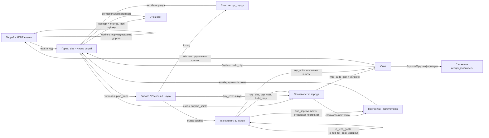

# Калибровка игры CivRealm в единицы DoF

**Статус:** ненормативный (informative). Документ описывает *рекомендуемую* интерпретацию игровых объектов и ресурсов в терминах степеней свободы DOF-Core и служит основой для `env/config.py` и `env/entity_extractor.py`. Нормативные документы на этот файл не ссылаются.

**Источники данных:** собственный реальный снимок стартового состояния (turn 1, 4 юнита, 1 город, 95 сущностей) и официальное руководство Freeciv (см. §11). Величины, помеченные «наблюдение», взяты из снимка; «руководство» — из документации; «оценка» — моя рекомендация, требующая проверки замером.

---

## 1. Единица измерения

**DoF = число независимых, жизнеспособных путей (опций), доступных сущности.** Это счётчик, а не нормированная величина: у любой живой сущности DoF ≥ 1 (как минимум — «продолжать существовать»), DoF = 0 означает необратимое прекращение всех переходов.

Из этого следуют три правила, которые нельзя нарушать:

1. **Считаем опции, а не «здоровье».** Каждый ресурс игры должен добавлять или убирать *варианты действий*, а не «очки качества».
2. **Индекс системы — `Σ ln(DoF)`** (произведение Нэша по множеству `calc`). При счётной шкале `ln(DoF) ≥ 0`, поэтому добавление сущности с опциями не понижает индекс, а коллапс любой сущности даёт `−∞`.
3. **Ресурс-поток ≠ ресурс-запас.** `surplus_*` и `prod_*` — способность делать *каждый ход* (опции сейчас); `*_stock`, `bulbs` — накопленный прогресс (опции, которые уже почти реализованы).

Ниже: §2 — типы юнитов, §3 — свойства юнитов, §4 — параметры города, §5 — сквозные ресурсы, §6 — пороговые явления, §7 — стоки DoF, §8 — рекомендуемые формулы, §9 — что не смоделировано, §10 — как проверять, §11 — источники.

---

## 2. Типы объектов (юнитов)

В стартовом состоянии у агента **не один юнит, а четыре** (плюс город). Наблюдение turn 1:

| Тип | Кол-во | `type_hp` | `health` | `type_move_rate` | `type_build_cost` | attack / def / firepower | `type_worker` | Назначение |
|---|---|---|---|---|---|---|---|---|
| **Settlers** (Поселенцы) | 1 | 20 | 20 | 3 | 40 | 0 / 1 / 1 | да | Создают города (движок населения). Единственный класс, повышающий население напрямую |
| **Workers** (Рабочие) | 2 | 10 | 10 | 3 | 30 | 0 / 1 / 1 | да | Преобразуют террейн (ирригация, шахта, дорога) — создают/меняют опции клеток |
| **Explorer** (Разведчик) | 1 | 10 | 10 | 3 | 30 | 0 / 1 / 1 | нет | Разведка: снимает неопределённость (Axiom 5 — «неизвестное не есть ноль опций») |
| *Warriors, Phalanx, Legion…* | 0 в старте | 10–30 | полный | 1–3 | 10–100 | 1–8 / 1–5 / 1 | нет | Оборона и захват: защита уже существующих опций |
| *Engineers* (Инженеры) | по технологии | 20 | 20 | 3 | 40+ | 0 / 1 / 1 | да | Как Workers, но быстрее и с большим набором работ |
| *Caravan / Trade* (Торговцы) | по технологии | 10 | 10 | 3 | 30–50 | 0 / 1 / 1 | нет | Разовые торговые маршруты: обмен опций между городами |

Все стартовые юниты стоят на одной клетке (x=25, y=43), `moves_left=3`, `owner=0`, `home_city=0`, `veteran=0`, `upkeep_food/gold/shield=0`.

### Что юнит умеет (36 семейств действий, 120 параметризованных имён)

| Класс действий | Действия | Смысл для DoF |
|---|---|---|
| Движение | `goto`, `paradrop`, `airlift`, `board`, `deboard`, `disembark`, `unit_unload` | Прямое увеличение доступного пространства состояний; транспорт **умножает** опции перевозимых сущностей |
| Работа с террейном | `irrigation`, `mine`, `plant`, `cultivate`, `transform_terrain`, `build_road`, `build_railroad`, `airbase`, `fortress` | Создание новых опций клетки (изменение ёмкости террейна) |
| Город | `build_city`, `join_city`, `conquer_city`, `set_homecity`, `marketplace`, `trade_route` | `build_city` — **создание движка населения**; `join_city` — обмен юнита на жителя |
| Бой и оборона | `attack`, `fortify`, `keep_activity`, `hut_enter`, `upgrade` | Защита существующих опций; `attack` — потенциальный коллапс чужой и своей сущности |
| Шпионаж | `investigate_spend`, `spy_bribe_unit`, `spy_sabotage_city`, `spy_steal_tech` | Получение информации без изменения структуры (Axiom 5), либо разрушение чужой структуры |
| Дипломатия | `embassy_stay` | Открытие/закрытие каналов взаимодействия между сущностями (Axiom 7 — нейтральность к чужой архитектуре) |
| Служебное | `cancel_order`, `pillage`, `set_homecity` | `pillage` — прямое уничтожение опций клетки (необратимо) |

### 2.2 Условия создания юнитов и что юнит порождает

Город **может** производить юниты любых типов из каталога ruleset (52 типа юнитов, ~120 наименований с постройками и чудесами) — но не сразу: доступность открывается условиями. Это первая половина графа источников DoF (§9).

| Тип | Условия, чтобы город мог его построить | Что порождает (вклад в DoF-граф) |
|---|---|---|
| **Settlers** | Технология не нужна. Стоит **2 населения** (civ2civ3; 1 в классике), поэтому город должен иметь запас жителей — по таблице foodbox рост Settlers возможен с **размера 3** (при размерах 1–2 строка «SETTLER NEW» пуста). Плюс достаточно щитов (`type_build_cost` 40) | **Создаёт город** (`build_city`) — источник населения, то есть главный узел-мультипликатор DoF. Также обрабатывает террейн |
| **Workers** | Технология не нужна, стоимость 30 щитов, населения не требует | Меняет террейн (ирригация, шахта, дорога) → повышает F/P/T клеток → рост города → новые опции |
| **Explorer** | Технология не нужна, 30 щитов, населения не требует; дома-города не имеет | Информация: снимает неопределённость (Axiom 5). Не увеличивает структуру напрямую |
| **Engineers** | Технология *Engineering* (или аналог), 40+ щитов, стоят населения | Как Workers, но шире набор работ и быстрее; нужны для загрязнения/трансформации |
| **Военные (Warriors, Phalanx, Archers, Legion…)** | Технология соответствующей эпохи; часть требует постройки (напр. казармы для ветеранов/апгрейда); **поддержка**: город содержит военных не больше своего размера (минимум 4, максимум 20), лишние съедают еду | Защита существующих опций; `conquer_city` — захват чужого узла (Axiom 3 запрещает оправдывать свой рост чужим коллапсом) |
| **Морские (Trireme, Caravel…)** | Технология + **город на побережье** (для дальних — Port Facility/Harbor) | Пространственные опции: доступ к морю, торговым путям |
| **Воздушные (Fighter, Bomber…)** | Технология + **Airport** в городе (либо авиабаза) | Дальнобойное влияние, разведка |
| **Diplomat / Spy** | Технология; невидимы как подлодки; платят содержание | Информация и воздействие на чужие опции без изменения структуры |
| **Caravan / Freight** | Технология; идут только по дорогам, рекам или на кораблях; торговые пути — только в чужие города, максимум 2 на город | Разовый перенос опций между городами (золото/щиты) |
| Любой юнит | Общие условия: (1) открыт технологией или стартовым набором (игра сообщает это в `sup_units` технологии; готовность города — маска `can_build_unit`); (2) не устарел (`type_obsoleted_by`); (3) хватает щитов (`production_value`); (4) есть содержание (`upkeep_shield`/`upkeep_gold`, для поселенцев ещё 1–2 еды); (5) `city_size` — минимальный размер города (приходит из игры, напр. 1 у бомбардировщика); (6) `pop_cost` — сколько населения стоит постройка (у Settlers 2 в civ2civ3); (7) `build_reqs` — требования к постройкам (напр. Airport для авиации); (8) город не в беспорядке (в беспорядке нельзя даже выкупить) | — |

Дополнительно: **чудеса и правительства** могут давать дополнительные слоты производства (напр. «Крестовый поход короля Ричарда» — +1 пехотный слот в городе; технология *Conscription* — по всей стране), а выкуп золотом стоит 2 × остаток работы (вдвое дороже, если работа не начата, и ещё вдвое — для чудес).

---

## 3. Свойства юнита: описание, лимиты, DoF

Все 23 поля, которые реально приходят в наблюдении. Колонка «DoF на единицу» — рекомендованный вклад в **число опций** (оценка автора, подлежит эмпирической проверке, §11).

> **Важно (согласовано 2026-09-26):** значения в этой таблице — покомпонентная расшифровка. Итоговый DoF юнита считается не простой суммой, а по двум компонентам — **текущий DoF** и **будущий потенциал** — см. §3.1 и §8.

| Поле | Описание (рус.) | Лимиты | DoF на единицу значения |
|---|---|---|---|
| `type_rule_name` | Имя типа юнита из ruleset (`Settlers`, `Workers`, `Explorer`…) | строка | — (классификация, влияет через коэффициенты типа) |
| `health` | Текущие очки жизни | 0 … `type_hp` (наблюдение: 10 и 20) | +0.02 за 1 HP — выживаемость есть условие всех прочих опций |
| `type_hp` | Максимум очков жизни для этого типа | 10 (обычные), 20 (поселенцы/инженеры), 30+ (поздние) | — (нормировочная база: `health/type_hp` — коэффициент риска) |
| `moves_left` | Остаток ходов в текущем ходу | 0 … `type_move_rate` | 0 — **не** уменьшает DoF (возобновляемый бюджет хода; уже учтено как ошибка модели ранее) |
| `type_move_rate` | Структурная скорость: сколько клеток за ход | 1 … 3 (наблюдение 3); в MP2-ruleset ×2 | +0.05 за 1 (пространственные опции) |
| `type_attack_strength` | Сила атаки | 0 … 8+ | +0.04 за 1 (способность изменять чужое состояние) |
| `type_defense_strength` | Сила защиты | 0 … 5+ | +0.04 за 1 |
| `type_firepower` | Урон за раунд боя | 1 … 2 | +0.03 за 1 |
| `type_build_cost` | Стоимость постройки в щитах | 10 … 1000 (наблюдение: 30 и 40) | −0.01 за 1 щит (цена входа; дорогой юнит = меньше вариантов у города) |
| `type_can_transport` | Может ли перевозить другие юниты | bool | +0.30 (умножает опции перевозимых — Axiom 6, автокатализ) |
| `type_convert_time` | Через сколько ходов юнит превращается в другой тип | 1 … N | +0.15 / `convert_time` (доступный путь трансформации) |
| `type_converted_to` | В какой тип превращается | id типа | — (связь: наличие пути повышает DoF) |
| `type_obsoleted_by` | Какая технология делает тип устаревшим | id технологии | — (ограничитель срока жизни опции; учитывать как τ, штрафа не давать) |
| `type_worker` | Умеет ли работать с террейном | bool | +0.20 (создание/изменение опций клеток) |
| `type_vision_radius_sq` | Квадрат радиуса обзора | 2 (радиус 1) типично | +0.05 за 1 (информация = снижение неопределённости) |
| `upkeep_food` | Еда, потребляемая юнитом у родного города | 0 … 2 | −0.05 за 1 (постоянный сток) |
| `upkeep_gold` | Золото на содержание | 0 … 2 | −0.05 за 1 (сток) |
| `upkeep_shield` | Щиты на содержание | 0 … 2 | −0.05 за 1 (сток) |
| `veteran` | Уровень ветерана | 0 … 4 (green → elite) | +0.10 за уровень (качество той же опции) |
| `home_city` | Город, который платит содержание | id города; у Explorer может отсутствовать | — |
| `owner` | Владелец | id игрока | — |
| `x`, `y` | Координаты | в пределах карты | — (используются для оценки достижимого пространства) |
| `activity` | Текущая работа/приказ | 0 … N | 0 (состояние, не ресурс) |

### 3.1 Текущий и будущий DoF юнита (решение 2026-09-26)

По замечанию заказчика юнит нельзя оценивать одной суммой: у разных типов разная структура.

- **Текущий DoF** — что юнит умеет *прямо сейчас* (атака, защита, живучесть, ход, обзор).
- **Будущий потенциал** — что юнит может *стать* или *создать* (основать город, изменить террейн, перевоплотиться, перевезти других).

Пример заказчика: **Поселенцы** — малый текущий DoF при огромном потенциале (город), **военные** — наоборот: текущий выше (умеют нападать, больше HP и урона), а потенциал скромный; их вклад в DoF системы идёт через *защиту города* (сохранение его опций), а не через собственный потенциал.

**Текущий компонент** (нормированный, вес в скобках, сумма максимум 0.80):

| Параметр | Вес | Как считается |
|---|---|---|
| факт существования и управления | 0.05 | константа |
| `health / type_hp` | 0.20 | живучесть |
| `type_attack_strength` | 0.15 | `min(1, attack/10)` |
| `type_defense_strength` | 0.15 | `min(1, defense/8)` |
| `type_firepower` | 0.05 | `min(1, firepower/2)` |
| `type_move_rate` | 0.10 | `min(1, move_rate/3)` |
| `type_vision_radius_sq` | 0.05 | `min(1, vision/8)` |
| `veteran` | 0.05 | `veteran/4` |

**Будущий компонент** (нормированный, сумма максимум 0.65):

| Возможность | Вес | Признак |
|---|---|---|
| основать город | **0.30** | тип в `POPULATION_UNIT_TYPES` (`Settlers`, `Engineers`) |
| изменять террейн | 0.10 | `type_worker = true` |
| путь трансформации | 0.10 | `type_convert_to` задан (+`1/convert_time`) |
| перевозка других юнитов | 0.20 | `type_can_transport = true` |

**Итог:**

```
DoF(юнит) = DOF_SCALE × [ s_текущий + W_FUTURE_UNIT × s_будущий × (health/type_hp) × decay(возраст) ]
DOF_SCALE = 10;  W_FUTURE_UNIT = 0.35
decay(возраст) = max(0.25, 1 − 0.05 × возраст)  — только для носителей населения
                                                  (5 %/ход — цена времени, см. §3.1)
```

Потенциал умножается на `health/type_hp` (риск гибели по дороге) и на убывание людей у поселенцев. Именно поэтому **бродячий поселенец дешевеет со временем**, а город — нет: у города потенциал неограничен (он может расти), у поселенца он фиксирован: ровно один город и ровно столько людей, сколько было.

**Проверка на реальных стартовых юнитах** (полное HP, ход 3, обзор 2):

| Юнит | Текущий (опции) | Будущий (опции) | Итог |
|---|---|---|---|
| Settlers (свежий) | 4.06 | 0.65 → 2.28 | **6.34** |
| Settlers (возраст 60) | 4.06 | 0.65 → 1.14 | **5.20** |
| Settlers (ранен, 50% HP) | 3.06 | 0.33 → 1.14 | **4.20** |
| Warriors (atk 1, ход 1) | **4.40** | 0.10 → 0.35 | **4.75** |
| Workers | 4.06 | 0.20 → 0.70 | **4.76** |
| Explorer | 3.86 | 0.10 → 0.35 | **4.21** |

Что видно: текущий DoF воина (4.40) больше текущего DoF поселенца (4.06) — как и требовалось; при этом итог поселенца выше, потому что его потенциал больше. Раненый поселенец (4.20) опускается ниже воина — риск учтён.

### Особые правила для поселенцев (Settlers, Engineers)

Население в поселенце **фиксировано и не может вырасти** — оно только убывает, пока он не основал город:

- **Люди:** +0.35 опции фиксированно (не растут со временем).
- **Убывание:** ×(1 − **0.05** × возраст в ходах), с полом **0.25** — «чем дольше он бродит, тем меньше в нём остаётся». Согласовано 2026-09-26: окно переноски закрывается за **15 ходов** (1 − 0.05×15 = 0.25), то есть первый город должен появиться в первых 5–10 ходах. Замер: свежий поселенец **3.81** опции, на 5 ходах — 3.38, на 10 — 2.94, на 15 и дальше — 2.50.
  - **Важно (методология):** затухание — это *прокси цены времени*, а не механика игры: правила население поселенца при движении не теряют. Само по себе оно **не создаёт стимула**: в индексе `Σ ln(DoF)` основание на ходу 0 даёт `ln(8.14) − ln(3.81) = +0.76`, а после 15 ходов блуждания — `−0.42` на поселенце плюс `ln(8.14) − ln(2.50) = +1.18` при основании, то есть **тот же итог +0.76**. Затухание меняет *когда* возникает потеря, а не *возникает ли она*.
  - **Стимул создают два других фактора** (согласованы 2026-09-26): (а) накапливающийся сток недоиспользованного населения (§7) — потеря, которая не возвращается; (б) контрфактический рост города — основать раньше значит получить N ходов роста (Axiom 6), и город на 15-м ходу был бы уже размера 2–3 с постройками, то есть дороже 8.14.
  - **(б) РЕАЛИЗОВАН** (2026-09-26, `env/site_eval.py` + `_compute_system_sink`): сток задержки больше не плоское 0.02, а прирост DoF контрфактического города за ход — `W_GROWTH × CITY_POP × DOF_SCALE × (surplus / амбар(size))`, где `surplus` и `амбар = 10×(size+1)` выводятся из площадки вокруг носителя, а `W_GROWTH = 0.35` (рост — будущая возможность, как потенциал юнита). Плоское 0.02 осталось **полом** для неоценённой или не прошедшей гейт площадки. **Живой замер (слот 6305):** площадка старта прошла гейт (еда 6.0 на 3 клетках, излишек +2), город на 15-м ходу — размера 2, цена задержки **0.350 опт./ход** (5.25 за 15 ходов) против 0.02 у плоского прокси, то есть в 17.5 раза сильнее; сток корректно падает, когда носитель перестаёт существовать. На бедной площадке (излишек 0, слоты 6302/6304) гейт её отвергает и цена падает до пола — «город-однодневка» запрещён, а не дорог.
- **Риск:** вся величина умножается на `health/type_hp` (поселенец в поле захватываем).
- **Мобильность:** +0.10 — его единственное реальное преимущество перед городом.
- **Создание города:** заменяет самого поселенца на город размера 1 (см. §8): город размера 1 всегда дороже свежего поселенца, потому что город — источник роста населения.

---

## 4. Параметры города

Город размера 1 (`Guánica`) из реального наблюдения: 37 полей. Колонка «DoF на единицу» — рекомендованный вклад.

| Поле | Описание (рус.) | Лимиты | DoF на единицу значения |
|---|---|---|---|
| `size` | Число жителей (население) | 1 … ~40 (рабочих клеток всего 21, далее — специалисты) | **+0.50 за жителя** — главный источник DoF в игре |
| `ppl_happy` | Довольные жители | 0 … `size` | +0.10 каждый |
| `ppl_content` | Нейтральные жители | 0 … `size` | 0 (базовое состояние) |
| `ppl_unhappy` | Недовольные жители | 0 … `size` | −0.15 каждый |
| `ppl_angry` | Злые жители (риск бунта) | 0 … `size` | −0.30 каждый |
| `food_stock` | Запас еды в «амбаре» | 0 … `granary_size` | +0.30 × (`food_stock` / `granary_size`) — почти реализованный рост |
| `granary_size` | Размер амбара: сколько еды нужно до +1 жителя | 20 при size 1, далее 10 × (size+1) | — (знаменатель прогресса роста) |
| `granary_turns` | Ходов до заполнения амбара | 0 … 32767 (32767 = «никогда», наблюдение) | +0.05 / `turns`, если рост возможен |
| `growth_in` | Текстовое представление срока роста | строка | — (использовать `granary_turns`) |
| `surplus_food` | Излишек еды за ход (отрицательный = голод) | −N … +N (наблюдение 0) | +0.20 за 1; при отрицательном — коллапс (τ = `food_stock`/долг) |
| `prod_food` | Произведено еды за ход | 0 … ~20 | 0 (уже учтено через излишек) |
| `last_turns_shield_surplus` | Излишек щитов в прошлом ходу | 0 … N | 0 (историческое) |
| `surplus_shield` | Излишек производства за ход | −N … +N (наблюдение 7) | +0.05 за 1 (способность превращать опции в новые) |
| `prod_shield` | Произведено щитов | 0 … ~20 (наблюдение 7) | 0 (учтено через излишек) |
| `shield_stock` | Накоплено щитов на текущем проекте | 0 … `production_value` | +0.20 × (`shield_stock` / `production_value`) |
| `production_value` | Общая стоимость текущего проекта | 10 … 1000 (наблюдение 71) | — (знаменатель прогресса) |
| `production_kind` | Тип проекта (юнит / постройка / чудо) | 0 … 6+ (наблюдение 6) | 0 (классификация) |
| `turns_to_prod_complete` | Ходов до завершения проекта | 0 … N (наблюдение 2) | +0.20 / `turns` (близость новой опции) |
| `can_build_unit` | Какие юниты сейчас доступны городу | булев массив по типам | +0.05 за каждый доступный тип (набор достижимых вариантов) |
| `buy_cost` | Цена выкупа проекта золотом | 0 … N (наблюдение 50) | −0.005 за 1 (цена ускорения) |
| `caravan_shields` | Щиты, привнесённые караванами | 0 … N | +0.03 за 1 |
| `disbanded_shields` | Щиты от расформированных юнитов | 0 … N | +0.03 за 1 |
| `prod_trade` | Торговля за ход | 0 … ~20 (наблюдение 3) | +0.05 за 1 |
| `surplus_trade` | Излишек торговли | −N … +N (наблюдение 3) | +0.05 за 1 |
| `prod_gold` | Золото за ход | 0 … N (наблюдение 1) | +0.10 за 1 (покупка опций) |
| `surplus_gold` | Излишек золота | −N … +N (наблюдение 1) | +0.10 за 1 |
| `luxury` | Роскошь (на вход счастья) | 0 … N | +0.05 за 1 (покупка лояльности жителей) |
| `science` | Наука за ход | 0 … N (наблюдение 2) | +0.05 за 1 (будущие тех-опции) |
| `bulbs` | Накопленные научные «лампочки» | 0 … N (наблюдение 7) | +0.01 за 1 (накопленный путь к новым опциям) |
| `city_corruption` | Потери торговли от коррупции | 0 … N (наблюдение 1) | −0.05 за 1 (прямая потеря опций) |
| `city_waste` | Потери производства от расточительства | 0 … N (наблюдение 0) | −0.05 за 1 |
| `city_pollution` | Загрязнение (порог 20 → риск) | 0 … N (наблюдение 0) | −0.05 за 1; суммарно >20 — коллапс качества клеток (§6) |
| `city_radius_sq` | Квадрат радиуса работы: 5 = радиус 1 (21 клетка) | 5, 21, 45 … | +0.50 × min(1, рабочие_клетки / 21) |
| `improvements` | Построенные здания (булев массив) | массив по числу построек ruleset | **+0.40 за постройку** (устойчивые новые опции) |
| `state` | Код состояния города (в т.ч. беспорядок / радость) | 0 … 7 (наблюдение 2) | Беспорядок → ×0.0 к производству и торговле (эффективный коллапс, §6) |
| `id`, `name`, `owner`, `x`, `y` | Идентификация и положение | — | — |
| `turn_last_built` | Ход постройки | ≥0 (наблюдение 1) | — |
| `prod_process` | Прогресс текущего проекта (доля) | 0.0 … 1.0 | +0.20 × `prod_process` |

### 4.1 Что город может производить и как это видно в наблюдении

Реальный стартовый город (`Guánica`, размер 1) в `available_actions` контроллера `city` отдаёт **207 действий / 161 семейство**:

| Группа действий города | Наблюдаемые имена | Смысл |
|---|---|---|
| Выбор производства | `produce_<Имя>` (каталог, ~120 наименований: юниты, постройки, чудеса) | «Что город может строить в принципе»; доступность сейчас определяется условиями (§2.2) |
| Маска доступных юнитов | поле `can_build_unit` — массив из **52** булевых значений | **Что город может построить именно сейчас**: в старте истинны индексы 0 и 3 (два типа) |
| Построенные здания | поле `improvements` — массив из **68** булевых | Инфраструктура города (в старте истинен индекс 21) |
| Выкуп золотом | `city_buy_production` | Покупка опции за золото (в беспорядке недоступно) |
| Специалисты | `city_change_specialist` ×3 | Переключение жителя в работу/налог/науку (налоговик и учёный — с размера 5) |
| Распределение клеток | `city_work_<tile>`, `city_unwork_<tile>` (по 20 + 4 варианта со специалистами) | Каждый житель работает одну клетку; это прямое управление числом опций выхода |
| Продажа построек | `city_sell_improvement_<Имя>` (~38 наименований) | Обратный переход: постройка → золото (потеря устойчивых опций) |
| Текущий проект | `production_kind`, `production_value` (71), `turns_to_prod_complete` (2), `prod_process` | Что строится, сколько стоит, когда завершится |

Отсюда правила для модели: **каталог производства фиксирован ruleset** (город не «придумывает» юниты), а **доступность — динамическая** и уже присутствует в наблюдении (`can_build_unit`, `improvements`, валидность `produce_*`). Значит, DoF-модель не обязана выводить условия из технологий сама — она может читать маску доступности и оценивать прирост опций от каждого нового доступного типа.

---

### 4.2 Пространство города и качество площадки (по документации, 2026-09-26)

**Сколько земли обрабатывается** (руководство Freeciv, «Working the Land and the Ocean» — дословно):

- **Область влияния — 21 клетка**: квадрат 5×5 с центром в городе, **без угловых**. За этими пределами город не работает ничего (совпадает с наблюдаемым `city_radius_sq = 5`).
- **Центральная клетка обрабатывается бесплатно**, без выделения жителя; она считается *ирригированной, но не шахтой*, дороги у города автоматически, и **минимум 1 щит город даёт всегда**, даже если террейн не позволяет.
- **Каждый житель обрабатывает одну клетку** → всего обрабатывается **`size + 1`** клеток (центр + `size` жителей). Когда клетки кончаются (21), лишние жители становятся специалистами.
- **Одну клетку обрабатывает только один город** — соседние города конкурируют за землю (учитывать при выборе площадки).
- Сервер распределяет жителей алгоритмом, **предпочитающим максимум еды** — именно это и должна предсказывать модель для нового города.
- **Каждый житель съедает `food_cost = 2` еды** (подтверждено самим стендом: `rules.food_cost = 2`).

**Легенда слоёв карты — ПОДТВЕРЖДЕНА на живой игре** (2026-09-26, слот 6323, 8 ходов, 65 раскрытых клеток; скрипты `scripts/inspect_terrain_legend.py`, `scripts/inspect_terrain_live.py`, доказательства `/tmp/terrain_evidence.json`):

- `map['terrain']` — слой **id** (X×Y), имя = `TERRAIN_NAMES[id]` (14 имён из `civrealm/freeciv/map/map_const.py`). Каждый террейн даёт **ровно один** выход — конфликтов нет.
- `map['extras']` — **one-hot `(X, Y, 34)`**, канал `i` = `EXTRA_NAMES[i]`. Это не битовая маска и не id-слой (проверено: dtype `bool`, значения только `False/True`).
- `map['output']` — `(X, Y, 6)`, но **значащих каналов три**: 3, 4, 5 нулевые на всей карте. Каналы 0/1/2 = еда / щиты / торговля.
- **Нераскрытая клетка = нулевой выход** (4035 из 4056 клеток), а не «нулевые опции»: слой `terrain` при этом заполнен. Значит разведку надо определять по `output != 0`, а не по террейну (Axiom 5/7 — неизвестное не считать нулём).

**Базовый выход террейна (измерено на живом стенде):**

| Террейн | Еда/Щит/Торг | | Террейн | Еда/Щит/Торг |
|---|---|---|---|---|
| Lake | 1/0/2 | | Mountains | **0**/1/0 |
| Ocean | 1/0/2 | | Plains | 1/1/0 |
| Forest | 1/2/0 | | Swamp | 1/0/0 |
| Grassland | 2/0/0 | | Hills | 1/0/0 |

**Ресурсы — аддитивные бонусы поверх террейна, а не абсолютный выход** (это исправление: в таблице спец-ресурсов выше числа были *бонусами*, и они подтвердились 1:1):

| Клетка | Наблюдённый выход | Бонус | Совпало с таблицей |
|---|---|---|---|
| Plains + Buffalo | 1/3/0 | (0, +2, 0) | ✅ `Buffalo 0/2/0` |
| Forest + Pheasant | 3/2/0 | (+2, 0, 0) | ✅ `Pheasant 2/0/0` |
| Forest + Silk | 1/2/3 | (0, 0, +3) | ✅ `Silk 0/0/3` |
| Ocean + Whales | 2/1/2 | (+1, +1, 0) | ✅ `Whales 1/1/0` |
| Hills + Wine | 1/0/4 | (0, 0, +4) | ✅ `Wine 0/0/4` |
| Grassland + Resources | 2/1/0 | (0, +1, 0) | — (общий маркер ресурсов) |
| + River (Grassland/Forest/Plains) | без изменений | (0, 0, 0) | река выход клетки не меняет |
| + Minor Tribe Village | без изменений | (0, 0, 0) | хижина, не ресурс |

Пять независимых ресурсов совпали точно, на четырёх разных базовых террейнах — легенда и таблица бонусов согласованы. Практический вывод: `map['output'][x][y]` остаётся единственным источником выхода (террейн + ресурс + улучшения уже сложены сервером), а отдельная таблица ресурсов нужна только для **оценки опций** (гавань, морские юниты), не для выхода.

**Гейт минимального качества площадки** (согласовано 2026-09-26; запрет «городов-однодневок»):

```
food_potential = Σ еда лучших (size + 1) клеток в радиусе
площадка допустима, только если food_potential ≥ SITE_MIN_FOOD = 6
```

Смысл: при `food_cost = 2` площадка с потенциалом ниже 6 не прокормить даже двух жителей с запасом — это структурная заморозка, а не плохой город. Такие варианты **исключаются из набора кандидатов** (doc §3: не штрафуем, а выбрасываем), а не оцениваются низко.

**На каком размере проверяется гейт (исправлено 2026-09-26 по факту прогона).** Порог определён как «прокормить *двух* жителей + запас», поэтому проверять его на первом размере неверно: на размере 1 работает всего `1+1 = 2` клетки и их суммарная еда почти всегда ниже 6, из-за чего гейт запрещал бы любой город. Гейт берёт лучшие `SITE_GATE_SIZE + 1 = 3` клетки (размер 2: два жителя съедают `2 × 2 = 4`, плюс запас 2). Введена константа `SITE_GATE_SIZE = 2`; при этом в модель и в отчёты всё равно отдаётся и `gate_size`, и `gate_food`, чтобы решение было проверяемым.

**Дельта основания по площадке (реализовано 2026-09-26).** `build_city` **не несёт координат** — город появляется на клетке, где стоит носитель, значит «выбор площадки» есть выбор, *куда идти*. Поэтому дельта основания считается по площадке **под носителем** (`BridgeCalibration.new_city_options_by_unit`), а не по среднему городу империи; цена города берётся той же формулой города (`city_options`) на гипотетическом наблюдении площадки (столица получает бесплатный Palace). Площадка, не прошедшая гейт, **в цены не попадает вовсе** — `estimate_dof_delta` для неё возвращает пустую дельту, то есть действие вырезается, а не штрафуется; при этом сток задержки продолжает подталкивать носителя идти туда, где город сможет расти.

**Сверка с миром (тот же прогон, прогноз до основания):**

| Оценка | Значение | Ошибка против факта мира |
|---|---|---|
| Прежняя константа (средний город империи) | 3.000 | **+171 %** (факт 8.136) |
| Площадка носителя, после дельта-правки | 8.400 | +2.6 % (факт 8.618) |
| Площадка носителя, после правки `truthy` | 8.200 | **+0.1 %** (факт 8.208) |

Заодно исправлен настоящий дефект чтения полей: `truthy()` возвращал `bool(value.size)`, поэтому **любой** numpy-скаляр (включая `np.False_`) считался истинным. Список флагов города (`improvements`) читался как «68 из 68 истинны» вместо реального «1 (Palace)», первый множитель города всегда упирался в потолок, и развитый город перестал отличаться от голого. Именно этот дефект и объясняет две трети ошибки прогноза. Регресс-тесты: `tests/unit/test_field_readers.py`.

**Что ещё нужно для полной оценки площадки:** берег (`SITE_COAST_BONUS`) и спец-ресурсы как *опции* (гавань, морские юниты, торговля) — легенда слоёв уже подтверждена (см. выше), поэтому это стало инженерной задачей, а не исследованием.

---

## 5. Сквозные ресурсы и пороги интерпретации

| Ресурс | Что это | DoF-смысл |
|---|---|---|
| Еда (`food`) | 2 еды на жителя за ход (руководство) | Содержание населения; дефицит → голод → смерть жителей = коллапс |
| Щиты (`shields`) | Производство | Способность превращать опции в новые |
| Торговля (`trade`) | Делится на золото / роскошь / науку | Золото — покупка опций, роскошь — лояльность, наука — будущие опции |
| Золото (`gold`) | Казна | Покупка: `buy_cost` = 2 × остаток (вдвое, если работа не начата; ещё вдвое для чудес) |
| Роскошь (`luxury`) | 2 роскоши = +1 довольный (или недовольный → нейтральный) | Управление счастьем = защита от беспорядка |
| Наука (`bulbs`/`science`) | Исследование | Доступ к новым типам юнитов и построек = новые опции (сейчас в модели **не учитывается**: измерено 0.0000) |

**Ключевые пороги (руководство):**

- **Размер 5** — открываются специалисты (налоговый инспектор +3 золота, учёный +3 науки) и возможна «радость» (rapture) при Республике/Демократии: +1 житель за ход. До этого — только работа на клетках. Это **структурный скачок** DoF, а не плавный прирост.
- **Размер 4/5** — «порог недовольства»: каждый житель сверх 4-го (при многих городах — сверх 3-го) рождается недовольным. Дальнейший рост требует роскоши/построек, иначе город входит в беспорядок.
- **Порог празднования — 3 жителя** (исправлено 2026-09-26: `rules.celebratesize = 3`; в документе ошибочно стояло 5). Отдельно есть «злой житель» (`rules.angrycitizen = 1`) — состояния сверх «недовольного», которого в документе не было вовсе.
- **21 клетка** — предел обрабатываемой земли (5×5 минус углы; `city_radius_sq = 5`). Далее рост даёт только специалистов.
- **`granary_size` = 10 × (size + 1)** — 20 при size 1 (совпадает с наблюдением), 30 при size 2 и т. д.
- **Загрязнение > 20** — превышение над порогом равно проценту шанса загрязнения клетки в области города; загрязнённая клетка даёт половину еды/щитов/торговли (потеря опций). Загрязнение города = промышленное (от производства) + популяционное (от размера).
- **Беспорядок** (`ppl_unhappy > ppl_happy`) — город не производит ни щитов, ни торговли: практически все его опции становятся недоступными на этот ход. Затяжной беспорядок при Демократии ведёт к революции.
- **Потеря последнего жителя** — город исчезает. Постройка Settlers/Engineers в городе **забирает 1 жителя** (в civ2civ3 — 2; прямой обмен населения на юнит).

**Уточнения по ruleset civ2civ3** (он и используется на стенде — старт: 1 Settlers + 1 Workers + 1 Explorer + 1 бесплатная технология):

- **Радости (rapture) нет**: празднование даёт не рост, а дополнительную торговлю с клетки.
- **Settlers стоят 2 населения** и доступны с размера 3 (в классике — 1 населения и с размера 2).
- **Амбар:** размер foodbox 20 при размерах 1–4, эффект амбара при pop ≤ 4 даётся бесплатно; «granary size» фиксирован на 10 еды для любого размера.
- **Поддержка военных = размер города** (минимум 4, максимум 20); лишние юниты съедают по 1 еде каждый; при голоде лишний юнит расформировывается.
- **Каждое содержание юнита всегда платится**: под одними правительствами щитами, под другими (монархия, республика, демократия, федерация) — золотом.
- **Техническое содержание городов:** каждая технология требует bulbs на поддержание (от 0 в средние века до 10 bulbs на город при полностью исследованном дереве); при отрицательном балансе теряется случайная технология.
- **Чума при размере > 4** (снижается Aqueduct, Sewer System, технологией Medicine, чудом Cure for Cancer) — источник коллапса, учитывать как τ.
- **Прочие бедствия:** землетрясение, пожар, наводнение, ядерная авария.
- **Минимальная дистанция между городами — 2 клетки** (исправлено 2026-09-26 по данным стенда: `rules.citymindist = 2`; в документе ошибочно стояло 3); начальная граница города задаётся `rules.border_city_radius_sq = 17`.
- **Оборона города:** любому городу +50% против наземных, при pop > 8 — ещё +50% против наземных и морских; стены +100%; город в беспорядке не производит и не покупает.

### 5.1 Исследования (технологии) — полноценный домен, а не примечание

Технологии — **самый крупный домен системы**: в стартовом состоянии из 95 сущностей **87 — технологии**. При этом в текущей модели их вклад равен нулю (измерено: `research_tech` даёт Δиндекса 0.0000). Это главный незакрытый участок калибровки.

**Поля технологии в наблюдении (8 полей на каждую из 87):**

| Поле | Описание (рус.) | Лимиты | DoF-смысл |
|---|---|---|---|
| `name` | Название технологии (`Advanced Flight`, `Ceremonial Burial`, `Chemistry`) | строка | — |
| `inv_state` | Состояние: известно / неизвестно (в наблюдении 0 и 1) | 0 … 1 (+) | Пока 0 — технология **не даёт опций**; при 1 — открывает свой набор |
| `is_researching` | Исследуется ли прямо сейчас | bool | Активный путь к новым опциям |
| `is_tech_goal` | Выбрана ли целью исследования | bool | Целеполагание (Axiom 1: куда расти) |
| `is_req_for_goal` | Является ли предпосылкой для выбранной цели | bool | Промежуточный узел на пути к цели |
| `reqs` | **Родители:** словарь `{id_технологии: известна_ли}` | 0 … N родителей | Входящие рёбра графа: путь к этой технологии |
| `sup_units` | **Какие типы юнитов открывает** — с полными параметрами (hp, move_rate, build_cost, **city_size**, **pop_cost**, **build_reqs**, upkeep, obsoleted_by, vision_radius_sq, worker, helptext, id) | 0 … N | Исходящие рёбра: сколько *новых опций* даёт технология |
| `sup_improvements` | **Какие постройки открывает** — с полными параметрами (build_cost, upkeep, reqs, helptext, id, genus) | 0 … N | Исходящие рёбра: устойчивые новые опции |

**Что это даёт модели.** Граф исследований наблюдаем целиком, без догадок:

- **DoF технологии** = 1 (сама возможность) + сумма DoF того, что она открывает. Формально: `DoF(tech) = 1 + Σ DoF(unit) + Σ DoF(improvement)` по `sup_units` и `sup_improvements`. Технология, не открывающая ничего, честно стоит 1 опцию; технология, открывающая бомбардировщик (attack 12, hp 20, move 24) и авианосец (transport_capacity 8), стоит существенно больше.
- **ΔDoF исследования** = прирост опций от открываемого набора, приведённый к числу ходов: `ΔDoF = Σ DoF(открытого) / turning_time`, где время берётся из стоимости технологии и текущего накопления bulbs. Это и есть исправление «research = 0.0000».
- **Целеполагание** (`is_tech_goal`, `is_req_for_goal`) — уже готовый маршрут по графу: агент может оценивать не только «что даст эта технология», но и «насколько она приближает к цели» — то есть считать DoF не одной вершины, а всего пути (Axiom 1: будущая возможность, Axiom 6: автокатализ).
- **Условия создания юнитов видны прямо здесь:** каждый элемент `sup_units` несёт `city_size` (минимальный размер города), `pop_cost` (сколько населения стоит юнит), `build_reqs` (требования к постройкам: `kind`, `present`, `range`, `value`) и `upkeep`. То есть условия из §2.2 не нужно выводить из документации — они приходят из игры для каждого юнита.

**Действия исследования:** контроллер `tech` отдаёт `research_tech_<Технология>` (×87) и `set_tech_goal_<Технология>` (×87) — всего 174 имени. В живых прогонах валидными были 87 (по одному исследованию за ход).

**Механика, которой в наблюдении НЕТ** (нужно моделировать самим):

| Механика | Источник | Как учитывать |
|---|---|---|
| Стоимость технологии | civ2civ3: `Tech Cost = Base × число родителей` | Нужна таблица Base; в наблюдении её нет — брать из ruleset или замерять по факту (`granary_turns`-подобных полей нет) |
| Накопление bulbs | `bulbs`, `science` города | Поток опций в исследования; при нуле — технологии не растут |
| Тех-содержание городов | 0 … 10 bulbs на город при полном дереве | Сток DoF; при отрицательном балансе **теряется случайная технология** (обвал, не постепенная потеря) |
| Утечка технологий | дешевле, если открыта у нации с посольством | Снижение цены пути (Axiom 7: чужой прогресс не обнуляет наши опции, но удешевляет наши) |
| Бесплатная стартовая технология | civ2civ3: 1 бесплатная | Начальный узел графа уже открыт |
| Технологии, меняющие террейн и правила | напр. Electricity — ирригация без рядом воды | Открывают *новые действия* (не только объекты): учитывать в DoF как +опции |
| Устаревание юнитов | `obsoleted_by` в `sup_units` | Ограничитель срока жизни опции (τ) |

**Порядок применения в модели.** Технология — это *гейт*: до открытия она не даёт опций (`inv_state = 0` → вклад 1), после — даёт столько, сколько открывает. Тогда:
- `research_tech_X` перестаёт быть нулевым действием: его ΔDoF = ценность открываемого набора, дисконтированная временем;
- `set_tech_goal_X` остаётся управляющим действием (нулевой мгновенный ΔDoF, но меняет будущий маршрут) — то есть его надо оценивать как *изменение плана*, а не как приобретение.

---

## 6. Пороговые (нелинейные) явления — учитывать отдельно от суммы

| Явление | Условие | DoF-эффект |
|---|---|---|
| Голод | `surplus_food < 0` | Сначала тратится `food_stock`; при нуле гибнут поселенцы, затем житель. τ = `food_stock` / долг |
| Беспорядок | `ppl_unhappy > ppl_happy` | Обнуление производства и торговли: эффективный DoF города падает до уровня «только существование» |
| Радость (rapture) | `size ≥ rules.celebratesize` (**3** в этом ruleset, не 5), `ppl_happy ≥ ppl_content`, нет недовольных, Республика/Демократия | +1 житель за ход — экспоненциальный рост опций. **Зависит от ruleset:** в civ2civ3 радости нет (вместо роста — дополнительная торговля) |
| Злой житель | `rules.angrycitizen = 1` | Порог, за которым житель становится «злым» — жёстче недовольного: дополнительный риск беспорядка (учитывать вместе с порогом недовольства) |
| Чума | размер > 4, снижается Aqueduct/Sewer System/Medicine/Cure for Cancer | Вероятностная потеря жителей — внезапный коллапс части опций города |
| Загрязнение | `city_corruption + city_pollution > 20` | Вероятностная потеря половины выхода клеток; риск глобального потепления (необратимое изменение террейна) |
| Устаревание юнита | Сработал `type_obsoleted_by` | Опция исчезает не по нашей воле: заранее закладывать как τ, но не как штраф |
| Захват города | `conquer_city` у противника | Смена владельца: для проигравшего — коллапс, для победителя — приобретение всей структуры (Axiom 3: нельзя оправдывать своё расширение чужим коллапсом) |

---

## 7. Стоки DoF (постоянные потери — считаются отрицательно)

| Источник | Значение | Рекомендация |
|---|---|---|
| `upkeep_food/gold/shield` юнитов | 0 … 2 каждый | **Системный сток** `D_поддержка = 0.05 × Σ upkeep` (отдельная сущность-сток или вычитание из казны), а не поправка к DoF юнита. Комментарий в §8: альтернативный вариант — вычитать прямо из юнита |
| **Недоиспользованное население** | носитель (Settlers/Engineers) существует без основанного города, `возраст` ходов | **Системный сток** `0.02 × Σ возраст` (согласовано 2026-09-26). В отличие от затухания (§3.1) потеря **необратима и растёт без насыщения** — это и есть цена задержки, которая делает «основать сейчас» лучше, чем «гулять». Проверка масштаба: 0.6 опции за 30 ходов против +5.1 опции от основания |
| `city_corruption`, `city_waste` | 0 … N | −0.05 за единицу |
| `city_pollution` | 0 … N | −0.05 за единицу + пороговый эффект при сумме > 20 |
| `type_build_cost` | 10 … 1000 | −0.01 за щит (цена входа при постройке) |
| Постройка Settlers/Engineers | −1 житель города | Обмен: юнит (+опции перемещения) против жителя (−опции города) — учитывать как переход, а не как «бесплатный» юнит |

---

## 8. Рекомендуемые формулы (в «опциях»)

**Юнит** — по двум компонентам (§3.1), согласовано 2026-09-26:

```
DoF(юнит) = DOF_SCALE × [ s_текущий + W_FUTURE_UNIT × s_будущий × (health/type_hp) × decay(возраст) ]

s_текущий = 0.05 + 0.20 × (health/type_hp)
          + 0.15 × min(1, attack/10) + 0.15 × min(1, defense/8)
          + 0.05 × min(1, firepower/2) + 0.10 × min(1, move_rate/3)
          + 0.05 × min(1, vision_radius_sq/8) + 0.05 × (veteran/4)

s_будущий = 0.30 × (тип в POPULATION_UNIT_TYPES)     // основать город
          + 0.10 × type_worker                        // изменение террейна
          + 0.10 × (type_convert_to задан) / min(1, convert_time)
          + 0.20 × type_can_transport                 // умножение чужих опций

DOF_SCALE = 10;  W_FUTURE_UNIT = 0.35
decay(возраст) = max(0.25, 1 − 0.05 × возраст)         // только для носителей населения
```

`W_FUTURE_UNIT < W_FUTURE_CITY` намеренно: потенциал юнита — это *возможность*, потенциал города — уже *реализованность*, которая к тому же растёт (Axiom 1: будущая возможность против наличной).

**Сток поддержки — системный, а не вычитается из юнита** (решение 2026-09-26):

```
D_поддержка = SINK_COEFF × Σ_юнитов (upkeep_food + upkeep_gold + upkeep_shield)
SINK_COEFF = 0.05 опции за единицу потребления
```

Смысл: содержание юнитов чувствуется тем сильнее, чем меньше бюджет системы; при большом бюджете оно несущественно. Поэтому это **отдельная сущность-сток** в наборе `calc` (или вычитание из DoF казны/города-плательщика), а не поправка к DoF самого юнита.

> *Альтернативный вариант учёта (для сравнения, не выбран):* вычитать `−0.05 × upkeep` прямо из DoF юнита. Тогда дешёвый в содержании юнит автоматически «дороже» дорогого, но теряется эффект «богатая казна терпит, бедная задыхается». Переключение — одна константа в `config.py`.

**Город** — трёхмножительная схема (решение 2026-09-26), база увеличена до 2.0 и население поднято до 1.0 опции за жителя (вариант A; вариант B — снижение «людей» поселенца до 0.20 — применён одновременно):

```
DoF(город) = (CITY_BASE + CITY_POP × size)
             × min(CAP_M1, 1 + 0.20 × positive(surplus_food)
                             + 0.30 × food_stock/granary_size
                             + 0.40 × improvements_count)
             × min(CAP_M2, 1 + 0.05 × surplus_shield + 0.05 × surplus_trade
                             + 0.10 × surplus_gold + 0.05 × science + 0.05 × luxury)
             × (1 − 0.05 × (corruption + waste + pollution))
             × happiness_factor × (беспорядок ? 0 : 1)

CITY_BASE = 2.0;  CITY_POP = 1.0
CAP_M1 = CAP_M2 = 2.0;  CITY_CEIL = 20 опций
happiness_factor = 1 + 0.10 × ppl_happy − 0.15 × ppl_unhappy − 0.30 × ppl_angry
```

> *Альтернативный вариант (для сравнения, не выбран):* линейная сумма вместо трёх множителей — проще контролировать итог, но теряется эффект «ворот»: при беспорядке или голоде опции города должны обнуляться, а не просто уменьшаться.

**Основание города** — по-прежнему разность, а не константа:

```
ΔDoF = DoF(город, размер 1) − DoF(поселенец, текущий)
```

**Проверка согласованности (согласовано 2026-09-26):**

| Объект | Расчёт | DoF (опций) |
|---|---|---|
| Settlers (свежий) | 10 × (0.406 + 0.35 × 0.65) | 6.34 |
| Settlers (раненый, 50% HP) | 10 × (0.306 + 0.35 × 0.65 × 0.5) | 4.20 |
| Warriors | 10 × (0.440 + 0.35 × 0.10) | 4.75 |
| Город, размер 1 (стартовый) | (2.0 + 1.0) × 1.40 × 1.70 × 0.95 | **6.78** |
| Город, размер 5 (растущий, 3 постройки) | (2.0 + 5.0) × 2.0 × 2.0 × 0.85 | 20 (потолок) |

Требуемые соотношения выполняются: город размера 1 (6.78) **больше** свежего поселенца (6.34); текущий DoF воина (4.40) **больше** текущего DoF поселенца (4.06); раненый поселенец (4.20) опускается ниже воина.

**Юнит-носитель населения (Settlers, Engineers)** — частный случай:

```
DoF = DOF_SCALE × [ s_текущий + W_FUTURE_UNIT × 0.30 × (health/type_hp) × decay(возраст) ]
```


---

## 9. Граф источников DoF

Игра — это ориентированный граф, в котором DoF не «начисляется» напрямую, а порождается переходами между узлами. Узлы: террейн, город (население), постройки, технологии, юниты, казна/наука. Рёбра: «производит», «открывает», «создаёт», «улучшает», «содержит» (сток).



Текстом те же рёбра (для реализации в модели):

| Источник (узел) | Ребро | Приёмник | Условие / цена | Что это даёт DoF |
|---|---|---|---|---|
| Террейн | обрабатывается жителем | Город (выход F/P/T) | нужен житель и клетка в радиусе | Каждый житель = одна опция использования клетки |
| Террейн | улучшение (`irrigation`, `mine`, `road`, `railroad`) | Террейн (более высокий F/P/T) | нужен Worker/Engineer, N ходов работы, технология (для продвинутых) | Повышает выход → рост → новые опции |
| Город | `surplus_shield` | Производство города | — | Способность превращать опции в новые |
| Производство | `produce_<Юнит>` | Юнит | технология + постройка + размер + щиты + содержание | Новые опции (защита, работа, разведка) |
| Производство | `produce_<Постройка>` | `improvements` | технология + щиты | Устойчивые опции города (амбар, рынок, библиотека, стены…) |
| Юнит Settlers | `build_city` | **Город** | −1…−2 населения города-родителя, ≥ дистанция 3 | Главный узел-мультипликатор: создаёт источник населения |
| Юнит Workers | работы на террейне | Террейн | ходы работы | Создаёт/улучшает опции клеток |
| Юнит Explorer/Spy | разведка | Информация | содержание | Снижает неопределённость (Axiom 5) |
| Город | `prod_trade` | Казна | — | Золото/роскошь/наука как три способа конвертации опций |
| Казна | `buy_cost`, `city_buy_production` | Производство | 2 × остаток (×2 если не начато, ×2 для чудес) | Покупка опции немедленно, вместо ожидания |
| Казна | роскошь | `ppl_happy` | 2 роскоши = +1 довольный | Защита от беспорядка (сохранение опций) |
| Казна | `science` / `bulbs` | Технологии | накопление; тех-содержание городов | Открывает новые узлы графа (юниты, постройки) |
| Технологии | `sup_units`, `sup_improvements` | Юниты и постройки | технология известна (`inv_state = 1`) | **Открывает конкретные новые опции** — размер набора читается прямо из наблюдения |
| Технологии | `reqs` (родители) | Технологии | все родители известны | Маршрут достижимости: дерево технологий как граф |
| Технологии | `is_tech_goal`, `is_req_for_goal` | Технологии | выбор игрока | Целеполагание: DoF пути, а не одной вершины |
| Технологии | `city_size`, `pop_cost`, `build_reqs` (внутри `sup_units`) | Производство | — | **Условия создания юнита**, сообщённые игрой |
| Город | `upkeep_*`, tech upkeep, `corruption/waste/pollution` | Стоки | каждый ход | Постоянное вычитание опций из системы |
| Город | Специалисты (с размера 5) | Казна/Наука | житель перестаёт работать клетку | Обмен одного типа опции на другой |

**Как это использовать в модели:** DoF сущности считается по её *исходящим* рёбрам (сколько опций она может породить или поддержать), а ценность узла — по его месту в графе: `Settlers` и `Город` — узлы-мультипликаторы (Axiom 6, автокатализ), `Workers` — модификаторы (Axiom 1), `Explorer`/`Spy` — снижение неопределённости (Axiom 5), военные — защита уже существующих опций (Axiom 3), стоки (`upkeep`, коррупция, загрязнение) — постоянные потери.

---

## 10. Что пока НЕ смоделировано (честные оговорки)

1. **Технологии пока DoF-нейтральны, хотя данные для них есть.** Измерено: `research_tech` даёт Δиндекса = 0.0000. Но граф наблюдаем целиком (§5.1): `reqs` даёт родителей, `sup_units` и `sup_improvements` — что технология открывает (с полными параметрами юнитов, включая `city_size`, `pop_cost`, `build_reqs`). Не смоделировано: (а) связь «технология → ценность открываемого набора», (б) стоимость технологии и время до открытия, (в) тех-содержание городов и утечка технологий — этих полей в наблюдении нет, их надо брать из ruleset или замерять.
2. **Работа с террейном нейтральна.** `irrigation`, `mine`, `build_road` измерены как 0.0000, хотя меняют выход клеток. Нужна модель «террейн → опции клетки».
3. **Дипломатия нейтральна.** `accept_treaty` и т. п. — 0.0000; при этом Axiom 7 требует не обнулять чужие опции, а взаимодействие с другими цивилизациями влияет на нашу достижимость.
4. **`state` города не расшифрован.** Значение 2 в наблюдении; нужна таблица кодов (беспорядок/радость) из ruleset.
5. **Диапазоны `move_rate` зависят от ruleset** (в MP2-ruleset скорости вдвое выше классических), поэтому нормировка `min(1, move_rate/3)` подлежит проверке на конкретном ruleset стенда.
6. **Все коэффициенты в §3–§4 — рекомендация (оценка),** а не измерение. Проверка: `scripts/measure_action_delta.py`.

---

## 11. Как проверять калибровку

```bash
P=/home/hermes/projects/AI/DOF-MODEL-CIV
SP=$(ls -d /nix/store/*-python3.12-*/lib/python3.12/site-packages | tr '\n' ':')
export PYTHONPATH="$P/civrealm/src:$P:$P/.venv/lib/python3.12/site-packages:$SP"

$P/.venv/bin/python scripts/inspect_obs_fields.py         # какие поля реально приходят
$P/.venv/bin/python scripts/inspect_start_state.py        # полный дамп старта: юниты, действия, город
$P/.venv/bin/python scripts/inspect_city_production.py    # маски can_build_unit / improvements
$P/.venv/bin/python scripts/inspect_city_actions.py       # 207 действий города по семействам
$P/.venv/bin/python scripts/inspect_city_buildable.py     # что из каталога доступно сейчас
$P/.venv/bin/python scripts/inspect_tech_options.py        # поля технологий, reqs, sup_units, действия исследования
$P/.venv/bin/python scripts/inspect_unit_realism.py       # какие DoF модель даёт стартовым юнитам
$P/.venv/bin/python scripts/measure_action_delta.py       # фактический ΔDoF по каждому действию
```

Правила проверки, уже подтверждённые практикой:

- добавление живой сущности **не должно** понижать индекс системы;
- трата ходов в текущем ходу (`moves_left`) **не должна** понижать DoF;
- город размера 1 **должен** быть дороже свежего поселенца;
- ни один отдельный юнит **не должен** быть дороже города размера 1;
- если ни одно действие не даёт измеренного положительного ΔDoF — индекс можно только сохранить, но не вырастить; это дефект модели, а не свойство игры.

---

## 12. Источники

- Реальное наблюдение старта: `tests/fixtures/real_obs_01.json` (turn 1: 4 юнита, 1 город `Guánica`, 95 сущностей).
- Freeciv: города и население (голод, амбар, беспорядок, радость, загрязнение, 21 клетка) — <https://tecfa.unige.ch/guides/games/freeciv/manual/game-12.html>
- Freeciv: производство, выкуп золотом, потеря жителя при постройке поселенца — <https://tecfa.unige.ch/guides/games/freeciv/manual/game-14.html>
- Freeciv MP2 Caravel: города (рост, беспорядок, радость, специалисты, слоты постройки) — <https://freeciv.fandom.com/wiki/Cities.mp2c>
- Freeciv MP2 Caravel: юниты (классы, содержание, движение, работы, апгрейды) — <https://freeciv.fandom.com/wiki/Units.mp2c>
- Freeciv: редактирование ruleset юнитов (классы, флаги, ветераны) — <https://freeciv.fandom.com/wiki/Editing_Units>
- **Civ2civ3 ruleset (используется на стенде): стоимость поселенцев в населении, таблица foodbox, поддержка юнитов, содержание технологий, чума, террейн F/P/T, оборона, правительства** — <https://github.com/longturn/freeciv-S2_5/blob/master/doc/README.ruleset_civ2civ3>
- Freeciv: обсуждение требования размера города для поселенцев — <http://forum.freeciv.org/f/viewtopic.php?t=92080>
- DOF-Core (аксиомы, `Σ ln(DoF)`, Axiom 3/4/5/6/7) — навык `dof-core`.
