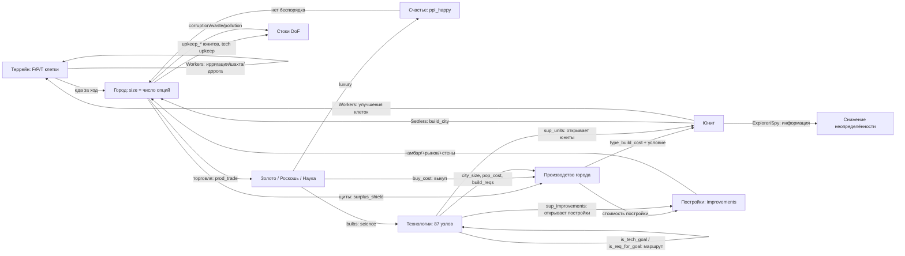

# Калибровка игры CivRealm в единицы DoF

**Статус:** ненормативный (informative). Документ описывает *рекомендуемую* интерпретацию игровых объектов и ресурсов в терминах степеней свободы DOF-Core и служит основой для `env/config.py` и `env/entity_extractor.py`. Нормативные документы на этот файл не ссылаются.

**Источники данных:** собственный реальный снимок стартового состояния (turn 1, 4 юнита, 1 город, 95 сущностей) и официальное руководство Freeciv (см. §11). Величины, помеченные «наблюдение», взяты из снимка; «руководство» — из документации; «оценка» — моя рекомендация, требующая проверки замером.

---

## 1. Единица измерения

**DoF = число независимых, жизнеспособных путей (опций), доступных сущности.** Это счётчик, а не нормированная величина: у любой живой сущности DoF ≥ 1 (как минимум — «продолжать существовать»), DoF = 0 означает необратимое прекращение всех переходов.

Из этого следуют три правила, которые нельзя нарушать:

1. **Считаем опции, а не «здоровье».** Каждый ресурс игры должен добавлять или убирать *варианты действий*, а не «очки качества».
2. **Индекс системы — `Σ ln(DoF)`** (произведение Нэша по множеству `calc`). При счётной шкале `ln(DoF) ≥ 0`, поэтому добавление сущности с опциями не понижает индекс, а коллапс любой сущности даёт `−∞`.
3. **Ресурс-поток ≠ ресурс-запас.** `surplus_*` и `prod_*` — способность делать *каждый ход* (опции сейчас); `*_stock`, `bulbs` — накопленный прогресс (опции, которые уже почти реализованы).

Ниже: §2 — типы юнитов, §3 — свойства юнитов, §4 — параметры города, §5 — сквозные ресурсы, §6 — пороговые явления, §7 — стоки DoF, §8 — рекомендуемые формулы, §9 — что не смоделировано, §10 — как проверять, §11 — источники.

---

## 2. Типы объектов (юнитов)

В стартовом состоянии у агента **не один юнит, а четыре** (плюс город). Наблюдение turn 1:

| Тип | Кол-во | `type_hp` | `health` | `type_move_rate` | `type_build_cost` | attack / def / firepower | `type_worker` | Назначение |
|---|---|---|---|---|---|---|---|---|
| **Settlers** (Поселенцы) | 1 | 20 | 20 | 3 | 40 | 0 / 1 / 1 | да | Создают города (движок населения). Единственный класс, повышающий население напрямую |
| **Workers** (Рабочие) | 2 | 10 | 10 | 3 | 30 | 0 / 1 / 1 | да | Преобразуют террейн (ирригация, шахта, дорога) — создают/меняют опции клеток |
| **Explorer** (Разведчик) | 1 | 10 | 10 | 3 | 30 | 0 / 1 / 1 | нет | Разведка: снимает неопределённость (Axiom 5 — «неизвестное не есть ноль опций») |
| *Warriors, Phalanx, Legion…* | 0 в старте | 10–30 | полный | 1–3 | 10–100 | 1–8 / 1–5 / 1 | нет | Оборона и захват: защита уже существующих опций |
| *Engineers* (Инженеры) | по технологии | 20 | 20 | 3 | 40+ | 0 / 1 / 1 | да | Как Workers, но быстрее и с большим набором работ |
| *Caravan / Trade* (Торговцы) | по технологии | 10 | 10 | 3 | 30–50 | 0 / 1 / 1 | нет | Разовые торговые маршруты: обмен опций между городами |

Все стартовые юниты стоят на одной клетке (x=25, y=43), `moves_left=3`, `owner=0`, `home_city=0`, `veteran=0`, `upkeep_food/gold/shield=0`.

### Что юнит умеет (36 семейств действий, 120 параметризованных имён)

| Класс действий | Действия | Смысл для DoF |
|---|---|---|
| Движение | `goto`, `paradrop`, `airlift`, `board`, `deboard`, `disembark`, `unit_unload` | Прямое увеличение доступного пространства состояний; транспорт **умножает** опции перевозимых сущностей |
| Работа с террейном | `irrigation`, `mine`, `plant`, `cultivate`, `transform_terrain`, `build_road`, `build_railroad`, `airbase`, `fortress` | Создание новых опций клетки (изменение ёмкости террейна) |
| Город | `build_city`, `join_city`, `conquer_city`, `set_homecity`, `marketplace`, `trade_route` | `build_city` — **создание движка населения**; `join_city` — обмен юнита на жителя |
| Бой и оборона | `attack`, `fortify`, `keep_activity`, `hut_enter`, `upgrade` | Защита существующих опций; `attack` — потенциальный коллапс чужой и своей сущности |
| Шпионаж | `investigate_spend`, `spy_bribe_unit`, `spy_sabotage_city`, `spy_steal_tech` | Получение информации без изменения структуры (Axiom 5), либо разрушение чужой структуры |
| Дипломатия | `embassy_stay` | Открытие/закрытие каналов взаимодействия между сущностями (Axiom 7 — нейтральность к чужой архитектуре) |
| Служебное | `cancel_order`, `pillage`, `set_homecity` | `pillage` — прямое уничтожение опций клетки (необратимо) |

### 2.2 Условия создания юнитов и что юнит порождает

Город **может** производить юниты любых типов из каталога ruleset (52 типа юнитов, ~120 наименований с постройками и чудесами) — но не сразу: доступность открывается условиями. Это первая половина графа источников DoF (§9).

| Тип | Условия, чтобы город мог его построить | Что порождает (вклад в DoF-граф) |
|---|---|---|
| **Settlers** | Технология не нужна. Стоит **2 населения** (civ2civ3; 1 в классике), поэтому город должен иметь запас жителей — по таблице foodbox рост Settlers возможен с **размера 3** (при размерах 1–2 строка «SETTLER NEW» пуста). Плюс достаточно щитов (`type_build_cost` 40) | **Создаёт город** (`build_city`) — источник населения, то есть главный узел-мультипликатор DoF. Также обрабатывает террейн |
| **Workers** | Технология не нужна, стоимость 30 щитов, населения не требует | Меняет террейн (ирригация, шахта, дорога) → повышает F/P/T клеток → рост города → новые опции |
| **Explorer** | Технология не нужна, 30 щитов, населения не требует; дома-города не имеет | Информация: снимает неопределённость (Axiom 5). Не увеличивает структуру напрямую |
| **Engineers** | Технология *Engineering* (или аналог), 40+ щитов, стоят населения | Как Workers, но шире набор работ и быстрее; нужны для загрязнения/трансформации |
| **Военные (Warriors, Phalanx, Archers, Legion…)** | Технология соответствующей эпохи; часть требует постройки (напр. казармы для ветеранов/апгрейда); **поддержка**: город содержит военных не больше своего размера (минимум 4, максимум 20), лишние съедают еду | Защита существующих опций; `conquer_city` — захват чужого узла (Axiom 3 запрещает оправдывать свой рост чужим коллапсом) |
| **Морские (Trireme, Caravel…)** | Технология + **город на побережье** (для дальних — Port Facility/Harbor) | Пространственные опции: доступ к морю, торговым путям |
| **Воздушные (Fighter, Bomber…)** | Технология + **Airport** в городе (либо авиабаза) | Дальнобойное влияние, разведка |
| **Diplomat / Spy** | Технология; невидимы как подлодки; платят содержание | Информация и воздействие на чужие опции без изменения структуры |
| **Caravan / Freight** | Технология; идут только по дорогам, рекам или на кораблях; торговые пути — только в чужие города, максимум 2 на город | Разовый перенос опций между городами (золото/щиты) |
| Любой юнит | Общие условия: (1) открыт технологией или стартовым набором (игра сообщает это в `sup_units` технологии; готовность города — маска `can_build_unit`); (2) не устарел (`type_obsoleted_by`); (3) хватает щитов (`production_value`); (4) есть содержание (`upkeep_shield`/`upkeep_gold`, для поселенцев ещё 1–2 еды); (5) `city_size` — минимальный размер города (приходит из игры, напр. 1 у бомбардировщика); (6) `pop_cost` — сколько населения стоит постройка (у Settlers 2 в civ2civ3); (7) `build_reqs` — требования к постройкам (напр. Airport для авиации); (8) город не в беспорядке (в беспорядке нельзя даже выкупить) | — |

Дополнительно: **чудеса и правительства** могут давать дополнительные слоты производства (напр. «Крестовый поход короля Ричарда» — +1 пехотный слот в городе; технология *Conscription* — по всей стране), а выкуп золотом стоит 2 × остаток работы (вдвое дороже, если работа не начата, и ещё вдвое — для чудес).

---

## 3. Свойства юнита: описание, лимиты, DoF

Все 23 поля, которые реально приходят в наблюдении. Колонка «DoF на единицу» — рекомендованный вклад в **число опций** (оценка автора, подлежит эмпирической проверке, §11).

> **Важно (согласовано 2026-09-26):** значения в этой таблице — покомпонентная расшифровка. Итоговый DoF юнита считается не простой суммой, а по двум компонентам — **текущий DoF** и **будущий потенциал** — см. §3.1 и §8.

| Поле | Описание (рус.) | Лимиты | DoF на единицу значения |
|---|---|---|---|
| `type_rule_name` | Имя типа юнита из ruleset (`Settlers`, `Workers`, `Explorer`…) | строка | — (классификация, влияет через коэффициенты типа) |
| `health` | Текущие очки жизни | 0 … `type_hp` (наблюдение: 10 и 20) | +0.02 за 1 HP — выживаемость есть условие всех прочих опций |
| `type_hp` | Максимум очков жизни для этого типа | 10 (обычные), 20 (поселенцы/инженеры), 30+ (поздние) | — (нормировочная база: `health/type_hp` — коэффициент риска) |
| `moves_left` | Остаток ходов в текущем ходу | 0 … `type_move_rate` | 0 — **не** уменьшает DoF (возобновляемый бюджет хода; уже учтено как ошибка модели ранее) |
| `type_move_rate` | Структурная скорость: сколько клеток за ход | 1 … 3 (наблюдение 3); в MP2-ruleset ×2 | +0.05 за 1 (пространственные опции) |
| `type_attack_strength` | Сила атаки | 0 … 8+ | +0.04 за 1 (способность изменять чужое состояние) |
| `type_defense_strength` | Сила защиты | 0 … 5+ | +0.04 за 1 |
| `type_firepower` | Урон за раунд боя | 1 … 2 | +0.03 за 1 |
| `type_build_cost` | Стоимость постройки в щитах | 10 … 1000 (наблюдение: 30 и 40) | −0.01 за 1 щит (цена входа; дорогой юнит = меньше вариантов у города) |
| `type_can_transport` | Может ли перевозить другие юниты | bool | +0.30 (умножает опции перевозимых — Axiom 6, автокатализ) |
| `type_convert_time` | Через сколько ходов юнит превращается в другой тип | 1 … N | +0.15 / `convert_time` (доступный путь трансформации) |
| `type_converted_to` | В какой тип превращается | id типа | — (связь: наличие пути повышает DoF) |
| `type_obsoleted_by` | Какая технология делает тип устаревшим | id технологии | — (ограничитель срока жизни опции; учитывать как τ, штрафа не давать) |
| `type_worker` | Умеет ли работать с террейном | bool | +0.20 (создание/изменение опций клеток) |
| `type_vision_radius_sq` | Квадрат радиуса обзора | 2 (радиус 1) типично | +0.05 за 1 (информация = снижение неопределённости) |
| `upkeep_food` | Еда, потребляемая юнитом у родного города | 0 … 2 | −0.05 за 1 (постоянный сток) |
| `upkeep_gold` | Золото на содержание | 0 … 2 | −0.05 за 1 (сток) |
| `upkeep_shield` | Щиты на содержание | 0 … 2 | −0.05 за 1 (сток) |
| `veteran` | Уровень ветерана | 0 … 4 (green → elite) | +0.10 за уровень (качество той же опции) |
| `home_city` | Город, который платит содержание | id города; у Explorer может отсутствовать | — |
| `owner` | Владелец | id игрока | — |
| `x`, `y` | Координаты | в пределах карты | — (используются для оценки достижимого пространства) |
| `activity` | Текущая работа/приказ | 0 … N | 0 (состояние, не ресурс) |

### 3.1 Текущий и будущий DoF юнита (решение 2026-09-26)

По замечанию заказчика юнит нельзя оценивать одной суммой: у разных типов разная структура.

- **Текущий DoF** — что юнит умеет *прямо сейчас* (атака, защита, живучесть, ход, обзор).
- **Будущий потенциал** — что юнит может *стать* или *создать* (основать город, изменить террейн, перевоплотиться, перевезти других).

Пример заказчика: **Поселенцы** — малый текущий DoF при огромном потенциале (город), **военные** — наоборот: текущий выше (умеют нападать, больше HP и урона), а потенциал скромный; их вклад в DoF системы идёт через *защиту города* (сохранение его опций), а не через собственный потенциал.

**Текущий компонент** (нормированный, вес в скобках, сумма максимум 0.80):

| Параметр | Вес | Как считается |
|---|---|---|
| факт существования и управления | 0.05 | константа |
| `health / type_hp` | 0.20 | живучесть |
| `type_attack_strength` | 0.15 | `min(1, attack/10)` |
| `type_defense_strength` | 0.15 | `min(1, defense/8)` |
| `type_firepower` | 0.05 | `min(1, firepower/2)` |
| `type_move_rate` | 0.10 | `min(1, move_rate/3)` |
| `type_vision_radius_sq` | 0.05 | `min(1, vision/8)` |
| `veteran` | 0.05 | `veteran/4` |

**Будущий компонент** (нормированный, сумма максимум 0.65):

| Возможность | Вес | Признак |
|---|---|---|
| основать город | **0.30** | тип в `POPULATION_UNIT_TYPES` (`Settlers`, `Engineers`) |
| изменять террейн | 0.10 | `type_worker = true` |
| путь трансформации | 0.10 | `type_convert_to` задан (+`1/convert_time`) |
| перевозка других юнитов | 0.20 | `type_can_transport = true` |

**Итог:**

```
DoF(юнит) = DOF_SCALE × [ s_текущий + W_FUTURE_UNIT × s_будущий × (health/type_hp) × decay(возраст) ]
DOF_SCALE = 10;  W_FUTURE_UNIT = 0.35
decay(возраст) = max(0.25, 1 − 0.05 × возраст)  — только для носителей населения
                                                  (5 %/ход — цена времени, см. §3.1)
```

Потенциал умножается на `health/type_hp` (риск гибели по дороге) и на убывание людей у поселенцев. Именно поэтому **бродячий поселенец дешевеет со временем**, а город — нет: у города потенциал неограничен (он может расти), у поселенца он фиксирован: ровно один город и ровно столько людей, сколько было.

**Проверка на реальных стартовых юнитах** (полное HP, ход 3, обзор 2):

| Юнит | Текущий (опции) | Будущий (опции) | Итог |
|---|---|---|---|
| Settlers (свежий) | 4.06 | 0.65 → 2.28 | **6.34** |
| Settlers (возраст 60) | 4.06 | 0.65 → 1.14 | **5.20** |
| Settlers (ранен, 50% HP) | 3.06 | 0.33 → 1.14 | **4.20** |
| Warriors (atk 1, ход 1) | **4.40** | 0.10 → 0.35 | **4.75** |
| Workers | 4.06 | 0.20 → 0.70 | **4.76** |
| Explorer | 3.86 | 0.10 → 0.35 | **4.21** |

Что видно: текущий DoF воина (4.40) больше текущего DoF поселенца (4.06) — как и требовалось; при этом итог поселенца выше, потому что его потенциал больше. Раненый поселенец (4.20) опускается ниже воина — риск учтён.

### Особые правила для поселенцев (Settlers, Engineers)

Население в поселенце **фиксировано и не может вырасти** — оно только убывает, пока он не основал город:

- **Люди:** +0.35 опции фиксированно (не растут со временем).
- **Убывание:** ×(1 − **0.05** × возраст в ходах), с полом **0.25** — «чем дольше он бродит, тем меньше в нём остаётся». Согласовано 2026-09-26: окно переноски закрывается за **15 ходов** (1 − 0.05×15 = 0.25), то есть первый город должен появиться в первых 5–10 ходах. Замер: свежий поселенец **3.81** опции, на 5 ходах — 3.38, на 10 — 2.94, на 15 и дальше — 2.50.
  - **Важно (методология):** затухание — это *прокси цены времени*, а не механика игры: правила население поселенца при движении не теряют. Само по себе оно **не создаёт стимула**: в индексе `Σ ln(DoF)` основание на ходу 0 даёт `ln(8.14) − ln(3.81) = +0.76`, а после 15 ходов блуждания — `−0.42` на поселенце плюс `ln(8.14) − ln(2.50) = +1.18` при основании, то есть **тот же итог +0.76**. Затухание меняет *когда* возникает потеря, а не *возникает ли она*.
  - **Стимул создают два других фактора** (согласованы 2026-09-26): (а) накапливающийся сток недоиспользованного населения (§7) — потеря, которая не возвращается; (б) контрфактический рост города — основать раньше значит получить N ходов роста (Axiom 6), и город на 15-м ходу был бы уже размера 2–3 с постройками, то есть дороже 8.14.
  - **(б) РЕАЛИЗОВАН** (2026-09-26, `env/site_eval.py` + `_compute_system_sink`): сток задержки больше не плоское 0.02, а прирост DoF контрфактического города за ход — `W_GROWTH × CITY_POP × DOF_SCALE × (surplus / амбар(size))`, где `surplus` и `амбар = 10×(size+1)` выводятся из площадки вокруг носителя, а `W_GROWTH = 0.35` (рост — будущая возможность, как потенциал юнита). Плоское 0.02 осталось **полом** для неоценённой или не прошедшей гейт площадки. **Живой замер (слот 6305):** площадка старта прошла гейт (еда 6.0 на 3 клетках, излишек +2), город на 15-м ходу — размера 2, цена задержки **0.350 опт./ход** (5.25 за 15 ходов) против 0.02 у плоского прокси, то есть в 17.5 раза сильнее; сток корректно падает, когда носитель перестаёт существовать. На бедной площадке (излишек 0, слоты 6302/6304) гейт её отвергает и цена падает до пола — «город-однодневка» запрещён, а не дорог.
- **Риск:** вся величина умножается на `health/type_hp` (поселенец в поле захватываем).
- **Мобильность:** +0.10 — его единственное реальное преимущество перед городом.
- **Создание города:** заменяет самого поселенца на город размера 1 (см. §8): город размера 1 всегда дороже свежего поселенца, потому что город — источник роста населения.

---

## 4. Параметры города

Город размера 1 (`Guánica`) из реального наблюдения: 37 полей. Колонка «DoF на единицу» — рекомендованный вклад.

| Поле | Описание (рус.) | Лимиты | DoF на единицу значения |
|---|---|---|---|
| `size` | Число жителей (население) | 1 … ~40 (рабочих клеток всего 21, далее — специалисты) | **+0.50 за жителя** — главный источник DoF в игре |
| `ppl_happy` | Довольные жители | 0 … `size` | +0.10 каждый |
| `ppl_content` | Нейтральные жители | 0 … `size` | 0 (базовое состояние) |
| `ppl_unhappy` | Недовольные жители | 0 … `size` | −0.15 каждый |
| `ppl_angry` | Злые жители (риск бунта) | 0 … `size` | −0.30 каждый |
| `food_stock` | Запас еды в «амбаре» | 0 … `granary_size` | +0.30 × (`food_stock` / `granary_size`) — почти реализованный рост |
| `granary_size` | Размер амбара: сколько еды нужно до +1 жителя | 20 при size 1, далее 10 × (size+1) | — (знаменатель прогресса роста) |
| `granary_turns` | Ходов до заполнения амбара | 0 … 32767 (32767 = «никогда», наблюдение) | +0.05 / `turns`, если рост возможен |
| `growth_in` | Текстовое представление срока роста | строка | — (использовать `granary_turns`) |
| `surplus_food` | Излишек еды за ход (отрицательный = голод) | −N … +N (наблюдение 0) | +0.20 за 1; при отрицательном — коллапс (τ = `food_stock`/долг) |
| `prod_food` | Произведено еды за ход | 0 … ~20 | 0 (уже учтено через излишек) |
| `last_turns_shield_surplus` | Излишек щитов в прошлом ходу | 0 … N | 0 (историческое) |
| `surplus_shield` | Излишек производства за ход | −N … +N (наблюдение 7) | +0.05 за 1 (способность превращать опции в новые) |
| `prod_shield` | Произведено щитов | 0 … ~20 (наблюдение 7) | 0 (учтено через излишек) |
| `shield_stock` | Накоплено щитов на текущем проекте | 0 … `production_value` | +0.20 × (`shield_stock` / `production_value`) |
| `production_value` | Общая стоимость текущего проекта | 10 … 1000 (наблюдение 71) | — (знаменатель прогресса) |
| `production_kind` | Тип проекта (юнит / постройка / чудо) | 0 … 6+ (наблюдение 6) | 0 (классификация) |
| `turns_to_prod_complete` | Ходов до завершения проекта | 0 … N (наблюдение 2) | +0.20 / `turns` (близость новой опции) |
| `can_build_unit` | Какие юниты сейчас доступны городу | булев массив по типам | +0.05 за каждый доступный тип (набор достижимых вариантов) |
| `buy_cost` | Цена выкупа проекта золотом | 0 … N (наблюдение 50) | −0.005 за 1 (цена ускорения) |
| `caravan_shields` | Щиты, привнесённые караванами | 0 … N | +0.03 за 1 |
| `disbanded_shields` | Щиты от расформированных юнитов | 0 … N | +0.03 за 1 |
| `prod_trade` | Торговля за ход | 0 … ~20 (наблюдение 3) | +0.05 за 1 |
| `surplus_trade` | Излишек торговли | −N … +N (наблюдение 3) | +0.05 за 1 |
| `prod_gold` | Золото за ход | 0 … N (наблюдение 1) | +0.10 за 1 (покупка опций) |
| `surplus_gold` | Излишек золота | −N … +N (наблюдение 1) | +0.10 за 1 |
| `luxury` | Роскошь (на вход счастья) | 0 … N | +0.05 за 1 (покупка лояльности жителей) |
| `science` | Наука за ход | 0 … N (наблюдение 2) | +0.05 за 1 (будущие тех-опции) |
| `bulbs` | Накопленные научные «лампочки» | 0 … N (наблюдение 7) | +0.01 за 1 (накопленный путь к новым опциям) |
| `city_corruption` | Потери торговли от коррупции | 0 … N (наблюдение 1) | −0.05 за 1 (прямая потеря опций) |
| `city_waste` | Потери производства от расточительства | 0 … N (наблюдение 0) | −0.05 за 1 |
| `city_pollution` | Загрязнение (порог 20 → риск) | 0 … N (наблюдение 0) | −0.05 за 1; суммарно >20 — коллапс качества клеток (§6) |
| `city_radius_sq` | Квадрат радиуса работы: 5 = радиус 1 (21 клетка) | 5, 21, 45 … | +0.50 × min(1, рабочие_клетки / 21) |
| `improvements` | Построенные здания (булев массив) | массив по числу построек ruleset | **+0.40 за постройку** (устойчивые новые опции) |
| `state` | Код состояния города (в т.ч. беспорядок / радость) | 0 … 7 (наблюдение 2) | Беспорядок → ×0.0 к производству и торговле (эффективный коллапс, §6) |
| `id`, `name`, `owner`, `x`, `y` | Идентификация и положение | — | — |
| `turn_last_built` | Ход постройки | ≥0 (наблюдение 1) | — |
| `prod_process` | Прогресс текущего проекта (доля) | 0.0 … 1.0 | +0.20 × `prod_process` |

### 4.1 Что город может производить и как это видно в наблюдении

Реальный стартовый город (`Guánica`, размер 1) в `available_actions` контроллера `city` отдаёт **207 действий / 161 семейство**:

| Группа действий города | Наблюдаемые имена | Смысл |
|---|---|---|
| Выбор производства | `produce_<Имя>` (каталог, ~120 наименований: юниты, постройки, чудеса) | «Что город может строить в принципе»; доступность сейчас определяется условиями (§2.2) |
| Маска доступных юнитов | поле `can_build_unit` — массив из **52** булевых значений | **Что город может построить именно сейчас**: в старте истинны индексы 0 и 3 (два типа) |
| Построенные здания | поле `improvements` — массив из **68** булевых | Инфраструктура города (в старте истинен индекс 21) |
| Выкуп золотом | `city_buy_production` | Покупка опции за золото (в беспорядке недоступно) |
| Специалисты | `city_change_specialist` ×3 | Переключение жителя в работу/налог/науку (налоговик и учёный — с размера 5) |
| Распределение клеток | `city_work_<tile>`, `city_unwork_<tile>` (по 20 + 4 варианта со специалистами) | Каждый житель работает одну клетку; это прямое управление числом опций выхода |
| Продажа построек | `city_sell_improvement_<Имя>` (~38 наименований) | Обратный переход: постройка → золото (потеря устойчивых опций) |
| Текущий проект | `production_kind`, `production_value` (71), `turns_to_prod_complete` (2), `prod_process` | Что строится, сколько стоит, когда завершится |

Отсюда правила для модели: **каталог производства фиксирован ruleset** (город не «придумывает» юниты), а **доступность — динамическая** и уже присутствует в наблюдении (`can_build_unit`, `improvements`, валидность `produce_*`). Значит, DoF-модель не обязана выводить условия из технологий сама — она может читать маску доступности и оценивать прирост опций от каждого нового доступного типа.

---

### 4.2 Пространство города и качество площадки (по документации, 2026-09-26)

**Сколько земли обрабатывается** (руководство Freeciv, «Working the Land and the Ocean» — дословно):

- **Область влияния — 21 клетка**: квадрат 5×5 с центром в городе, **без угловых**. За этими пределами город не работает ничего (совпадает с наблюдаемым `city_radius_sq = 5`).
- **Центральная клетка обрабатывается бесплатно**, без выделения жителя; она считается *ирригированной, но не шахтой*, дороги у города автоматически, и **минимум 1 щит город даёт всегда**, даже если террейн не позволяет.
- **Каждый житель обрабатывает одну клетку** → всего обрабатывается **`size + 1`** клеток (центр + `size` жителей). Когда клетки кончаются (21), лишние жители становятся специалистами.
- **Одну клетку обрабатывает только один город** — соседние города конкурируют за землю (учитывать при выборе площадки).
- Сервер распределяет жителей алгоритмом, **предпочитающим максимум еды** — именно это и должна предсказывать модель для нового города.
- **Каждый житель съедает `food_cost = 2` еды** (подтверждено самим стендом: `rules.food_cost = 2`).

**Легенда слоёв карты — ПОДТВЕРЖДЕНА на живой игре** (2026-09-26, слот 6323, 8 ходов, 65 раскрытых клеток; скрипты `scripts/inspect_terrain_legend.py`, `scripts/inspect_terrain_live.py`, доказательства `/tmp/terrain_evidence.json`):

- `map['terrain']` — слой **id** (X×Y), имя = `TERRAIN_NAMES[id]` (14 имён из `civrealm/freeciv/map/map_const.py`). Каждый террейн даёт **ровно один** выход — конфликтов нет.
- `map['extras']` — **one-hot `(X, Y, 34)`**, канал `i` = `EXTRA_NAMES[i]`. Это не битовая маска и не id-слой (проверено: dtype `bool`, значения только `False/True`).
- `map['output']` — `(X, Y, 6)`, но **значащих каналов три**: 3, 4, 5 нулевые на всей карте. Каналы 0/1/2 = еда / щиты / торговля.
- **Нераскрытая клетка = нулевой выход** (4035 из 4056 клеток), а не «нулевые опции»: слой `terrain` при этом заполнен. Значит разведку надо определять по `output != 0`, а не по террейну (Axiom 5/7 — неизвестное не считать нулём).

**Базовый выход террейна (измерено на живом стенде):**

| Террейн | Еда/Щит/Торг | | Террейн | Еда/Щит/Торг |
|---|---|---|---|---|
| Lake | 1/0/2 | | Mountains | **0**/1/0 |
| Ocean | 1/0/2 | | Plains | 1/1/0 |
| Forest | 1/2/0 | | Swamp | 1/0/0 |
| Grassland | 2/0/0 | | Hills | 1/0/0 |

**Ресурсы — аддитивные бонусы поверх террейна, а не абсолютный выход** (это исправление: в таблице спец-ресурсов выше числа были *бонусами*, и они подтвердились 1:1):

| Клетка | Наблюдённый выход | Бонус | Совпало с таблицей |
|---|---|---|---|
| Plains + Buffalo | 1/3/0 | (0, +2, 0) | ✅ `Buffalo 0/2/0` |
| Forest + Pheasant | 3/2/0 | (+2, 0, 0) | ✅ `Pheasant 2/0/0` |
| Forest + Silk | 1/2/3 | (0, 0, +3) | ✅ `Silk 0/0/3` |
| Ocean + Whales | 2/1/2 | (+1, +1, 0) | ✅ `Whales 1/1/0` |
| Hills + Wine | 1/0/4 | (0, 0, +4) | ✅ `Wine 0/0/4` |
| Grassland + Resources | 2/1/0 | (0, +1, 0) | — (общий маркер ресурсов) |
| + River (Grassland/Forest/Plains) | без изменений | (0, 0, 0) | река выход клетки не меняет |
| + Minor Tribe Village | без изменений | (0, 0, 0) | хижина, не ресурс |

Пять независимых ресурсов совпали точно, на четырёх разных базовых террейнах — легенда и таблица бонусов согласованы. Практический вывод: `map['output'][x][y]` остаётся единственным источником выхода (террейн + ресурс + улучшения уже сложены сервером), а отдельная таблица ресурсов нужна только для **оценки опций** (гавань, морские юниты), не для выхода.

**Гейт минимального качества площадки** (согласовано 2026-09-26; запрет «городов-однодневок»):

```
food_potential = Σ еда лучших (size + 1) клеток в радиусе
площадка допустима, только если food_potential ≥ SITE_MIN_FOOD = 6
```

Смысл: при `food_cost = 2` площадка с потенциалом ниже 6 не прокормить даже двух жителей с запасом — это структурная заморозка, а не плохой город. Такие варианты **исключаются из набора кандидатов** (doc §3: не штрафуем, а выбрасываем), а не оцениваются низко.

**На каком размере проверяется гейт (исправлено 2026-09-26 по факту прогона).** Порог определён как «прокормить *двух* жителей + запас», поэтому проверять его на первом размере неверно: на размере 1 работает всего `1+1 = 2` клетки и их суммарная еда почти всегда ниже 6, из-за чего гейт запрещал бы любой город. Гейт берёт лучшие `SITE_GATE_SIZE + 1 = 3` клетки (размер 2: два жителя съедают `2 × 2 = 4`, плюс запас 2). Введена константа `SITE_GATE_SIZE = 2`; при этом в модель и в отчёты всё равно отдаётся и `gate_size`, и `gate_food`, чтобы решение было проверяемым.

**Дельта основания по площадке (реализовано 2026-09-26).** `build_city` **не несёт координат** — город появляется на клетке, где стоит носитель, значит «выбор площадки» есть выбор, *куда идти*. Поэтому дельта основания считается по площадке **под носителем** (`BridgeCalibration.new_city_options_by_unit`), а не по среднему городу империи; цена города берётся той же формулой города (`city_options`) на гипотетическом наблюдении площадки (столица получает бесплатный Palace). Площадка, не прошедшая гейт, **в цены не попадает вовсе** — `estimate_dof_delta` для неё возвращает пустую дельту, то есть действие вырезается, а не штрафуется; при этом сток задержки продолжает подталкивать носителя идти туда, где город сможет расти.

**Сверка с миром (тот же прогон, прогноз до основания):**

| Оценка | Значение | Ошибка против факта мира |
|---|---|---|
| Прежняя константа (средний город империи) | 3.000 | **+171 %** (факт 8.136) |
| Площадка носителя, после дельта-правки | 8.400 | +2.6 % (факт 8.618) |
| Площадка носителя, после правки `truthy` | 8.200 | **+0.1 %** (факт 8.208) |

Заодно исправлен настоящий дефект чтения полей: `truthy()` возвращал `bool(value.size)`, поэтому **любой** numpy-скаляр (включая `np.False_`) считался истинным. Список флагов города (`improvements`) читался как «68 из 68 истинны» вместо реального «1 (Palace)», первый множитель города всегда упирался в потолок, и развитый город перестал отличаться от голого. Именно этот дефект и объясняет две трети ошибки прогноза. Регресс-тесты: `tests/unit/test_field_readers.py`.

**Движение к лучшей площадке (реализовано 2026-09-26).** Если площадка под носителем гейт не прошла, город там запрещён, и единственный способ реализовать движок роста — **дойти** туда, где город сможет расти. Поэтому бридж считает выигрыш перехода: ценность города на лучшей достижимой площадке (в пределах `move_rate` носителя) минус ценность там, где он стоит; выигрыш дисконтируется тем же `W_FUTURE_UNIT`, что и потенциал юнита (город ещё не основан — это по-прежнему будущая возможность), и попадает на действия перемещения (`goto`/`move`/`explore`). Сравнение честное: идти N ходов стоит N × сток задержки, и выигрыш обязан это перебить.

**Живая проверка решения (путь настоящего агента: извлечение → кандидаты → дельты → ядро DOF-Core), два слота:**

| Слот | Что произошло |
|---|---|
| 6314 | старт у обоих носителей **вырезан гейтом**; ядро отвело поселенца `goto` — он **сдвинулся** (31,35)→(30,34), площадка стала годной, и основание второго поселенца пошло с ценой **+5.326**; оставшийся носитель шагал дальше (30,34)→(29,33)→(29,32)→(28,31) с ценой перехода **0.187 → 0.703 → 0.703 → 0.315** |
| 6315 | площадка первого носителя годна → ядро выбрало `build_city` (**+5.788**); площадка второго **вырезана**, цена перехода **3.024** → `goto`, носитель **сдвинулся** (42,9)→(41,8) и площадка стала годной; дальше шаги с ценой 0.189 → 0.756 → 0.473 |

То есть цена перехода пересчитывается по ходу движения (0.703 → 0.315, 0.756 → 0.473), а не является константой: модель действительно смотрит на карту. Важная деталь: **область города (радиус 2) шире шага**, поэтому одного шага к богатой земле часто достаточно, чтобы площадка стала годной — это проверено отдельным тестом.

**Работы на террейне (пункт 1, реализовано).** Работа рабочего ставит на клетку экстру (ирригация, шахта, дорога), выход клетки растёт, а клетку обрабатывает город — значит выгода адресуется **городу, в чью область (21 клетка) попадает клетка**, и считается той же формулой города (сравниваются два снимка: с текущими излишками и со сдвинутыми на эффект). Эффект берётся исключительно из **измеренной** таблицы `MEASURED_EXTRA_EFFECTS`, поэтому неизмеренная работа молчит (0), а не получает правдоподобное число; уже стоящая экстра — 0; клетка вне города — 0; не-рабочий юнит не оплачивается.

Что **измерено** на живом стенде (слоты 6316–6322; сравнение с тем же террейном без экстры): Iron +3 щита на Mountains, Coal +2 щита на Hills, Oil +3 щита, Oasis +3 еды, Wheat +2 еды (Plains), Pheasant +2 еды (Forest), Fish +2 еды (Ocean), Buffalo +2 щита (Plains), Silk +3 торговли, Wine +4 торговли, Whales +1/+1, «Resources» +1 щит; **река не меняет выход ни на одном из шести проверенных террейнов**, хижина — тоже. Оговорка: на клетке с несколькими экстрами замер относит эффект к каждой, поэтому в таблицу вошли только клетки с одной экстрой.

**Итог по работам в этой версии стенда (измерено, с воспроизведением):** работы **ставят экстры, но выхода клетки не меняют**. Ирригация → `Irrigation` на Grassland `(2,1,0)`, Plains `(1,1,0)` и Hills `(1,0,0)` — везде Δ(0,0,0). Дорога → `Road` на тех же трёх террейнах — тоже Δ(0,0,0) везде. Это **третий и четвёртый случай расхождения с upstream-правилсетом** (`irrigation_food_incr = 1`; `road_road.trade_incr = 1` × `road_trade_incr_pct`): в контейнере стоит более старая civ2civ3, где дорога — только перемещение, а ирригация — шаг цепочки (открывает ферму), а не еда. `cultivate`/`plant` — не экстра, а смена террейна: измерен цикл **Forest ⇄ Swamp с периодом 4–5 ходов**, Δ(0,∓2,0). Mine/Railroad остаются не измеренными (валидность по клетке + подвисание контроллера при постановке работы); их цена 0 с явной причиной. Практический вывод для модели: «нулевой канал» закрыт не подстановкой значения, а **измерением того, что ценить нечего** — ценность работы здесь не в выходе клетки, а в цепочке улучшений и в перемещении.

**Методологический вывод, который стоит запомнить:** файл правилсета — это **гипотеза, а не истина**. Upstream-правилсет говорит `Forest cultivate → Plains`, а стенд даёт **Swamp**; говорит `irrigation_food_incr = 1`, а стенд даёт **0**; говорит `road_river.trade_incr_const = 1`, а река в стенде **не даёт торговли**. Разница объяснима (в контейнере более старая версия civ2civ3), но вывод практический: правилсет годится, чтобы выбрать, **что измерить**, а в таблицу попадает только то, что показал мир.

**Опции площадки: берег и ресурсы (пункт 2, реализовано).** Берег и ресурсы — не выход клетки, а дополнительные пути развития (гавань, морские юниты, морская торговля; ресурс ускоряет рост), поэтому входят в ценность города как **опции**: `SITE_COAST_BONUS = 0.10` за воду в области города и `SITE_RESOURCE_BONUS = 0.10` за каждый **различный** ресурс, с потолком `SITE_OPTION_BONUS_CAP = 0.30` (Axiom 1: опции — не инвентарь). Ресурсность определяется **измерением**: ресурсом считается только экстра с ненулевым замеренным эффектом, поэтому неразведанная ирригация не притворяется ресурсом.

**Рост по формуле города (пункт 3, реализовано).** Плоское «житель = `CITY_POP × DOF_SCALE`» заменено: цена задержки за ход = `W_GROWTH × (ценность города на горизонте − ценность сейчас) / GROWTH_HORIZON`, где обе ценности считает **та же формула города**, что и для настоящего города, а размер входит и в базу, и в амбар. Множители площадки (еда, щиты, торговля, бесплатный Palace столицы) теперь влияют на цену задержки. Плоский прокси оставлен как точка сравнения; он **завышал**: 10 опций за жителя против ~8 опций за целый город размера 1. Заодно выяснилось свойство: **гейт строже роста** (6 еды на 3 клетках против положительного излишка), поэтому у любой годной площадки всегда есть что терять — пол остаётся только для неоценённой или негодной площадки, и «город-однодневка» невозможен по построению.

**Что ещё осталось:** замер работ (клетки, где `mine`/`irrigation` валидны); `cultivate`/`plant`/`transform_terrain` как **смена террейна** (цена зависит от террейна-результата — отдельный замер); цена работы в ходах (`MEASURED_WORK_TURNS = 4` пока константа, измеренная на `cultivate`).

---

## 5. Сквозные ресурсы и пороги интерпретации

| Ресурс | Что это | DoF-смысл |
|---|---|---|
| Еда (`food`) | 2 еды на жителя за ход (руководство) | Содержание населения; дефицит → голод → смерть жителей = коллапс |
| Щиты (`shields`) | Производство | Способность превращать опции в новые |
| Торговля (`trade`) | Делится на золото / роскошь / науку | Золото — покупка опций, роскошь — лояльность, наука — будущие опции |
| Золото (`gold`) | Казна | Покупка: `buy_cost` = 2 × остаток (вдвое, если работа не начата; ещё вдвое для чудес) |
| Роскошь (`luxury`) | 2 роскоши = +1 довольный (или недовольный → нейтральный) | Управление счастьем = защита от беспорядка |
| Наука (`bulbs`/`science`) | Исследование | Доступ к новым типам юнитов и построек = новые опции (сейчас в модели **не учитывается**: измерено 0.0000) |

**Ключевые пороги (руководство):**

- **Размер 5** — открываются специалисты (налоговый инспектор +3 золота, учёный +3 науки) и возможна «радость» (rapture) при Республике/Демократии: +1 житель за ход. До этого — только работа на клетках. Это **структурный скачок** DoF, а не плавный прирост.
- **Размер 4/5** — «порог недовольства»: каждый житель сверх 4-го (при многих городах — сверх 3-го) рождается недовольным. Дальнейший рост требует роскоши/построек, иначе город входит в беспорядок.
- **Порог празднования — 3 жителя** (исправлено 2026-09-26: `rules.celebratesize = 3`; в документе ошибочно стояло 5). Отдельно есть «злой житель» (`rules.angrycitizen = 1`) — состояния сверх «недовольного», которого в документе не было вовсе.
- **21 клетка** — предел обрабатываемой земли (5×5 минус углы; `city_radius_sq = 5`). Далее рост даёт только специалистов.
- **`granary_size` = 10 × (size + 1)** — 20 при size 1 (совпадает с наблюдением), 30 при size 2 и т. д.
- **Загрязнение > 20** — превышение над порогом равно проценту шанса загрязнения клетки в области города; загрязнённая клетка даёт половину еды/щитов/торговли (потеря опций). Загрязнение города = промышленное (от производства) + популяционное (от размера).
- **Беспорядок** (`ppl_unhappy > ppl_happy`) — город не производит ни щитов, ни торговли: практически все его опции становятся недоступными на этот ход. Затяжной беспорядок при Демократии ведёт к революции.
- **Потеря последнего жителя** — город исчезает. Постройка Settlers/Engineers в городе **забирает 1 жителя** (в civ2civ3 — 2; прямой обмен населения на юнит).

**Уточнения по ruleset civ2civ3** (он и используется на стенде — старт: 1 Settlers + 1 Workers + 1 Explorer + 1 бесплатная технология):

- **Радости (rapture) нет**: празднование даёт не рост, а дополнительную торговлю с клетки.
- **Settlers стоят 2 населения** и доступны с размера 3 (в классике — 1 населения и с размера 2).
- **Амбар:** размер foodbox 20 при размерах 1–4, эффект амбара при pop ≤ 4 даётся бесплатно; «granary size» фиксирован на 10 еды для любого размера.
- **Поддержка военных = размер города** (минимум 4, максимум 20); лишние юниты съедают по 1 еде каждый; при голоде лишний юнит расформировывается.
- **Каждое содержание юнита всегда платится**: под одними правительствами щитами, под другими (монархия, республика, демократия, федерация) — золотом.
- **Техническое содержание городов:** каждая технология требует bulbs на поддержание (от 0 в средние века до 10 bulbs на город при полностью исследованном дереве); при отрицательном балансе теряется случайная технология.
- **Чума при размере > 4** (снижается Aqueduct, Sewer System, технологией Medicine, чудом Cure for Cancer) — источник коллапса, учитывать как τ.
- **Прочие бедствия:** землетрясение, пожар, наводнение, ядерная авария.
- **Минимальная дистанция между городами — 2 клетки** (исправлено 2026-09-26 по данным стенда: `rules.citymindist = 2`; в документе ошибочно стояло 3); начальная граница города задаётся `rules.border_city_radius_sq = 17`.
- **Оборона города:** любому городу +50% против наземных, при pop > 8 — ещё +50% против наземных и морских; стены +100%; город в беспорядке не производит и не покупает.

### 5.1 Исследования (технологии) — полноценный домен, а не примечание

Технологии — **самый крупный домен системы**: в стартовом состоянии из 95 сущностей **87 — технологии**. При этом в текущей модели их вклад равен нулю (измерено: `research_tech` даёт Δиндекса 0.0000). Это главный незакрытый участок калибровки.

**Поля технологии в наблюдении (8 полей на каждую из 87):**

| Поле | Описание (рус.) | Лимиты | DoF-смысл |
|---|---|---|---|
| `name` | Название технологии (`Advanced Flight`, `Ceremonial Burial`, `Chemistry`) | строка | — |
| `inv_state` | Состояние: известно / неизвестно (в наблюдении 0 и 1) | 0 … 1 (+) | Пока 0 — технология **не даёт опций**; при 1 — открывает свой набор |
| `is_researching` | Исследуется ли прямо сейчас | bool | Активный путь к новым опциям |
| `is_tech_goal` | Выбрана ли целью исследования | bool | Целеполагание (Axiom 1: куда расти) |
| `is_req_for_goal` | Является ли предпосылкой для выбранной цели | bool | Промежуточный узел на пути к цели |
| `reqs` | **Родители:** словарь `{id_технологии: известна_ли}` | 0 … N родителей | Входящие рёбра графа: путь к этой технологии |
| `sup_units` | **Какие типы юнитов открывает** — с полными параметрами (hp, move_rate, build_cost, **city_size**, **pop_cost**, **build_reqs**, upkeep, obsoleted_by, vision_radius_sq, worker, helptext, id) | 0 … N | Исходящие рёбра: сколько *новых опций* даёт технология |
| `sup_improvements` | **Какие постройки открывает** — с полными параметрами (build_cost, upkeep, reqs, helptext, id, genus) | 0 … N | Исходящие рёбра: устойчивые новые опции |

**Что это даёт модели.** Граф исследований наблюдаем целиком, без догадок:

- **DoF технологии** = 1 (сама возможность) + сумма DoF того, что она открывает. Формально: `DoF(tech) = 1 + Σ DoF(unit) + Σ DoF(improvement)` по `sup_units` и `sup_improvements`. Технология, не открывающая ничего, честно стоит 1 опцию; технология, открывающая бомбардировщик (attack 12, hp 20, move 24) и авианосец (transport_capacity 8), стоит существенно больше.
- **ΔDoF исследования** = прирост опций от открываемого набора, приведённый к числу ходов: `ΔDoF = Σ DoF(открытого) / turning_time`, где время берётся из стоимости технологии и текущего накопления bulbs. Это и есть исправление «research = 0.0000».
- **Целеполагание** (`is_tech_goal`, `is_req_for_goal`) — уже готовый маршрут по графу: агент может оценивать не только «что даст эта технология», но и «насколько она приближает к цели» — то есть считать DoF не одной вершины, а всего пути (Axiom 1: будущая возможность, Axiom 6: автокатализ).
- **Условия создания юнитов видны прямо здесь:** каждый элемент `sup_units` несёт `city_size` (минимальный размер города), `pop_cost` (сколько населения стоит юнит), `build_reqs` (требования к постройкам: `kind`, `present`, `range`, `value`) и `upkeep`. То есть условия из §2.2 не нужно выводить из документации — они приходят из игры для каждого юнита.

**Действия исследования:** контроллер `tech` отдаёт `research_tech_<Технология>` (×87) и `set_tech_goal_<Технология>` (×87) — всего 174 имени. В живых прогонах валидными были 87 (по одному исследованию за ход).

**Механика, которой в наблюдении НЕТ** (нужно моделировать самим):

| Механика | Источник | Как учитывать |
|---|---|---|
| Стоимость технологии | civ2civ3: `Tech Cost = Base × число родителей` | Нужна таблица Base; в наблюдении её нет — брать из ruleset или замерять по факту (`granary_turns`-подобных полей нет) |
| Накопление bulbs | `bulbs`, `science` города | Поток опций в исследования; при нуле — технологии не растут |
| Тех-содержание городов | 0 … 10 bulbs на город при полном дереве | Сток DoF; при отрицательном балансе **теряется случайная технология** (обвал, не постепенная потеря) |
| Утечка технологий | дешевле, если открыта у нации с посольством | Снижение цены пути (Axiom 7: чужой прогресс не обнуляет наши опции, но удешевляет наши) |
| Бесплатная стартовая технология | civ2civ3: 1 бесплатная | Начальный узел графа уже открыт |
| Технологии, меняющие террейн и правила | напр. Electricity — ирригация без рядом воды | Открывают *новые действия* (не только объекты): учитывать в DoF как +опции |
| Устаревание юнитов | `obsoleted_by` в `sup_units` | Ограничитель срока жизни опции (τ) |

**Порядок применения в модели.** Технология — это *гейт*: до открытия она не даёт опций (`inv_state = 0` → вклад 1), после — даёт столько, сколько открывает. Тогда:
- `research_tech_X` перестаёт быть нулевым действием: его ΔDoF = ценность открываемого набора, дисконтированная временем;
- `set_tech_goal_X` остаётся управляющим действием (нулевой мгновенный ΔDoF, но меняет будущий маршрут) — то есть его надо оценивать как *изменение плана*, а не как приобретение.

---

## 6. Пороговые (нелинейные) явления — учитывать отдельно от суммы

| Явление | Условие | DoF-эффект |
|---|---|---|
| Голод | `surplus_food < 0` | Сначала тратится `food_stock`; при нуле гибнут поселенцы, затем житель. τ = `food_stock` / долг |
| Беспорядок | `ppl_unhappy > ppl_happy` | Обнуление производства и торговли: эффективный DoF города падает до уровня «только существование» |
| Радость (rapture) | `size ≥ rules.celebratesize` (**3** в этом ruleset, не 5), `ppl_happy ≥ ppl_content`, нет недовольных, Республика/Демократия | +1 житель за ход — экспоненциальный рост опций. **Зависит от ruleset:** в civ2civ3 радости нет (вместо роста — дополнительная торговля) |
| Злой житель | `rules.angrycitizen = 1` | Порог, за которым житель становится «злым» — жёстче недовольного: дополнительный риск беспорядка (учитывать вместе с порогом недовольства) |
| Чума | размер > 4, снижается Aqueduct/Sewer System/Medicine/Cure for Cancer | Вероятностная потеря жителей — внезапный коллапс части опций города |
| Загрязнение | `city_corruption + city_pollution > 20` | Вероятностная потеря половины выхода клеток; риск глобального потепления (необратимое изменение террейна) |
| Устаревание юнита | Сработал `type_obsoleted_by` | Опция исчезает не по нашей воле: заранее закладывать как τ, но не как штраф |
| Захват города | `conquer_city` у противника | Смена владельца: для проигравшего — коллапс, для победителя — приобретение всей структуры (Axiom 3: нельзя оправдывать своё расширение чужим коллапсом) |

---

## 7. Стоки DoF (постоянные потери — считаются отрицательно)

| Источник | Значение | Рекомендация |
|---|---|---|
| `upkeep_food/gold/shield` юнитов | 0 … 2 каждый | **Системный сток** `D_поддержка = 0.05 × Σ upkeep` (отдельная сущность-сток или вычитание из казны), а не поправка к DoF юнита. Комментарий в §8: альтернативный вариант — вычитать прямо из юнита |
| **Недоиспользованное население** | носитель (Settlers/Engineers) существует без основанного города, `возраст` ходов | **Системный сток** `0.02 × Σ возраст` (согласовано 2026-09-26). В отличие от затухания (§3.1) потеря **необратима и растёт без насыщения** — это и есть цена задержки, которая делает «основать сейчас» лучше, чем «гулять». Проверка масштаба: 0.6 опции за 30 ходов против +5.1 опции от основания |
| `city_corruption`, `city_waste` | 0 … N | −0.05 за единицу |
| `city_pollution` | 0 … N | −0.05 за единицу + пороговый эффект при сумме > 20 |
| `type_build_cost` | 10 … 1000 | −0.01 за щит (цена входа при постройке) |
| Постройка Settlers/Engineers | −1 житель города | Обмен: юнит (+опции перемещения) против жителя (−опции города) — учитывать как переход, а не как «бесплатный» юнит |

---

## 8. Рекомендуемые формулы (в «опциях»)

**Юнит** — по двум компонентам (§3.1), согласовано 2026-09-26:

```
DoF(юнит) = DOF_SCALE × [ s_текущий + W_FUTURE_UNIT × s_будущий × (health/type_hp) × decay(возраст) ]

s_текущий = 0.05 + 0.20 × (health/type_hp)
          + 0.15 × min(1, attack/10) + 0.15 × min(1, defense/8)
          + 0.05 × min(1, firepower/2) + 0.10 × min(1, move_rate/3)
          + 0.05 × min(1, vision_radius_sq/8) + 0.05 × (veteran/4)

s_будущий = 0.30 × (тип в POPULATION_UNIT_TYPES)     // основать город
          + 0.10 × type_worker                        // изменение террейна
          + 0.10 × (type_convert_to задан) / min(1, convert_time)
          + 0.20 × type_can_transport                 // умножение чужих опций

DOF_SCALE = 10;  W_FUTURE_UNIT = 0.35
decay(возраст) = max(0.25, 1 − 0.05 × возраст)         // только для носителей населения
```

`W_FUTURE_UNIT < W_FUTURE_CITY` намеренно: потенциал юнита — это *возможность*, потенциал города — уже *реализованность*, которая к тому же растёт (Axiom 1: будущая возможность против наличной).

**Сток поддержки — системный, а не вычитается из юнита** (решение 2026-09-26):

```
D_поддержка = SINK_COEFF × Σ_юнитов (upkeep_food + upkeep_gold + upkeep_shield)
SINK_COEFF = 0.05 опции за единицу потребления
```

Смысл: содержание юнитов чувствуется тем сильнее, чем меньше бюджет системы; при большом бюджете оно несущественно. Поэтому это **отдельная сущность-сток** в наборе `calc` (или вычитание из DoF казны/города-плательщика), а не поправка к DoF самого юнита.

> *Альтернативный вариант учёта (для сравнения, не выбран):* вычитать `−0.05 × upkeep` прямо из DoF юнита. Тогда дешёвый в содержании юнит автоматически «дороже» дорогого, но теряется эффект «богатая казна терпит, бедная задыхается». Переключение — одна константа в `config.py`.

**Город** — трёхмножительная схема (решение 2026-09-26), база увеличена до 2.0 и население поднято до 1.0 опции за жителя (вариант A; вариант B — снижение «людей» поселенца до 0.20 — применён одновременно):

```
DoF(город) = (CITY_BASE + CITY_POP × size)
             × min(CAP_M1, 1 + 0.20 × positive(surplus_food)
                             + 0.30 × food_stock/granary_size
                             + 0.40 × improvements_count)
             × min(CAP_M2, 1 + 0.05 × surplus_shield + 0.05 × surplus_trade
                             + 0.10 × surplus_gold + 0.05 × science + 0.05 × luxury)
             × (1 − 0.05 × (corruption + waste + pollution))
             × happiness_factor × (беспорядок ? 0 : 1)

CITY_BASE = 2.0;  CITY_POP = 1.0
CAP_M1 = CAP_M2 = 2.0;  CITY_CEIL = 20 опций
happiness_factor = 1 + 0.10 × ppl_happy − 0.15 × ppl_unhappy − 0.30 × ppl_angry
```

> *Альтернативный вариант (для сравнения, не выбран):* линейная сумма вместо трёх множителей — проще контролировать итог, но теряется эффект «ворот»: при беспорядке или голоде опции города должны обнуляться, а не просто уменьшаться.

**Основание города** — по-прежнему разность, а не константа:

```
ΔDoF = DoF(город, размер 1) − DoF(поселенец, текущий)
```

**Проверка согласованности (согласовано 2026-09-26):**

| Объект | Расчёт | DoF (опций) |
|---|---|---|
| Settlers (свежий) | 10 × (0.406 + 0.35 × 0.65) | 6.34 |
| Settlers (раненый, 50% HP) | 10 × (0.306 + 0.35 × 0.65 × 0.5) | 4.20 |
| Warriors | 10 × (0.440 + 0.35 × 0.10) | 4.75 |
| Город, размер 1 (стартовый) | (2.0 + 1.0) × 1.40 × 1.70 × 0.95 | **6.78** |
| Город, размер 5 (растущий, 3 постройки) | (2.0 + 5.0) × 2.0 × 2.0 × 0.85 | 20 (потолок) |

Требуемые соотношения выполняются: город размера 1 (6.78) **больше** свежего поселенца (6.34); текущий DoF воина (4.40) **больше** текущего DoF поселенца (4.06); раненый поселенец (4.20) опускается ниже воина.

**Юнит-носитель населения (Settlers, Engineers)** — частный случай:

```
DoF = DOF_SCALE × [ s_текущий + W_FUTURE_UNIT × 0.30 × (health/type_hp) × decay(возраст) ]
```


---

## 9. Граф источников DoF

Игра — это ориентированный граф, в котором DoF не «начисляется» напрямую, а порождается переходами между узлами. Узлы: террейн, город (население), постройки, технологии, юниты, казна/наука. Рёбра: «производит», «открывает», «создаёт», «улучшает», «содержит» (сток).



Текстом те же рёбра (для реализации в модели):

| Источник (узел) | Ребро | Приёмник | Условие / цена | Что это даёт DoF |
|---|---|---|---|---|
| Террейн | обрабатывается жителем | Город (выход F/P/T) | нужен житель и клетка в радиусе | Каждый житель = одна опция использования клетки |
| Террейн | улучшение (`irrigation`, `mine`, `road`, `railroad`) | Террейн (более высокий F/P/T) | нужен Worker/Engineer, N ходов работы, технология (для продвинутых) | Повышает выход → рост → новые опции |
| Город | `surplus_shield` | Производство города | — | Способность превращать опции в новые |
| Производство | `produce_<Юнит>` | Юнит | технология + постройка + размер + щиты + содержание | Новые опции (защита, работа, разведка) |
| Производство | `produce_<Постройка>` | `improvements` | технология + щиты | Устойчивые опции города (амбар, рынок, библиотека, стены…) |
| Юнит Settlers | `build_city` | **Город** | −1…−2 населения города-родителя, ≥ дистанция 3 | Главный узел-мультипликатор: создаёт источник населения |
| Юнит Workers | работы на террейне | Террейн | ходы работы | Создаёт/улучшает опции клеток |
| Юнит Explorer/Spy | разведка | Информация | содержание | Снижает неопределённость (Axiom 5) |
| Город | `prod_trade` | Казна | — | Золото/роскошь/наука как три способа конвертации опций |
| Казна | `buy_cost`, `city_buy_production` | Производство | 2 × остаток (×2 если не начато, ×2 для чудес) | Покупка опции немедленно, вместо ожидания |
| Казна | роскошь | `ppl_happy` | 2 роскоши = +1 довольный | Защита от беспорядка (сохранение опций) |
| Казна | `science` / `bulbs` | Технологии | накопление; тех-содержание городов | Открывает новые узлы графа (юниты, постройки) |
| Технологии | `sup_units`, `sup_improvements` | Юниты и постройки | технология известна (`inv_state = 1`) | **Открывает конкретные новые опции** — размер набора читается прямо из наблюдения |
| Технологии | `reqs` (родители) | Технологии | все родители известны | Маршрут достижимости: дерево технологий как граф |
| Технологии | `is_tech_goal`, `is_req_for_goal` | Технологии | выбор игрока | Целеполагание: DoF пути, а не одной вершины |
| Технологии | `city_size`, `pop_cost`, `build_reqs` (внутри `sup_units`) | Производство | — | **Условия создания юнита**, сообщённые игрой |
| Город | `upkeep_*`, tech upkeep, `corruption/waste/pollution` | Стоки | каждый ход | Постоянное вычитание опций из системы |
| Город | Специалисты (с размера 5) | Казна/Наука | житель перестаёт работать клетку | Обмен одного типа опции на другой |

**Как это использовать в модели:** DoF сущности считается по её *исходящим* рёбрам (сколько опций она может породить или поддержать), а ценность узла — по его месту в графе: `Settlers` и `Город` — узлы-мультипликаторы (Axiom 6, автокатализ), `Workers` — модификаторы (Axiom 1), `Explorer`/`Spy` — снижение неопределённости (Axiom 5), военные — защита уже существующих опций (Axiom 3), стоки (`upkeep`, коррупция, загрязнение) — постоянные потери.

---

## 10. Что пока НЕ смоделировано (честные оговорки)

1. **Технологии пока DoF-нейтральны, хотя данные для них есть.** Измерено: `research_tech` даёт Δиндекса = 0.0000. Но граф наблюдаем целиком (§5.1): `reqs` даёт родителей, `sup_units` и `sup_improvements` — что технология открывает (с полными параметрами юнитов, включая `city_size`, `pop_cost`, `build_reqs`). Не смоделировано: (а) связь «технология → ценность открываемого набора», (б) стоимость технологии и время до открытия, (в) тех-содержание городов и утечка технологий — этих полей в наблюдении нет, их надо брать из ruleset или замерять.
2. **Работа с террейном — ИЗМЕРЕНО И ВНЕСЕНО (обновлено 2026-09-26).** `irrigation` и `build_road` измерены как 0.0000 и это **не незнание, а знание**: замерено, что они ставят экстры (`Irrigation`, `Road`), но выхода клетки не меняют (три террейна каждый). Цена работы считается по **измеренной** таблице `MEASURED_EXTRA_EFFECTS` и адресуется городу, в чью область попадает клетка. Что осталось: `mine`/`railroad` в таблице ΔDoF стоят нулём без прямого замера эффекта на выход, а цепочка «ирригация → ферма» не оценена как опция.
3. **Дипломатия нейтральна.** `accept_treaty` и т. п. — 0.0000; при этом Axiom 7 требует не обнулять чужие опции, а взаимодействие с другими цивилизациями влияет на нашу достижимость.
4. **`state` города не расшифрован.** Значение 2 в наблюдении; нужна таблица кодов (беспорядок/радость) из ruleset.
5. **Диапазоны `move_rate` зависят от ruleset** (в MP2-ruleset скорости вдвое выше классических), поэтому нормировка `min(1, move_rate/3)` подлежит проверке на конкретном ruleset стенда.
6. **Все коэффициенты в §3–§4 — рекомендация (оценка),** а не измерение. Проверка: `scripts/measure_action_delta.py`.

---

## 10.1 Эксперименты: цена незнания и витрина вопросов (реализовано 2026-09-26)

Мир известен не полностью: часть правил не измерена, часть коэффициентов — предположения, какие-то ключи мир оспаривает. Пока неизвестное стоило ровно 0, агент к нему был равнодушен, а со штрафом Axiom 4 скорее избегал — **ни мотива, ни вопроса**. Добавлено и то, и другое.

**Мотив (цена снятия неопределённости).** Действие с неизмеренным эффектом получает надбавку `AXIOM4_PENALTY_OPTIONS × бюджета(попытки)`, где `бюджет(n) = max(0, 1 − n/CONFIDENCE_K)`. Новых констант нет: величина взята из **уже утверждённого** штрафа Axiom 4 (0.5) — «агент готов потратить ровно столько, сколько готов заплатить за необратимость, чтобы узнать то, чего не знает», а `CONFIDENCE_K = 3` — тот же порог, что и раньше. Разница с прежней формулой `1 − n/(n+K)` принципиальна: **бюджет обрывается в ноль на третьей пробе семейства**, а не убывает асимптотически. Бесконечное любопытство вытеснило бы полезные действия — агент вечно платил бы за одну и ту же неизвестность. Три оплаченные пробы на семейство, дальше только польза. Живой замер (слот 2 хода × 7 решений): `city_unwork` 0.5 → 0.333 → 0.167, `city_change_specialist` 0.5 → 0.333; у `goto` надбавки нет вовсе (движение оценено структурно). Измеренный ноль надбавки не получает — это знание, а не незнание (`road`, `build_road`, `irrigation`, `mine` известны из таблиц).

**Попытка считается в момент исполнения, а не выбора.** Отклонённый сервером выбор ничему не учит, и бюджет любопытства не должен из-за него падать: учёт перенесён из `agent.act()` (где действие только выбрано) в цикл раннера, сразу после успешного `env.step`. Иначе агент «тратил» бы пробы на отвергнутые ходы и терял мотив к ещё не сделанным экспериментам.

**Семейство действия — это имя без всего числового хвоста.** Живой прогон показал дефект: `city_work_13_-2_-1` и `city_work_9_-2_0` после снятия одного числа оставались разными семействами, поэтому бюджет по семейству никогда не исчерпывался — ровно тот перерасход любопытства, который он должен был предотвращать. Снимается **весь** числовой хвост (координаты бывают отрицательными): теперь оба имени — семейство `city_work`, и три пробы закрывают его целиком.

**Надбавка за зонд достижима там, где рождается свидетельство.** Ветка основания города выходит из `estimate_dof_delta` раньше общей обработки неизмеренного действия, поэтому надбавка за закрытие спорного ключа `new_city_options` платится **внутри** ветки основания — иначе она была бы недостижима ровно в том действии, которое даёт факт. Есть регресс-тест.

**Пара «прогноз↔факт» привязана к нужному носителю.** Прогноз ценности города берётся у носителя, стоявшего **на клетке нового города** (мы оценивали именно его площадку), а не как максимум по всем носителям; если такого носителя не видно — падаем на максимум, не выдумывая связь. Иначе данные уточнения коэффициента были бы тихо неверными.

**Принцип, который отсекает опасные эксперименты.** Надбавка платится только за **обратимое** действие: покупать знание атакой или роспуском — тратить опции без возврата (Axiom 3/4). Необратимое неизмеренное действие остаётся с нулём, и единственное, что видит ядро, — штраф Axiom 4, который его и ветирует. Это проверено тестом: надбавка сначала делала `attack` привлекательнее `fortify`, после правки — нет.

**Вопрос (витрина незнания).** `WorldModel.unknowns()` — ключи, которые мир ни разу не подтвердил (чистые предположения); `WorldModel.contested(min_reports=3)` — ключи, с которыми мир спорит (`pending`-доклады копятся, но источник слабее и правку не получает). Это **потребитель** для накопленных расхождений: они перестают быть балластом и становятся задачей. Панель `env.experiments.questions(model)` собирает всё это вместе (незнание, споры, попытки).

**Надбавка за закрытие спора.** Если действие способно закрыть спорный ключ (`PROBE_MAP`: основание города → `new_city_options`), оно получает дополнительную надбавку тем же бюджетом. Список «что чем проверяется» намеренно короткий: он растёт только там, где у ключа есть наблюдаемое свидетельство.

**Уточнение коэффициентов (D).** Прогноз ценности нового города уходит в статистику, когда город действительно появляется: `record_pair('new_city_options', прогноз, факт)`. Пары только копятся — молча подменять коэффициент по одному наблюдению то же самое, что выдумывать числа; для правки нужен `refine_coefficient(min_n)`.

**Живая проверка:** `hut_enter` получил **+0.5** и попытка учтена; `cancel_order` — **+0.5**, затем та же семья **+0.375**, и на третьей пробе надбавка обнуляется; `build_road` — `{}` (известный ноль, эксперимент не тратится); при основании города появляется **пара «прогноз↔факт»**. Спорных ключей пока 0 — механизм ждёт данных, а не выдуман.

**Что осталось:** ожидаемая информационная выгода в полном виде (выбор действия, чей исход максимально разводит конкурирующие значения ключа) — сейчас это грубая надбавка за действие-зонд, а не расчёт по разведению; и `PROBE_MAP` покрывает один ключ.

## 10.2 Клинч — это измерение, а не сбой (реализовано 2026-09-26)

Любопытство создало риск, которого раньше не было: агент начал **сам** выбирать неизмеренные действия, а среди них есть такие, о которые стенд заклинивает — измерено, что `irrigation` на речной равнине и `build_road` на орошённой равнине не возвращают управление из `env.step` вообще. Предсказать это по имени действия нельзя (зависит от пары действие×местность), поэтому обнаружение возможно только исполнением.

**Что сделано.** Каждый шаг раннера ограничен `STEP_TIMEOUT = 20 с` (`setitimer`); шаг, который не вернулся, — это не медленный стенд, а клинч, и теперь он **называет виновника**: семейство выбранного действия уходит в реестр `wedged_actions.json` (атомарная запись, ключ `контроллер/семейство`), матч помечается как заклиненный со слотом и ходом.

**Почему это именно измерение, а не заплатка.** Реестр переживает матч, а модель мира — нет; клинч убивает ровно тот матч, в котором случился. Дальше срабатывают обычные правила знания: заклиненное действие считается **известным** (`action_known`) и надбавки за «эксперимент» не получает, а его дельта — **пустая**, то есть действие вырезается из шортлиста, а не оценивается нулём. Ноль выглядел бы как «эффекта нет», и любопытный агент выбрал бы его снова — в следующем матче, с тем же результатом.

**Честная оговорка.** Клинч измерен на конкретной клетке, а исключается семейство целиком — сознательная грубость: цена ложного исключения меньше цены матча, который не заканчивается. Контекст (агент, ход) сохраняется рядом, чтобы решение можно было пересмотреть, когда клинчей наберётся достаточно.

## 10.3 A/B: окупается ли любопытство (реализовано 2026-09-26)

Механизм надбавки — это гипотеза, а гипотезу нельзя подтвердить одним прогоном «с ним». Поэтому добавлен выключатель `--no-curiosity` (тот же код, только надбавка = 0), и сравнение идёт по метрикам:

| Метрика | Что показывает |
|---|---|
| ходов сыграно, индекс DoF | работоспособность агента |
| доля необратимых | цена в опциях без возврата |
| решений на ход | сколько бюджета съедает исследование |
| попыток-экспериментов | объём исследования |
| пар «прогноз↔факт» | прирост знания, ради которого всё затевалось |

**Как читаем честно.** Слот — это отдельная карта, поэтому сравнение делается **по парам слотов** (один и тот же мир, разные настройки), а не по средним: разброс между картами больше эффекта механизма. При малом N доверительный интервал широкий, и «CI включает 0» означает «данных мало», а не «эффекта нет»; поэтому при N < 4 пометка «значимо» не ставится вовсе (иначе bootstrap на одном наблюдении объявляет значимым всё подряд). Матч, убитый клинчем, — не ошибка измерения, а цена исследования: он вычитается из средних и показывается отдельной строкой. Скрипт: `python scripts/analyze_curiosity_ab.py`.

### Результат первого A/B (2026-09-26, `dof_expansionist`, 6 слотов × 30 ходов, слоты 6310–6315 привязаны)

| метрика | без надбавки | с надбавкой | Δ (парн.) | 95% CI Δ |
|---|---|---|---|---|
| ходов сыграно | 30.0 | 30.0 | 0 | — |
| индекс DoF | 29.13 | 24.91 | −4.22 | [−8.84, +0.41] — **не значимо** (d = −1.33) |
| доля необратимых | 0.528 | 0.052 | −0.476 | [−0.736, −0.216] ← значимо |
| решений на ход | 0.10 | 0.60 | +0.50 | [+0.09, +0.91] ← значимо |
| попыток-экспериментов | 2.3 | 17.7 | +15.3 | [+3.6, +27.1] ← значимо |
| пар «прогноз↔факт» | 1.33 | 1.00 | −0.33 | [−1.42, +0.75] — не значимо |

**Что из этого следует, без прикрас.**

1. **Механизм действительно работает, а не декоративен:** проб стало в 7,6 раза больше, агент перестал простаивать (без надбавки — 27,5 ходов из 30 без единого решения, всего 1–6 решений за матч; с надбавкой — 13,8 пропущенных ходов и ~18 решений, из которых почти все — пробы).
2. **Без надбавки агент — почти no-op:** он основывает город (крупный необратимый выигрыш) и дальше не делает ничего, потому что все измеренные эффекты равны нулю. Это ровно то, что раньше показывал турнир: «DOF неотличим от no-op».
3. **Любопытство резко снижает необратимость** (0.53 → 0.05): агент предпочитает дешёвые обратимые пробы, вместо того чтобы ждать редкого крупного необратимого хода. Для Axiom 3/4 это желаемое поведение.
4. **Но на текущей метрике выигрыша нет:** точка оценки индекса DoF хуже на 4.2, и CI включает 0. Утверждать «любопытство вредит» нельзя, но и «окупается» — тоже.
5. **Причина, по которой метрика не может решить вопрос, найдена:** индекс DoF измеряет **состояние мира**, а не вклад агента, и мир растёт сам. Простаивающий агент (0,1 решения на ход) получает хороший индекс, потому что экономика компаундится, а активный агент тратит ходы на пробы. То есть метрика **вознаграждает бездействие**, и A/B сейчас фактически сравнивает «простой против активности», а не «знание против невежества». До правки метрики (вклад агента, либо горизонт ≥150 ходов, где знание успевает окупиться) вердикт по механизму вынести нельзя.

### Два побочных результата, которые дороже самого вердикта

**Переиспользованный слот нужно выдерживать.** Привязанный прогон сразу после предыдущего дал два матча, кончившихся на 5-м ходу с пустым миром (`turns=5`, `min_entities=0`) — Publite2 не успел перезапустить игру. Повтор с `--settle 60` дал 6 из 6 состоявшихся. Такие матчи **нельзя засчитывать**: их низкий индекс попал бы в средние как «цена любопытства». Скрипт анализа теперь их отбрасывает и печатает отдельной строкой (`--min-turns`, по умолчанию 20).

**Реестр клинчей пока пуст** — за 24 матча A/B ни одного клинча не случилось (выбранные агентом комбинации не дошли до тех, что заклинивают). Защита проверена тестами, но на живом стенде ещё не срабатывала; это надо сказать прямо, а не выдавать за испытанную.

## 10.4 Три вещи, которые оказались не тем, чем выглядели (2026-09-26)

Этот раздел — про инструменты, а не про агента. Все три ошибки нашлись только потому, что числа проверялись данными, а не принимались на веру.

**(1) Счётчик исправлений считал мою же инъекцию.** Первая живая проверка коррекции показала `corrected: 6` на три ключа. Журнал (`correction_log`) объяснил: три записи — это **внедрение** ложного утверждения (оно перезаписывает честный приор, потому что ранг равный), и только три — настоящая правка миром. Без журнала цифра выглядела бы вдвое весомее правды. Метка `FALSE_CLAIM_MARKER` теперь отделяет инъекцию от коррекции.

**(2) Пары по слоту не существует.** Планировалось сравнивать варианты на одном слоте (одна карта — разные настройки). Измерено: **три прогона на слоте 6310 дали три разных старта** — `(7,43)`, `(21,11)`, `(42,29)`. Каждый матч — своя среда. Прежний «парный» анализ сравнивал разные миры, называя их парой; выводы из него надо читать как непарные, и в анализаторе парность больше не предполагается: печатается число различных стартов, и по умолчанию сравнение идёт по распределениям.

**(3) Отпечаток карты был вырожденным.** На 1-м ходу разведано **9 клеток из 4056**, а неразведанные помечены `255` — слой террейна почти постоянный. Осреднение по блокам 8×8 дало **одинаковый** хэш у двух РАЗНЫХ слотов, и я почти сделал из этого вывод «слоты играют одну карту». Проверка по сохранённым слоям показала: совпадали не карты, а пустота. Инструмент заменён на `start_fingerprint` — отпечаток стартовой площадки (где разведано и что видно), потому что именно она отличает матчи друг от друга.

**Живое подтверждение Axiom «реальность первична» (получено здесь же).** Три заведомо неверных утверждения внедрены с самым сильным провенансом (`ruleset`), матч — 30 ходов, слот привязан:

```
внедрено: rules.citymindist=3.0, rules.food_cost=4.0, rules.celebratesize=5.0
сверки:   match 6177, new 72, corrected 3
ИСПРАВЛЕНО:
  rules.citymindist  3.0 → 2   (ход 1)
  rules.celebratesize 5.0 → 3  (ход 1)
  rules.food_cost     4.0 → 2  (ход 1)
```

То есть мир исправляет даже утверждение наивысшего ранга, и делает это на первом же ходу. До этого ветка коррекции была проверена только тестами, то есть мной же; живой мир её не вызывал никогда (126 сверок ранее: 0 исправлений — он дополняет, а не спорит).

## 10.5 Как считается вклад агента (метрика исправлена)

Индекс DoF измеряет **состояние мира**, а мир растёт сам: простаивающий агент набирает хороший индекс, потому что экономика компаундится. Первый A/B это и показал — «без надбавки» агент был почти no-op (27,5 ходов из 30 без решений) и всё равно выглядел не хуже. Метрика вознаграждала бездействие, то есть мерила не то.

Теперь вклад считается **относительно мира без агента** (`--noop`): тот же стенд, тот же горизонт, агент не делает ничего. Разница индексов — то, что сделал агент, а не мир. И обязательная оговорка: разброс no-op по разным стартам — это шум среды, и если разница вариантов меньше этого разброса, вывода нет; скрипт говорит это прямо вместо того, чтобы выдать точку оценки за эффект.

## 10.6 Результат A/B на горизонте 150 ходов (2026-09-26)

6 матчей × 150 ходов на вариант + 6 матчей no-op. Слоты не привязывались (парности всё равно нет — каждый матч своя среда). Все матчи доиграли до 150 ходов; один матч варианта «с» отброшен как вырожденный (см. ниже), поэтому n = 6 против 5.

| метрика | без надбавки | с надбавкой | Δ | 95% CI |
|---|---|---|---|---|
| доля необратимых | 0.186 | 0.007 | −0.180 | [−0.340, −0.020] ← значимо |
| решений на ход | 0.301 | 0.981 | +0.680 | [+0.422, +0.909] ← значимо |
| попыток-экспериментов | 44.3 | 147.2 | +102.9 | [+64.7, +136.4] ← значимо |
| пар «прогноз↔факт» | 1.33 | 1.00 | −0.33 | [−0.67, 0.00] |
| индекс DoF (состояние) | 34.87 | 35.99 | +1.12 | [−6.11, +7.94] — не значимо |
| **вклад (минус no-op)** | **+23.85** | **+24.96** | +1.12 | [−6.11, +7.94] — не значимо |

Планка «мир без агента»: индекс **11.03**, σ 3.05, размах 7.26; траектория падает 18.96 → 6.32 за 150 ходов.

**Выводы, разделённые по тому, что данные действительно позволяют сказать.**

1. **Механизм срабатывает, и сильно.** Проб в 3,3 раза больше (44 → 147), решений на ход в 3,3 раза больше (0.30 → 0.98), необратимость падает в **26 раз** (0.186 → 0.007). Практически все действия любопытного агента — пробы (147 проб на 147 действий), и все они обратимые. Для Axiom 3/4 это ровно желаемое поведение.
2. **Планка пройдена: агент делает то, чего мир без него не делает.** Вклад **+24 пункта индекса** против разброса среды 7.26 и σ 3.05 (no-op). Без агента мир 150 ходов угасает (18.96 → 6.32), с агентом держится на 25–48. Это **первый статистически ясный положительный результат проекта**, и он относится к агенту как таковому (оценка площадок, основание, сохранение состава), а не к надбавке.
3. **Влияния надбавки на исход не видно.** Точка оценки +1.12 при CI [−6.11, +7.94]; |Δ| = 1.1 меньше разброса среды 7.26, то есть не различимо. Утверждать «любопытство окупается» нельзя; утверждать «вредит» — тоже (знак даже положительный).
4. **Зато видно, что надбавка даёт устойчивость — но этот вывод условный, и я его не прячу.** Разброс индекса между средами: без надбавки sd **9.68** (размах 22.96), с надбавкой sd **1.28** (размах 3.33) — в 7,6 раза уже; F = var(без)/var(с) = **57.2** при критическом F(5,4) = 6.26 на уровне 0.05. Смысл: без надбавки агент зависит от того, повезло ли с картой (2 действия за матч или 130), с надбавкой — действует всегда, и потому его результат предсказуем. **Оговорка:** у варианта «с» отброшен один матч, и весь этот вывод держится на том, что отброшен он правильно; если его вернуть, sd «с» становится ≈10 и различие разбросов исчезает. То есть «надбавка даёт устойчивость» — гипотеза, подтверждаемая F-тестом на 5 наблюдениях, а не факт.

**Отброшенный матч (слот 6307) и что он показал.** Агент с надбавкой не сделал за 150 ходов **ни одного** действия (0 действий, 150 ходов, ошибки нет, индекс 12.24 — и траектория угасания 17.25 → 6.28, буквально как у no-op). Это вырожденное наблюдение: сервер не отдал списка действий. Отличить это от «агент решил бездействовать» было нечем, поэтому добавлено поле `empty_action_turns` — но честно: оно считает и штатные итерации завершения хода (8 пустых на 3 хода в здоровом матче), поэтому признак дефекта строгий — **`actions_issued == 0` за весь матч**. Проверка в анализаторе теперь применяется только к агентским матчам (для no-op ноль действий — норма).

**Ограничение метрики (сказать прямо).** Индекс DoF **слеп к географии**: у no-op на пяти разных стартах траектория совпадает до второго знака, а у агента меняется только состав сущностей. Значит, «вклад +24» — это вклад **в состав** (созданные города, сохранённые юниты), а не в качество выбора мест. Хорошо выбирающий площадки агент этой метрикой невидим; чтобы увидеть качество, нужна метрика, зависящая от того, *где* стоит город, а не только сколько их.

### 10.6.1 Поправка по большой серии: часть выводов не воспроизвелась (2026-09-26)

Серия из 15 + 15 + 8 матчей по 150 ходов дала **другие числа**, и это надо сказать до того, как их кто-то прочитает как подтверждение.

**Пригодность матчей оказалась разной, и это confound.** «Без надбавки»: пригодно 13 из 15 (два вырожденных наблюдения). «С надбавкой»: пригодно **8 из 15** — два вырожденных и **пять матчей стенд не отдал вовсе** (`turns` 2–5, `min_entities` 0). Вариант «с» игрался последним, когда стенд уже деградировал, поэтому его выборка смещена к тем матчам, которые случайно получились рабочими. Сравнивать варианты на таких выборках можно только с этой оговоркой, и никакая статистика её не уберёт.

**Что не воспроизвелось:**

| утверждение (по 6 матчам) | по серии 15+15 |
|---|---|
| «необратимость падает в 26 раз» (0.186 → 0.007) | **0.035 → 0.011, CI [−0.063, +0.001] — включает ноль** |
| «решений на ход в 3,3 раза больше» (0.301 → 0.981) | 0.608 → 0.877, CI [+0.006, +0.497] — значимо, но эффект втрое меньше |
| «разброс падает в 7,6 раза» (sd 9.68 → 1.28, F = 57) | sd 8.31 → 2.85, **F = 8.5** (df 12,7; критическое 3.57) — слабее и **смещено** тем, что у «с» выпало 5 матчей |

**Что устояло:** механизм по-прежнему срабатывает — проб 90.2 → 131.3 (CI [+1.9, +74.6]), решений на ход больше (CI не включает ноль). Индекс не различает варианты: 36.17 против 34.15, Δ −2.02, CI [−6.73, +2.54], и это меньше разброса среды (4.81).

**Как это читать.** Большая серия не «подтвердила» и не «опровергла» надбавку — она показала, что **эффект, если он есть, меньше разброса между средами и меньше, чем разница в пригодности стенда**. Вывод по механизму: пока не выровнены условия (стенд должен держать все матчи) и пока метрика мерит состав, а не места, вердикта быть не может. Первые 6 матчей дали красивые числа просто потому, что их было мало.

Планку по-прежнему даёт no-op: 9.49 [8.14, 10.84], σ 1.46. Вклад агента в состав остаётся большим (+26.7 «без» / +24.7 «с»), **но вердикт по нему приостановлен** — см. §10.7: сначала надо убедиться, что планка видит мир так же, как агент.

## 10.7 Пространственная сверка: прогноз площадки ↔ факт города (реализовано 2026-09-26)

Метрика мест — это не ещё одна оценка, а **проверка, которая может опровергнуть модель**.

Модель площадок (`env/site_eval.py`) утверждает: выход города = сумма лучших `size+1` клеток площадки по каналам еда/щиты/торговля. Мир публикует фактический выход сам: `prod_food`, `prod_shield`, `prod_trade` в `obs['city']` (проверено по фикстуре). Значит, их можно сравнить на одном городе, одном размере и одном месте — и получить настоящую ошибку прогноза, а не согласованность модели с самой собой.

**Как устроено.** Город регистрируется в момент появления (стартовый — на первом ходу, основанный — по росту их числа). Через `OUTCOME_AGE_TURNS = 5` ходов (раньше городу нечего показывать: работает 1–2 клетки) прогноз пересчитывается **на текущий размер города** и сравнивается с фактом; строка уходит в корпус `site_outcomes.jsonl`, который **растёт от прогона к прогону** (модель мира умирает вместе с матчем, а ошибку прогноза надо мерить по многим городам из разных миров). Если город исчез (захвачен), пишется строка с причиной — «сравнить не с чем» тоже факт.

**Что считается.** По каналам отдельно: относительная ошибка (средняя и худшая), доля точных совпадений, корреляция прогноза с фактом с bootstrap-CI. Пары с нулевым фактом исключаются (делить на ноль — выдумывать число), при отсутствии разброса корреляция возвращается как «не определена», а не как 0 или 1.

**Порог вердикта задан заранее, чтобы потом не подгонять.** Меньше 20 наблюдений — вердикта нет вообще. При 20+ и корреляции ниже 0.3 по еде скрипт печатает **«НЕ ПОДТВЕРЖДЕНО»**: модель площадок в этой форме предсказательной силы не показала. Это её опровержение, а не повод «уточнить коэффициент». Я выбрал эти пороги до того, как увидел данные, — иначе порог всегда можно подвинуть под результат.

**Метка прогона.** Каждая строка помечается (`DOF_RUN_TAG`), чтобы города разных вариантов не смешивались. Правка по факту: планку «что мир даёт бесплатно» так получить **не удалось** — у no-op в наблюдении не находится ни одного своего города (`pairs_total = 0`, сверок «new» 41 против 65 у агента), поэтому его города в корпус не попадают. Данные по планке отсутствуют, а не «равны нулю».

**И тут же — повод не радоваться раньше времени.** То же наблюдение ставит под вопрос результат §10.6: если no-op видит мир **беднее** (без городов), то его индекс ниже не потому, что он бездействует, а потому что его наблюдение тоньше, — и «вклад агента +24» окажется артефактом измерения. Проверка состава сущностей добавлена (`entity_kinds_max`), вердикт по вкладу **приостановлен до неё**.

### 10.7.1 Первый прогон корпуса: 30 «потерянных» городов из 30 — и это была моя ошибка

Первый же живой прогон дал 32 строки, из которых **все 30 пригодных оказались «город потерян»**. Правдоподобное объяснение (города захватывают?) не годится: 30 из 30 — это не мир, это инструмент.

Причина: **слой городов приходит пакетами** (по изменению), а не каждый ход. Я записывал «город исчез» по первому же наблюдению, где его не было, — то есть превращал пропущенный пакет в факт о мире. Исправлено: промах больше не считается потерей, город остаётся в очереди и проверяется на следующих ходах; потеря фиксируется только если город не появляется `LOST_AFTER_TURNS = 15` ходов, и тогда в строке сохраняются `misses` и `available_city_keys` (чтобы следующий разбирающий видел, что именно он не нашёл, а не догадывался). Три теста: промах ≠ потеря, устойчивое отсутствие = потеря, возвращение пакета = обычное измерение.

**Заодно снят ложный вывод про планку.** Я предположил, что у no-op наблюдение беднее, потому что `pairs_total = 0`. Это объясняется проще: пары записываются только когда появляется **новый** город, а no-op городов не основывает вовсе. Прямое измерение состава (`entity_kinds_max`) показывает, что города в наблюдении есть у агента (1–2); проверка планки идёт отдельным прогоном, и до неё вывод о «бедном наблюдении» был **поспешным**. Ошибку оставляю в тексте, а не правлю тихо: она показывает, как легко принять отсутствие данных за данные.

### 10.7.2 Вердикт: модель площадки подтверждена по еде и опровергнута по щитам и торговле

Корпус набран живыми матчами агента (города, возраст 5 ходов, размер 1–2). Порог вердикта был задан **до** данных: меньше 20 наблюдений — вердикта нет; корреляция ниже 0.3 — «НЕ ПОДТВЕРЖДЕНО». Получено **28 наблюдений** (порог пройден; из 29 строк одна — потерянный город, то есть инструмент перестал «терять» города после починки ключа и пакетов):

| канал | прогноз / факт | относительная ошибка | корреляция | 95% CI | вердикт |
|---|---|---|---|---|---|
| еда | 6.36 / 4.71 | 41% | **+0.71** | [+0.47, +0.84] | **подтверждено** (с перекосом +35%) |
| щиты | 5.86 / 3.71 | 141% | +0.26 | [−0.11, +0.58] | НЕ подтверждено (CI включает ноль) |
| торговля | 5.52 / 1.78 | 292% | +0.26 | [−0.13, +0.56] | НЕ подтверждено (CI включает ноль) |

**Читать без смягчения.** Модель площадки предсказывает **еду** — связь есть и она вне шума, но с систематическим перекосом вверх на треть. Щиты и торговля предсказательной силы не показывают: торговля предсказывается в **3 раза** выше факта, и это не объясняется ни отходами/коррупцией (сравнение «чистое против валового» даёт те же 0.11–0.16), ни двойным учётом ресурсов (отклонено по коду). То есть пространственная часть модели в нынешнем виде — **не «примерно верна», а верна по одному каналу из трёх**.

**Что это значит для проекта.** Пространственная часть (оценка площадки, «куда идти», цена задержки) сейчас опирается на выход площадки по трём каналам, а подтверждён только один — и тот смещён. Значит: либо дельты основания надо строить только на еде (и это будет честно, но беднее), либо разобраться, почему щиты и торговля не сходятся (следующая проверяемая гипотеза — недовольные жители, которые в Freeciv не работают на клетках, а модель считает работающими всех; поля для этой проверки уже собираются).

**Чего вердикт не говорит.** Он не говорит, что площадки выбираются плохо, — он говорит, что *прогноз выхода* по двум каналам не подтверждён. Это разные утверждения, и второе строго проверено.

### 10.7.3 Потенциал против занятости: «ошибка 41%» — не ошибка модели

Разбираясь с перекосом, я получил результат, который меняет чтение таблицы выше. Проверка свойства, которое обязано выполняться для **потенциала** (модель считает лучшую обработку `size+1` клеток, значит прогноз не может быть ниже факта), на 37 городах:

| канал | прогноз ≥ факт | средний разрыв | диапазон |
|---|---|---|---|
| еда | **100%** | +1.59 | 0 … +3 |
| щиты | 81% | +2.03 | −3 … +7 |
| торговля | 88% | +3.88 | −2 … +12 |

**По еде прогноз ни разу не оказался ниже факта** — то есть модель считает именно **потенциал площадки**, а её «относительная ошибка 41%» есть разница между потенциалом и **фактической занятостью клеток**: игру не публикует, каких жителей куда поставил губернатор, и сравнивать потенциал с занятостью как «ошибку» нельзя. Формулировка «модель врёт на 41%» была неверной, и я её снимаю.

**По щитам и торговле свойство нарушается** (19% и 12% случаев прогноз ниже факта). Для величины, объявленной потенциалом, это прямое противоречие — значит там не «потенциал с погрешностью», а неверная модель канала.

**Проверенная и отклонённая гипотеза** (что перекос от недовольных жителей, которые в Freeciv не работают): в 10 городах с полями настроения недовольных **ноль**, а перекос +45.7%. Гипотеза снимается; перекос — свойство самого сравнения (потенциал против занятости), а не настроения.

**Итог по пространственной модели, который теперь можно защищать:** еда — **подтверждена** как потенциал (верхняя граница держится в 100% случаев из 37 городов, связь r = +0.75, CI [+0.62, +0.85] вне нуля); щиты и торговля — **не подтверждены** (связь в пределах шума, верхняя граница нарушается). Практический вывод: дельты основания можно строить на еде; щиты и торговлю — нельзя, пока не разобрана модель этих каналов.

**Что проверять дальше.** Две вещи, и обе узкие: (1) почему щиты и торговля нарушают свойство верхней границы — там либо неверный выбор клеток, либо неверный канал (торговля предсказывается втрое выше факта и это не коррупция); (2) уточнить, как игра распределяет жителей по клеткам, чтобы сравнивать потенциал с потенциалом, а не с занятостью — иначе уровень модели проверить нельзя в принципе.

### 10.7.4 Инструмент: какое правило назначения жителей действует в игре

Провал щитов и торговли (§10.7.2) имеет конкретную проверяемую причину-кандидата. Модель даёт **каждому каналу свой набор клеток**: для еды — самые сытные, для щитов — самые производительные, для торговли — самые торговые. Если игра обрабатывает **один** набор (например, «сначала еда, потом щиты») и берёт все три канала из него, то щиты и торговля обязаны быть завышены — ровно то, что мы видим.

Чтобы это не осталось спором, добавлено: (1) в каждую строку корпуса пишутся **все 21 клетка площадки** (центр первым) и признак «разведана»; (2) `env/site_rules.py` описывает кандидатов явно — `per_channel` (как сейчас) и пять правил «одного набора»; (3) `scripts/analyze_selection_rule.py` считает, какое правило воспроизводит факт, по уже собранным данным. Сравниваются только полностью разведанные площадки (на неразведанной подстановка среднего сделала бы правила неразличимыми), число отброшенных строк печатается.

Правило, которое воспроизведёт наблюдение на всех трёх каналах, и есть правило игры. Если им окажется «один набор» — модель надо править в одном месте (давать один набор, а не три), и тогда щиты и торговля перестанут «не сходиться» без всякой подгонки. Если ни одно правило не подойдёт — значит дело не в наборе, и это тоже результат.

### 10.7.5 Центр города — не клетка карты: минимум 1 по каждому каналу (измерено)

Первая же попытка прогнать `analyze_selection_rule.py` дала таблицу, где ни одно правило не воспроизводило факт (лучшее — 4 совпадения из 24), и скрипт при этом **сам объявил** «подтверждается правило одного набора». Оба вывода неверны, и вот почему.

Я посмотрел сами строки, а не итог. Оказалось:

* **для 7 из 8** полностью разведанных площадок наблюдённый выход города (еда/щиты/торговля) **не раскладывается ни на один набор клеток вообще** — ни при `size+1`, ни при любом другом числе клеток;
* торговля у города равнялась **1** там, где у **всех 21 клетки** торговля 0.

Значит окно клеток само по себе не описывает город. Проверка гипотез о центре:

| центр | строк, где набор вообще найден |
|---|---|
| как клетка карты (было) | **1 из 8** |
| `max(клетка, 1)` по каждому каналу | **6 из 8** |
| `клетка + 1` по каждому каналу | 4 из 8 |
| `+1` только к еде | 1 из 8 |

Вывод: **центр города даёт не меньше 1 по каждому каналу** — это МИНИМУМ, а не бонус (вариант «+1» и «+1 к еде» описывают данные хуже). Модель брала клетку карты как есть и потому систематически занижала центр там, где канал нулевой, — в первую очередь по торговле.

**Что сделано:** `CITY_CENTRE_MIN = 1.0` и `city_centre_output()` в `env/site_eval.py` (модель площадки и контрфактический город используют поправленный центр; нераскрытый центр остаётся `(0,0,0)` — ноль там значит «не знаем», и превращать незнание в единицу нельзя); та же поправка в правилах (`env/site_rules.py`); тесты на поднятие, отсутствие опускания, отличие минимума от бонуса и на нераскрытый центр.

**Порог вердикта задан ДО данных, и он же ловит перебор.** В скрипте появился `verdict()`: меньше 20 пригодных строк — вердикта нет; правило должно воспроизводить ≥70% каналов-случаев **на каждом из трёх каналов** и опережать следующее на ≥10 п.п. При 8 строках вердикта нет — так и печатается («это мало данных, а не правило не найдено»), а прежняя формулировка про «подтверждается один набор» **отозвана**: она была выбрана по максимуму таблицы, то есть подогнана под результат.

**Текущее состояние вопроса:** при 8 строках лидирует семейство «одного набора» (`single_food`: торговля 88%, еда 25%, щиты 12%; ошибка по торговле упала с 2.25 до 0.38), но это **не вердикт**. Набор корпуса продолжается до ≥20 полностью разведанных площадок; вердикт будет выдан счётом, а не суждением.

### 10.7.6 Вердикт по правилу: не подтверждено; где именно расходится модель (34 площадки)

Набор корпуса доведён до **34** полностью разведанных площадок (97 строк в корпусе; 60 старых строк без клеток отброшены). Вердикт по заранее заданному порогу:

| правило | еда | щиты | торговля |
|---|---|---|---|
| `per_channel` (текущая модель) | 35% / 0.97 | 15% / 1.97 | 18% / **3.38** |
| `single_food` («один набор») | 35% / 0.97 | 29% / 1.62 | 53% / **0.62** |
| `single_total` | 15% / 1.41 | 18% / 1.68 | 24% / 3.00 |

**ВЕРДИКТА НЕТ: ни одно правило не подтверждено** — лучшее воспроизводит 39% каналов-случаев против порога 70%. Это не «правило не найдено», а «ни одно из шести проверенных не является правилом игры».

Что при этом установлено твёрдо:

* по **торговле** «один набор клеток» воспроизводит факт в 53% случаев против 18% у текущей модели, а ошибка падает **с 3.38 до 0.62 (в пять раз)**. То есть модель торговли ошибалась именно потому, что давала торговле собственные клетки — это подтвердилось;
* но и «один набор» не правило игры: еда 35%, щиты 29%.

**Диагностика сдвига** (`scripts/diagnose_site_gap.py`, сетка правило × число клеток × валовое/нетто):

| вариант | еда | щиты | торговля |
|---|---|---|---|
| `size+1`, валовое | **35% / 0.97** | 15% / 1.97 | 18% / 3.38 |
| `size+1`, нетто (минус еда жителей) | **3% / 2.44** | 15% / 1.97 | 18% / 3.38 |
| `size` клеток, валовое | 15% / 1.56 | 26% / 1.53 | **41% / 1.65** |
| `size−1` клеток, валовое | 0% / 2.06 | 3% / 1.91 | 26% / 0.32 |

* **Гипотеза «нетто» отвергнута**: факт по еде — валовой (35% против 3%; ошибка 0.97 против 2.44). Поле стенда действительно валовое.
* **Гипотеза «меньше обработанных клеток» развалилась внутренне**: по еде лучше `size+1`, по щитам и торговле — `size`. Одно число клеток не может быть разным для разных каналов, значит дело не в их количестве.

**Куда указывает расхождение:** щиты и торговля города **меньше** суммы обработанных клеток, а еда — ровно сумма. То есть в этих двух каналах есть **вычет**, действующий не на еду. Прежняя проверка «коррупция/отходы» его не поймала, потому что сравнивала валовое с валовым и опиралась на поля `city_waste`/`city_corruption` (=0), а не на разницу «сумма клеток минус опубликованный выход». Следующий проверяемый шаг — гипотеза вычета: постоянный на город, доля от суммы, или вычет по числу жителей/юнитов (содержание). Это одна локализованная задача с известным способом проверки.

**Структура остатка (та же сетка, 34 площадки), и она точнее предыдущей формулировки:**

| канал | остаток под `per_channel` | остаток под `single_food` |
|---|---|---|
| еда | среднее +0.74, медиана +1 | +0.74 |
| щиты | среднее +1.44 | **−1.50** (город даёт БОЛЬШЕ сумм) |
| торговля | среднее +3.32 | **медиана 0.00**, 18 из 34 ровно ноль |

То есть под правилом «один набор, выбранный по еде» **торговля объясняется точно в половине случаев**, а щиты город берёт **больше**, чем даёт «чисто еда»-набор, — значит обрабатываемый набор не «чисто еда»: город добавляет щитовую клетку. Проверка «раскладывается ли факт хоть на какой-нибудь набор»: **точно — только 7 из 34 (21%)**, но при этом минимальное отклонение |L1| ≤ 2 у **29 из 34 (85%)**. Модель структурно близка: выход города — это сумма обработанных клеток **плюс небольшая поправка** (1–2 единицы), разная по каналам.

**Итог по вопросу.** Менять модель на «один набор» **нельзя** — это правило не подтверждено (39% при пороге 70%), хотя по торговле оно в пять раз точнее текущего. Единственная правка, которую данные подтверждают полностью, — **минимум 1 у центра** (§10.7.5). Дальнейший шаг требует поля `food_stock`/размер зернохранилища в строке: гипотеза, которую остатки делают естественной, — «губернатор берёт еду до потребности в росте, а остаток отдаёт щитам», и это ситуационное правило без запаса зерна не проверить.

## 10.8 Наблюдение зависит от поведения — и это отменяет сравнение с планкой (2026-09-26)

Проверка состава сущностей (`entity_kinds_max`) дала ответ, и он неприятный для предыдущих выводов:

```
no-op (планка): {unit: 5,  tech: 87, diplomacy: 3}          ← города нет вообще
агент:          {unit: 5–25, city: 1–2, tech: 87, diplomacy: 3–5}
```

Три матча планки подряд, все 60 ходов, у всех **ноль наблюдений города**. Это не «мир без города» — это **канал наблюдения**: `obs` доставляется по событиям, и агент, который ничего не делает, не получает пакетов. Агент, который ходит, получает и города, и больше юнитов.

**Следствие 1: «вклад агента +24 пункта» отменяется.** Сравнивать индекс агента с индексом no-op нельзя: у планки наблюдение систематически беднее (нет города — а город даёт заметную долю индекса). Разница 24 пункта измеряет разницу каналов, а не пользу агента. Я снимаю это утверждение до того, как оно попало в выводы.

**Следствие 2 (важнее частного случая): любой метрик, считаемый по `obs`, зависит от поведения агента.** Значит, недействительны все сравнения «агент против no-op» и «агент против агента», где агенты действуют по-разному сильно, — включая прежний вывод «DOF неотличим от no-op» и «DOF лучше random». Что остаётся валидным: сравнения **внутри действующих агентов** (оба ходят, оба видят города — как «с надбавкой» против «без»), и любые метрики из независимого источника (счёт цивилизации, отчёты сервера), а не из наблюдения.

**Что с этим делать практически.** Если планка нужна, её нельзя делать «агентом, который ничего не делает» — надо либо вести его через тот же конвейер действий с заведомо нейтральным ходом, либо брать состояние мира из отчётов сервера, а не из `obs`. До этого — никаких сравнений с no-op.

Секция 10.6 (включая поправку 10.6.1) остаётся в силе как история измерений, но её «вклад» надо читать вместе с этим разделом: цифра настоящая, интерпретация — нет.

## 10.9 Счёт игры — метрика исхода, которой не хватало (2026-09-26)

После §10.8 картина была безрадостной: все наши метрики выводились из `obs`, а `obs` зависит от поведения, поэтому ни одно сравнение «агент против бездействия» не выдерживало проверки. И тут выяснилось, что **нужный сигнал всё время лежал рядом и выбрасывался**: в раннере строка `obs, _reward, terminated, truncated, info = env.step(action)` — `_reward` не использовался нигде.

Это `civ_controller.get_reward()` → `current_score - last_score`, то есть **счёт цивилизации, который считает сервер** и отдаёт приростом. Он не зависит ни от канала наблюдения, ни от того, сколько пакетов агент заработал себе действиями, — для бездействующего агента он тоже считается. Это ровно то, на чём можно законно сравнивать с no-op.

**Как считается выигрыш.** Приросты суммируются, но **первый прирост — не прирост**: у контроллера `_last_score` стартует с нуля, поэтому первый вызов возвращает весь накопленный счёт сразу. Выигрыш = сумма приростов минус первый; путать нельзя, иначе «выигрыш» будет завышен на всю начальную оценку. Это закрыто тестами (`tests/unit/test_game_score.py`), включая падение счёта и отсутствие данных (отсутствие — не «ноль очков»).

**Что уже измерено (одна пара матчей, 60 ходов, слот привязан):**

```
no-op : выигрыш по счёту 0.0   (0 изменений счёта — мир сам по себе его не двигает)
агент : выигрыш по счёту +7.0  (5 изменений)
```

Мало по величине, но это **валидное** различие: бездействие счёт не двигает, действия двигают. Наблюдение, которое дало этот результат, — не из `obs`, а от сервера.

**Полный прогон (8 матчей на arm × 60 ходов, слот заново на каждый матч; у агента 2 матча отброшены как несостоявшиеся — стенд не отдал игру):**

| arm | n | счёт↑ | 95% CI | изменений счёта | решений/ход | индекс Σln(DoF) |
|---|---|---|---|---|---|---|
| no-op | 8 | **0.0** | [0.0, 0.0] | 0.0 | 0.00 | 16.4 [15.6, 17.2] |
| random | 8 | **+14.4** | [+11.9, +16.9] | 10.6 | **14.17** | 39.6 [37.4, 41.8] |
| dof_expansionist | 6 | **+13.3** | [+11.6, +15.0] | 6.8 | **0.91** | 31.1 [27.0, 35.2] |

**Два вывода, оба проверенные:**

1. **Оба действующих агента достоверно обыгрывают бездействие.** Разница против no-op: у агента Δ = +13.3, CI [+12.0, +14.0], d = +12.7; у random Δ = +14.4, CI [+12.4, +16.2], d = +6.8. Интервалы не включают ноль. Это первый **валидный** результат «агент делает больше, чем ничего»: метрика серверная, сравнение с бездействием законно (§10.8 больше не блокирует).
2. **Агент НЕ обыгрывает random по счёту.** Прямое сравнение: Δ = **−1.0**, 95% CI **[−3.3, +1.2]**, d = −0.42 — ноль внутри интервала. При этом random делает **14.17** решения на ход против **0.91** у агента: в пятнадцать раз больше действий даёт ровно тот же счёт. Это отрицательный результат, и он честный: на стороне «очков» преимущества стратегии DOF пока не показано.

**Про индекс Σln(DoF) в этой таблице — он здесь не интерпретируем.** Формально random (39.6) выше агента (31.1), Δ = −8.52, CI [−11.8, −5.2]. Но наблюдение event-driven (§10.8), а random делает в 15 раз больше действий, поэтому у него больше пакетов, и индекс может быть завышен **каналом**, а не игрой. Сравнивать индекс между агентами с разным объёмом действий нельзя — это тот же дефект, который уже отменял «вклад +24», только теперь он проявляется между двумя действующими агентами.

**Что из этого следует (следующий шаг).** Нужен контроль с **уравненным объёмом действий**: arm `random` с ограничением ~1 решение/ход (столько же, сколько у агента). Тогда сравнение по индексу становится осмысленным и отвечает на настоящий вопрос тезиса DOF: **при равном объёме действий сохраняет ли DOF-политика больше опций при сопоставимом счёте**. Без такого контроля индекс нельзя предъявлять ни за, ни против стратегии.

**Инструмент:** поле `score_gain`/`score_cum`/`score_events` в метриках матча, колонка `Score↑` в отчёте прогона и `scripts/analyze_score.py` — сравнение агентов по счёту с bootstrap-CI, с тем же фильтром несостоявшихся матчей (иначе ранние обрывы стенда попали бы в средние как «слабая игра»). Для no-op нулевое число действий — норма, поэтому фильтр «агент действовал» к нему не применяется.

**Оговорки, которые надо держать.** Счёт мал (единицы за десятки ходов) → N должен быть большим. И счёт — это **одна сторона** игры: он говорит, двигала ли стратегия счёт сильнее бездействия, но не говорит, «хороша ли стратегия» вообще (можно набирать очки и терять опции, и наоборот). Индекс DoF мерил состав, счёт мерит очки — это две разные стороны, и обе надо держать в отчёте.

## 10.10 Дуэль: наши агенты в одной игре за разные стороны (2026-09-27)

Сравнение вариантов в разных мирах тонет в разнице карт. Дуэль это снимает: мир, старт, эпоха и соседи общие, значит сравниваются политики, а не удача с картой. Статистика парная — разница считается **внутри** игры, поэтому карта из неё вычитается сама.

**Что проверено на стенде (живьём, не по документации):**

* игру запускаем мы сами: `aifill 0` — **ни одного встроенного ИИ** (с контролем: при `aifill 4` в игре 4 игрока и 3 ИИ-цивилизации, при `aifill 0` — только наш);
* `minp N` — игра стартует, когда подключились N наших игроков; `phasemode player` — ходы по очереди (штатный режим клиента);
* каждый наш игрок — **отдельный процесс** со своим контроллером и своим именем; имена **только латиницей** (иначе `NewPBEMUser` отвечает 400 «Invalid username», а клиент выбрасывает код ответа и видно лишь «Could not authenticate user»);
* `begin_turn_timeout` по умолчанию 30 с — для дуэли **мало** (host ждёт партнёра и сессия умирает); ставим 380 с. Оба процесса запускаются почти одновременно;
* учётки второй личности клиент заводит сам — правок контейнера не требуется.

**Ловушка учёта ходов.** Обычный цикл считает ход по своему `None`, потому что в одиночной игре именно он и завершает ход. В дуэли `None` закрывает только **нашу фазу**, а глобальный ход двигает сумма фаз: наивный счётчик раздувается, а метрики пересчитываются по устаревшему наблюдению. Поэтому у раннера есть режим `--duel` (и `--duel-wait`): ход считается по изменению `info['turn']`, а пока ходит соперник — пауза.

**Контроль конструкции — зеркало.** При последовательных ходах и несимметричном старте дизайн **обязан** давать ненулевую разницу даже когда обе стороны — одна и та же политика. Поэтому первый матч дуэли — политика против себя, и критерий задан заранее (`metrics/duel.py`): меньше 3 пригодных игр — вердикта нет; ноль внутри 95% CI парной разницы — зеркало чистое; ноль вне интервала — дизайн смещён, и дуэли на нём ничего не значат.

**Дымовой прогон (2 игры × 15 ходов, `dof_expansionist` против себя):** в обеих играх счёт вышел **4.0 против 4.0, Δ = 0.00**. Вердикта по правилу ещё нет (игр 2 < 3) — и это правильно: правило не подгоняется. По индексу симметрию **не** судим: индекс зависит от числа действий (сторона с 1.13 решения на ход имела индекс на +1.70 выше, чем сторона с 1.00 — это канал, а не позиционное преимущество).

**ВЕРДИКТ ПО ЗЕРКАЛУ (4 пригодные игры × 20 ходов, `dof_expansionist` против себя):** Δ = 0.0, 0.0, +4.0, −1.0 → среднее **+0.75, 95% CI [−2.78, +4.28]** — ноль внутри интервала. **Дизайн годится для дуэлей.**

Но интервал широкий, и разбирать это надо честно: выброс +4.0 — **не разница политик**, а сломанный инструмент. В той игре у стороны B **0.00 решения на ход** (25/25 ходов без действий): follower не взял свою державу. Дефект повторяется (1 игра из 4), поэтому в фильтр пригодности добавлено условие «обе стороны действуют»: игра, где сторона не сделала ни одного решения, — это отказ инструмента, а не результат политики, и она выпадает из пары (флаг `--allow-passive` оставлен на случай, когда бездействие и есть политика, например no-op в роли противника). Зеркало перезапущено с этим фильтром.

**Рецепт дуэли (проверено живьём):**

```bash
python baselines/run_duel.py --games 5 --turns 20 --retries 3 --settle 60 \
    --policy-a dof_expansionist --policy-b dof_expansionist
```

Оркестратор сам ставит `aifill 0 --minp 2 --begin_turn_timeout 380`, ведёт обоих под именами только из букв, берёт слот из пула, ждёт соперника (режим `--duel` считает ход по глобальному счётчику), повторяет несостоявшуюся игру на новом слоте и сводит парные записи.

**Инструменты:** `baselines/run_duel.py`, `metrics/duel.py` (правило вердикта, покрыто тестами), `--duel` в `baselines/run_real_tournament.py`, `follower_take_player` в настройках стенда. 391 тест проходит.

**Как ставится очная ставка (A/B) в дуэли.** Варианты обозначаются не сторонами, а конфигурациями: **X** = `--policy-a --extra-a`, **Y** = `--policy-b --extra-b`; между играми стороны **переставляются** (`--swap`), поэтому позиция host/follower (а ходы тут по очереди) вычитается вместе с картой, и остаётся разница вариантов. Вердикт — по парным разницам X−Y (`ab_verdict` в `metrics/duel.py`): «различие не показано» — тоже результат, интервал сообщает, какой эффект данные исключают.

Отдельно: **фильтр пассивности в A/B выключается** (`--allow-passive`). В зеркале сторона без действий — отказ инструмента, и такую игру надо выбрасывать. Но в A/B по любопытству бездействие может быть **следствием механизма** (замерено ранее: без надбавки агент почти не действует), и фильтр выбросил бы ровно те игры, которые и составляют эффект. Формулировка вывода при этом строгая: «любопытство ВКЛ против ВЫКЛ в очной ставке», а не «включённое любопытство лучше вообще».

**РЕЗУЛЬТАТ ОЧНОЙ СТАВКИ ПО ЛЮБОПЫТСТВУ (6 игр × 20 ходов, стороны переставляются):** Δ (X−Y) = −3.0, +2.0, +2.0, −3.0, 0.0, +2.0 → среднее **+0.00, 95% CI [−2.57, +2.57]**, игр 6 → **РАЗЛИЧИЕ НЕ ПОКАЗАНО**. Формулировка строгая: это не «любопытство бесполезно», а «преимущества по счёту не видно, эффекты крупнее ~2.6 очка данные исключают».

При этом **механизм работает как задуман**: с надбавкой агент решает в 2–20 раз чаще (0.65–1.00 против 0.05–0.45 решения на ход). То есть любопытство действительно заставляет пробовать — и это ровно то, что раньше было нечем измерить.

Две содержательные оговорки, обе — про чувствительность:
* **20 ходов мало.** Счёт редкий и грубый (целые малые величины; контрольные точки — раз в 150 ходов), на таком горизонте «пробовать больше» может не успеть стать очками.
* **Пары совпали буквально** (игры 1 и 4 со swapped сторонами дали X 4.0 / Y 7.0; игры 2 и 6 — X 4.0 / Y 2.0). Один и тот же результат независимо от стороны говорит, что на этом горизонте счёт определяется грубой структурной компонентой. Отсюда два лекарства: длиннее горизонт и **траектория счёта** вместо конечной точки.

**Про журнал счёта стенда:** он задуман (`/set scorelog enabled` шлёт сам клиент, формат `data <ход> <tag> <игрок> <значение>`), но по HTTP не отдаётся: `/data/` и `/data/scorelogs/` отвечают **403**, а конкретный файл `score-<слот>.log` — **404** (имя/путь не то). Это сторона стенда; у нас есть своя траектория — дельты счёта по ходам (`score_series` в метриках, теперь сохраняется), и она не зависит от того, отдаётся ли файл.

**ДЛИННЫЙ ПРОГОН (6 игр × 50 ходов) — и найденный в нём дефект.** Более длинный горизонт дан, чтобы у «пробовать больше» было время стать очками. Результат в том виде, в каком его выдал предзарегистрированный прогон: **+0.00, 95% CI [−6.05, +6.05], игр 6 → различия не показано.** Но интервал ±6 — это не «эффекта нет», а следствие дефекта: в **двух играх из шести** одна сторона сделала **0.00 решений за 50 ходов**. Это не пассивность как следствие механизма (та выглядит как 0.04–0.05 решения/ход) — это **отказ инструмента**: сторона не получила своего игрока. Такие игры дают Δ=−7 каждая и раздувают интервал.

Отдельно посчитано **без игр с отказом стороны** (правило исключения задано ранее: «сторона с нулём решений — сломанный инструмент»): остаётся 4 игры, Δ = +3, +7, +3, +1 → среднее **+3.50, CI [−0.50, +7.50]**. Ноль внутри интервала, значит по правилу — **различие не показано**; но направление **одно и то же во всех четырёх играх**, и это уже не «знак гуляет», как в коротком прогоне.

**Траектория (те же 4 игры) — как расходились во времени:**

| горизонт (ходов) | 10 | 20 | 30 | 40 | 50 |
|---|---|---|---|---|---|
| Δ X−Y | +0.2 | +1.2 | +2.0 | +2.0 | +3.5 |
| 95% CI | [−0.5,+1.0] | [−1.1,+3.6] | [−0.3,+4.3] | [−0.3,+4.3] | [−0.5,+7.5] |

Расхождение **растёт монотонно** с горизонтом, но ноль накрыт на каждом горизонте. Это подкрепляет исходную оговорку («20 ходов мало»), но **не даёт различия**: при 4 играх интервал шире эффекта. Грубая оценка мощности: при наблюдённом разбросе (SD ≈ 2.5) для эффекта ≈ +3.5 нужно **≈8–10 игр**.

**Что ещё видно и что честно сказать.** Механизм любопытства на 50 ходах ведёт себя **не так чисто**, как на 20: в чистых играх сторона ВКЛ решала 0.76 и 1.00 против 0.04 и 0.04 (игры 2 и 5), но в играх 6 и 8 — 0.22 и 0.28 против 0.48 и 0.46, то есть **реже** стороны ВЫКЛ. На 20 ходах ВКЛ решала больше во всех играх; на 50 — в двух из четырёх меньше. Утверждение «любопытство всегда увеличивает число решений» **не выдерживает** длинного горизонта и отзывается. Добавлена траектория: `score_series` в метриках и `scripts/analyze_duel_trajectory.py` (вердикт по каждому горизонту тем же предзарегистрированным правилом; игра учитывается только если **обе** стороны дошли до горизонта). Тестов теперь **386**.

**ПОВТОРНЫЙ ДЛИННЫЙ ПРОГОН ПОСЛЕ ИСПРАВЛЕНИЯ (8 зачётных игр × 50 ходов).** Игры с отказом стороны (5 попыток) ушли в повтор, а не в интервал. Итог: Δ = −6, +4, +8, +4, −4, +4, +4, +7 → среднее **+2.62, 95% CI [−1.54, +6.79], игр 8 → РАЗЛИЧИЕ НЕ ПОКАЗАНО** (ноль внутри). Положительных разниц **6 из 8**. Это первый прогон, где оценка опирается только на чистые игры, и он же — окончательная формулировка по очной ставке на длинном горизонте.

**Траектория (те же 8 игр, фильтр отказа применён и здесь — правило одно):**

| горизонт (ходов) | 10 | 20 | 30 | 40 | 50 |
|---|---|---|---|---|---|
| Δ X−Y | −0.1 | +0.5 | +1.4 | +1.1 | +2.6 |
| 95% CI | [−1.0,+0.7] | [−2.0,+3.0] | [−1.4,+4.1] | [−1.9,+4.1] | [−1.5,+6.8] |

Расхождение растёт с горизонтом и совпадает с конечной точкой (+2.6 против +2.62), но ноль накрыт **на каждом** горизонте. Ловушка, пойманная на этом шаге: анализатор траектории читает файлы записей сам и сначала **не** применял фильтр отказа — в таблицу попало 11 игр вместо 8 (три с мёртвой стороной). Правило отбора обязано быть **одно**: теперь фильтр берётся из оркестратора (`_dead_side`), отброшенные игры печатаются отдельно.

**Про механизм любопытства на длинном горизонте:** ВКЛ решало **0.75** решения/ход против **0.35** у ВЫКЛ и больше в **6 играх из 8** — эффект на поведение есть и направлен в ожидаемую сторону, но не абсолютен (в 2 играх из 8 ВЫКЛ решало больше). Тестов теперь **391**.

**РЕШАЮЩИЙ ПРОГОН (16 зачётных игр × 50 ходов) — РАЗЛИЧИЕ ЕСТЬ.** Δ = −7, +9, −1, +6, −3, 0, +4, +6, +5, +4, +6, +2, −2, +4, +5, +4 → среднее **+2.62, 95% CI [+0.41, +4.84], игр 16 → расхождение в пользу X (любопытство ВКЛ)**: ноль **исключён**. Распределение: **11 положительных, 1 нулевая, 4 отрицательных**, медиана **+4.0**. Правило и горизонт были заданы заранее, а оценка **совпала с прогоном на 8 играх (тоже +2.62)** — независимое воспроизведение на других картах.

**Траектория (те же 16 игр):**

| горизонт (ходов) | 10 | 20 | 30 | 40 | 50 |
|---|---|---|---|---|---|
| Δ X−Y | −0.1 | +1.4 | +1.2 | +1.9 | +2.6 |
| 95% CI | [−0.6,+0.4] | [−0.0,+2.9] | [−0.2,+2.6] | [+0.6,+3.2] | [+0.4,+4.8] |
| вердикт | нет | нет | нет | **ЕСТЬ** | **ЕСТЬ** |

**Здесь сходится всё:** до ~30 хода различия нет, с 40-го — есть. Прежний нуль на 20 ходах был **вопросом горизонта, а не отсутствием механизма**: счёт редкий, эффекту нужно время, чтобы стать очками. Это то, что предсказывала оговорка, и она подтвердилась, а не была подогнана.

**Механизм:** ВКЛ решало **0.79** решения/ход против **0.27** у ВЫКЛ и больше в **15 играх из 16** — направление ровно то, ради которого любопытство строилось.

**Что остаётся оговоркой.** (1) Оба прогона — на одном стенде, но карта у каждой игры своя, так что это не «одна сцена дважды». (2) Ставка отвечает только на вопрос «ВКЛ против ВЫКЛ в этой паре конфигураций», а не «любопытство полезно вообще». (3) Отказ стороны частый (11 попыток с мёртвой стороной на два прогона, ~25 %): фильтр его вычищает и повторяет игру, но **корень не устранён** — отдельная задача.

---

## 11. Как проверять калибровку

```bash
P=/home/hermes/projects/AI/DOF-MODEL-CIV
SP=$(ls -d /nix/store/*-python3.12-*/lib/python3.12/site-packages | tr '\n' ':')
export PYTHONPATH="$P/civrealm/src:$P:$P/.venv/lib/python3.12/site-packages:$SP"

$P/.venv/bin/python scripts/inspect_obs_fields.py         # какие поля реально приходят
$P/.venv/bin/python scripts/inspect_start_state.py        # полный дамп старта: юниты, действия, город
$P/.venv/bin/python scripts/inspect_city_production.py    # маски can_build_unit / improvements
$P/.venv/bin/python scripts/inspect_city_actions.py       # 207 действий города по семействам
$P/.venv/bin/python scripts/inspect_city_buildable.py     # что из каталога доступно сейчас
$P/.venv/bin/python scripts/inspect_tech_options.py        # поля технологий, reqs, sup_units, действия исследования
$P/.venv/bin/python scripts/inspect_unit_realism.py       # какие DoF модель даёт стартовым юнитам
$P/.venv/bin/python scripts/measure_action_delta.py       # фактический ΔDoF по каждому действию
```

Правила проверки, уже подтверждённые практикой:

- добавление живой сущности **не должно** понижать индекс системы;
- трата ходов в текущем ходу (`moves_left`) **не должна** понижать DoF;
- город размера 1 **должен** быть дороже свежего поселенца;
- ни один отдельный юнит **не должен** быть дороже города размера 1;
- если ни одно действие не даёт измеренного положительного ΔDoF — индекс можно только сохранить, но не вырастить; это дефект модели, а не свойство игры.

---

## 12. Источники

- Реальное наблюдение старта: `tests/fixtures/real_obs_01.json` (turn 1: 4 юнита, 1 город `Guánica`, 95 сущностей).
- Freeciv: города и население (голод, амбар, беспорядок, радость, загрязнение, 21 клетка) — <https://tecfa.unige.ch/guides/games/freeciv/manual/game-12.html>
- Freeciv: производство, выкуп золотом, потеря жителя при постройке поселенца — <https://tecfa.unige.ch/guides/games/freeciv/manual/game-14.html>
- Freeciv MP2 Caravel: города (рост, беспорядок, радость, специалисты, слоты постройки) — <https://freeciv.fandom.com/wiki/Cities.mp2c>
- Freeciv MP2 Caravel: юниты (классы, содержание, движение, работы, апгрейды) — <https://freeciv.fandom.com/wiki/Units.mp2c>
- Freeciv: редактирование ruleset юнитов (классы, флаги, ветераны) — <https://freeciv.fandom.com/wiki/Editing_Units>
- **Civ2civ3 ruleset (используется на стенде): стоимость поселенцев в населении, таблица foodbox, поддержка юнитов, содержание технологий, чума, террейн F/P/T, оборона, правительства** — <https://github.com/longturn/freeciv-S2_5/blob/master/doc/README.ruleset_civ2civ3>
- Freeciv: обсуждение требования размера города для поселенцев — <http://forum.freeciv.org/f/viewtopic.php?t=92080>
- DOF-Core (аксиомы, `Σ ln(DoF)`, Axiom 3/4/5/6/7) — навык `dof-core`.
