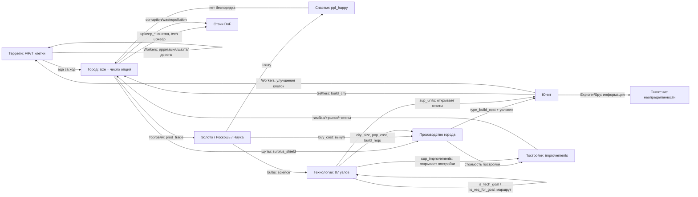

# Калибровка игры CivRealm в единицы DoF

**Статус:** ненормативный (informative). Документ описывает *рекомендуемую* интерпретацию игровых объектов и ресурсов в терминах степеней свободы DOF-Core и служит основой для `env/config.py` и `env/entity_extractor.py`. Нормативные документы на этот файл не ссылаются.

**Источники данных:** собственный реальный снимок стартового состояния (turn 1, 4 юнита, 1 город, 95 сущностей) и официальное руководство Freeciv (см. §11). Величины, помеченные «наблюдение», взяты из снимка; «руководство» — из документации; «оценка» — моя рекомендация, требующая проверки замером.

---

## 1. Единица измерения

**DoF = число независимых, жизнеспособных путей (опций), доступных сущности.** Это счётчик, а не нормированная величина: у любой живой сущности DoF ≥ 1 (как минимум — «продолжать существовать»), DoF = 0 означает необратимое прекращение всех переходов.

Из этого следуют три правила, которые нельзя нарушать:

1. **Считаем опции, а не «здоровье».** Каждый ресурс игры должен добавлять или убирать *варианты действий*, а не «очки качества».
2. **Индекс системы — `Σ ln(DoF)`** (произведение Нэша по множеству `calc`). При счётной шкале `ln(DoF) ≥ 0`, поэтому добавление сущности с опциями не понижает индекс, а коллапс любой сущности даёт `−∞`.
3. **Ресурс-поток ≠ ресурс-запас.** `surplus_*` и `prod_*` — способность делать *каждый ход* (опции сейчас); `*_stock`, `bulbs` — накопленный прогресс (опции, которые уже почти реализованы).

Ниже: §2 — типы юнитов, §3 — свойства юнитов, §4 — параметры города, §5 — сквозные ресурсы, §6 — пороговые явления, §7 — стоки DoF, §8 — рекомендуемые формулы, §9 — что не смоделировано, §10 — как проверять, §11 — источники.

---

## 2. Типы объектов (юнитов)

В стартовом состоянии у агента **не один юнит, а четыре** (плюс город). Наблюдение turn 1:

| Тип | Кол-во | `type_hp` | `health` | `type_move_rate` | `type_build_cost` | attack / def / firepower | `type_worker` | Назначение |
|---|---|---|---|---|---|---|---|---|
| **Settlers** (Поселенцы) | 1 | 20 | 20 | 3 | 40 | 0 / 1 / 1 | да | Создают города (движок населения). Единственный класс, повышающий население напрямую |
| **Workers** (Рабочие) | 2 | 10 | 10 | 3 | 30 | 0 / 1 / 1 | да | Преобразуют террейн (ирригация, шахта, дорога) — создают/меняют опции клеток |
| **Explorer** (Разведчик) | 1 | 10 | 10 | 3 | 30 | 0 / 1 / 1 | нет | Разведка: снимает неопределённость (Axiom 5 — «неизвестное не есть ноль опций») |
| *Warriors, Phalanx, Legion…* | 0 в старте | 10–30 | полный | 1–3 | 10–100 | 1–8 / 1–5 / 1 | нет | Оборона и захват: защита уже существующих опций |
| *Engineers* (Инженеры) | по технологии | 20 | 20 | 3 | 40+ | 0 / 1 / 1 | да | Как Workers, но быстрее и с большим набором работ |
| *Caravan / Trade* (Торговцы) | по технологии | 10 | 10 | 3 | 30–50 | 0 / 1 / 1 | нет | Разовые торговые маршруты: обмен опций между городами |

Все стартовые юниты стоят на одной клетке (x=25, y=43), `moves_left=3`, `owner=0`, `home_city=0`, `veteran=0`, `upkeep_food/gold/shield=0`.

### Что юнит умеет (36 семейств действий, 120 параметризованных имён)

| Класс действий | Действия | Смысл для DoF |
|---|---|---|
| Движение | `goto`, `paradrop`, `airlift`, `board`, `deboard`, `disembark`, `unit_unload` | Прямое увеличение доступного пространства состояний; транспорт **умножает** опции перевозимых сущностей |
| Работа с террейном | `irrigation`, `mine`, `plant`, `cultivate`, `transform_terrain`, `build_road`, `build_railroad`, `airbase`, `fortress` | Создание новых опций клетки (изменение ёмкости террейна) |
| Город | `build_city`, `join_city`, `conquer_city`, `set_homecity`, `marketplace`, `trade_route` | `build_city` — **создание движка населения**; `join_city` — обмен юнита на жителя |
| Бой и оборона | `attack`, `fortify`, `keep_activity`, `hut_enter`, `upgrade` | Защита существующих опций; `attack` — потенциальный коллапс чужой и своей сущности |
| Шпионаж | `investigate_spend`, `spy_bribe_unit`, `spy_sabotage_city`, `spy_steal_tech` | Получение информации без изменения структуры (Axiom 5), либо разрушение чужой структуры |
| Дипломатия | `embassy_stay` | Открытие/закрытие каналов взаимодействия между сущностями (Axiom 7 — нейтральность к чужой архитектуре) |
| Служебное | `cancel_order`, `pillage`, `set_homecity` | `pillage` — прямое уничтожение опций клетки (необратимо) |

### 2.2 Условия создания юнитов и что юнит порождает

Город **может** производить юниты любых типов из каталога ruleset (52 типа юнитов, ~120 наименований с постройками и чудесами) — но не сразу: доступность открывается условиями. Это первая половина графа источников DoF (§9).

| Тип | Условия, чтобы город мог его построить | Что порождает (вклад в DoF-граф) |
|---|---|---|
| **Settlers** | Технология не нужна. Стоит **2 населения** (civ2civ3; 1 в классике), поэтому город должен иметь запас жителей — по таблице foodbox рост Settlers возможен с **размера 3** (при размерах 1–2 строка «SETTLER NEW» пуста). Плюс достаточно щитов (`type_build_cost` 40) | **Создаёт город** (`build_city`) — источник населения, то есть главный узел-мультипликатор DoF. Также обрабатывает террейн |
| **Workers** | Технология не нужна, стоимость 30 щитов, населения не требует | Меняет террейн (ирригация, шахта, дорога) → повышает F/P/T клеток → рост города → новые опции |
| **Explorer** | Технология не нужна, 30 щитов, населения не требует; дома-города не имеет | Информация: снимает неопределённость (Axiom 5). Не увеличивает структуру напрямую |
| **Engineers** | Технология *Engineering* (или аналог), 40+ щитов, стоят населения | Как Workers, но шире набор работ и быстрее; нужны для загрязнения/трансформации |
| **Военные (Warriors, Phalanx, Archers, Legion…)** | Технология соответствующей эпохи; часть требует постройки (напр. казармы для ветеранов/апгрейда); **поддержка**: город содержит военных не больше своего размера (минимум 4, максимум 20), лишние съедают еду | Защита существующих опций; `conquer_city` — захват чужого узла (Axiom 3 запрещает оправдывать свой рост чужим коллапсом) |
| **Морские (Trireme, Caravel…)** | Технология + **город на побережье** (для дальних — Port Facility/Harbor) | Пространственные опции: доступ к морю, торговым путям |
| **Воздушные (Fighter, Bomber…)** | Технология + **Airport** в городе (либо авиабаза) | Дальнобойное влияние, разведка |
| **Diplomat / Spy** | Технология; невидимы как подлодки; платят содержание | Информация и воздействие на чужие опции без изменения структуры |
| **Caravan / Freight** | Технология; идут только по дорогам, рекам или на кораблях; торговые пути — только в чужие города, максимум 2 на город | Разовый перенос опций между городами (золото/щиты) |
| Любой юнит | Общие условия: (1) открыт технологией или стартовым набором (игра сообщает это в `sup_units` технологии; готовность города — маска `can_build_unit`); (2) не устарел (`type_obsoleted_by`); (3) хватает щитов (`production_value`); (4) есть содержание (`upkeep_shield`/`upkeep_gold`, для поселенцев ещё 1–2 еды); (5) `city_size` — минимальный размер города (приходит из игры, напр. 1 у бомбардировщика); (6) `pop_cost` — сколько населения стоит постройка (у Settlers 2 в civ2civ3); (7) `build_reqs` — требования к постройкам (напр. Airport для авиации); (8) город не в беспорядке (в беспорядке нельзя даже выкупить) | — |

Дополнительно: **чудеса и правительства** могут давать дополнительные слоты производства (напр. «Крестовый поход короля Ричарда» — +1 пехотный слот в городе; технология *Conscription* — по всей стране), а выкуп золотом стоит 2 × остаток работы (вдвое дороже, если работа не начата, и ещё вдвое — для чудес).

---

## 3. Свойства юнита: описание, лимиты, DoF

Все 23 поля, которые реально приходят в наблюдении. Колонка «DoF на единицу» — рекомендованный вклад в **число опций** (оценка автора, подлежит эмпирической проверке, §11).

> **Важно (согласовано 2026-09-26):** значения в этой таблице — покомпонентная расшифровка. Итоговый DoF юнита считается не простой суммой, а по двум компонентам — **текущий DoF** и **будущий потенциал** — см. §3.1 и §8.

| Поле | Описание (рус.) | Лимиты | DoF на единицу значения |
|---|---|---|---|
| `type_rule_name` | Имя типа юнита из ruleset (`Settlers`, `Workers`, `Explorer`…) | строка | — (классификация, влияет через коэффициенты типа) |
| `health` | Текущие очки жизни | 0 … `type_hp` (наблюдение: 10 и 20) | +0.02 за 1 HP — выживаемость есть условие всех прочих опций |
| `type_hp` | Максимум очков жизни для этого типа | 10 (обычные), 20 (поселенцы/инженеры), 30+ (поздние) | — (нормировочная база: `health/type_hp` — коэффициент риска) |
| `moves_left` | Остаток ходов в текущем ходу | 0 … `type_move_rate` | 0 — **не** уменьшает DoF (возобновляемый бюджет хода; уже учтено как ошибка модели ранее) |
| `type_move_rate` | Структурная скорость: сколько клеток за ход | 1 … 3 (наблюдение 3); в MP2-ruleset ×2 | +0.05 за 1 (пространственные опции) |
| `type_attack_strength` | Сила атаки | 0 … 8+ | +0.04 за 1 (способность изменять чужое состояние) |
| `type_defense_strength` | Сила защиты | 0 … 5+ | +0.04 за 1 |
| `type_firepower` | Урон за раунд боя | 1 … 2 | +0.03 за 1 |
| `type_build_cost` | Стоимость постройки в щитах | 10 … 1000 (наблюдение: 30 и 40) | −0.01 за 1 щит (цена входа; дорогой юнит = меньше вариантов у города) |
| `type_can_transport` | Может ли перевозить другие юниты | bool | +0.30 (умножает опции перевозимых — Axiom 6, автокатализ) |
| `type_convert_time` | Через сколько ходов юнит превращается в другой тип | 1 … N | +0.15 / `convert_time` (доступный путь трансформации) |
| `type_converted_to` | В какой тип превращается | id типа | — (связь: наличие пути повышает DoF) |
| `type_obsoleted_by` | Какая технология делает тип устаревшим | id технологии | — (ограничитель срока жизни опции; учитывать как τ, штрафа не давать) |
| `type_worker` | Умеет ли работать с террейном | bool | +0.20 (создание/изменение опций клеток) |
| `type_vision_radius_sq` | Квадрат радиуса обзора | 2 (радиус 1) типично | +0.05 за 1 (информация = снижение неопределённости) |
| `upkeep_food` | Еда, потребляемая юнитом у родного города | 0 … 2 | −0.05 за 1 (постоянный сток) |
| `upkeep_gold` | Золото на содержание | 0 … 2 | −0.05 за 1 (сток) |
| `upkeep_shield` | Щиты на содержание | 0 … 2 | −0.05 за 1 (сток) |
| `veteran` | Уровень ветерана | 0 … 4 (green → elite) | +0.10 за уровень (качество той же опции) |
| `home_city` | Город, который платит содержание | id города; у Explorer может отсутствовать | — |
| `owner` | Владелец | id игрока | — |
| `x`, `y` | Координаты | в пределах карты | — (используются для оценки достижимого пространства) |
| `activity` | Текущая работа/приказ | 0 … N | 0 (состояние, не ресурс) |

### 3.1 Текущий и будущий DoF юнита (решение 2026-09-26)

По замечанию заказчика юнит нельзя оценивать одной суммой: у разных типов разная структура.

- **Текущий DoF** — что юнит умеет *прямо сейчас* (атака, защита, живучесть, ход, обзор).
- **Будущий потенциал** — что юнит может *стать* или *создать* (основать город, изменить террейн, перевоплотиться, перевезти других).

Пример заказчика: **Поселенцы** — малый текущий DoF при огромном потенциале (город), **военные** — наоборот: текущий выше (умеют нападать, больше HP и урона), а потенциал скромный; их вклад в DoF системы идёт через *защиту города* (сохранение его опций), а не через собственный потенциал.

**Текущий компонент** (нормированный, вес в скобках, сумма максимум 0.80):

| Параметр | Вес | Как считается |
|---|---|---|
| факт существования и управления | 0.05 | константа |
| `health / type_hp` | 0.20 | живучесть |
| `type_attack_strength` | 0.15 | `min(1, attack/10)` |
| `type_defense_strength` | 0.15 | `min(1, defense/8)` |
| `type_firepower` | 0.05 | `min(1, firepower/2)` |
| `type_move_rate` | 0.10 | `min(1, move_rate/3)` |
| `type_vision_radius_sq` | 0.05 | `min(1, vision/8)` |
| `veteran` | 0.05 | `veteran/4` |

**Будущий компонент** (нормированный, сумма максимум 0.65):

| Возможность | Вес | Признак |
|---|---|---|
| основать город | **0.30** | тип в `POPULATION_UNIT_TYPES` (`Settlers`, `Engineers`) |
| изменять террейн | 0.10 | `type_worker = true` |
| путь трансформации | 0.10 | `type_convert_to` задан (+`1/convert_time`) |
| перевозка других юнитов | 0.20 | `type_can_transport = true` |

**Итог:**

```
DoF(юнит) = DOF_SCALE × [ s_текущий + W_FUTURE_UNIT × s_будущий × (health/type_hp) × decay(возраст) ]
DOF_SCALE = 10;  W_FUTURE_UNIT = 0.35
decay(возраст) = max(0.25, 1 − 0.05 × возраст)  — только для носителей населения
                                                  (5 %/ход — цена времени, см. §3.1)
```

Потенциал умножается на `health/type_hp` (риск гибели по дороге) и на убывание людей у поселенцев. Именно поэтому **бродячий поселенец дешевеет со временем**, а город — нет: у города потенциал неограничен (он может расти), у поселенца он фиксирован: ровно один город и ровно столько людей, сколько было.

**Проверка на реальных стартовых юнитах** (полное HP, ход 3, обзор 2):

| Юнит | Текущий (опции) | Будущий (опции) | Итог |
|---|---|---|---|
| Settlers (свежий) | 4.06 | 0.65 → 2.28 | **6.34** |
| Settlers (возраст 60) | 4.06 | 0.65 → 1.14 | **5.20** |
| Settlers (ранен, 50% HP) | 3.06 | 0.33 → 1.14 | **4.20** |
| Warriors (atk 1, ход 1) | **4.40** | 0.10 → 0.35 | **4.75** |
| Workers | 4.06 | 0.20 → 0.70 | **4.76** |
| Explorer | 3.86 | 0.10 → 0.35 | **4.21** |

Что видно: текущий DoF воина (4.40) больше текущего DoF поселенца (4.06) — как и требовалось; при этом итог поселенца выше, потому что его потенциал больше. Раненый поселенец (4.20) опускается ниже воина — риск учтён.

### Особые правила для поселенцев (Settlers, Engineers)

Население в поселенце **фиксировано и не может вырасти** — оно только убывает, пока он не основал город:

- **Люди:** +0.35 опции фиксированно (не растут со временем).
- **Убывание:** ×(1 − **0.05** × возраст в ходах), с полом **0.25** — «чем дольше он бродит, тем меньше в нём остаётся». Согласовано 2026-09-26: окно переноски закрывается за **15 ходов** (1 − 0.05×15 = 0.25), то есть первый город должен появиться в первых 5–10 ходах. Замер: свежий поселенец **3.81** опции, на 5 ходах — 3.38, на 10 — 2.94, на 15 и дальше — 2.50.
  - **Важно (методология):** затухание — это *прокси цены времени*, а не механика игры: правила население поселенца при движении не теряют. Само по себе оно **не создаёт стимула**: в индексе `Σ ln(DoF)` основание на ходу 0 даёт `ln(8.14) − ln(3.81) = +0.76`, а после 15 ходов блуждания — `−0.42` на поселенце плюс `ln(8.14) − ln(2.50) = +1.18` при основании, то есть **тот же итог +0.76**. Затухание меняет *когда* возникает потеря, а не *возникает ли она*.
  - **Стимул создают два других фактора** (согласованы 2026-09-26): (а) накапливающийся сток недоиспользованного населения (§7) — потеря, которая не возвращается; (б) контрфактический рост города — основать раньше значит получить N ходов роста (Axiom 6), и город на 15-м ходу был бы уже размера 2–3 с постройками, то есть дороже 8.14.
  - **(б) РЕАЛИЗОВАН** (2026-09-26, `env/site_eval.py` + `_compute_system_sink`): сток задержки больше не плоское 0.02, а прирост DoF контрфактического города за ход — `W_GROWTH × CITY_POP × DOF_SCALE × (surplus / амбар(size))`, где `surplus` и `амбар = 10×(size+1)` выводятся из площадки вокруг носителя, а `W_GROWTH = 0.35` (рост — будущая возможность, как потенциал юнита). Плоское 0.02 осталось **полом** для неоценённой или не прошедшей гейт площадки. **Живой замер (слот 6305):** площадка старта прошла гейт (еда 6.0 на 3 клетках, излишек +2), город на 15-м ходу — размера 2, цена задержки **0.350 опт./ход** (5.25 за 15 ходов) против 0.02 у плоского прокси, то есть в 17.5 раза сильнее; сток корректно падает, когда носитель перестаёт существовать. На бедной площадке (излишек 0, слоты 6302/6304) гейт её отвергает и цена падает до пола — «город-однодневка» запрещён, а не дорог.
- **Риск:** вся величина умножается на `health/type_hp` (поселенец в поле захватываем).
- **Мобильность:** +0.10 — его единственное реальное преимущество перед городом.
- **Создание города:** заменяет самого поселенца на город размера 1 (см. §8): город размера 1 всегда дороже свежего поселенца, потому что город — источник роста населения.

---

## 4. Параметры города

Город размера 1 (`Guánica`) из реального наблюдения: 37 полей. Колонка «DoF на единицу» — рекомендованный вклад.

| Поле | Описание (рус.) | Лимиты | DoF на единицу значения |
|---|---|---|---|
| `size` | Число жителей (население) | 1 … ~40 (рабочих клеток всего 21, далее — специалисты) | **+0.50 за жителя** — главный источник DoF в игре |
| `ppl_happy` | Довольные жители | 0 … `size` | +0.10 каждый |
| `ppl_content` | Нейтральные жители | 0 … `size` | 0 (базовое состояние) |
| `ppl_unhappy` | Недовольные жители | 0 … `size` | −0.15 каждый |
| `ppl_angry` | Злые жители (риск бунта) | 0 … `size` | −0.30 каждый |
| `food_stock` | Запас еды в «амбаре» | 0 … `granary_size` | +0.30 × (`food_stock` / `granary_size`) — почти реализованный рост |
| `granary_size` | Размер амбара: сколько еды нужно до +1 жителя | 20 при size 1, далее 10 × (size+1) | — (знаменатель прогресса роста) |
| `granary_turns` | Ходов до заполнения амбара | 0 … 32767 (32767 = «никогда», наблюдение) | +0.05 / `turns`, если рост возможен |
| `growth_in` | Текстовое представление срока роста | строка | — (использовать `granary_turns`) |
| `surplus_food` | Излишек еды за ход (отрицательный = голод) | −N … +N (наблюдение 0) | +0.20 за 1; при отрицательном — коллапс (τ = `food_stock`/долг) |
| `prod_food` | Произведено еды за ход | 0 … ~20 | 0 (уже учтено через излишек) |
| `last_turns_shield_surplus` | Излишек щитов в прошлом ходу | 0 … N | 0 (историческое) |
| `surplus_shield` | Излишек производства за ход | −N … +N (наблюдение 7) | +0.05 за 1 (способность превращать опции в новые) |
| `prod_shield` | Произведено щитов | 0 … ~20 (наблюдение 7) | 0 (учтено через излишек) |
| `shield_stock` | Накоплено щитов на текущем проекте | 0 … `production_value` | +0.20 × (`shield_stock` / `production_value`) |
| `production_value` | Общая стоимость текущего проекта | 10 … 1000 (наблюдение 71) | — (знаменатель прогресса) |
| `production_kind` | Тип проекта (юнит / постройка / чудо) | 0 … 6+ (наблюдение 6) | 0 (классификация) |
| `turns_to_prod_complete` | Ходов до завершения проекта | 0 … N (наблюдение 2) | +0.20 / `turns` (близость новой опции) |
| `can_build_unit` | Какие юниты сейчас доступны городу | булев массив по типам | +0.05 за каждый доступный тип (набор достижимых вариантов) |
| `buy_cost` | Цена выкупа проекта золотом | 0 … N (наблюдение 50) | −0.005 за 1 (цена ускорения) |
| `caravan_shields` | Щиты, привнесённые караванами | 0 … N | +0.03 за 1 |
| `disbanded_shields` | Щиты от расформированных юнитов | 0 … N | +0.03 за 1 |
| `prod_trade` | Торговля за ход | 0 … ~20 (наблюдение 3) | +0.05 за 1 |
| `surplus_trade` | Излишек торговли | −N … +N (наблюдение 3) | +0.05 за 1 |
| `prod_gold` | Золото за ход | 0 … N (наблюдение 1) | +0.10 за 1 (покупка опций) |
| `surplus_gold` | Излишек золота | −N … +N (наблюдение 1) | +0.10 за 1 |
| `luxury` | Роскошь (на вход счастья) | 0 … N | +0.05 за 1 (покупка лояльности жителей) |
| `science` | Наука за ход | 0 … N (наблюдение 2) | +0.05 за 1 (будущие тех-опции) |
| `bulbs` | Накопленные научные «лампочки» | 0 … N (наблюдение 7) | +0.01 за 1 (накопленный путь к новым опциям) |
| `city_corruption` | Потери торговли от коррупции | 0 … N (наблюдение 1) | −0.05 за 1 (прямая потеря опций) |
| `city_waste` | Потери производства от расточительства | 0 … N (наблюдение 0) | −0.05 за 1 |
| `city_pollution` | Загрязнение (порог 20 → риск) | 0 … N (наблюдение 0) | −0.05 за 1; суммарно >20 — коллапс качества клеток (§6) |
| `city_radius_sq` | Квадрат радиуса работы: 5 = радиус 1 (21 клетка) | 5, 21, 45 … | +0.50 × min(1, рабочие_клетки / 21) |
| `improvements` | Построенные здания (булев массив) | массив по числу построек ruleset | **+0.40 за постройку** (устойчивые новые опции) |
| `state` | Код состояния города (в т.ч. беспорядок / радость) | 0 … 7 (наблюдение 2) | Беспорядок → ×0.0 к производству и торговле (эффективный коллапс, §6) |
| `id`, `name`, `owner`, `x`, `y` | Идентификация и положение | — | — |
| `turn_last_built` | Ход постройки | ≥0 (наблюдение 1) | — |
| `prod_process` | Прогресс текущего проекта (доля) | 0.0 … 1.0 | +0.20 × `prod_process` |

### 4.1 Что город может производить и как это видно в наблюдении

Реальный стартовый город (`Guánica`, размер 1) в `available_actions` контроллера `city` отдаёт **207 действий / 161 семейство**:

| Группа действий города | Наблюдаемые имена | Смысл |
|---|---|---|
| Выбор производства | `produce_<Имя>` (каталог, ~120 наименований: юниты, постройки, чудеса) | «Что город может строить в принципе»; доступность сейчас определяется условиями (§2.2) |
| Маска доступных юнитов | поле `can_build_unit` — массив из **52** булевых значений | **Что город может построить именно сейчас**: в старте истинны индексы 0 и 3 (два типа) |
| Построенные здания | поле `improvements` — массив из **68** булевых | Инфраструктура города (в старте истинен индекс 21) |
| Выкуп золотом | `city_buy_production` | Покупка опции за золото (в беспорядке недоступно) |
| Специалисты | `city_change_specialist` ×3 | Переключение жителя в работу/налог/науку (налоговик и учёный — с размера 5) |
| Распределение клеток | `city_work_<tile>`, `city_unwork_<tile>` (по 20 + 4 варианта со специалистами) | Каждый житель работает одну клетку; это прямое управление числом опций выхода |
| Продажа построек | `city_sell_improvement_<Имя>` (~38 наименований) | Обратный переход: постройка → золото (потеря устойчивых опций) |
| Текущий проект | `production_kind`, `production_value` (71), `turns_to_prod_complete` (2), `prod_process` | Что строится, сколько стоит, когда завершится |

Отсюда правила для модели: **каталог производства фиксирован ruleset** (город не «придумывает» юниты), а **доступность — динамическая** и уже присутствует в наблюдении (`can_build_unit`, `improvements`, валидность `produce_*`). Значит, DoF-модель не обязана выводить условия из технологий сама — она может читать маску доступности и оценивать прирост опций от каждого нового доступного типа.

---

### 4.2 Пространство города и качество площадки (по документации, 2026-09-26)

**Сколько земли обрабатывается** (руководство Freeciv, «Working the Land and the Ocean» — дословно):

- **Область влияния — 21 клетка**: квадрат 5×5 с центром в городе, **без угловых**. За этими пределами город не работает ничего (совпадает с наблюдаемым `city_radius_sq = 5`).
- **Центральная клетка обрабатывается бесплатно**, без выделения жителя; она считается *ирригированной, но не шахтой*, дороги у города автоматически, и **минимум 1 щит город даёт всегда**, даже если террейн не позволяет.
- **Каждый житель обрабатывает одну клетку** → всего обрабатывается **`size + 1`** клеток (центр + `size` жителей). Когда клетки кончаются (21), лишние жители становятся специалистами.
- **Одну клетку обрабатывает только один город** — соседние города конкурируют за землю (учитывать при выборе площадки).
- Сервер распределяет жителей алгоритмом, **предпочитающим максимум еды** — именно это и должна предсказывать модель для нового города.
- **Каждый житель съедает `food_cost = 2` еды** (подтверждено самим стендом: `rules.food_cost = 2`).

**Легенда слоёв карты — ПОДТВЕРЖДЕНА на живой игре** (2026-09-26, слот 6323, 8 ходов, 65 раскрытых клеток; скрипты `scripts/inspect_terrain_legend.py`, `scripts/inspect_terrain_live.py`, доказательства `/tmp/terrain_evidence.json`):

- `map['terrain']` — слой **id** (X×Y), имя = `TERRAIN_NAMES[id]` (14 имён из `civrealm/freeciv/map/map_const.py`). Каждый террейн даёт **ровно один** выход — конфликтов нет.
- `map['extras']` — **one-hot `(X, Y, 34)`**, канал `i` = `EXTRA_NAMES[i]`. Это не битовая маска и не id-слой (проверено: dtype `bool`, значения только `False/True`).
- `map['output']` — `(X, Y, 6)`, но **значащих каналов три**: 3, 4, 5 нулевые на всей карте. Каналы 0/1/2 = еда / щиты / торговля.
- **Нераскрытая клетка = нулевой выход** (4035 из 4056 клеток), а не «нулевые опции»: слой `terrain` при этом заполнен. Значит разведку надо определять по `output != 0`, а не по террейну (Axiom 5/7 — неизвестное не считать нулём).

**Базовый выход террейна (измерено на живом стенде):**

| Террейн | Еда/Щит/Торг | | Террейн | Еда/Щит/Торг |
|---|---|---|---|---|
| Lake | 1/0/2 | | Mountains | **0**/1/0 |
| Ocean | 1/0/2 | | Plains | 1/1/0 |
| Forest | 1/2/0 | | Swamp | 1/0/0 |
| Grassland | 2/0/0 | | Hills | 1/0/0 |

**Ресурсы — аддитивные бонусы поверх террейна, а не абсолютный выход** (это исправление: в таблице спец-ресурсов выше числа были *бонусами*, и они подтвердились 1:1):

| Клетка | Наблюдённый выход | Бонус | Совпало с таблицей |
|---|---|---|---|
| Plains + Buffalo | 1/3/0 | (0, +2, 0) | ✅ `Buffalo 0/2/0` |
| Forest + Pheasant | 3/2/0 | (+2, 0, 0) | ✅ `Pheasant 2/0/0` |
| Forest + Silk | 1/2/3 | (0, 0, +3) | ✅ `Silk 0/0/3` |
| Ocean + Whales | 2/1/2 | (+1, +1, 0) | ✅ `Whales 1/1/0` |
| Hills + Wine | 1/0/4 | (0, 0, +4) | ✅ `Wine 0/0/4` |
| Grassland + Resources | 2/1/0 | (0, +1, 0) | — (общий маркер ресурсов) |
| + River (Grassland/Forest/Plains) | без изменений | (0, 0, 0) | река выход клетки не меняет |
| + Minor Tribe Village | без изменений | (0, 0, 0) | хижина, не ресурс |

Пять независимых ресурсов совпали точно, на четырёх разных базовых террейнах — легенда и таблица бонусов согласованы. Практический вывод: `map['output'][x][y]` остаётся единственным источником выхода (террейн + ресурс + улучшения уже сложены сервером), а отдельная таблица ресурсов нужна только для **оценки опций** (гавань, морские юниты), не для выхода.

**Гейт минимального качества площадки** (согласовано 2026-09-26; запрет «городов-однодневок»):

```
food_potential = Σ еда лучших (size + 1) клеток в радиусе
площадка допустима, только если food_potential ≥ SITE_MIN_FOOD = 6
```

Смысл: при `food_cost = 2` площадка с потенциалом ниже 6 не прокормить даже двух жителей с запасом — это структурная заморозка, а не плохой город. Такие варианты **исключаются из набора кандидатов** (doc §3: не штрафуем, а выбрасываем), а не оцениваются низко.

**На каком размере проверяется гейт (исправлено 2026-09-26 по факту прогона).** Порог определён как «прокормить *двух* жителей + запас», поэтому проверять его на первом размере неверно: на размере 1 работает всего `1+1 = 2` клетки и их суммарная еда почти всегда ниже 6, из-за чего гейт запрещал бы любой город. Гейт берёт лучшие `SITE_GATE_SIZE + 1 = 3` клетки (размер 2: два жителя съедают `2 × 2 = 4`, плюс запас 2). Введена константа `SITE_GATE_SIZE = 2`; при этом в модель и в отчёты всё равно отдаётся и `gate_size`, и `gate_food`, чтобы решение было проверяемым.

**Дельта основания по площадке (реализовано 2026-09-26).** `build_city` **не несёт координат** — город появляется на клетке, где стоит носитель, значит «выбор площадки» есть выбор, *куда идти*. Поэтому дельта основания считается по площадке **под носителем** (`BridgeCalibration.new_city_options_by_unit`), а не по среднему городу империи; цена города берётся той же формулой города (`city_options`) на гипотетическом наблюдении площадки (столица получает бесплатный Palace). Площадка, не прошедшая гейт, **в цены не попадает вовсе** — `estimate_dof_delta` для неё возвращает пустую дельту, то есть действие вырезается, а не штрафуется; при этом сток задержки продолжает подталкивать носителя идти туда, где город сможет расти.

**Сверка с миром (тот же прогон, прогноз до основания):**

| Оценка | Значение | Ошибка против факта мира |
|---|---|---|
| Прежняя константа (средний город империи) | 3.000 | **+171 %** (факт 8.136) |
| Площадка носителя, после дельта-правки | 8.400 | +2.6 % (факт 8.618) |
| Площадка носителя, после правки `truthy` | 8.200 | **+0.1 %** (факт 8.208) |

Заодно исправлен настоящий дефект чтения полей: `truthy()` возвращал `bool(value.size)`, поэтому **любой** numpy-скаляр (включая `np.False_`) считался истинным. Список флагов города (`improvements`) читался как «68 из 68 истинны» вместо реального «1 (Palace)», первый множитель города всегда упирался в потолок, и развитый город перестал отличаться от голого. Именно этот дефект и объясняет две трети ошибки прогноза. Регресс-тесты: `tests/unit/test_field_readers.py`.

**Движение к лучшей площадке (реализовано 2026-09-26).** Если площадка под носителем гейт не прошла, город там запрещён, и единственный способ реализовать движок роста — **дойти** туда, где город сможет расти. Поэтому бридж считает выигрыш перехода: ценность города на лучшей достижимой площадке (в пределах `move_rate` носителя) минус ценность там, где он стоит; выигрыш дисконтируется тем же `W_FUTURE_UNIT`, что и потенциал юнита (город ещё не основан — это по-прежнему будущая возможность), и попадает на действия перемещения (`goto`/`move`/`explore`). Сравнение честное: идти N ходов стоит N × сток задержки, и выигрыш обязан это перебить.

**Живая проверка решения (путь настоящего агента: извлечение → кандидаты → дельты → ядро DOF-Core), два слота:**

| Слот | Что произошло |
|---|---|
| 6314 | старт у обоих носителей **вырезан гейтом**; ядро отвело поселенца `goto` — он **сдвинулся** (31,35)→(30,34), площадка стала годной, и основание второго поселенца пошло с ценой **+5.326**; оставшийся носитель шагал дальше (30,34)→(29,33)→(29,32)→(28,31) с ценой перехода **0.187 → 0.703 → 0.703 → 0.315** |
| 6315 | площадка первого носителя годна → ядро выбрало `build_city` (**+5.788**); площадка второго **вырезана**, цена перехода **3.024** → `goto`, носитель **сдвинулся** (42,9)→(41,8) и площадка стала годной; дальше шаги с ценой 0.189 → 0.756 → 0.473 |

То есть цена перехода пересчитывается по ходу движения (0.703 → 0.315, 0.756 → 0.473), а не является константой: модель действительно смотрит на карту. Важная деталь: **область города (радиус 2) шире шага**, поэтому одного шага к богатой земле часто достаточно, чтобы площадка стала годной — это проверено отдельным тестом.

**Работы на террейне (пункт 1, реализовано).** Работа рабочего ставит на клетку экстру (ирригация, шахта, дорога), выход клетки растёт, а клетку обрабатывает город — значит выгода адресуется **городу, в чью область (21 клетка) попадает клетка**, и считается той же формулой города (сравниваются два снимка: с текущими излишками и со сдвинутыми на эффект). Эффект берётся исключительно из **измеренной** таблицы `MEASURED_EXTRA_EFFECTS`, поэтому неизмеренная работа молчит (0), а не получает правдоподобное число; уже стоящая экстра — 0; клетка вне города — 0; не-рабочий юнит не оплачивается.

Что **измерено** на живом стенде (слоты 6316–6322; сравнение с тем же террейном без экстры): Iron +3 щита на Mountains, Coal +2 щита на Hills, Oil +3 щита, Oasis +3 еды, Wheat +2 еды (Plains), Pheasant +2 еды (Forest), Fish +2 еды (Ocean), Buffalo +2 щита (Plains), Silk +3 торговли, Wine +4 торговли, Whales +1/+1, «Resources» +1 щит; **река не меняет выход ни на одном из шести проверенных террейнов**, хижина — тоже. Оговорка: на клетке с несколькими экстрами замер относит эффект к каждой, поэтому в таблицу вошли только клетки с одной экстрой.

**Итог по работам в этой версии стенда (измерено, с воспроизведением):** работы **ставят экстры, но выхода клетки не меняют**. Ирригация → `Irrigation` на Grassland `(2,1,0)`, Plains `(1,1,0)` и Hills `(1,0,0)` — везде Δ(0,0,0). Дорога → `Road` на тех же трёх террейнах — тоже Δ(0,0,0) везде. Это **третий и четвёртый случай расхождения с upstream-правилсетом** (`irrigation_food_incr = 1`; `road_road.trade_incr = 1` × `road_trade_incr_pct`): в контейнере стоит более старая civ2civ3, где дорога — только перемещение, а ирригация — шаг цепочки (открывает ферму), а не еда. `cultivate`/`plant` — не экстра, а смена террейна: измерен цикл **Forest ⇄ Swamp с периодом 4–5 ходов**, Δ(0,∓2,0). Mine/Railroad остаются не измеренными (валидность по клетке + подвисание контроллера при постановке работы); их цена 0 с явной причиной. Практический вывод для модели: «нулевой канал» закрыт не подстановкой значения, а **измерением того, что ценить нечего** — ценность работы здесь не в выходе клетки, а в цепочке улучшений и в перемещении.

**Методологический вывод, который стоит запомнить:** файл правилсета — это **гипотеза, а не истина**. Upstream-правилсет говорит `Forest cultivate → Plains`, а стенд даёт **Swamp**; говорит `irrigation_food_incr = 1`, а стенд даёт **0**; говорит `road_river.trade_incr_const = 1`, а река в стенде **не даёт торговли**. Разница объяснима (в контейнере более старая версия civ2civ3), но вывод практический: правилсет годится, чтобы выбрать, **что измерить**, а в таблицу попадает только то, что показал мир.

**Опции площадки: берег и ресурсы (пункт 2, реализовано).** Берег и ресурсы — не выход клетки, а дополнительные пути развития (гавань, морские юниты, морская торговля; ресурс ускоряет рост), поэтому входят в ценность города как **опции**: `SITE_COAST_BONUS = 0.10` за воду в области города и `SITE_RESOURCE_BONUS = 0.10` за каждый **различный** ресурс, с потолком `SITE_OPTION_BONUS_CAP = 0.30` (Axiom 1: опции — не инвентарь). Ресурсность определяется **измерением**: ресурсом считается только экстра с ненулевым замеренным эффектом, поэтому неразведанная ирригация не притворяется ресурсом.

**Рост по формуле города (пункт 3, реализовано).** Плоское «житель = `CITY_POP × DOF_SCALE`» заменено: цена задержки за ход = `W_GROWTH × (ценность города на горизонте − ценность сейчас) / GROWTH_HORIZON`, где обе ценности считает **та же формула города**, что и для настоящего города, а размер входит и в базу, и в амбар. Множители площадки (еда, щиты, торговля, бесплатный Palace столицы) теперь влияют на цену задержки. Плоский прокси оставлен как точка сравнения; он **завышал**: 10 опций за жителя против ~8 опций за целый город размера 1. Заодно выяснилось свойство: **гейт строже роста** (6 еды на 3 клетках против положительного излишка), поэтому у любой годной площадки всегда есть что терять — пол остаётся только для неоценённой или негодной площадки, и «город-однодневка» невозможен по построению.

**Что ещё осталось:** замер работ (клетки, где `mine`/`irrigation` валидны); `cultivate`/`plant`/`transform_terrain` как **смена террейна** (цена зависит от террейна-результата — отдельный замер); цена работы в ходах (`MEASURED_WORK_TURNS = 4` пока константа, измеренная на `cultivate`).

---

## 5. Сквозные ресурсы и пороги интерпретации

| Ресурс | Что это | DoF-смысл |
|---|---|---|
| Еда (`food`) | 2 еды на жителя за ход (руководство) | Содержание населения; дефицит → голод → смерть жителей = коллапс |
| Щиты (`shields`) | Производство | Способность превращать опции в новые |
| Торговля (`trade`) | Делится на золото / роскошь / науку | Золото — покупка опций, роскошь — лояльность, наука — будущие опции |
| Золото (`gold`) | Казна | Покупка: `buy_cost` = 2 × остаток (вдвое, если работа не начата; ещё вдвое для чудес) |
| Роскошь (`luxury`) | 2 роскоши = +1 довольный (или недовольный → нейтральный) | Управление счастьем = защита от беспорядка |
| Наука (`bulbs`/`science`) | Исследование | Доступ к новым типам юнитов и построек = новые опции (сейчас в модели **не учитывается**: измерено 0.0000) |

**Ключевые пороги (руководство):**

- **Размер 5** — открываются специалисты (налоговый инспектор +3 золота, учёный +3 науки) и возможна «радость» (rapture) при Республике/Демократии: +1 житель за ход. До этого — только работа на клетках. Это **структурный скачок** DoF, а не плавный прирост.
- **Размер 4/5** — «порог недовольства»: каждый житель сверх 4-го (при многих городах — сверх 3-го) рождается недовольным. Дальнейший рост требует роскоши/построек, иначе город входит в беспорядок.
- **Порог празднования — 3 жителя** (исправлено 2026-09-26: `rules.celebratesize = 3`; в документе ошибочно стояло 5). Отдельно есть «злой житель» (`rules.angrycitizen = 1`) — состояния сверх «недовольного», которого в документе не было вовсе.
- **21 клетка** — предел обрабатываемой земли (5×5 минус углы; `city_radius_sq = 5`). Далее рост даёт только специалистов.
- **`granary_size` = 10 × (size + 1)** — 20 при size 1 (совпадает с наблюдением), 30 при size 2 и т. д.
- **Загрязнение > 20** — превышение над порогом равно проценту шанса загрязнения клетки в области города; загрязнённая клетка даёт половину еды/щитов/торговли (потеря опций). Загрязнение города = промышленное (от производства) + популяционное (от размера).
- **Беспорядок** (`ppl_unhappy > ppl_happy`) — город не производит ни щитов, ни торговли: практически все его опции становятся недоступными на этот ход. Затяжной беспорядок при Демократии ведёт к революции.
- **Потеря последнего жителя** — город исчезает. Постройка Settlers/Engineers в городе **забирает 1 жителя** (в civ2civ3 — 2; прямой обмен населения на юнит).

**Уточнения по ruleset civ2civ3** (он и используется на стенде — старт: 1 Settlers + 1 Workers + 1 Explorer + 1 бесплатная технология):

- **Радости (rapture) нет**: празднование даёт не рост, а дополнительную торговлю с клетки.
- **Settlers стоят 2 населения** и доступны с размера 3 (в классике — 1 населения и с размера 2).
- **Амбар:** размер foodbox 20 при размерах 1–4, эффект амбара при pop ≤ 4 даётся бесплатно; «granary size» фиксирован на 10 еды для любого размера.
- **Поддержка военных = размер города** (минимум 4, максимум 20); лишние юниты съедают по 1 еде каждый; при голоде лишний юнит расформировывается.
- **Каждое содержание юнита всегда платится**: под одними правительствами щитами, под другими (монархия, республика, демократия, федерация) — золотом.
- **Техническое содержание городов:** каждая технология требует bulbs на поддержание (от 0 в средние века до 10 bulbs на город при полностью исследованном дереве); при отрицательном балансе теряется случайная технология.
- **Чума при размере > 4** (снижается Aqueduct, Sewer System, технологией Medicine, чудом Cure for Cancer) — источник коллапса, учитывать как τ.
- **Прочие бедствия:** землетрясение, пожар, наводнение, ядерная авария.
- **Минимальная дистанция между городами — 2 клетки** (исправлено 2026-09-26 по данным стенда: `rules.citymindist = 2`; в документе ошибочно стояло 3); начальная граница города задаётся `rules.border_city_radius_sq = 17`.
- **Оборона города:** любому городу +50% против наземных, при pop > 8 — ещё +50% против наземных и морских; стены +100%; город в беспорядке не производит и не покупает.

### 5.1 Исследования (технологии) — полноценный домен, а не примечание

Технологии — **самый крупный домен системы**: в стартовом состоянии из 95 сущностей **87 — технологии**. При этом в текущей модели их вклад равен нулю (измерено: `research_tech` даёт Δиндекса 0.0000). Это главный незакрытый участок калибровки.

**Поля технологии в наблюдении (8 полей на каждую из 87):**

| Поле | Описание (рус.) | Лимиты | DoF-смысл |
|---|---|---|---|
| `name` | Название технологии (`Advanced Flight`, `Ceremonial Burial`, `Chemistry`) | строка | — |
| `inv_state` | Состояние: известно / неизвестно (в наблюдении 0 и 1) | 0 … 1 (+) | Пока 0 — технология **не даёт опций**; при 1 — открывает свой набор |
| `is_researching` | Исследуется ли прямо сейчас | bool | Активный путь к новым опциям |
| `is_tech_goal` | Выбрана ли целью исследования | bool | Целеполагание (Axiom 1: куда расти) |
| `is_req_for_goal` | Является ли предпосылкой для выбранной цели | bool | Промежуточный узел на пути к цели |
| `reqs` | **Родители:** словарь `{id_технологии: известна_ли}` | 0 … N родителей | Входящие рёбра графа: путь к этой технологии |
| `sup_units` | **Какие типы юнитов открывает** — с полными параметрами (hp, move_rate, build_cost, **city_size**, **pop_cost**, **build_reqs**, upkeep, obsoleted_by, vision_radius_sq, worker, helptext, id) | 0 … N | Исходящие рёбра: сколько *новых опций* даёт технология |
| `sup_improvements` | **Какие постройки открывает** — с полными параметрами (build_cost, upkeep, reqs, helptext, id, genus) | 0 … N | Исходящие рёбра: устойчивые новые опции |

**Что это даёт модели.** Граф исследований наблюдаем целиком, без догадок:

- **DoF технологии** = 1 (сама возможность) + сумма DoF того, что она открывает. Формально: `DoF(tech) = 1 + Σ DoF(unit) + Σ DoF(improvement)` по `sup_units` и `sup_improvements`. Технология, не открывающая ничего, честно стоит 1 опцию; технология, открывающая бомбардировщик (attack 12, hp 20, move 24) и авианосец (transport_capacity 8), стоит существенно больше.
- **ΔDoF исследования** = прирост опций от открываемого набора, приведённый к числу ходов: `ΔDoF = Σ DoF(открытого) / turning_time`, где время берётся из стоимости технологии и текущего накопления bulbs. Это и есть исправление «research = 0.0000».
- **Целеполагание** (`is_tech_goal`, `is_req_for_goal`) — уже готовый маршрут по графу: агент может оценивать не только «что даст эта технология», но и «насколько она приближает к цели» — то есть считать DoF не одной вершины, а всего пути (Axiom 1: будущая возможность, Axiom 6: автокатализ).
- **Условия создания юнитов видны прямо здесь:** каждый элемент `sup_units` несёт `city_size` (минимальный размер города), `pop_cost` (сколько населения стоит юнит), `build_reqs` (требования к постройкам: `kind`, `present`, `range`, `value`) и `upkeep`. То есть условия из §2.2 не нужно выводить из документации — они приходят из игры для каждого юнита.

**Действия исследования:** контроллер `tech` отдаёт `research_tech_<Технология>` (×87) и `set_tech_goal_<Технология>` (×87) — всего 174 имени. В живых прогонах валидными были 87 (по одному исследованию за ход).

**Механика, которой в наблюдении НЕТ** (нужно моделировать самим):

| Механика | Источник | Как учитывать |
|---|---|---|
| Стоимость технологии | civ2civ3: `Tech Cost = Base × число родителей` | Нужна таблица Base; в наблюдении её нет — брать из ruleset или замерять по факту (`granary_turns`-подобных полей нет) |
| Накопление bulbs | `bulbs`, `science` города | Поток опций в исследования; при нуле — технологии не растут |
| Тех-содержание городов | 0 … 10 bulbs на город при полном дереве | Сток DoF; при отрицательном балансе **теряется случайная технология** (обвал, не постепенная потеря) |
| Утечка технологий | дешевле, если открыта у нации с посольством | Снижение цены пути (Axiom 7: чужой прогресс не обнуляет наши опции, но удешевляет наши) |
| Бесплатная стартовая технология | civ2civ3: 1 бесплатная | Начальный узел графа уже открыт |
| Технологии, меняющие террейн и правила | напр. Electricity — ирригация без рядом воды | Открывают *новые действия* (не только объекты): учитывать в DoF как +опции |
| Устаревание юнитов | `obsoleted_by` в `sup_units` | Ограничитель срока жизни опции (τ) |

**Порядок применения в модели.** Технология — это *гейт*: до открытия она не даёт опций (`inv_state = 0` → вклад 1), после — даёт столько, сколько открывает. Тогда:
- `research_tech_X` перестаёт быть нулевым действием: его ΔDoF = ценность открываемого набора, дисконтированная временем;
- `set_tech_goal_X` остаётся управляющим действием (нулевой мгновенный ΔDoF, но меняет будущий маршрут) — то есть его надо оценивать как *изменение плана*, а не как приобретение.

---

## 6. Пороговые (нелинейные) явления — учитывать отдельно от суммы

| Явление | Условие | DoF-эффект |
|---|---|---|
| Голод | `surplus_food < 0` | Сначала тратится `food_stock`; при нуле гибнут поселенцы, затем житель. τ = `food_stock` / долг |
| Беспорядок | `ppl_unhappy > ppl_happy` | Обнуление производства и торговли: эффективный DoF города падает до уровня «только существование» |
| Радость (rapture) | `size ≥ rules.celebratesize` (**3** в этом ruleset, не 5), `ppl_happy ≥ ppl_content`, нет недовольных, Республика/Демократия | +1 житель за ход — экспоненциальный рост опций. **Зависит от ruleset:** в civ2civ3 радости нет (вместо роста — дополнительная торговля) |
| Злой житель | `rules.angrycitizen = 1` | Порог, за которым житель становится «злым» — жёстче недовольного: дополнительный риск беспорядка (учитывать вместе с порогом недовольства) |
| Чума | размер > 4, снижается Aqueduct/Sewer System/Medicine/Cure for Cancer | Вероятностная потеря жителей — внезапный коллапс части опций города |
| Загрязнение | `city_corruption + city_pollution > 20` | Вероятностная потеря половины выхода клеток; риск глобального потепления (необратимое изменение террейна) |
| Устаревание юнита | Сработал `type_obsoleted_by` | Опция исчезает не по нашей воле: заранее закладывать как τ, но не как штраф |
| Захват города | `conquer_city` у противника | Смена владельца: для проигравшего — коллапс, для победителя — приобретение всей структуры (Axiom 3: нельзя оправдывать своё расширение чужим коллапсом) |

---

## 7. Стоки DoF (постоянные потери — считаются отрицательно)

| Источник | Значение | Рекомендация |
|---|---|---|
| `upkeep_food/gold/shield` юнитов | 0 … 2 каждый | **Системный сток** `D_поддержка = 0.05 × Σ upkeep` (отдельная сущность-сток или вычитание из казны), а не поправка к DoF юнита. Комментарий в §8: альтернативный вариант — вычитать прямо из юнита |
| **Недоиспользованное население** | носитель (Settlers/Engineers) существует без основанного города, `возраст` ходов | **Системный сток** `0.02 × Σ возраст` (согласовано 2026-09-26). В отличие от затухания (§3.1) потеря **необратима и растёт без насыщения** — это и есть цена задержки, которая делает «основать сейчас» лучше, чем «гулять». Проверка масштаба: 0.6 опции за 30 ходов против +5.1 опции от основания |
| `city_corruption`, `city_waste` | 0 … N | −0.05 за единицу |
| `city_pollution` | 0 … N | −0.05 за единицу + пороговый эффект при сумме > 20 |
| `type_build_cost` | 10 … 1000 | −0.01 за щит (цена входа при постройке) |
| Постройка Settlers/Engineers | −1 житель города | Обмен: юнит (+опции перемещения) против жителя (−опции города) — учитывать как переход, а не как «бесплатный» юнит |

---

## 8. Рекомендуемые формулы (в «опциях»)

**Юнит** — по двум компонентам (§3.1), согласовано 2026-09-26:

```
DoF(юнит) = DOF_SCALE × [ s_текущий + W_FUTURE_UNIT × s_будущий × (health/type_hp) × decay(возраст) ]

s_текущий = 0.05 + 0.20 × (health/type_hp)
          + 0.15 × min(1, attack/10) + 0.15 × min(1, defense/8)
          + 0.05 × min(1, firepower/2) + 0.10 × min(1, move_rate/3)
          + 0.05 × min(1, vision_radius_sq/8) + 0.05 × (veteran/4)

s_будущий = 0.30 × (тип в POPULATION_UNIT_TYPES)     // основать город
          + 0.10 × type_worker                        // изменение террейна
          + 0.10 × (type_convert_to задан) / min(1, convert_time)
          + 0.20 × type_can_transport                 // умножение чужих опций

DOF_SCALE = 10;  W_FUTURE_UNIT = 0.35
decay(возраст) = max(0.25, 1 − 0.05 × возраст)         // только для носителей населения
```

`W_FUTURE_UNIT < W_FUTURE_CITY` намеренно: потенциал юнита — это *возможность*, потенциал города — уже *реализованность*, которая к тому же растёт (Axiom 1: будущая возможность против наличной).

**Сток поддержки — системный, а не вычитается из юнита** (решение 2026-09-26):

```
D_поддержка = SINK_COEFF × Σ_юнитов (upkeep_food + upkeep_gold + upkeep_shield)
SINK_COEFF = 0.05 опции за единицу потребления
```

Смысл: содержание юнитов чувствуется тем сильнее, чем меньше бюджет системы; при большом бюджете оно несущественно. Поэтому это **отдельная сущность-сток** в наборе `calc` (или вычитание из DoF казны/города-плательщика), а не поправка к DoF самого юнита.

> *Альтернативный вариант учёта (для сравнения, не выбран):* вычитать `−0.05 × upkeep` прямо из DoF юнита. Тогда дешёвый в содержании юнит автоматически «дороже» дорогого, но теряется эффект «богатая казна терпит, бедная задыхается». Переключение — одна константа в `config.py`.

**Город** — трёхмножительная схема (решение 2026-09-26), база увеличена до 2.0 и население поднято до 1.0 опции за жителя (вариант A; вариант B — снижение «людей» поселенца до 0.20 — применён одновременно):

```
DoF(город) = (CITY_BASE + CITY_POP × size)
             × min(CAP_M1, 1 + 0.20 × positive(surplus_food)
                             + 0.30 × food_stock/granary_size
                             + 0.40 × improvements_count)
             × min(CAP_M2, 1 + 0.05 × surplus_shield + 0.05 × surplus_trade
                             + 0.10 × surplus_gold + 0.05 × science + 0.05 × luxury)
             × (1 − 0.05 × (corruption + waste + pollution))
             × happiness_factor × (беспорядок ? 0 : 1)

CITY_BASE = 2.0;  CITY_POP = 1.0
CAP_M1 = CAP_M2 = 2.0;  CITY_CEIL = 20 опций
happiness_factor = 1 + 0.10 × ppl_happy − 0.15 × ppl_unhappy − 0.30 × ppl_angry
```

> *Альтернативный вариант (для сравнения, не выбран):* линейная сумма вместо трёх множителей — проще контролировать итог, но теряется эффект «ворот»: при беспорядке или голоде опции города должны обнуляться, а не просто уменьшаться.

**Основание города** — по-прежнему разность, а не константа:

```
ΔDoF = DoF(город, размер 1) − DoF(поселенец, текущий)
```

**Проверка согласованности (согласовано 2026-09-26):**

| Объект | Расчёт | DoF (опций) |
|---|---|---|
| Settlers (свежий) | 10 × (0.406 + 0.35 × 0.65) | 6.34 |
| Settlers (раненый, 50% HP) | 10 × (0.306 + 0.35 × 0.65 × 0.5) | 4.20 |
| Warriors | 10 × (0.440 + 0.35 × 0.10) | 4.75 |
| Город, размер 1 (стартовый) | (2.0 + 1.0) × 1.40 × 1.70 × 0.95 | **6.78** |
| Город, размер 5 (растущий, 3 постройки) | (2.0 + 5.0) × 2.0 × 2.0 × 0.85 | 20 (потолок) |

Требуемые соотношения выполняются: город размера 1 (6.78) **больше** свежего поселенца (6.34); текущий DoF воина (4.40) **больше** текущего DoF поселенца (4.06); раненый поселенец (4.20) опускается ниже воина.

**Юнит-носитель населения (Settlers, Engineers)** — частный случай:

```
DoF = DOF_SCALE × [ s_текущий + W_FUTURE_UNIT × 0.30 × (health/type_hp) × decay(возраст) ]
```


---

## 9. Граф источников DoF

Игра — это ориентированный граф, в котором DoF не «начисляется» напрямую, а порождается переходами между узлами. Узлы: террейн, город (население), постройки, технологии, юниты, казна/наука. Рёбра: «производит», «открывает», «создаёт», «улучшает», «содержит» (сток).



Текстом те же рёбра (для реализации в модели):

| Источник (узел) | Ребро | Приёмник | Условие / цена | Что это даёт DoF |
|---|---|---|---|---|
| Террейн | обрабатывается жителем | Город (выход F/P/T) | нужен житель и клетка в радиусе | Каждый житель = одна опция использования клетки |
| Террейн | улучшение (`irrigation`, `mine`, `road`, `railroad`) | Террейн (более высокий F/P/T) | нужен Worker/Engineer, N ходов работы, технология (для продвинутых) | Повышает выход → рост → новые опции |
| Город | `surplus_shield` | Производство города | — | Способность превращать опции в новые |
| Производство | `produce_<Юнит>` | Юнит | технология + постройка + размер + щиты + содержание | Новые опции (защита, работа, разведка) |
| Производство | `produce_<Постройка>` | `improvements` | технология + щиты | Устойчивые опции города (амбар, рынок, библиотека, стены…) |
| Юнит Settlers | `build_city` | **Город** | −1…−2 населения города-родителя, ≥ дистанция 3 | Главный узел-мультипликатор: создаёт источник населения |
| Юнит Workers | работы на террейне | Террейн | ходы работы | Создаёт/улучшает опции клеток |
| Юнит Explorer/Spy | разведка | Информация | содержание | Снижает неопределённость (Axiom 5) |
| Город | `prod_trade` | Казна | — | Золото/роскошь/наука как три способа конвертации опций |
| Казна | `buy_cost`, `city_buy_production` | Производство | 2 × остаток (×2 если не начато, ×2 для чудес) | Покупка опции немедленно, вместо ожидания |
| Казна | роскошь | `ppl_happy` | 2 роскоши = +1 довольный | Защита от беспорядка (сохранение опций) |
| Казна | `science` / `bulbs` | Технологии | накопление; тех-содержание городов | Открывает новые узлы графа (юниты, постройки) |
| Технологии | `sup_units`, `sup_improvements` | Юниты и постройки | технология известна (`inv_state = 1`) | **Открывает конкретные новые опции** — размер набора читается прямо из наблюдения |
| Технологии | `reqs` (родители) | Технологии | все родители известны | Маршрут достижимости: дерево технологий как граф |
| Технологии | `is_tech_goal`, `is_req_for_goal` | Технологии | выбор игрока | Целеполагание: DoF пути, а не одной вершины |
| Технологии | `city_size`, `pop_cost`, `build_reqs` (внутри `sup_units`) | Производство | — | **Условия создания юнита**, сообщённые игрой |
| Город | `upkeep_*`, tech upkeep, `corruption/waste/pollution` | Стоки | каждый ход | Постоянное вычитание опций из системы |
| Город | Специалисты (с размера 5) | Казна/Наука | житель перестаёт работать клетку | Обмен одного типа опции на другой |

**Как это использовать в модели:** DoF сущности считается по её *исходящим* рёбрам (сколько опций она может породить или поддержать), а ценность узла — по его месту в графе: `Settlers` и `Город` — узлы-мультипликаторы (Axiom 6, автокатализ), `Workers` — модификаторы (Axiom 1), `Explorer`/`Spy` — снижение неопределённости (Axiom 5), военные — защита уже существующих опций (Axiom 3), стоки (`upkeep`, коррупция, загрязнение) — постоянные потери.

---

## 10. Что пока НЕ смоделировано (честные оговорки)

1. **Технологии пока DoF-нейтральны, хотя данные для них есть.** Измерено: `research_tech` даёт Δиндекса = 0.0000. Но граф наблюдаем целиком (§5.1): `reqs` даёт родителей, `sup_units` и `sup_improvements` — что технология открывает (с полными параметрами юнитов, включая `city_size`, `pop_cost`, `build_reqs`). Не смоделировано: (а) связь «технология → ценность открываемого набора», (б) стоимость технологии и время до открытия, (в) тех-содержание городов и утечка технологий — этих полей в наблюдении нет, их надо брать из ruleset или замерять.
2. **Работа с террейном — ИЗМЕРЕНО И ВНЕСЕНО (обновлено 2026-09-26).** `irrigation` и `build_road` измерены как 0.0000 и это **не незнание, а знание**: замерено, что они ставят экстры (`Irrigation`, `Road`), но выхода клетки не меняют (три террейна каждый). Цена работы считается по **измеренной** таблице `MEASURED_EXTRA_EFFECTS` и адресуется городу, в чью область попадает клетка. Что осталось: `mine`/`railroad` в таблице ΔDoF стоят нулём без прямого замера эффекта на выход, а цепочка «ирригация → ферма» не оценена как опция.
3. **Дипломатия нейтральна.** `accept_treaty` и т. п. — 0.0000; при этом Axiom 7 требует не обнулять чужие опции, а взаимодействие с другими цивилизациями влияет на нашу достижимость.
4. **`state` города не расшифрован.** Значение 2 в наблюдении; нужна таблица кодов (беспорядок/радость) из ruleset.
5. **Диапазоны `move_rate` зависят от ruleset** (в MP2-ruleset скорости вдвое выше классических), поэтому нормировка `min(1, move_rate/3)` подлежит проверке на конкретном ruleset стенда.
6. **Все коэффициенты в §3–§4 — рекомендация (оценка),** а не измерение. Проверка: `scripts/measure_action_delta.py`.

---

## 10.1 Эксперименты: цена незнания и витрина вопросов (реализовано 2026-09-26)

Мир известен не полностью: часть правил не измерена, часть коэффициентов — предположения, какие-то ключи мир оспаривает. Пока неизвестное стоило ровно 0, агент к нему был равнодушен, а со штрафом Axiom 4 скорее избегал — **ни мотива, ни вопроса**. Добавлено и то, и другое.

**Мотив (цена снятия неопределённости).** Действие с неизмеренным эффектом получает надбавку `AXIOM4_PENALTY_OPTIONS × бюджета(попытки)`, где `бюджет(n) = max(0, 1 − n/CONFIDENCE_K)`. Новых констант нет: величина взята из **уже утверждённого** штрафа Axiom 4 (0.5) — «агент готов потратить ровно столько, сколько готов заплатить за необратимость, чтобы узнать то, чего не знает», а `CONFIDENCE_K = 3` — тот же порог, что и раньше. Разница с прежней формулой `1 − n/(n+K)` принципиальна: **бюджет обрывается в ноль на третьей пробе семейства**, а не убывает асимптотически. Бесконечное любопытство вытеснило бы полезные действия — агент вечно платил бы за одну и ту же неизвестность. Три оплаченные пробы на семейство, дальше только польза. Живой замер (слот 2 хода × 7 решений): `city_unwork` 0.5 → 0.333 → 0.167, `city_change_specialist` 0.5 → 0.333; у `goto` надбавки нет вовсе (движение оценено структурно). Измеренный ноль надбавки не получает — это знание, а не незнание (`road`, `build_road`, `irrigation`, `mine` известны из таблиц).

**Попытка считается в момент исполнения, а не выбора.** Отклонённый сервером выбор ничему не учит, и бюджет любопытства не должен из-за него падать: учёт перенесён из `agent.act()` (где действие только выбрано) в цикл раннера, сразу после успешного `env.step`. Иначе агент «тратил» бы пробы на отвергнутые ходы и терял мотив к ещё не сделанным экспериментам.

**Семейство действия — это имя без всего числового хвоста.** Живой прогон показал дефект: `city_work_13_-2_-1` и `city_work_9_-2_0` после снятия одного числа оставались разными семействами, поэтому бюджет по семейству никогда не исчерпывался — ровно тот перерасход любопытства, который он должен был предотвращать. Снимается **весь** числовой хвост (координаты бывают отрицательными): теперь оба имени — семейство `city_work`, и три пробы закрывают его целиком.

**Надбавка за зонд достижима там, где рождается свидетельство.** Ветка основания города выходит из `estimate_dof_delta` раньше общей обработки неизмеренного действия, поэтому надбавка за закрытие спорного ключа `new_city_options` платится **внутри** ветки основания — иначе она была бы недостижима ровно в том действии, которое даёт факт. Есть регресс-тест.

**Пара «прогноз↔факт» привязана к нужному носителю.** Прогноз ценности города берётся у носителя, стоявшего **на клетке нового города** (мы оценивали именно его площадку), а не как максимум по всем носителям; если такого носителя не видно — падаем на максимум, не выдумывая связь. Иначе данные уточнения коэффициента были бы тихо неверными.

**Принцип, который отсекает опасные эксперименты.** Надбавка платится только за **обратимое** действие: покупать знание атакой или роспуском — тратить опции без возврата (Axiom 3/4). Необратимое неизмеренное действие остаётся с нулём, и единственное, что видит ядро, — штраф Axiom 4, который его и ветирует. Это проверено тестом: надбавка сначала делала `attack` привлекательнее `fortify`, после правки — нет.

**Вопрос (витрина незнания).** `WorldModel.unknowns()` — ключи, которые мир ни разу не подтвердил (чистые предположения); `WorldModel.contested(min_reports=3)` — ключи, с которыми мир спорит (`pending`-доклады копятся, но источник слабее и правку не получает). Это **потребитель** для накопленных расхождений: они перестают быть балластом и становятся задачей. Панель `env.experiments.questions(model)` собирает всё это вместе (незнание, споры, попытки).

**Надбавка за закрытие спора.** Если действие способно закрыть спорный ключ (`PROBE_MAP`: основание города → `new_city_options`), оно получает дополнительную надбавку тем же бюджетом. Список «что чем проверяется» намеренно короткий: он растёт только там, где у ключа есть наблюдаемое свидетельство.

**Уточнение коэффициентов (D).** Прогноз ценности нового города уходит в статистику, когда город действительно появляется: `record_pair('new_city_options', прогноз, факт)`. Пары только копятся — молча подменять коэффициент по одному наблюдению то же самое, что выдумывать числа; для правки нужен `refine_coefficient(min_n)`.

**Живая проверка:** `hut_enter` получил **+0.5** и попытка учтена; `cancel_order` — **+0.5**, затем та же семья **+0.375**, и на третьей пробе надбавка обнуляется; `build_road` — `{}` (известный ноль, эксперимент не тратится); при основании города появляется **пара «прогноз↔факт»**. Спорных ключей пока 0 — механизм ждёт данных, а не выдуман.

**Что осталось:** ожидаемая информационная выгода в полном виде (выбор действия, чей исход максимально разводит конкурирующие значения ключа) — сейчас это грубая надбавка за действие-зонд, а не расчёт по разведению; и `PROBE_MAP` покрывает один ключ.

## 10.2 Клинч — это измерение, а не сбой (реализовано 2026-09-26)

Любопытство создало риск, которого раньше не было: агент начал **сам** выбирать неизмеренные действия, а среди них есть такие, о которые стенд заклинивает — измерено, что `irrigation` на речной равнине и `build_road` на орошённой равнине не возвращают управление из `env.step` вообще. Предсказать это по имени действия нельзя (зависит от пары действие×местность), поэтому обнаружение возможно только исполнением.

**Что сделано.** Каждый шаг раннера ограничен `STEP_TIMEOUT = 20 с` (`setitimer`); шаг, который не вернулся, — это не медленный стенд, а клинч, и теперь он **называет виновника**: семейство выбранного действия уходит в реестр `wedged_actions.json` (атомарная запись, ключ `контроллер/семейство`), матч помечается как заклиненный со слотом и ходом.

**Почему это именно измерение, а не заплатка.** Реестр переживает матч, а модель мира — нет; клинч убивает ровно тот матч, в котором случился. Дальше срабатывают обычные правила знания: заклиненное действие считается **известным** (`action_known`) и надбавки за «эксперимент» не получает, а его дельта — **пустая**, то есть действие вырезается из шортлиста, а не оценивается нулём. Ноль выглядел бы как «эффекта нет», и любопытный агент выбрал бы его снова — в следующем матче, с тем же результатом.

**Честная оговорка.** Клинч измерен на конкретной клетке, а исключается семейство целиком — сознательная грубость: цена ложного исключения меньше цены матча, который не заканчивается. Контекст (агент, ход) сохраняется рядом, чтобы решение можно было пересмотреть, когда клинчей наберётся достаточно.

## 10.3 A/B: окупается ли любопытство (реализовано 2026-09-26)

Механизм надбавки — это гипотеза, а гипотезу нельзя подтвердить одним прогоном «с ним». Поэтому добавлен выключатель `--no-curiosity` (тот же код, только надбавка = 0), и сравнение идёт по метрикам:

| Метрика | Что показывает |
|---|---|
| ходов сыграно, индекс DoF | работоспособность агента |
| доля необратимых | цена в опциях без возврата |
| решений на ход | сколько бюджета съедает исследование |
| попыток-экспериментов | объём исследования |
| пар «прогноз↔факт» | прирост знания, ради которого всё затевалось |

**Как читаем честно.** Слот — это отдельная карта, поэтому сравнение делается **по парам слотов** (один и тот же мир, разные настройки), а не по средним: разброс между картами больше эффекта механизма. При малом N доверительный интервал широкий, и «CI включает 0» означает «данных мало», а не «эффекта нет»; поэтому при N < 4 пометка «значимо» не ставится вовсе (иначе bootstrap на одном наблюдении объявляет значимым всё подряд). Матч, убитый клинчем, — не ошибка измерения, а цена исследования: он вычитается из средних и показывается отдельной строкой. Скрипт: `python scripts/analyze_curiosity_ab.py`.

### Результат первого A/B (2026-09-26, `dof_expansionist`, 6 слотов × 30 ходов, слоты 6310–6315 привязаны)

| метрика | без надбавки | с надбавкой | Δ (парн.) | 95% CI Δ |
|---|---|---|---|---|
| ходов сыграно | 30.0 | 30.0 | 0 | — |
| индекс DoF | 29.13 | 24.91 | −4.22 | [−8.84, +0.41] — **не значимо** (d = −1.33) |
| доля необратимых | 0.528 | 0.052 | −0.476 | [−0.736, −0.216] ← значимо |
| решений на ход | 0.10 | 0.60 | +0.50 | [+0.09, +0.91] ← значимо |
| попыток-экспериментов | 2.3 | 17.7 | +15.3 | [+3.6, +27.1] ← значимо |
| пар «прогноз↔факт» | 1.33 | 1.00 | −0.33 | [−1.42, +0.75] — не значимо |

**Что из этого следует, без прикрас.**

1. **Механизм действительно работает, а не декоративен:** проб стало в 7,6 раза больше, агент перестал простаивать (без надбавки — 27,5 ходов из 30 без единого решения, всего 1–6 решений за матч; с надбавкой — 13,8 пропущенных ходов и ~18 решений, из которых почти все — пробы).
2. **Без надбавки агент — почти no-op:** он основывает город (крупный необратимый выигрыш) и дальше не делает ничего, потому что все измеренные эффекты равны нулю. Это ровно то, что раньше показывал турнир: «DOF неотличим от no-op».
3. **Любопытство резко снижает необратимость** (0.53 → 0.05): агент предпочитает дешёвые обратимые пробы, вместо того чтобы ждать редкого крупного необратимого хода. Для Axiom 3/4 это желаемое поведение.
4. **Но на текущей метрике выигрыша нет:** точка оценки индекса DoF хуже на 4.2, и CI включает 0. Утверждать «любопытство вредит» нельзя, но и «окупается» — тоже.
5. **Причина, по которой метрика не может решить вопрос, найдена:** индекс DoF измеряет **состояние мира**, а не вклад агента, и мир растёт сам. Простаивающий агент (0,1 решения на ход) получает хороший индекс, потому что экономика компаундится, а активный агент тратит ходы на пробы. То есть метрика **вознаграждает бездействие**, и A/B сейчас фактически сравнивает «простой против активности», а не «знание против невежества». До правки метрики (вклад агента, либо горизонт ≥150 ходов, где знание успевает окупиться) вердикт по механизму вынести нельзя.

### Два побочных результата, которые дороже самого вердикта

**Переиспользованный слот нужно выдерживать.** Привязанный прогон сразу после предыдущего дал два матча, кончившихся на 5-м ходу с пустым миром (`turns=5`, `min_entities=0`) — Publite2 не успел перезапустить игру. Повтор с `--settle 60` дал 6 из 6 состоявшихся. Такие матчи **нельзя засчитывать**: их низкий индекс попал бы в средние как «цена любопытства». Скрипт анализа теперь их отбрасывает и печатает отдельной строкой (`--min-turns`, по умолчанию 20).

**Реестр клинчей пока пуст** — за 24 матча A/B ни одного клинча не случилось (выбранные агентом комбинации не дошли до тех, что заклинивают). Защита проверена тестами, но на живом стенде ещё не срабатывала; это надо сказать прямо, а не выдавать за испытанную.

## 10.4 Три вещи, которые оказались не тем, чем выглядели (2026-09-26)

Этот раздел — про инструменты, а не про агента. Все три ошибки нашлись только потому, что числа проверялись данными, а не принимались на веру.

**(1) Счётчик исправлений считал мою же инъекцию.** Первая живая проверка коррекции показала `corrected: 6` на три ключа. Журнал (`correction_log`) объяснил: три записи — это **внедрение** ложного утверждения (оно перезаписывает честный приор, потому что ранг равный), и только три — настоящая правка миром. Без журнала цифра выглядела бы вдвое весомее правды. Метка `FALSE_CLAIM_MARKER` теперь отделяет инъекцию от коррекции.

**(2) Пары по слоту не существует.** Планировалось сравнивать варианты на одном слоте (одна карта — разные настройки). Измерено: **три прогона на слоте 6310 дали три разных старта** — `(7,43)`, `(21,11)`, `(42,29)`. Каждый матч — своя среда. Прежний «парный» анализ сравнивал разные миры, называя их парой; выводы из него надо читать как непарные, и в анализаторе парность больше не предполагается: печатается число различных стартов, и по умолчанию сравнение идёт по распределениям.

**(3) Отпечаток карты был вырожденным.** На 1-м ходу разведано **9 клеток из 4056**, а неразведанные помечены `255` — слой террейна почти постоянный. Осреднение по блокам 8×8 дало **одинаковый** хэш у двух РАЗНЫХ слотов, и я почти сделал из этого вывод «слоты играют одну карту». Проверка по сохранённым слоям показала: совпадали не карты, а пустота. Инструмент заменён на `start_fingerprint` — отпечаток стартовой площадки (где разведано и что видно), потому что именно она отличает матчи друг от друга.

**Живое подтверждение Axiom «реальность первична» (получено здесь же).** Три заведомо неверных утверждения внедрены с самым сильным провенансом (`ruleset`), матч — 30 ходов, слот привязан:

```
внедрено: rules.citymindist=3.0, rules.food_cost=4.0, rules.celebratesize=5.0
сверки:   match 6177, new 72, corrected 3
ИСПРАВЛЕНО:
  rules.citymindist  3.0 → 2   (ход 1)
  rules.celebratesize 5.0 → 3  (ход 1)
  rules.food_cost     4.0 → 2  (ход 1)
```

То есть мир исправляет даже утверждение наивысшего ранга, и делает это на первом же ходу. До этого ветка коррекции была проверена только тестами, то есть мной же; живой мир её не вызывал никогда (126 сверок ранее: 0 исправлений — он дополняет, а не спорит).

## 10.5 Как считается вклад агента (метрика исправлена)

Индекс DoF измеряет **состояние мира**, а мир растёт сам: простаивающий агент набирает хороший индекс, потому что экономика компаундится. Первый A/B это и показал — «без надбавки» агент был почти no-op (27,5 ходов из 30 без решений) и всё равно выглядел не хуже. Метрика вознаграждала бездействие, то есть мерила не то.

Теперь вклад считается **относительно мира без агента** (`--noop`): тот же стенд, тот же горизонт, агент не делает ничего. Разница индексов — то, что сделал агент, а не мир. И обязательная оговорка: разброс no-op по разным стартам — это шум среды, и если разница вариантов меньше этого разброса, вывода нет; скрипт говорит это прямо вместо того, чтобы выдать точку оценки за эффект.

## 10.6 Результат A/B на горизонте 150 ходов (2026-09-26)

6 матчей × 150 ходов на вариант + 6 матчей no-op. Слоты не привязывались (парности всё равно нет — каждый матч своя среда). Все матчи доиграли до 150 ходов; один матч варианта «с» отброшен как вырожденный (см. ниже), поэтому n = 6 против 5.

| метрика | без надбавки | с надбавкой | Δ | 95% CI |
|---|---|---|---|---|
| доля необратимых | 0.186 | 0.007 | −0.180 | [−0.340, −0.020] ← значимо |
| решений на ход | 0.301 | 0.981 | +0.680 | [+0.422, +0.909] ← значимо |
| попыток-экспериментов | 44.3 | 147.2 | +102.9 | [+64.7, +136.4] ← значимо |
| пар «прогноз↔факт» | 1.33 | 1.00 | −0.33 | [−0.67, 0.00] |
| индекс DoF (состояние) | 34.87 | 35.99 | +1.12 | [−6.11, +7.94] — не значимо |
| **вклад (минус no-op)** | **+23.85** | **+24.96** | +1.12 | [−6.11, +7.94] — не значимо |

Планка «мир без агента»: индекс **11.03**, σ 3.05, размах 7.26; траектория падает 18.96 → 6.32 за 150 ходов.

**Выводы, разделённые по тому, что данные действительно позволяют сказать.**

1. **Механизм срабатывает, и сильно.** Проб в 3,3 раза больше (44 → 147), решений на ход в 3,3 раза больше (0.30 → 0.98), необратимость падает в **26 раз** (0.186 → 0.007). Практически все действия любопытного агента — пробы (147 проб на 147 действий), и все они обратимые. Для Axiom 3/4 это ровно желаемое поведение.
2. **Планка пройдена: агент делает то, чего мир без него не делает.** Вклад **+24 пункта индекса** против разброса среды 7.26 и σ 3.05 (no-op). Без агента мир 150 ходов угасает (18.96 → 6.32), с агентом держится на 25–48. Это **первый статистически ясный положительный результат проекта**, и он относится к агенту как таковому (оценка площадок, основание, сохранение состава), а не к надбавке.
3. **Влияния надбавки на исход не видно.** Точка оценки +1.12 при CI [−6.11, +7.94]; |Δ| = 1.1 меньше разброса среды 7.26, то есть не различимо. Утверждать «любопытство окупается» нельзя; утверждать «вредит» — тоже (знак даже положительный).
4. **Зато видно, что надбавка даёт устойчивость — но этот вывод условный, и я его не прячу.** Разброс индекса между средами: без надбавки sd **9.68** (размах 22.96), с надбавкой sd **1.28** (размах 3.33) — в 7,6 раза уже; F = var(без)/var(с) = **57.2** при критическом F(5,4) = 6.26 на уровне 0.05. Смысл: без надбавки агент зависит от того, повезло ли с картой (2 действия за матч или 130), с надбавкой — действует всегда, и потому его результат предсказуем. **Оговорка:** у варианта «с» отброшен один матч, и весь этот вывод держится на том, что отброшен он правильно; если его вернуть, sd «с» становится ≈10 и различие разбросов исчезает. То есть «надбавка даёт устойчивость» — гипотеза, подтверждаемая F-тестом на 5 наблюдениях, а не факт.

**Отброшенный матч (слот 6307) и что он показал.** Агент с надбавкой не сделал за 150 ходов **ни одного** действия (0 действий, 150 ходов, ошибки нет, индекс 12.24 — и траектория угасания 17.25 → 6.28, буквально как у no-op). Это вырожденное наблюдение: сервер не отдал списка действий. Отличить это от «агент решил бездействовать» было нечем, поэтому добавлено поле `empty_action_turns` — но честно: оно считает и штатные итерации завершения хода (8 пустых на 3 хода в здоровом матче), поэтому признак дефекта строгий — **`actions_issued == 0` за весь матч**. Проверка в анализаторе теперь применяется только к агентским матчам (для no-op ноль действий — норма).

**Ограничение метрики (сказать прямо).** Индекс DoF **слеп к географии**: у no-op на пяти разных стартах траектория совпадает до второго знака, а у агента меняется только состав сущностей. Значит, «вклад +24» — это вклад **в состав** (созданные города, сохранённые юниты), а не в качество выбора мест. Хорошо выбирающий площадки агент этой метрикой невидим; чтобы увидеть качество, нужна метрика, зависящая от того, *где* стоит город, а не только сколько их.

### 10.6.1 Поправка по большой серии: часть выводов не воспроизвелась (2026-09-26)

Серия из 15 + 15 + 8 матчей по 150 ходов дала **другие числа**, и это надо сказать до того, как их кто-то прочитает как подтверждение.

**Пригодность матчей оказалась разной, и это confound.** «Без надбавки»: пригодно 13 из 15 (два вырожденных наблюдения). «С надбавкой»: пригодно **8 из 15** — два вырожденных и **пять матчей стенд не отдал вовсе** (`turns` 2–5, `min_entities` 0). Вариант «с» игрался последним, когда стенд уже деградировал, поэтому его выборка смещена к тем матчам, которые случайно получились рабочими. Сравнивать варианты на таких выборках можно только с этой оговоркой, и никакая статистика её не уберёт.

**Что не воспроизвелось:**

| утверждение (по 6 матчам) | по серии 15+15 |
|---|---|
| «необратимость падает в 26 раз» (0.186 → 0.007) | **0.035 → 0.011, CI [−0.063, +0.001] — включает ноль** |
| «решений на ход в 3,3 раза больше» (0.301 → 0.981) | 0.608 → 0.877, CI [+0.006, +0.497] — значимо, но эффект втрое меньше |
| «разброс падает в 7,6 раза» (sd 9.68 → 1.28, F = 57) | sd 8.31 → 2.85, **F = 8.5** (df 12,7; критическое 3.57) — слабее и **смещено** тем, что у «с» выпало 5 матчей |

**Что устояло:** механизм по-прежнему срабатывает — проб 90.2 → 131.3 (CI [+1.9, +74.6]), решений на ход больше (CI не включает ноль). Индекс не различает варианты: 36.17 против 34.15, Δ −2.02, CI [−6.73, +2.54], и это меньше разброса среды (4.81).

**Как это читать.** Большая серия не «подтвердила» и не «опровергла» надбавку — она показала, что **эффект, если он есть, меньше разброса между средами и меньше, чем разница в пригодности стенда**. Вывод по механизму: пока не выровнены условия (стенд должен держать все матчи) и пока метрика мерит состав, а не места, вердикта быть не может. Первые 6 матчей дали красивые числа просто потому, что их было мало.

Планку по-прежнему даёт no-op: 9.49 [8.14, 10.84], σ 1.46. Вклад агента в состав остаётся большим (+26.7 «без» / +24.7 «с»), **но вердикт по нему приостановлен** — см. §10.7: сначала надо убедиться, что планка видит мир так же, как агент.

## 10.7 Пространственная сверка: прогноз площадки ↔ факт города (реализовано 2026-09-26)

Метрика мест — это не ещё одна оценка, а **проверка, которая может опровергнуть модель**.

Модель площадок (`env/site_eval.py`) утверждает: выход города = сумма лучших `size+1` клеток площадки по каналам еда/щиты/торговля. Мир публикует фактический выход сам: `prod_food`, `prod_shield`, `prod_trade` в `obs['city']` (проверено по фикстуре). Значит, их можно сравнить на одном городе, одном размере и одном месте — и получить настоящую ошибку прогноза, а не согласованность модели с самой собой.

**Как устроено.** Город регистрируется в момент появления (стартовый — на первом ходу, основанный — по росту их числа). Через `OUTCOME_AGE_TURNS = 5` ходов (раньше городу нечего показывать: работает 1–2 клетки) прогноз пересчитывается **на текущий размер города** и сравнивается с фактом; строка уходит в корпус `site_outcomes.jsonl`, который **растёт от прогона к прогону** (модель мира умирает вместе с матчем, а ошибку прогноза надо мерить по многим городам из разных миров). Если город исчез (захвачен), пишется строка с причиной — «сравнить не с чем» тоже факт.

**Что считается.** По каналам отдельно: относительная ошибка (средняя и худшая), доля точных совпадений, корреляция прогноза с фактом с bootstrap-CI. Пары с нулевым фактом исключаются (делить на ноль — выдумывать число), при отсутствии разброса корреляция возвращается как «не определена», а не как 0 или 1.

**Порог вердикта задан заранее, чтобы потом не подгонять.** Меньше 20 наблюдений — вердикта нет вообще. При 20+ и корреляции ниже 0.3 по еде скрипт печатает **«НЕ ПОДТВЕРЖДЕНО»**: модель площадок в этой форме предсказательной силы не показала. Это её опровержение, а не повод «уточнить коэффициент». Я выбрал эти пороги до того, как увидел данные, — иначе порог всегда можно подвинуть под результат.

**Метка прогона.** Каждая строка помечается (`DOF_RUN_TAG`), чтобы города разных вариантов не смешивались. Правка по факту: планку «что мир даёт бесплатно» так получить **не удалось** — у no-op в наблюдении не находится ни одного своего города (`pairs_total = 0`, сверок «new» 41 против 65 у агента), поэтому его города в корпус не попадают. Данные по планке отсутствуют, а не «равны нулю».

**И тут же — повод не радоваться раньше времени.** То же наблюдение ставит под вопрос результат §10.6: если no-op видит мир **беднее** (без городов), то его индекс ниже не потому, что он бездействует, а потому что его наблюдение тоньше, — и «вклад агента +24» окажется артефактом измерения. Проверка состава сущностей добавлена (`entity_kinds_max`), вердикт по вкладу **приостановлен до неё**.

### 10.7.1 Первый прогон корпуса: 30 «потерянных» городов из 30 — и это была моя ошибка

Первый же живой прогон дал 32 строки, из которых **все 30 пригодных оказались «город потерян»**. Правдоподобное объяснение (города захватывают?) не годится: 30 из 30 — это не мир, это инструмент.

Причина: **слой городов приходит пакетами** (по изменению), а не каждый ход. Я записывал «город исчез» по первому же наблюдению, где его не было, — то есть превращал пропущенный пакет в факт о мире. Исправлено: промах больше не считается потерей, город остаётся в очереди и проверяется на следующих ходах; потеря фиксируется только если город не появляется `LOST_AFTER_TURNS = 15` ходов, и тогда в строке сохраняются `misses` и `available_city_keys` (чтобы следующий разбирающий видел, что именно он не нашёл, а не догадывался). Три теста: промах ≠ потеря, устойчивое отсутствие = потеря, возвращение пакета = обычное измерение.

**Заодно снят ложный вывод про планку.** Я предположил, что у no-op наблюдение беднее, потому что `pairs_total = 0`. Это объясняется проще: пары записываются только когда появляется **новый** город, а no-op городов не основывает вовсе. Прямое измерение состава (`entity_kinds_max`) показывает, что города в наблюдении есть у агента (1–2); проверка планки идёт отдельным прогоном, и до неё вывод о «бедном наблюдении» был **поспешным**. Ошибку оставляю в тексте, а не правлю тихо: она показывает, как легко принять отсутствие данных за данные.

### 10.7.2 Вердикт: модель площадки подтверждена по еде и опровергнута по щитам и торговле

Корпус набран живыми матчами агента (города, возраст 5 ходов, размер 1–2). Порог вердикта был задан **до** данных: меньше 20 наблюдений — вердикта нет; корреляция ниже 0.3 — «НЕ ПОДТВЕРЖДЕНО». Получено **28 наблюдений** (порог пройден; из 29 строк одна — потерянный город, то есть инструмент перестал «терять» города после починки ключа и пакетов):

| канал | прогноз / факт | относительная ошибка | корреляция | 95% CI | вердикт |
|---|---|---|---|---|---|
| еда | 6.36 / 4.71 | 41% | **+0.71** | [+0.47, +0.84] | **подтверждено** (с перекосом +35%) |
| щиты | 5.86 / 3.71 | 141% | +0.26 | [−0.11, +0.58] | НЕ подтверждено (CI включает ноль) |
| торговля | 5.52 / 1.78 | 292% | +0.26 | [−0.13, +0.56] | НЕ подтверждено (CI включает ноль) |

**Читать без смягчения.** Модель площадки предсказывает **еду** — связь есть и она вне шума, но с систематическим перекосом вверх на треть. Щиты и торговля предсказательной силы не показывают: торговля предсказывается в **3 раза** выше факта, и это не объясняется ни отходами/коррупцией (сравнение «чистое против валового» даёт те же 0.11–0.16), ни двойным учётом ресурсов (отклонено по коду). То есть пространственная часть модели в нынешнем виде — **не «примерно верна», а верна по одному каналу из трёх**.

**Что это значит для проекта.** Пространственная часть (оценка площадки, «куда идти», цена задержки) сейчас опирается на выход площадки по трём каналам, а подтверждён только один — и тот смещён. Значит: либо дельты основания надо строить только на еде (и это будет честно, но беднее), либо разобраться, почему щиты и торговля не сходятся (следующая проверяемая гипотеза — недовольные жители, которые в Freeciv не работают на клетках, а модель считает работающими всех; поля для этой проверки уже собираются).

**Чего вердикт не говорит.** Он не говорит, что площадки выбираются плохо, — он говорит, что *прогноз выхода* по двум каналам не подтверждён. Это разные утверждения, и второе строго проверено.

### 10.7.3 Потенциал против занятости: «ошибка 41%» — не ошибка модели

Разбираясь с перекосом, я получил результат, который меняет чтение таблицы выше. Проверка свойства, которое обязано выполняться для **потенциала** (модель считает лучшую обработку `size+1` клеток, значит прогноз не может быть ниже факта), на 37 городах:

| канал | прогноз ≥ факт | средний разрыв | диапазон |
|---|---|---|---|
| еда | **100%** | +1.59 | 0 … +3 |
| щиты | 81% | +2.03 | −3 … +7 |
| торговля | 88% | +3.88 | −2 … +12 |

**По еде прогноз ни разу не оказался ниже факта** — то есть модель считает именно **потенциал площадки**, а её «относительная ошибка 41%» есть разница между потенциалом и **фактической занятостью клеток**: игру не публикует, каких жителей куда поставил губернатор, и сравнивать потенциал с занятостью как «ошибку» нельзя. Формулировка «модель врёт на 41%» была неверной, и я её снимаю.

**По щитам и торговле свойство нарушается** (19% и 12% случаев прогноз ниже факта). Для величины, объявленной потенциалом, это прямое противоречие — значит там не «потенциал с погрешностью», а неверная модель канала.

**Проверенная и отклонённая гипотеза** (что перекос от недовольных жителей, которые в Freeciv не работают): в 10 городах с полями настроения недовольных **ноль**, а перекос +45.7%. Гипотеза снимается; перекос — свойство самого сравнения (потенциал против занятости), а не настроения.

**Итог по пространственной модели, который теперь можно защищать:** еда — **подтверждена** как потенциал (верхняя граница держится в 100% случаев из 37 городов, связь r = +0.75, CI [+0.62, +0.85] вне нуля); щиты и торговля — **не подтверждены** (связь в пределах шума, верхняя граница нарушается). Практический вывод: дельты основания можно строить на еде; щиты и торговлю — нельзя, пока не разобрана модель этих каналов.

**Что проверять дальше.** Две вещи, и обе узкие: (1) почему щиты и торговля нарушают свойство верхней границы — там либо неверный выбор клеток, либо неверный канал (торговля предсказывается втрое выше факта и это не коррупция); (2) уточнить, как игра распределяет жителей по клеткам, чтобы сравнивать потенциал с потенциалом, а не с занятостью — иначе уровень модели проверить нельзя в принципе.

### 10.7.4 Инструмент: какое правило назначения жителей действует в игре

Провал щитов и торговли (§10.7.2) имеет конкретную проверяемую причину-кандидата. Модель даёт **каждому каналу свой набор клеток**: для еды — самые сытные, для щитов — самые производительные, для торговли — самые торговые. Если игра обрабатывает **один** набор (например, «сначала еда, потом щиты») и берёт все три канала из него, то щиты и торговля обязаны быть завышены — ровно то, что мы видим.

Чтобы это не осталось спором, добавлено: (1) в каждую строку корпуса пишутся **все 21 клетка площадки** (центр первым) и признак «разведана»; (2) `env/site_rules.py` описывает кандидатов явно — `per_channel` (как сейчас) и пять правил «одного набора»; (3) `scripts/analyze_selection_rule.py` считает, какое правило воспроизводит факт, по уже собранным данным. Сравниваются только полностью разведанные площадки (на неразведанной подстановка среднего сделала бы правила неразличимыми), число отброшенных строк печатается.

Правило, которое воспроизведёт наблюдение на всех трёх каналах, и есть правило игры. Если им окажется «один набор» — модель надо править в одном месте (давать один набор, а не три), и тогда щиты и торговля перестанут «не сходиться» без всякой подгонки. Если ни одно правило не подойдёт — значит дело не в наборе, и это тоже результат.

### 10.7.5 Центр города — не клетка карты: минимум 1 по каждому каналу (измерено)

Первая же попытка прогнать `analyze_selection_rule.py` дала таблицу, где ни одно правило не воспроизводило факт (лучшее — 4 совпадения из 24), и скрипт при этом **сам объявил** «подтверждается правило одного набора». Оба вывода неверны, и вот почему.

Я посмотрел сами строки, а не итог. Оказалось:

* **для 7 из 8** полностью разведанных площадок наблюдённый выход города (еда/щиты/торговля) **не раскладывается ни на один набор клеток вообще** — ни при `size+1`, ни при любом другом числе клеток;
* торговля у города равнялась **1** там, где у **всех 21 клетки** торговля 0.

Значит окно клеток само по себе не описывает город. Проверка гипотез о центре:

| центр | строк, где набор вообще найден |
|---|---|
| как клетка карты (было) | **1 из 8** |
| `max(клетка, 1)` по каждому каналу | **6 из 8** |
| `клетка + 1` по каждому каналу | 4 из 8 |
| `+1` только к еде | 1 из 8 |

Вывод: **центр города даёт не меньше 1 по каждому каналу** — это МИНИМУМ, а не бонус (вариант «+1» и «+1 к еде» описывают данные хуже). Модель брала клетку карты как есть и потому систематически занижала центр там, где канал нулевой, — в первую очередь по торговле.

**Что сделано:** `CITY_CENTRE_MIN = 1.0` и `city_centre_output()` в `env/site_eval.py` (модель площадки и контрфактический город используют поправленный центр; нераскрытый центр остаётся `(0,0,0)` — ноль там значит «не знаем», и превращать незнание в единицу нельзя); та же поправка в правилах (`env/site_rules.py`); тесты на поднятие, отсутствие опускания, отличие минимума от бонуса и на нераскрытый центр.

**Порог вердикта задан ДО данных, и он же ловит перебор.** В скрипте появился `verdict()`: меньше 20 пригодных строк — вердикта нет; правило должно воспроизводить ≥70% каналов-случаев **на каждом из трёх каналов** и опережать следующее на ≥10 п.п. При 8 строках вердикта нет — так и печатается («это мало данных, а не правило не найдено»), а прежняя формулировка про «подтверждается один набор» **отозвана**: она была выбрана по максимуму таблицы, то есть подогнана под результат.

**Текущее состояние вопроса:** при 8 строках лидирует семейство «одного набора» (`single_food`: торговля 88%, еда 25%, щиты 12%; ошибка по торговле упала с 2.25 до 0.38), но это **не вердикт**. Набор корпуса продолжается до ≥20 полностью разведанных площадок; вердикт будет выдан счётом, а не суждением.

### 10.7.6 Вердикт по правилу: не подтверждено; где именно расходится модель (34 площадки)

Набор корпуса доведён до **34** полностью разведанных площадок (97 строк в корпусе; 60 старых строк без клеток отброшены). Вердикт по заранее заданному порогу:

| правило | еда | щиты | торговля |
|---|---|---|---|
| `per_channel` (текущая модель) | 35% / 0.97 | 15% / 1.97 | 18% / **3.38** |
| `single_food` («один набор») | 35% / 0.97 | 29% / 1.62 | 53% / **0.62** |
| `single_total` | 15% / 1.41 | 18% / 1.68 | 24% / 3.00 |

**ВЕРДИКТА НЕТ: ни одно правило не подтверждено** — лучшее воспроизводит 39% каналов-случаев против порога 70%. Это не «правило не найдено», а «ни одно из шести проверенных не является правилом игры».

Что при этом установлено твёрдо:

* по **торговле** «один набор клеток» воспроизводит факт в 53% случаев против 18% у текущей модели, а ошибка падает **с 3.38 до 0.62 (в пять раз)**. То есть модель торговли ошибалась именно потому, что давала торговле собственные клетки — это подтвердилось;
* но и «один набор» не правило игры: еда 35%, щиты 29%.

**Диагностика сдвига** (`scripts/diagnose_site_gap.py`, сетка правило × число клеток × валовое/нетто):

| вариант | еда | щиты | торговля |
|---|---|---|---|
| `size+1`, валовое | **35% / 0.97** | 15% / 1.97 | 18% / 3.38 |
| `size+1`, нетто (минус еда жителей) | **3% / 2.44** | 15% / 1.97 | 18% / 3.38 |
| `size` клеток, валовое | 15% / 1.56 | 26% / 1.53 | **41% / 1.65** |
| `size−1` клеток, валовое | 0% / 2.06 | 3% / 1.91 | 26% / 0.32 |

* **Гипотеза «нетто» отвергнута**: факт по еде — валовой (35% против 3%; ошибка 0.97 против 2.44). Поле стенда действительно валовое.
* **Гипотеза «меньше обработанных клеток» развалилась внутренне**: по еде лучше `size+1`, по щитам и торговле — `size`. Одно число клеток не может быть разным для разных каналов, значит дело не в их количестве.

**Куда указывает расхождение:** щиты и торговля города **меньше** суммы обработанных клеток, а еда — ровно сумма. То есть в этих двух каналах есть **вычет**, действующий не на еду. Прежняя проверка «коррупция/отходы» его не поймала, потому что сравнивала валовое с валовым и опиралась на поля `city_waste`/`city_corruption` (=0), а не на разницу «сумма клеток минус опубликованный выход». Следующий проверяемый шаг — гипотеза вычета: постоянный на город, доля от суммы, или вычет по числу жителей/юнитов (содержание). Это одна локализованная задача с известным способом проверки.

**Структура остатка (та же сетка, 34 площадки), и она точнее предыдущей формулировки:**

| канал | остаток под `per_channel` | остаток под `single_food` |
|---|---|---|
| еда | среднее +0.74, медиана +1 | +0.74 |
| щиты | среднее +1.44 | **−1.50** (город даёт БОЛЬШЕ сумм) |
| торговля | среднее +3.32 | **медиана 0.00**, 18 из 34 ровно ноль |

То есть под правилом «один набор, выбранный по еде» **торговля объясняется точно в половине случаев**, а щиты город берёт **больше**, чем даёт «чисто еда»-набор, — значит обрабатываемый набор не «чисто еда»: город добавляет щитовую клетку. Проверка «раскладывается ли факт хоть на какой-нибудь набор»: **точно — только 7 из 34 (21%)**, но при этом минимальное отклонение |L1| ≤ 2 у **29 из 34 (85%)**. Модель структурно близка: выход города — это сумма обработанных клеток **плюс небольшая поправка** (1–2 единицы), разная по каналам.

**Итог по вопросу.** Менять модель на «один набор» **нельзя** — это правило не подтверждено (39% при пороге 70%), хотя по торговле оно в пять раз точнее текущего. Единственная правка, которую данные подтверждают полностью, — **минимум 1 у центра** (§10.7.5). Дальнейший шаг требует поля `food_stock`/размер зернохранилища в строке: гипотеза, которую остатки делают естественной, — «губернатор берёт еду до потребности в росте, а остаток отдаёт щитам», и это ситуационное правило без запаса зерна не проверить.

## 10.8 Наблюдение зависит от поведения — и это отменяет сравнение с планкой (2026-09-26)

Проверка состава сущностей (`entity_kinds_max`) дала ответ, и он неприятный для предыдущих выводов:

```
no-op (планка): {unit: 5,  tech: 87, diplomacy: 3}          ← города нет вообще
агент:          {unit: 5–25, city: 1–2, tech: 87, diplomacy: 3–5}
```

Три матча планки подряд, все 60 ходов, у всех **ноль наблюдений города**. Это не «мир без города» — это **канал наблюдения**: `obs` доставляется по событиям, и агент, который ничего не делает, не получает пакетов. Агент, который ходит, получает и города, и больше юнитов.

**Следствие 1: «вклад агента +24 пункта» отменяется.** Сравнивать индекс агента с индексом no-op нельзя: у планки наблюдение систематически беднее (нет города — а город даёт заметную долю индекса). Разница 24 пункта измеряет разницу каналов, а не пользу агента. Я снимаю это утверждение до того, как оно попало в выводы.

**Следствие 2 (важнее частного случая): любой метрик, считаемый по `obs`, зависит от поведения агента.** Значит, недействительны все сравнения «агент против no-op» и «агент против агента», где агенты действуют по-разному сильно, — включая прежний вывод «DOF неотличим от no-op» и «DOF лучше random». Что остаётся валидным: сравнения **внутри действующих агентов** (оба ходят, оба видят города — как «с надбавкой» против «без»), и любые метрики из независимого источника (счёт цивилизации, отчёты сервера), а не из наблюдения.

**Что с этим делать практически.** Если планка нужна, её нельзя делать «агентом, который ничего не делает» — надо либо вести его через тот же конвейер действий с заведомо нейтральным ходом, либо брать состояние мира из отчётов сервера, а не из `obs`. До этого — никаких сравнений с no-op.

Секция 10.6 (включая поправку 10.6.1) остаётся в силе как история измерений, но её «вклад» надо читать вместе с этим разделом: цифра настоящая, интерпретация — нет.

## 10.9 Счёт игры — метрика исхода, которой не хватало (2026-09-26)

После §10.8 картина была безрадостной: все наши метрики выводились из `obs`, а `obs` зависит от поведения, поэтому ни одно сравнение «агент против бездействия» не выдерживало проверки. И тут выяснилось, что **нужный сигнал всё время лежал рядом и выбрасывался**: в раннере строка `obs, _reward, terminated, truncated, info = env.step(action)` — `_reward` не использовался нигде.

Это `civ_controller.get_reward()` → `current_score - last_score`, то есть **счёт цивилизации, который считает сервер** и отдаёт приростом. Он не зависит ни от канала наблюдения, ни от того, сколько пакетов агент заработал себе действиями, — для бездействующего агента он тоже считается. Это ровно то, на чём можно законно сравнивать с no-op.

**Как считается выигрыш.** Приросты суммируются, но **первый прирост — не прирост**: у контроллера `_last_score` стартует с нуля, поэтому первый вызов возвращает весь накопленный счёт сразу. Выигрыш = сумма приростов минус первый; путать нельзя, иначе «выигрыш» будет завышен на всю начальную оценку. Это закрыто тестами (`tests/unit/test_game_score.py`), включая падение счёта и отсутствие данных (отсутствие — не «ноль очков»).

**Что уже измерено (одна пара матчей, 60 ходов, слот привязан):**

```
no-op : выигрыш по счёту 0.0   (0 изменений счёта — мир сам по себе его не двигает)
агент : выигрыш по счёту +7.0  (5 изменений)
```

Мало по величине, но это **валидное** различие: бездействие счёт не двигает, действия двигают. Наблюдение, которое дало этот результат, — не из `obs`, а от сервера.

**Полный прогон (8 матчей на arm × 60 ходов, слот заново на каждый матч; у агента 2 матча отброшены как несостоявшиеся — стенд не отдал игру):**

| arm | n | счёт↑ | 95% CI | изменений счёта | решений/ход | индекс Σln(DoF) |
|---|---|---|---|---|---|---|
| no-op | 8 | **0.0** | [0.0, 0.0] | 0.0 | 0.00 | 16.4 [15.6, 17.2] |
| random | 8 | **+14.4** | [+11.9, +16.9] | 10.6 | **14.17** | 39.6 [37.4, 41.8] |
| dof_expansionist | 6 | **+13.3** | [+11.6, +15.0] | 6.8 | **0.91** | 31.1 [27.0, 35.2] |

**Два вывода, оба проверенные:**

1. **Оба действующих агента достоверно обыгрывают бездействие.** Разница против no-op: у агента Δ = +13.3, CI [+12.0, +14.0], d = +12.7; у random Δ = +14.4, CI [+12.4, +16.2], d = +6.8. Интервалы не включают ноль. Это первый **валидный** результат «агент делает больше, чем ничего»: метрика серверная, сравнение с бездействием законно (§10.8 больше не блокирует).
2. **Агент НЕ обыгрывает random по счёту.** Прямое сравнение: Δ = **−1.0**, 95% CI **[−3.3, +1.2]**, d = −0.42 — ноль внутри интервала. При этом random делает **14.17** решения на ход против **0.91** у агента: в пятнадцать раз больше действий даёт ровно тот же счёт. Это отрицательный результат, и он честный: на стороне «очков» преимущества стратегии DOF пока не показано.

**Про индекс Σln(DoF) в этой таблице — он здесь не интерпретируем.** Формально random (39.6) выше агента (31.1), Δ = −8.52, CI [−11.8, −5.2]. Но наблюдение event-driven (§10.8), а random делает в 15 раз больше действий, поэтому у него больше пакетов, и индекс может быть завышен **каналом**, а не игрой. Сравнивать индекс между агентами с разным объёмом действий нельзя — это тот же дефект, который уже отменял «вклад +24», только теперь он проявляется между двумя действующими агентами.

**Что из этого следует (следующий шаг).** Нужен контроль с **уравненным объёмом действий**: arm `random` с ограничением ~1 решение/ход (столько же, сколько у агента). Тогда сравнение по индексу становится осмысленным и отвечает на настоящий вопрос тезиса DOF: **при равном объёме действий сохраняет ли DOF-политика больше опций при сопоставимом счёте**. Без такого контроля индекс нельзя предъявлять ни за, ни против стратегии.

**Инструмент:** поле `score_gain`/`score_cum`/`score_events` в метриках матча, колонка `Score↑` в отчёте прогона и `scripts/analyze_score.py` — сравнение агентов по счёту с bootstrap-CI, с тем же фильтром несостоявшихся матчей (иначе ранние обрывы стенда попали бы в средние как «слабая игра»). Для no-op нулевое число действий — норма, поэтому фильтр «агент действовал» к нему не применяется.

**Оговорки, которые надо держать.** Счёт мал (единицы за десятки ходов) → N должен быть большим. И счёт — это **одна сторона** игры: он говорит, двигала ли стратегия счёт сильнее бездействия, но не говорит, «хороша ли стратегия» вообще (можно набирать очки и терять опции, и наоборот). Индекс DoF мерил состав, счёт мерит очки — это две разные стороны, и обе надо держать в отчёте.

## 10.10 Дуэль: наши агенты в одной игре за разные стороны (2026-09-27)

Сравнение вариантов в разных мирах тонет в разнице карт. Дуэль это снимает: мир, старт, эпоха и соседи общие, значит сравниваются политики, а не удача с картой. Статистика парная — разница считается **внутри** игры, поэтому карта из неё вычитается сама.

**Что проверено на стенде (живьём, не по документации):**

* игру запускаем мы сами: `aifill 0` — **ни одного встроенного ИИ** (с контролем: при `aifill 4` в игре 4 игрока и 3 ИИ-цивилизации, при `aifill 0` — только наш);
* `minp N` — игра стартует, когда подключились N наших игроков; `phasemode player` — ходы по очереди (штатный режим клиента);
* каждый наш игрок — **отдельный процесс** со своим контроллером и своим именем; имена **только латиницей** (иначе `NewPBEMUser` отвечает 400 «Invalid username», а клиент выбрасывает код ответа и видно лишь «Could not authenticate user»);
* `begin_turn_timeout` по умолчанию 30 с — для дуэли **мало** (host ждёт партнёра и сессия умирает); ставим 380 с. Оба процесса запускаются почти одновременно;
* учётки второй личности клиент заводит сам — правок контейнера не требуется.

**Ловушка учёта ходов.** Обычный цикл считает ход по своему `None`, потому что в одиночной игре именно он и завершает ход. В дуэли `None` закрывает только **нашу фазу**, а глобальный ход двигает сумма фаз: наивный счётчик раздувается, а метрики пересчитываются по устаревшему наблюдению. Поэтому у раннера есть режим `--duel` (и `--duel-wait`): ход считается по изменению `info['turn']`, а пока ходит соперник — пауза.

**Контроль конструкции — зеркало.** При последовательных ходах и несимметричном старте дизайн **обязан** давать ненулевую разницу даже когда обе стороны — одна и та же политика. Поэтому первый матч дуэли — политика против себя, и критерий задан заранее (`metrics/duel.py`): меньше 3 пригодных игр — вердикта нет; ноль внутри 95% CI парной разницы — зеркало чистое; ноль вне интервала — дизайн смещён, и дуэли на нём ничего не значат.

**Дымовой прогон (2 игры × 15 ходов, `dof_expansionist` против себя):** в обеих играх счёт вышел **4.0 против 4.0, Δ = 0.00**. Вердикта по правилу ещё нет (игр 2 < 3) — и это правильно: правило не подгоняется. По индексу симметрию **не** судим: индекс зависит от числа действий (сторона с 1.13 решения на ход имела индекс на +1.70 выше, чем сторона с 1.00 — это канал, а не позиционное преимущество).

**ВЕРДИКТ ПО ЗЕРКАЛУ (4 пригодные игры × 20 ходов, `dof_expansionist` против себя):** Δ = 0.0, 0.0, +4.0, −1.0 → среднее **+0.75, 95% CI [−2.78, +4.28]** — ноль внутри интервала. **Дизайн годится для дуэлей.**

Но интервал широкий, и разбирать это надо честно: выброс +4.0 — **не разница политик**, а сломанный инструмент. В той игре у стороны B **0.00 решения на ход** (25/25 ходов без действий): follower не взял свою державу. Дефект повторяется (1 игра из 4), поэтому в фильтр пригодности добавлено условие «обе стороны действуют»: игра, где сторона не сделала ни одного решения, — это отказ инструмента, а не результат политики, и она выпадает из пары (флаг `--allow-passive` оставлен на случай, когда бездействие и есть политика, например no-op в роли противника). Зеркало перезапущено с этим фильтром.

**Рецепт дуэли (проверено живьём):**

```bash
python baselines/run_duel.py --games 5 --turns 20 --retries 3 --settle 60 \
    --policy-a dof_expansionist --policy-b dof_expansionist
```

Оркестратор сам ставит `aifill 0 --minp 2 --begin_turn_timeout 380`, ведёт обоих под именами только из букв, берёт слот из пула, ждёт соперника (режим `--duel` считает ход по глобальному счётчику), повторяет несостоявшуюся игру на новом слоте и сводит парные записи.

**Инструменты:** `baselines/run_duel.py`, `metrics/duel.py` (правило вердикта, покрыто тестами), `--duel` в `baselines/run_real_tournament.py`, `follower_take_player` в настройках стенда. 391 тест проходит.

**Как ставится очная ставка (A/B) в дуэли.** Варианты обозначаются не сторонами, а конфигурациями: **X** = `--policy-a --extra-a`, **Y** = `--policy-b --extra-b`; между играми стороны **переставляются** (`--swap`), поэтому позиция host/follower (а ходы тут по очереди) вычитается вместе с картой, и остаётся разница вариантов. Вердикт — по парным разницам X−Y (`ab_verdict` в `metrics/duel.py`): «различие не показано» — тоже результат, интервал сообщает, какой эффект данные исключают.

Отдельно: **фильтр пассивности в A/B выключается** (`--allow-passive`). В зеркале сторона без действий — отказ инструмента, и такую игру надо выбрасывать. Но в A/B по любопытству бездействие может быть **следствием механизма** (замерено ранее: без надбавки агент почти не действует), и фильтр выбросил бы ровно те игры, которые и составляют эффект. Формулировка вывода при этом строгая: «любопытство ВКЛ против ВЫКЛ в очной ставке», а не «включённое любопытство лучше вообще».

**РЕЗУЛЬТАТ ОЧНОЙ СТАВКИ ПО ЛЮБОПЫТСТВУ (6 игр × 20 ходов, стороны переставляются):** Δ (X−Y) = −3.0, +2.0, +2.0, −3.0, 0.0, +2.0 → среднее **+0.00, 95% CI [−2.57, +2.57]**, игр 6 → **РАЗЛИЧИЕ НЕ ПОКАЗАНО**. Формулировка строгая: это не «любопытство бесполезно», а «преимущества по счёту не видно, эффекты крупнее ~2.6 очка данные исключают».

При этом **механизм работает как задуман**: с надбавкой агент решает в 2–20 раз чаще (0.65–1.00 против 0.05–0.45 решения на ход). То есть любопытство действительно заставляет пробовать — и это ровно то, что раньше было нечем измерить.

Две содержательные оговорки, обе — про чувствительность:
* **20 ходов мало.** Счёт редкий и грубый (целые малые величины; контрольные точки — раз в 150 ходов), на таком горизонте «пробовать больше» может не успеть стать очками.
* **Пары совпали буквально** (игры 1 и 4 со swapped сторонами дали X 4.0 / Y 7.0; игры 2 и 6 — X 4.0 / Y 2.0). Один и тот же результат независимо от стороны говорит, что на этом горизонте счёт определяется грубой структурной компонентой. Отсюда два лекарства: длиннее горизонт и **траектория счёта** вместо конечной точки.

**Про журнал счёта стенда:** он задуман (`/set scorelog enabled` шлёт сам клиент, формат `data <ход> <tag> <игрок> <значение>`), но по HTTP не отдаётся: `/data/` и `/data/scorelogs/` отвечают **403**, а конкретный файл `score-<слот>.log` — **404** (имя/путь не то). Это сторона стенда; у нас есть своя траектория — дельты счёта по ходам (`score_series` в метриках, теперь сохраняется), и она не зависит от того, отдаётся ли файл.

**ДЛИННЫЙ ПРОГОН (6 игр × 50 ходов) — и найденный в нём дефект.** Более длинный горизонт дан, чтобы у «пробовать больше» было время стать очками. Результат в том виде, в каком его выдал предзарегистрированный прогон: **+0.00, 95% CI [−6.05, +6.05], игр 6 → различия не показано.** Но интервал ±6 — это не «эффекта нет», а следствие дефекта: в **двух играх из шести** одна сторона сделала **0.00 решений за 50 ходов**. Это не пассивность как следствие механизма (та выглядит как 0.04–0.05 решения/ход) — это **отказ инструмента**: сторона не получила своего игрока. Такие игры дают Δ=−7 каждая и раздувают интервал.

Отдельно посчитано **без игр с отказом стороны** (правило исключения задано ранее: «сторона с нулём решений — сломанный инструмент»): остаётся 4 игры, Δ = +3, +7, +3, +1 → среднее **+3.50, CI [−0.50, +7.50]**. Ноль внутри интервала, значит по правилу — **различие не показано**; но направление **одно и то же во всех четырёх играх**, и это уже не «знак гуляет», как в коротком прогоне.

**Траектория (те же 4 игры) — как расходились во времени:**

| горизонт (ходов) | 10 | 20 | 30 | 40 | 50 |
|---|---|---|---|---|---|
| Δ X−Y | +0.2 | +1.2 | +2.0 | +2.0 | +3.5 |
| 95% CI | [−0.5,+1.0] | [−1.1,+3.6] | [−0.3,+4.3] | [−0.3,+4.3] | [−0.5,+7.5] |

Расхождение **растёт монотонно** с горизонтом, но ноль накрыт на каждом горизонте. Это подкрепляет исходную оговорку («20 ходов мало»), но **не даёт различия**: при 4 играх интервал шире эффекта. Грубая оценка мощности: при наблюдённом разбросе (SD ≈ 2.5) для эффекта ≈ +3.5 нужно **≈8–10 игр**.

**Что ещё видно и что честно сказать.** Механизм любопытства на 50 ходах ведёт себя **не так чисто**, как на 20: в чистых играх сторона ВКЛ решала 0.76 и 1.00 против 0.04 и 0.04 (игры 2 и 5), но в играх 6 и 8 — 0.22 и 0.28 против 0.48 и 0.46, то есть **реже** стороны ВЫКЛ. На 20 ходах ВКЛ решала больше во всех играх; на 50 — в двух из четырёх меньше. Утверждение «любопытство всегда увеличивает число решений» **не выдерживает** длинного горизонта и отзывается. Добавлена траектория: `score_series` в метриках и `scripts/analyze_duel_trajectory.py` (вердикт по каждому горизонту тем же предзарегистрированным правилом; игра учитывается только если **обе** стороны дошли до горизонта). Тестов теперь **386**.

**ПОВТОРНЫЙ ДЛИННЫЙ ПРОГОН ПОСЛЕ ИСПРАВЛЕНИЯ (8 зачётных игр × 50 ходов).** Игры с отказом стороны (5 попыток) ушли в повтор, а не в интервал. Итог: Δ = −6, +4, +8, +4, −4, +4, +4, +7 → среднее **+2.62, 95% CI [−1.54, +6.79], игр 8 → РАЗЛИЧИЕ НЕ ПОКАЗАНО** (ноль внутри). Положительных разниц **6 из 8**. Это первый прогон, где оценка опирается только на чистые игры, и он же — окончательная формулировка по очной ставке на длинном горизонте.

**Траектория (те же 8 игр, фильтр отказа применён и здесь — правило одно):**

| горизонт (ходов) | 10 | 20 | 30 | 40 | 50 |
|---|---|---|---|---|---|
| Δ X−Y | −0.1 | +0.5 | +1.4 | +1.1 | +2.6 |
| 95% CI | [−1.0,+0.7] | [−2.0,+3.0] | [−1.4,+4.1] | [−1.9,+4.1] | [−1.5,+6.8] |

Расхождение растёт с горизонтом и совпадает с конечной точкой (+2.6 против +2.62), но ноль накрыт **на каждом** горизонте. Ловушка, пойманная на этом шаге: анализатор траектории читает файлы записей сам и сначала **не** применял фильтр отказа — в таблицу попало 11 игр вместо 8 (три с мёртвой стороной). Правило отбора обязано быть **одно**: теперь фильтр берётся из оркестратора (`_dead_side`), отброшенные игры печатаются отдельно.

**Про механизм любопытства на длинном горизонте:** ВКЛ решало **0.75** решения/ход против **0.35** у ВЫКЛ и больше в **6 играх из 8** — эффект на поведение есть и направлен в ожидаемую сторону, но не абсолютен (в 2 играх из 8 ВЫКЛ решало больше). Тестов теперь **391**.

**РЕШАЮЩИЙ ПРОГОН (16 зачётных игр × 50 ходов) — РАЗЛИЧИЕ ЕСТЬ.** Δ = −7, +9, −1, +6, −3, 0, +4, +6, +5, +4, +6, +2, −2, +4, +5, +4 → среднее **+2.62, 95% CI [+0.41, +4.84], игр 16 → расхождение в пользу X (любопытство ВКЛ)**: ноль **исключён**. Распределение: **11 положительных, 1 нулевая, 4 отрицательных**, медиана **+4.0**. Правило и горизонт были заданы заранее, а оценка **совпала с прогоном на 8 играх (тоже +2.62)** — независимое воспроизведение на других картах.

**Траектория (те же 16 игр):**

| горизонт (ходов) | 10 | 20 | 30 | 40 | 50 |
|---|---|---|---|---|---|
| Δ X−Y | −0.1 | +1.4 | +1.2 | +1.9 | +2.6 |
| 95% CI | [−0.6,+0.4] | [−0.0,+2.9] | [−0.2,+2.6] | [+0.6,+3.2] | [+0.4,+4.8] |
| вердикт | нет | нет | нет | **ЕСТЬ** | **ЕСТЬ** |

**Здесь сходится всё:** до ~30 хода различия нет, с 40-го — есть. Прежний нуль на 20 ходах был **вопросом горизонта, а не отсутствием механизма**: счёт редкий, эффекту нужно время, чтобы стать очками. Это то, что предсказывала оговорка, и она подтвердилась, а не была подогнана.

**Механизм:** ВКЛ решало **0.79** решения/ход против **0.27** у ВЫКЛ и больше в **15 играх из 16** — направление ровно то, ради которого любопытство строилось.

**Что остаётся оговоркой.** (1) Оба прогона — на одном стенде, но карта у каждой игры своя, так что это не «одна сцена дважды». (2) Ставка отвечает только на вопрос «ВКЛ против ВЫКЛ в этой паре конфигураций», а не «любопытство полезно вообще». (3) Отказ стороны частый (11 попыток с мёртвой стороной на два прогона, ~25 %): фильтр его вычищает и повторяет игру, но **корень не устранён** — отдельная задача.

### 10.11 Отказ стороны в дуэли: что установлено и что опровергнуто (2026-09-27)

Симптом всегда один и тот же: сторона играет все ходы, видит мир, выходит с `rc=0` — и делает **0.00 решений**. Снаружи это неотличимо от «политика пассивна», поэтому каждая гипотеза проверялась замером, а не рассуждением. Диагностика, которая это позволила, стоит трёх печатей в клиенте и раннере:

```
[thaw N] role=host|follower player_num=… observing=… conn_observer=… is_observer=… frozen_before=…
[пусто N] ход T: сервер предложил контроллеры {…}        # что реально предложено
[состав] сторона видит игроков: [...] (мой player_id=…)  # одна ли игра у сторон
```

**Установлено (отказавшая сторона):** это настоящий игрок — `player_num` 0 или 1, `observing=False`, `conn_observer=False`, `is_observer=False`; оттаивания идут **всю игру** (1,2,3,25,50,…); наблюдение живое (свои 93 сущности, туман); ходы идут; `_get_info` **ни разу** не уходит в ветку «поражение/конец игры» — то есть клиент исправно спрашивает действия и **получает пусто**. Отказывают **обе** роли (и host, и follower).

**Опровергнуто (и чем именно):**

| гипотеза | проверка | итог |
|---|---|---|
| «follower не взял державу» | после правки follower пишет `держава взята: player_num=1 после 0 попыток`, а отказ бьёт по host'у в 5 играх из 6 | **не причина** (правка полезна сама по себе) |
| «стороны в разных играх» | обе печатают один список игроков `['Duela','Duelb']` со своими id 0 и 1 | **опровергнуто** |
| «клиент считает себя побеждённым» (ветка «нет городов И нет поселенцев») | в отказавших играх `defeated=False`, `end=True` только на последнем ходу | **опровергнуто** |
| «соединение — наблюдатель» (и `client_is_observer()`, и `conn['observer']`) | печать обоих признаков: `False` у отказавшей стороны | **опровергнуто** |
| «набор контроллеров пуст» | `controller_list` строится один раз в `__init__` и не пуст | **опровергнуто** |

**Отдельная ловушка чтения результатов:** файлы попыток в `/tmp` переживают прогон, поэтому «до/после» по ним обманчиво — первая сводка была неверной, пока старые номера не удалялись перед прогоном. Номера попыток и стороны надо брать из записей прогона и **сверять время файлов**, а не догадываться.

**Что остаётся:** пусто приходит из сборки опций (`turn_manager.get_available_actions()` → `get_current_options(self._turn_player)`), и следующий замер печатает по каждому контроллеру, сколько опций он даёт и **для какого игрока** (`игрок хода=…`, `turn_active=…`). Пока это открытый вопрос — и он открыт честно, а не «решён» предположением.

**ПОПРАВКА К СОБСТВЕННОМУ ЗАМЕРУ (важно, отозвано).** Утверждение «сервер каждый ход предлагает ноль контроллеров» было **измерено неверно и отзывается**. Действия приходят в `info` (`env.step` → `civ_controller.get_info_and_observation`), а счёт шёл по `obs`, где ключа `available_actions` **нет вообще** — поэтому «пусто» получалось **всегда**, и это выглядело фактом о сервере, а было фактом об измерении. Следствие: метрика `empty_action_turns` в прежних записях **мусор** (считала одно и то же всегда), её прошлые значения использовать нельзя. Замер перенесён в `info`; рядом печатается наличие ключа в наблюдении, чтобы ошибка не вернулась. Оставлен и сам `_count_actions` с предупреждением в docstring — как напоминание.

Мораль, которую стоит применять ко всем диагностикам здесь: **прежде чем объявлять «сервер не дал», проверь, что ты читаешь тот словарь, где данные действительно лежат** — иначе пустой результат выглядит как свойство мира.

**ПРИЧИНА НАЙДЕНА (2026-09-27): замерзание правила, а не отказ инструмента.** После исправления замера видно точно: отказавшая сторона **получала от сервера 9 действий каждый ход** и не выбирала ни одного. Печать самого агента называет причину:

```
[вето ядра 1] кандидатов 6, выбор=unit_103_goto_0, net_delta=+0.000
[выбор-пуст 1] ход 2: предложено действий 9, агент не выбрал ни одного
```

Кандидаты **были** (6 штук — варианты `goto` одного юнита), но лучший из них даёт **ровно нулевой** прирост, а правило требует **строго > 0** (оно вводилось сознательно: принимая нули, агент тратил игры на измеренно-нейтральные действия). Итог: сторона на таком старте не делает ничего всю игру.

**Это отменяет мою прежнюю классификацию.** Игры с нулём решений я называл «отказом инструмента» и **переигрывал**. Но ноль здесь — законный **предельный исход нашей же политики** («нет строгого улучшения — не действовать»), а не поломка. Выбрасывать такое нельзя: это подмена результата. Что сделано:

* `_dead_side` теперь различает две природы нуля, и **различие берётся по доказательству из лога стороны** (`_freeze_evidence`: строки `[вето ядра` / `[нет-кандидатов` / `[выбор-пуст`). Молчание доказательством не считается — тогда сторона остаётся подозреваемой в отказе инструмента и игру повторяют;
* замерзшие игры **остаются в выборке** и помечаются в отчёте столбцом «замёрз» с указанием, какой ВАРИАНТ (X=ВКЛ или Y=ВЫКЛ) замерз — от этого зависит, смещена выборка или нет;
* первое измерение по вариантам дало три замерзания: ВКЛ 1, ВЫКЛ 2, и в одной игре замерзли **обе** стороны — явного перекоса к одному варианту не видно, но событий мало;
* **проверка устойчивости вердикта запущена**: тот же решающий опыт (16 игр × 50 ходов) повторяется с замерзанием как исходом, чтобы сравнить с прежним +2.62 (CI [+0.41,+4.84]), где такие игры переигрывались.

**Что это значит для прежних чисел.** Решающий вердикт +2.62 получен на выборке, из которой замерзания **вычищались переигровкой**. Если замерзание симметрично по вариантам, вердикт устойчив; если нет — он смещён, и это надо сказать прямо. Сравнение идёт сейчас.

**Тесты:** 391 → 414 (14 на взятие державы follower'ом, 5 на доказательство замерзания, 4 на «замерзла/сломана»).

**ПРОВЕРКА УСТОЙЧИВОСТИ ВЫПОЛНЕНА (16 игр × 50 ходов, замерзание как исход, 2026-09-27).** Тот же решающий опыт повторён на честной выборке — игры с замерзанием больше не переигрываются, а входят в вердикт с пометкой варианта. Результат: **Δ = +4.25, 95% CI [+1.68, +6.82], игр 16 → различие ЕСТЬ в пользу X (любопытство ВКЛ)**, при пяти замерзших играх (ВКЛ 1, ВЫКЛ 5, в одной замерзли обе стороны).

Разложение (важно, что все три числа согласованы):

| выборка | n | Δ X−Y | 95% CI |
|---|---|---|---|
| все игры (замерзание — исход) | 16 | **+4.25** | [+1.68, +6.82] |
| без замерзших игр («кто лучше играет») | 11 | **+2.73** | [+0.11, +5.35] |
| только замерзшие (для разложения, не доказательство) | 5 | +7.60 | [+0.94, +14.26] |

**Вывод про устойчивость:** прежний вердикт (+2.62, CI [+0.41,+4.84]) получен на выборке, из которой замерзания **вычищались переигровкой**, и он совпал с явно посчитанным «чистым» числом (+2.73). То есть фильтр переигровки был **не подгонкой, а консервативностью**: он выбрасывал игры, где сторона ВЫКЛ замерзала и получала ноль, и тем **занижал** разницу. Полная выборка даёт +4.25. Направление и значимость совпадают во всех вариантах — вердикт устойчив.

**Содержательный вывод про любопытство (это ответ на вопрос «как уровень любопытства влияет на замерзание»).** В замерзших играх сторона ВКЛ **не замерзала** и её активность целиком состояла из оплаченных проб:

| игра | ВКЛ: решений/ход | опытов | счёт | ВЫКЛ: решений/ход | опытов | счёт |
|---|---|---|---|---|---|---|
| 5 | 0.62 (31 решение) | **31** | 12.0 | 0.00 | 0 | 0.0 |
| 9 | 1.06 (53) | **53** | 4.0 | 0.00 | 0 | 0.0 |
| 13 | 1.00 (50) | **50** | 12.0 | 0.00 | 0 | 0.0 |
| 16 | 0.00 | 0 | 0.0 | 0.00 | 0 | 0.0 |

Числа опытов **совпадают с числом решений**: значит в этих играх ВСЕ решения стороны ВКЛ были пробами неизмеренного. Механика проста и измерена: когда все измеренные варианты не дают строгого улучшения, у стороны ВЫКЛ не остаётся ни одного кандидата с положительной проекцией (замерзание), а у стороны ВКЛ надбавка за незнание создаёт такой кандидат — и сторона продолжает действовать. Игра 16 — контрпример: там набор не содержал ни одного неизмеренного обратимого действия, и замерзли **обе** стороны.

Оговорка: в «замерзших» играх счёт 12/4/12 набрала сторона ВКЛ, поэтому эти игры и дают основной вклад (Δ=+7.6 на пяти играх). Это **не** самостоятельное доказательство (выборка сделана по исходу), но и не артефакт: механизм подтверждён отдельно — оплаченные пробы и полное отсутствие действий у ВЫКЛ.

**Горизонт прогноза (справочно, для связи с замерзанием).** Ядро ищет на **3 хода** (`lookahead_horizon=3`, дуэли не переопределяют), причём перебирает **тот же** список сегодняшних кандидатов на каждом уровне и **без дисконтирования** по ходам. Поэтому увеличение горизонта замерзание не лечит и не может: цепочка из нулевых дельт остаётся нулевой. Горизонты *модели* — другие числа: `GROWTH_HORIZON_TURNS = 15` (сток роста города), `TECH_NOMINAL_TURNS = 10`, дисконты будущего `W_FUTURE_UNIT = 0.35` / `W_FUTURE_CITY = 0.70`.

### 10.12 Скрытые клетки: правило среднего и что остаётся нерешённым (обсуждение 2026-09-27)

**Факт, снятый проверкой: террейн под туманом НЕ известен.** У нераскрытой клетки в слое террейна стоит **метка-заполнитель 255**, а не настоящий террейн (`output` при этом `(0,0,0)`). Поэтому: раскрытость определяется **только** по ненулевому выходу, и **оценивать скрытую клетку по её террейну нельзя** — террейна у нас нет. Формулировка в навыке была двусмысленной («слой террейна заполнен») и исправлена: заполнен ≠ известен.

**Правило (предложено пользователем, принято к обсуждению):** для скрытой клетки брать **среднее арифметическое по каналам среди всех раскрытых клеток** и пересчитывать его при каждом новом раскрытии. Террейн-версия отпадает по факту выше.

**Свойство, которое делает правило не «допущением», а механизмом.** Смещение среднего **убывает с ростом знания**: пока раскрыто мало, среднее считается по крошечной выборке и скрытая клетка оценивается оптимистично; по мере раскрытия оценка сходится к истине. То есть **незнание само создаёт мотивацию к разведке**, и эта мотивация гаснет ровно тогда, когда знание получено — это и есть «цена незнания» по Аксиоме 5/7, только выраженная через оценку клетки, а не через отдельную надбавку. Формулу принято рассматривать именно так: завышение ранней игры — достоинство, а не изъян.

**Где правило действует сейчас.** `env/site_eval.py::evaluate_site` уже заполняет скрытые клетки **локальным** средним — по раскрытым клеткам той же площадки (до 21 штуки), а не по всей карте; верхняя граница (`food_high`, гейт) берётся по лучшей видимой. Пересчёт — на каждом вызове, то есть при новом раскрытии значение меняется само. Отличие предложенного правила — **область усреднения**: карта целиком вместо площадки (у нас 4056 клеток, раскрытых к 50-му ходу — заметная доля, тогда как локальная выборка стартовой округи мала и смещена).

**Чего правило НЕ решает (важно не выдать одно за другое).** Если старт полностью раскрыт и беден, скрытых клеток в зоне нет — среднее ничего не изменит, и площадки не подорожают. А движение **неизмеренного** юнита (разведчик, рабочие, воин) вообще не имеет модели: цена хода считается **только для носителей населения** (`is_population_carrier`) в `_site_move_gains`, все прочие действия движения падают в таблицу замеров, где `("unit","goto") = 0.0`. То есть у не-носителя ход стоит ноль **по построению**, и никакая правка цен клеток этого не изменит.

**Отсюда два разных вопроса, которые нельзя смешивать:**
1. **Ценность площадки у тумана** — лечится правилом среднего (скрытые клетки перестают быть нулём).
2. **Ценность разведки как таковой** — не лечится: ценности **информации** в модели нет. Естественное место для неё — **сужение полосы** `food_low…food_high`, которая уже считается: при среднем-заполнении раскрытие клетки **не меняет** ожидаемую оценку (среднее и так стоит в формуле), оно **сужает полосу**, то есть даёт возможность точнее распределить жителей. Считать ценность информации как «среднее скрытой клетки» значит посчитать её дважды.

**Замер (в работе).** Для замерзшей стороны выгружаются факты, без которых формула была бы гаданием: тип юнита и признак носителя, число скрытых и раскрытых клеток в его достижимой зоне, оценка площадки на месте (годность, еда, гейт, доля скрытых в рабочей зоне). Печать ставится **только в точке отказа ядра** и не более 2–3 раз за матч, поэтому на поведение не влияет.

### 10.13 Работы: измеренная таблица и опровержение «цепочки» (2026-09-27)

Замер живой: `scripts/measure_work_chain.py` ставит работу юниту и следит за той же клеткой по ходам, `scripts/summarize_work_chain.py` сводит; данные — `work_chain_*.jsonl`.

| работа | до → после | Δ еда/щиты/торговля | n |
|---|---|---|---|
| `cultivate` | Forest(+Pheasant) → Swamp | 0 / **−2** / 0 | 12 |
| `cultivate` | Swamp → Forest(+Pheasant) | 0 / **+2** / 0 | 12 |
| `build_road` | Forest → +Road | 0 / 0 / 0 | 3 |
| `build_road` | Plains → +Road | 0 / 0 / 0 | 2 |
| `irrigation` | Grassland → +Irrigation | 0 / 0 / 0 | 3 |
| `mine`, `plant`, `transform_terrain` | — | замер идёт | — |

**Вывод 1: `cultivate` не ноль.** Он меняет щиты на ∓2, потому что меняет **сам террейн** (Forest 1/2/0 ⇄ Swamp 1/0/0). Переход Swamp → Forest — реальный выигрыш +2 щита, который модель до сих пор считала нулём (в таблице стояли только `Irrigation`/`Road`). Цикл в обе стороны даёт ноль, эксплуатации нет.

**Вывод 2: «цепочка» — опровергнута замером.** Прежняя гипотеза («ценность работы в том, что она открывает следующую») на этом стенде **не подтверждается**: строгое сравнение «до/после» показывает, что после завершения работы **ничего не открывается**, а исчезает только сама сделанная работа.

* после `cultivate` (Forest→Swamp и обратно): было `[build_road, irrigation, plant]`, стало `[build_road, cultivate, plant]` — `irrigation` **ушёл**, `cultivate` появился (обратный переход), нового ничего;
* после `irrigation` (Grassland): было `[build_road, irrigation, plant]`, стало `[build_road, plant]` — **никакого farmland не появилось** (upstream-правилсет говорил о шаге в цепочке — в этом контейнере шага нет);
* после `build_road`: `build_road` исчезает (дорога есть), нового ничего.

**Вывод 3: ценность работы = измеренному изменению выхода клетки, и только.** Раз открываемых возможностей нет, гипотеза о цепочке отпадает, и в модель идёт ровно таблица выше. Для `irrigation` и дороги это **измеренный ноль** — факт о стенде, а не допущение.

**Вывод 4 (важная деталь доступности).** Валидность работы зависит не только от террейна: `irrigation` был валиден на одних клетках Forest и отсутствовал на других (вероятно, нужен доступ к воде), а на Grassland встречался и в валидном, и в отсутствующем виде. Значит цена работы должна применяться там, где сервер её предлагает, — что наш мост и делает (он работает по `available_actions`), но объясняет, почему «ирригация всегда доступна на лугах» — неверное предположение.

**Чего не хватает для полноты:** `mine`, `plant`, `transform_terrain` (нужен подходящий террейн: холмы/горы), и более сильный тест дороги — вдоль цепочки дорог, а не стоя на одной (в текущем замере юнит стоит *на* дороге, и его набор `goto` не меняется: 8 → 8).

**СТАТУС СНИЖЕН, ПРОГОНЫ ОСТАНОВЛЕНЫ (2026-09-27, решение пользователя).** Формулировка «поиск перебирает нынешнее меню, повторённое N раз» признана **в корне неправильной конструкцией**: прогноз должен прогонять **варианты ситуации** с перевыводом возможностей в будущем состоянии, а не повторять текущие дельты. Пока этот механизм не реализован, прогоны A/B **не имеют смысла как проверка DOF-Core и остановлены** (записи перенесены в `runs_superseded/` с пояснением).

Что это значит для чисел выше: `+2.62`, `+4.25`, `+7.60`, траектории и «различия нет/есть» описывают **поведение прежней реализации**, а не свойства метода: раз движок не прогнозирует, эти сравнения мерят взаимодействие дефицита с надбавкой за любопытство. Как валидация аксиом DOF-Core они **не зачитываются**; как факты о прежнем движке — остаются. Раздельно сохраняется всё, что от прогноза не зависит: легенда карты (террейн/экстры/центр города = минимум 1 по каналу), «измеренный ноль — это знание», реестр клинчей, инструменты дуэли, и **замерзание как предельный исход правила «строго > 0»** — оно остаётся полезным тестом: после настоящего прогноза замерзаний быть не должно.

**Что именно требуется реализовать (согласовано по сути, числа — на подтверждение):**
1. **Ценность преемника на рёбрах поиска**: узел «действие» несёт не только свою дельту, но и лучшую возможность в состоянии, которое он создаёт (движение → ценность площадки/города там; основание → индекс с новой сущностью города; технология → открываемый набор; производство → юнит через N ходов). Сейчас эти величины считаются **снаружи ядра** константами на юнита (`_site_move_gains`, `_site_city_value`, `tech_research_gain`).
2. **Дисконт за ход γ**, иначе дальняя выгода равна ближней (при γ = 0.8 цепочка 5 шагов даёт 3.36 вместо 5).
3. **Перевывод набора возможностей** для будущего состояния (полноценная модель перехода) — это и делает горизонт «симуляцией ходов»; ширина луча вместо полного перебора держит цену в единицах миллисекунд (замер: `scripts/bench_lookahead.py`).

**Глубину при этом можно не поднимать**: при настоящих переходах H=3 считает три хода **ситуаций**, а не три повторения — это и есть ответ на вопрос про горизонт.

---

## 10.14 Прогноз перехода: чем он отличается от прежнего поиска (2026-09-27)

Признание, с которого началась переделка: прежний `lookahead` в ядре **перебирал
нынешнее меню, повторённое N раз** — тот же список кандидатов на каждом уровне, те
же дельты-константы, без дисконта за ход. Такой поиск не может увидеть
последствий: поселенец в трёх ходах от площадки не находился даже при горизонте 5,
потому что `goto` измеряется нулём, основание на текущей клетке запрещено, а
`0 + 0 + … = 0`. Поэтому прежние числа любопытства, полученные на этом движке,
**как валидация DOF-Core не зачитываются** (записи сохранены в `runs_superseded/`).

Прогноз (`brain/forecast/`) отличается тремя вещами, и все три — требования, а не
улучшения:

1. **Возможности выводятся заново для предсказанного состояния.** Ценность действия
   = `ΔDoF(сейчас) + γ·max V(состояние после)`, где `V` — ЛУЧШАЯ ВОЗМОЖНОСТЬ в том
   состоянии. Именно это даёт видеть «идти → встать на площадку → основать город».
2. **Дисконт за ход.** Числа заданы ДО кода: `γ = 0.8`, ширина луча `B = 3`,
   глубина `H = 3` (цепочка из пяти шагов даёт 3.36, а не 5).
3. **Вето и штрафы не смягчены:** вето Аксиомы 3 на коллапс обратимой сущности,
   штраф за необратимость, правило «строго больше нуля» — ноль означает «не
   действовать».

Шкала — **число опций**, а не нормализованная доля (иначе `Σ ln DoF` наказывает
рост). Здесь же отозвана вторая ошибка того же рода: в переходах стоял потолок
`min(1.0, …)` — остаток нормализованной шкалы, из-за которого любая прибавка к
городу с 8 опциями «уменьшала» его значение до `ln 1`, то есть работа, улучшающая
клетку, выглядела вредной для того самого города, которому помогает.

## 10.15 Срок производства — измеренное правило (2026-09-27)

Стоимость типа в наблюдении не публикуется, поэтому срок нельзя вывести — его
надо измерить. Измерено и сверено с серверным `turns_to_prod_complete`
(`scripts/measure_production_costs.py`):

```
стоимость = shield_stock / prod_process
срок      = max(1, ceil((стоимость − shield_stock) / prod_shield))
```

| тип | stock | prod_process | щиты/ход | стоимость | срок расчёт | срок сервера |
|---|---|---|---|---|---|---|
| Settlers | 3 | 0.075 | 3 | 40 | 13 | 13 |
| Warriors | 6 | 0.6 | 3 | 10 | 2 | 2 |
| Workers | 9 | 0.9 | 3 | 10 | 1 | 1 |
| Settlers | 5 | 0.125 | 5 | 40 | 7 | 7 |
| Workers | 5 | 0.5 | 5 | 10 | 1 | 1 |

**Нижняя граница `max(1, …)` — отдельный замер:** при `stock == стоимость`
(Warriors: 10 при `prod_process 1.0`, стоимость 10) формула без границы даёт 0, а
сервер отвечает **1** — он считает и текущий ход.

**Отозвано:** первая версия считала `стоимость = prod_shield / prod_process` и
проверяла её через `buy_cost` (`осталось = (buy_cost − 2) / 2`). Оба положения
неверны: `buy_cost` даёт 73 при настоящей стоимости 40, а первое выражение совпало
случайно — в том городе `shield_stock` равнялся `prod_shield`. Согласие, полученное
случайным совпадением, подтверждением не считается.

## 10.16 Цена раскрытия: разрыв Дженсена в шкале индекса (2026-09-27)

Содержание скрытой клетки модель и так считает средним по раскрытым (Axiom 5/7,
§10.12), поэтому «ещё одна средняя клетка» выгоды не даёт. Остаётся **опция** —
узнать, что неизвестная клетка лучше того, чем мы готовы удовлетвориться. Для
максимизатора `E[max(v, V)] ≥ max(v, E[V])`; это и есть разрыв Дженсена, где `V` —
измеренный разброс ценностей площадок на карте (свободных параметров нет).

Считать его надо **в шкале индекса**, потому что решение принимает поиск В ИНДЕКСЕ:
цена в опциях не проходит правило «строго больше нуля», и агент не идёт в туман
вообще. Рабочая формула:

```
gap = E[ ln(max(V, 1)) ] − ln(max(mean(V), 1))
```

(`max(V, 1)` — живая сущность имеет хотя бы одну опцию). Тогда скромная область
получает цену: вера даёт индекс `ln 1 = 0` («средняя клетка бесполезна»), а редкая
находка — положительный. Направление, которое легко спутать: **держимая опция
понижает** ценность разглядывания (база растёт), а не повышает.

**Отозвана первая редакция:** разрыв в опциях с `best_known` = лучшая удерживаемая
площадка. При `best_known` = максимум выборки разрыв **тождественно ноль** (максимум
наблюдений доминирует любое новое), а в опциях пустая локальная окрестность тоже
даёт 0 — и агент стоял 30 ходов там, где рядом нет ни одной годной площадки.

## 10.17 Что известно о типах — и как это узнаётся (2026-09-27)

Первый источник — **живой юнит**: у него есть `type_rule_name`, `type_build_cost` и
все `type_*` параметры, то есть ОБА числа сразу (опции через `unit_options` и
стоимость через `type_build_cost`). Каталог извлекателя (`unit_type_options`) это не
заменяет: измерено, что в нём **нет `Settlers` и `Warriors`** (он строится из
спецификаций известных технологий), а в каталоге улучшений нет `Barracks` — то есть
отсутствие в каталоге ничего не доказывает.

Причина отсутствия установлена (2026-09-27): это **не расхождение в написании**, а
свойство правил — `Settlers` и `Warriors` доступны без исследования и не выдаются ни
одной технологией, поэтому в `sup_units` не попадают вовсе (для сравнения: `Workers`,
`Explorer`, `Phalanx`, `Horsemen` в каталоге есть). Следствие: опции этих типов
принципиально нельзя получить из каталога, и единственный законный путь — увидеть
юнита живьём и запомнить его числа в складе.

Второй источник — **склад измеренных фактов** (`env/measured_facts.py`,
`measured_facts.json`): стоимость и опции типа, с правилом «замеры разошлись ⇒ не
знаем», а не «среднее». Записывается **в момент наблюдения**, а не когда
понадобится: поселенец основывает город на первом же ходу и исчезает вместе со
своими опциями, после чего город не мог оценить постройку новых поселенцев.

Третий — **замер в бою**: если ход иначе пуст, а город предлагает тип, который мы
оценить не можем, ход тратится на постановку этого типа, и на следующем ходу
стоимость читается из записи города (`cost_from_city`). Ограничения названы прямо:

* замер разрешён только типам с **доказательством**, что это юнит (есть в каталоге
  юнитов или уже виден живьём): постановка улучшения роняет контроллер
  (`AssertionError: self.ws_client.server_timeout_handle == None`), а класс типа из
  наблюдения не выводится;
* действует общий реестр клинов (`env/wedged.py`): тип, уронивший матч, больше не
  пробуется;
* клин записывается только для отказов стенда (`AssertionError`/таймаут), но не для
  наших собственных `KeyError`/`TypeError` — иначе законное действие вычёркивалось бы
  из-за ошибки в нашем коде;
* бюджет замера — тот же, что у неизмеренных действий (`exploration_budget`, три
  попытки на семейство), и засчитывается только ПОСЛЕ шага.

## 10.18 Включение прогноза в агента: два обязательных фильтра (2026-09-27)

**Фильтр «сервер это предлагает».** Первый живой прогон с прогнозом дал 26 решений,
из них **25 не сопоставлено**: прогноз выбирал `build_city` юниту, которому сервер
этого не предлагает (город нельзя основывать ближе двух клеток к другому — правило
`citymindist`, которого модель площадки не знает). Сторона простояла матч. Теперь
прогноз физически не может предложить то, чего нет в `available_actions`; неизвестный
вид действия считается недоступным.

**Фильтр «один актёр — одно решение за ход».** Прогноз вызывается второй раз за тот
же ход; без этого фильтра он предлагает ход уже решившему актёру, раннер его
отбрасывает, и **счётчики расходятся с проводом** (измерено: отчёт показывал 61
«действие» при 31 отправленном). Нормализация имён актёров — та же, что на проводе
(`city_121` → `121`, но `cur_player` не трогается), а сравнивать надо **по строке**:
живьём ключ города целый, и на тип-чувствительном сравнении правило молча не
срабатывало.

**Вердикт включения (живой прогон, 30 ходов, `--forecast`):** выдано действий 31 =
`actions_issued` 31 (счётчики сошлись), не сопоставлено 0, сбоев 0, клинов нет,
необратимых решений 3%, счёт +2.0…+5.0 по картам. Из 61 вызова решения 30 —
законные «конец хода»: у оставшихся юнитов нет строго улучшающего хода, и причина
печатается с составом кандидатов.

**Что остаётся невалидированным:** A/B «прогноз ВКЛ против ВЫКЛ» ещё не проведён —
прогноз только что начал действовать, и прежние числа любопытства (§10.3, §10.6)
получены на движке без прогноза. Технологии (`research_tech_*`) в прогнозе пока не
подключены; улучшения не оцениваются (их срок не читается, постановка роняет матч) и
перечисляются в отчёте как неизмеренные.

## 10.19 Предрегистрация A/B «прогноз ВКЛ против ВЫКЛ» (правило задано 2026-09-27, прогон НЕ запущен)

Правило записано ДО данных: иначе порог подгонится под результат, и вердикт перестанет
что-либо значить. Здесь только правило и обоснование размеров; ни одной игры ещё не
сыграно.

**Вопрос.** Даёт ли дисконтированный прогноз перехода преимущество в исходе игры по
сравнению с прежним поиском — при одинаковом ядре, одинаковых ценностях и одном
стенде.

**Две ветви, различие ровно одно:**

```
прогноз ВКЛ :  --forecast      (brain/forecast: перевывод возможностей, γ=0.8, B=3, H=3)
прогноз ВЫКЛ:  --no-forecast   (прежний путь: меню + lookahead ядра)
```

**Метрика исхода — серверный счёт** (`score_cum`), не индекс: индекс считает наша
модель, а счёт выдаёт мир (§10.9). Разница по действию (сколько решений выдано, сколько
ходов пропущено) сообщается отдельно как **механизм**, а не как вердикт.

**Правило вердикта (задано до данных):**

1. Игру отбрасываем ЦЕЛИКОМ, если в ней есть клин, таймаут, `error ≠ ''` или
   `min_entities == 0` (стенд не отдал мир — это отказ инструмента, а не поведение
   агента). Отброшенная игра **повторяется**, пока не наберётся нужное число чистых.
2. Ноль решений за матч у ветви ВКЛ — тоже отказ инструмента: прогноз обязан
   действовать, если работает.
3. **Нужное число чистых игр на ветвь — 16.** Обоснование: по прежнему разбросу
   (SD ≈ 4.8 по счёту, §10.3/§10.6) для исключения нуля при разнице ≈ 3 нужны ≈16
   парных наблюдений на ветвь; прежняя оценка «8–10 достаточно» была оптимистичной и
   таковой записана.
4. Сравнение **непарное** (разные карты в ветвях): это признаётся прямо, поэтому
   используется интервал для разницы средних (bootstrap, 10 000 пересборок, 95%) —
   не парный тест. Парность невозможна: обе ветви — один и тот же код в одном и том
   же матче, второй стороной их не поставить.
5. **Вердикт «различие есть»** = интервал разницы не содержит нуля И медиана разницы
   положительна. **Вердикт «различия не показано»** = интервал содержит нуль; это
   полноценный результат, а не неудача.
6. Число игр фиксировано заранее; останавливать серию раньше или продолжать после
   взгляда на результат запрещено.

**Что сообщается в любом исходе:** обе ветви по отдельности (действий за ход,
пропущенных ходов), отдельно отброшенные игры с причиной, и только затем разница по
счёту. Отрицательный результат публикуется так же, как положительный.

**Инструмент готов и самопроверен (2026-09-27, серия не запускалась).**
`scripts/ab_two_arm_verdict.py` реализует правило целиком: фильтры (`error`, клин,
`min_entities == 0`, ноль действий у ВКЛ), непарный bootstrap-интервал (10 000
пересборок, фиксированный сид — иначе вердикт невоспроизводим), порог «интервал без
нуля И положительная разница». Проверен на выдуманных записях (10 тестов: отбраковка,
недобор, чистое разделение, шум, обратная разница, воспроизводимость интервала) и на
двух имеющихся записях дня. На них он **вердикта не дал** — «недобор: 1/16 и 1/16
чистых», — и это правильное поведение: механическую разницу он показывает рядом
(1.03 действия за ход при 0 % простоев против 0.30 при 77 %), но исход по одной игре
на ветвь не сравнивает.

### 10.19.1 Горизонт зафиксирован перед запуском (2026-09-27, дописано ДО данных)

Правило §10.19 фиксировало число чистых игр (16 на ветвь), но **не горизонт** — это
пробел предрегистрации, и он закрывается здесь, пока ни одной игры серии не сыграно:

* **Горизонт: 50 ходов на игру.** Обоснование — то же, что у серии любопытства
  (§5.2h навыка): счёт мира разрежён (контрольные точки примерно каждые 150 ходов),
  на 20 ходах серия любопытства честно показала ноль, а различие проявилось с 40-го
  хода; 50 ходов — наименьший горизонт, на котором счёт уже способен различить
  ветви, при том что 150-ходовые игры удлинили бы серию до суток.
* **Число игр: 18 запрошенных на ветвь** (при 16 нужных) — запас на отброс по
  фильтрам §10.19; отброшенные повторяются, вердикт читается только при 16 чистых.
* **Дополнительно сохраняются ряды счёта** (`--save-series`), чтобы траекторию по
  горизонтам можно было посчитать после вердикта. Это описание, а не подгонка:
  решение принято до запуска, и вердикт считается только по 50 ходам.
* Прогон контрольной ветви проверен ДО серии (правило §5.3b №10): 8 ходов, 1.2
  решения/ход, пропущенных ходов 0, сбоев 0 — инструмент в порядке.


### 10.19.2 Результат серии A/B «прогноз ВКЛ против ВЫКЛ» (2026-09-27)

Серия сыграна по правилу §10.19 с горизонтом §10.19.1 (50 ходов). Запрошено по 18 игр
на ветвь; ветвь ВКЛ добрана до 24 игр, потому что три её игры попали под правило п.2
(см. ниже), и 16 чистых на ветвь набирались повторением отброшенных.

**Итог по счёту мира — различие ЕСТЬ, и оно в пользу ПРЕЖНЕГО ПУТИ.** Оба прочтения
правила дают один и тот же знак:

| прочтение | ВКЛ (прогноз) | ВЫКЛ (прежний путь) | разница средних | 95% CI | медиана разницы |
|---|---|---|---|---|---|
| A. буквальное §10.19 (у ВКЛ застой отброшен) | n=21, среднее 6.76, медиана 6 | n=16, среднее 10.62, медиана 11 | **−3.86** | [−5.27, −2.29] | −5.50 |
| B. симметричное (застой — исход политики, обе ветви) | n=24, среднее 5.92, медиана 6 | n=16, среднее 10.62, медиана 11 | **−4.71** | [−6.35, −3.00] | −6.00 |

Вердикт по правилу п.5 (интервал без нуля и медиана разницы знака не меняет) —
**«различие есть, в пользу ВЫКЛ»**. Это отрицательный результат для прогноза, и он
публикуется как отрицательный: на 50 ходах дисконтированный прогноз перехода
**проигрывает** прежнему пути по счёту мира на ≈4–5 пунктов, при том что действует
ЧАЩЕ (1.28 против 0.91 решения за ход).

Распределения (чистые игры): ВКЛ `5,5,5,6×13,7,8,10,12,12` против ВЫКЛ
`5,6,8,10×4,12×5,13,14,14` — сдвиг виден и по медиане, и по хвосту, а не только по
среднему.

**Механизм — измеренный, насколько получилось (`scripts/ab_mechanism_report.py`).**

| показатель | ВКЛ | ВЫКЛ |
|---|---|---|
| решений за ход | 1.28 | 0.91 |
| юнитов в наблюдении (медиана максимума за игру) | **16** | 9 |
| городов | 1 | 1 |
| смен очереди производства (доля от решений) | 98 % | 97 % |
| частые действия | `produce_Warriors` 524, `produce_Settlers` 491, `research_tech_Bronze Working` 387 | `produce_Workers` 106, `produce_Phalanx` 89, `produce_City Walls` 87, `produce_Archers` 82, `city_work_…` 46, `city_unwork_…` 46 |

Чехарда очереди одинакова у обеих ветвей (98 % против 97 %), поэтому ею разницу
**не объяснить** — гипотеза «прогноз переключает очередь и потому не достраивает»
измерением опровергнута. Различается **состав**: прогноз почти всё тратит на дешёвых
`Warriors`/`Settlers` и на исследование, прежний путь строит `Workers` (клетки →
еда → рост), `Phalanx`, `Archers`, `City Walls` и распоряжается клетками города
(`city_work`/`city_unwork`). Прогноз при этом выводит БОЛЬШЕ сущностей (16 юнитов
против 9), а счёт — меньше: **модель покупает опции (число сущностей), а счёт мира
платит за рост, клетки и технологии.** Это согласуется с уже измеренным: индекс и
счёт — разные планки, и §10.9 запрещает выдавать индекс за исход.

**Что здесь НЕ доказано (называю прямо).**

* Это не проверка аксиом DOF-Core. Ветвь ВЫКЛ — не «прогноз вообще», а прежний путь
  с переиспользуемым меню (§5.2i), поэтому результат говорит о **проводке и ценах**
  текущей реализации, а не о теории.
* Горизонт 50 ходов. Счёт мира разрежён; на 150 ходах картина может быть иной — но
  правило предрегистрации фиксировало именно 50, и менять горизонт после результата
  нельзя. Проверка длинного горизонта — отдельная серия, объявляемая заранее.
* Причина «16 юнитов и меньше счёта» — **гипотеза** по составу действий, а не
  измеренная зависимость: чтобы её подтвердить, нужна серия, где состав сравнивается
  напрямую (например прогноз с запретом на `Warriors`), а не разбирается по частотам.

**Правило п.2 предрегистрации опровергнуто измерением.** Оно гласило: «ноль решений за
матч у ветви ВКЛ — отказ инструмента, потому что прогноз обязан действовать, если
работает». В серии три игры ВКЛ прошли 50 ходов без единого решения при **работающем**
прогнозе: он 50 раз отказал с причиной «нет строгого улучшения (кандидаты: move 4)»,
потому что под носителем нет годной площадки, а цена раскрытия (разрыв Дженсена) на
этих картах равна нулю — все кандидаты имеют ровно нулевую дельту. Это исход политики
(тот же нулевой застой, что документирован для прежнего ядра), а не отказ инструмента.
Поэтому публикуются оба прочтения: отбрасывать застой только у ВКЛ значило бы сместить
сравнение в её пользу (застойная игра приносит счёт 0), и этот изъян правила назван,
а не спрятан.

Отдельно: **доля застойных игр — сама по себе результат**: у ВКЛ замерли 3 из 24
(12 %), у ВЫКЛ — 0 из 18 (0 %) в одиночных матчах (в дуэлях картина была обратной,
§10.21.5 — там застой ловился у обеих сторон).

**Что это значит для проекта.** Пункты §10.21 (оси, технологии, улучшения, дорога,
направления) остаются в силе: они про то, что модель видит мир правильно. А вот
**разрыв между индексом и счётом теперь измерен прямо**: действовать больше и
покупать больше опций — не то же самое, что выигрывать по счёту. Следующий шаг, если
его подтвердит Andy, — серия с выровненным составом действий (та же цена опций, но
запрет/поощрение конкретных семейств), объявленная заранее.


## 10.20 Три ответа на вопросы (2026-09-27, по фактам)

### 10.20.1 Улучшения: стоимость есть в мире — замер не нужен (сделано)

Стоимость улучшения публикуется там же, где стоимость юнита: в спецификациях
технологий, `sup_improvements[].build_cost` (Temple 30, Courthouse 60, Police Station
50). Значит:

* цена улучшения берётся из мира, срок — тем же правилом, что у юнитов:
  `max(1, ceil((стоимость − shield_stock) / prod_shield))`;
* постановка производства (которая роняет контроллер: `AssertionError:
  self.ws_client.server_timeout_handle == None`) больше НЕ нужна ни для улучшений,
  ни для типов юнитов;
* тот же источник даёт стоимости юнитов (Phalanx 30, Legion 40 …) — то есть склад
  фактов пополняется из наблюдения, а замер в бою остаётся только для типов, которых
  нет ни живьём, ни в спецификациях известных технологий.

### 10.20.2 Технологии: драйвер науки УСТАНОВЛЕН замером (сделано)

Срок технологии нужен — наука и технологии сильные умножители DoF. Первый вывод
(`ceil((стоимость − накоплено) / сумма bulbs городов)`) был **опровергнут**: прогресс
рос `+0,+0,+1,…` при `bulbs` города 3 и `player.science` 60. Тогда драйвер был
**установлен замером**, причём кандидаты формул объявлялись ДО данных, а не
подбирались после:

```
наука_за_ход = round(Σ prod_trade своих городов × ставка науки / 100)
срок         = max(1, ceil((researching_cost − bulbs_researched) / наука_за_ход))
```

Три независимых прогона (разные карты, разная торговля):

| торговля | ставка | рост прогресса | `Σ торговля` | `floor` | `ceil` | **`round`** | `bulbs` города | `player.science` |
|---|---|---|---|---|---|---|---|---|
| 1 | 60 | +1 | 24/24 | 0/24 | 24/24 | **24/24** | 0/24 | 0/24 |
| 3 | 60 | +2 | 0/35 | 18/35 | 17/35 | **35/35** | 0/35 | 0/35 |
| 2 | 60 | +1…+2 | 6/27 | 21/27 | 6/27 | **27/27** | 0/27 | 0/27 |

Первая строка `Σ торговля` и `round` не различает (при торговле 1 они совпадают) —
именно поэтому понадобился второй прогон, где торговля 3: там `Σ торговля` рассыпалась
до 0/35. Оба «очевидных» поля оказались обманками: `bulbs` города (3) и
`player.science` (60) не совпали с ростом прогресса **ни в одном ходу** ни на одной
карте.

Оговорки, названные прямо:

* при ставке 60 % произведение торговли на ставку никогда не даёт ровно .5, поэтому
  правило округления половин не проверено; при смене ставки (например на 50 %) это
  надо перенастроить;
* стоимость публикуется только для ТЕКУЩЕЙ исследуемой технологии
  (`researching_cost`), поэтому прогноз советует по ней; для остальных цены нет и они
  не предлагаются (подставить «номинальный срок» значило бы выдумать число).

Побочно вскрыт и **исправлен** дефект в извлекателе (решение «чинить сейчас»):
`_tech_research_gains` брал науку из `player['science']` — поля, которое, как теперь
измерено, **не двигает прогресс вообще** (и делил выигрыш на срок, возвращая скорость
вместо выигрыша). Теперь срок считается по тому же измеренному драйверу
(`round(Σ prod_trade × ставка / 100)`), а если торговли нет — цена не публикуется
вовсе (номинальным сроком подменять известный нельзя). Там же убрана вторая ловушка:
запись игрока читалась по строковому ключу, тогда как живой поток ключует `player`
**числами**, — поэтому в живых прогонах извлекатель видел пустого игрока. Правило
чтения игрока теперь одно на проект (`env.entity_extractor.player_record`), и на него
переведён прогноз. Тесты — `tests/unit/test_research_driver.py` (7).

### 10.20.3 Оси карты: X замыкается, Y — нет (проверено у стенда)

Наш `tile_output` делает `x %= xa; y %= ya`, то есть замыкает обе оси. Спрошено у
самого стенда (у него есть флаги `TF_WRAPX = 1`, `TF_WRAPY = 2`):

```
topology_id=0, wrap_id=1, xsize=78, ysize=52
замыкание по X: True    замыкание по Y: False
```

Следствие: площадка радиусом 2, стоящая в двух крайних рядах (`y = 0` и `y = 51`),
берёт часть клеток с противоположного края карты — то есть выход и годность считаются
по клеткам, которых рядом нет. Найдено случайно, по собственному синтетическому тесту:
«бедные» клетки на `y = 0` оказались соседями находки с другого края, и числа
объяснялись только вертикальным замыканием.

Масштаб: полоса два ряда сверху и два снизу из 52; в сегодняшних прогонах старты были
в середине (`y` = 20, 21, 14, 11), поэтому на сегодняшние числа это не влияло.

**ИСПРАВЛЕНО (2026-09-27, по решению «править»).** Введена `in_bounds(map_obs, x, y)`:
по X замыкание остаётся (цилиндр), по Y клетка за краем просто не существует.
`tile_output` больше не читает чужую клетку за краем, а модель площадки **выбрасывает**
закрайние клетки из набора рабочих — именно выбрасывает, а не помечает неизвестными:
иначе они попали бы в среднее заполнение (Axiom 5/7) и площадка у полюса снова
получила бы чужие числа, только другим путём. Тот же фильтр применён к перечислению
террейна и ресурсов, к замеру обзора в раннере и к террейн-работам
(`env/terrain_work.py`). Тесты — `tests/unit/test_map_axes.py` (6), в том числе
ловушка «находка у противоположного края не должна обогащать площадку у полюса».

Проверка калибровки площадок (§10.7) пройдена: вся сюита, включая тесты площадок и их
калибровки, зелёная — предсказания для площадок **в середине карты не изменились**
(там все рабочие клетки в границах, и правка их не касается). Изменение затрагивает
только полосу у полюсов, где раньше считались несуществующие клетки.

## 11. Как проверять калибровку

```bash
P=/home/hermes/projects/AI/DOF-MODEL-CIV
SP=$(ls -d /nix/store/*-python3.12-*/lib/python3.12/site-packages | tr '\n' ':')
export PYTHONPATH="$P/civrealm/src:$P:$P/.venv/lib/python3.12/site-packages:$SP"

$P/.venv/bin/python scripts/inspect_obs_fields.py         # какие поля реально приходят
$P/.venv/bin/python scripts/inspect_start_state.py        # полный дамп старта: юниты, действия, город
$P/.venv/bin/python scripts/inspect_city_production.py    # маски can_build_unit / improvements
$P/.venv/bin/python scripts/inspect_city_actions.py       # 207 действий города по семействам
$P/.venv/bin/python scripts/inspect_city_buildable.py     # что из каталога доступно сейчас
$P/.venv/bin/python scripts/inspect_tech_options.py        # поля технологий, reqs, sup_units, действия исследования
$P/.venv/bin/python scripts/inspect_unit_realism.py       # какие DoF модель даёт стартовым юнитам
$P/.venv/bin/python scripts/measure_action_delta.py       # фактический ΔDoF по каждому действию
```

Правила проверки, уже подтверждённые практикой:

- добавление живой сущности **не должно** понижать индекс системы;
- трата ходов в текущем ходу (`moves_left`) **не должна** понижать DoF;
- город размера 1 **должен** быть дороже свежего поселенца;
- ни один отдельный юнит **не должен** быть дороже города размера 1;
- если ни одно действие не даёт измеренного положительного ΔDoF — индекс можно только сохранить, но не вырастить; это дефект модели, а не свойство игры.

---

## 10.21 Пять пунктов перед A/B: что измерено и что получилось (2026-09-27)

Пункты 2–6 названы мной как «осталось незакрытым» после правок осей и извлекателя.
Закрыты замерами, а не рассуждениями; отрицательный результат объявляется
отрицательным.

### 10.21.1 `goto_N` — это НАПРАВЛЕНИЕ, и прежнее «координат нет» ОТОЗВАНО (п.6)

Здесь стояло: «`goto_N` не несёт координат (параметры буквально `true`), поэтому
движение моделируется семейством — это верхняя граница». **Неверно.** Измерено по
исходнику стенда:

```
civrealm/freeciv/units/unit_actions.py:  class ActGoto:  action_key = "goto"
   __init__:  self.action_key += "_%i" % dir8        # N — это dir8!
   _action_packet: ORDER_MOVE, "dir": dir8, dest_tile = mapstep(ptile, dir8)
map_const: DIR8_ORDER = [0..7]; DIR_DX = [-1,0,1,-1,1,-1,0,1]; DIR_DY = [-1,-1,-1,0,0,1,1,1]
map_ctrl.map_pos_to_tile: X замыкается, при y вне [0,ysize) → None  (полюс)
```

То есть `goto_3` — это «шаг на одну клетку на запад», и цель вычислима:
`(x + DIR_DX[N], y + DIR_DY[N])` с замыканием по X. Следствия:

- прогноз больше не «семейство»: каждый предложенный шаг — кандидат со своим
  настоящим именем и своей клеткой (`brain/forecast/live.py::direction_target`,
  `Valuations.moves`);
- провод отправляет ИМЕННО выбранное направление (`_to_wire_action`), а не первое
  попавшееся предложенное — раньше выбор прогноза не доходил до провода;
- заодно закрыт остаток ошибки осей: `reach_tiles` больше не заворачивает Y
  (клеток за полюсом нет), тест на это добавлен.

### 10.21.2 Технологии: семейство было пустым не из-за недооценки, а из-за ключа (п.2)

Первым делом замер показал: `research` **не появлялся среди кандидатов ни разу**.
Причина — не дисконт, а ловушка живых ключей, уже третья в проекте: запись
технологии искали как `obs['tech'][str(id)]`, а живьём слой ключуется ЧИСЛАМИ
(`{2: {...}}`), поэтому `record` был пуст и цена не публиковалась. Исправлено общим
правилом `_record_by_id` (значения → по `id`/`name` → оба вида ключа), тесты — в
`tests/unit/test_tech_record_lookup.py`.

После исправления у технологии появились свои числа (живой прогон):

| ход | исследуется | стоимость | накоплено | торговля | ставка | наука/ход | срок | открывает |
|---|---|---|---|---|---|---|---|---|
| 1 | id 46 | 28 | 0 | 0 | 60% | 0 | — | **5.60 опций** |
| 1 | id 35 | 28 | 0 | 0 | 60% | 0 | — | **4.71 опций** |
| 2 | id 2 (Alphabet) | 28 | 1 | 2 | 60% | 1 | 27 | **0.00 опций** |
| 11 | id 2 | 28 | 22 | 6 | 60% | 4 | 2 | 0.00 опций |

Два факта, оба измеренные:

1. **Наука за ход = `round(Σ торговля × ставка / 100)`** — подтверждено ещё раз
   (торговля 2, ставка 60 → 1/ход; торговля 6 → 4/ход; «Σ торговля» и `ceil`
   снова не совпали: 0/15 и 0/15).
2. **`Alphabet` не открывает ничего напрямую** (`sup_units` 0, `sup_improvements` 0),
   поэтому её вклад в опции — измеренный НОЛЬ, и прогноз обязан её не предлагать
   (измеренный ноль — знание, а не повод подставить правдоподобное число).

Порог «когда наука перевешивает производство» посчитан той же формулой, которой
пользуется прогноз (γ = 0.8, штраф за необратимость 0.05 у обоих семейств), по
измеренным числам: `scripts/research_threshold.py`.

| наука/ход | срок (стоимость 28) | вклад исследования (5.60 опций) | лучшее производство (Warriors 4.56 оп., 1–3 хода) |
|---|---|---|---|
| 1 | 27 | +0.004 | +0.777 … +1.212 |
| 4 | 7 | +0.325 | то же |
| 10 | 3 | +0.793 | **впервые не хуже** |
| 14 | 2 | +0.992 | лучше |

**Вердикт:** исследование становится конкурентоспособным при сроке технологии ≤ 3
ходов, то есть **наука/ход ≥ 10** (при ставке 60 % — торговля городов ≥ 17). Ниже
этого порога приоритет производства не ошибка модели, а следствие дисконта: тот же
вклад, полученный втрое позже, стоит втрое меньше. Вывод сформулирован так, чтобы
его можно было опровергнуть: если найти технологию с большим открываемым набором
(или дешевле 28), порог опустится — проверяется тем же скриптом.

### 10.21.3 Улучшения: семейство подключено, цена измерена, прежнее «поля null» отозвано (п.3)

Улучшение — **не новая сущность**, а рост опций САМОГО города, поэтому оно получило
отдельное семейство (`transitions.improve`, `Valuations.improvements`, вид `improve`),
а не пошло через производство: иначе здание считалось бы и живой сущностью, и
множителем города одновременно.

Прибавка опций считается формулой города, а не константой: сколько опций у города
сейчас и сколько станет, если флаг улучшения добавится (`improvement_gain`). Иначе
потолок первого множителя (`CITY_CAP_M1`) не виден и город на потолке получал бы
надбавку за то, что у него уже есть.

Замер (`scripts/probe_improvement_family.py`, живой стенд):

* улучшения **предлагаются**: на первом же ходу в меню города были
  `produce_Settlers`, `produce_Barracks`, `produce_Coinage`; позже `produce_Temple`
  (ход 19) и `produce_City Walls` (ход 28);
* **постановка улучшения матч не роняет** — ОТОЗВАНО прежнее «постановка улучшения
  роняет контроллер». Падало не оно, а **дозвон** (второй `env.step` в том же ходу) и
  постановка имени, которого сервер НЕ предлагал: в этой же пробе
  `produce_A.Smith's Trading Co.` из спецификаций (в меню его не было) ответил
  `Action ... is not valid` и убил матч (`AssertionError` на конце хода). Правило:
  ставить можно только то, что в меню;
* срок улучшения **не считается формулой юнитов**. Прямое наблюдение (одна проба,
  15 последовательных наблюдений, два улучшения, стоимость 60 и 300):

  | улучшение | щиты/ход (`prod_shield`) | Δstock за ход | `стоимость = stock/prod_process` | срок сервера | `стоимость − stock` | формула юнитов |
  |---|---|---|---|---|---|---|
  | City Walls | 5 | **1** | 60.0 | 58 | 58.0 ✓ | 11.6 ✗ |
  | Great Wall | 5 | **1** | 300.0 | 293 | 293.0 ✓ | 58.6 ✗ |

  То есть у улучшений накопление идёт **1 щит за ход** независимо от `prod_shield`;
  правило `срок = стоимость − stock` подтверждено дважды точно. Формула юнитов
  (`ceil((стоимость − stock) / prod_shield)`) обещала бы улучшение в 5 раз быстрее.
  Поэтому в прогнозе для улучшений стоит измеренное правило, а для юнитов —
  прежнее: **это разные правила для разных семейств**, и путать их нельзя.
  Оговорка: измерено на этом стенде/этом наборе правил (n = 2 улучшения, 15
  наблюдений); при обновлении стенда правило надо перемерить.

### 10.21.4 Дорога: движения не ускоряет — измеренный ноль, а не «не проверено» (п.4)

Прежний замер дороги был слабым по двум причинам: юнит стоял *на* дороге (а дорога
проявляется у идущего), и на карте дорог могло не быть вовсе. Обе причины сняты:
дорога теперь **строится** в ходе замера (сначала одна, потом вторая — рядом с
первой, чтобы получить шаг «дорога→дорога»), а цель шага вычисляется из направления.

Единицы: freeciv хранит очки движения в **третях** (`move_rate` 3 у юнита с ходом 1),
цена шага 3 = целое очко, 1 = треть очка. Инструмент проверен контролем: юнит класса
Explorer (игнорирует местность) в том же прогоне показывал цену **1** треть, то есть
дешёвый шаг прибор видит.

Результат (два живых прогона, 267 строк с ценой шага; на карте дорог не было — все
построены замером, в одном прогоне две):

| класс шага | медиана цены | n |
|---|---|---|
| местность→местность, без дороги | 3.0 | 3–72 по парам |
| Mountains→Mountains, НА клетку с дорогой | **3.0** | 45 |
| Mountains→Mountains, С клетки с дорогой | **3.0** | 47 |
| Plains→Mountains, НА клетку с дорогой | **3.0** | 1 |

**Вердикт H0: дорога не снижает цену шага** — дешевле в 0 из 3 пар «местность→
местность», где есть оба класса, медиана отношения 1.0. Это согласуется с уже
измеренным: `build_road` ставит экстру Road и выход клетки не меняет — теперь и
движение не меняет. Итог: **дорога на этом стенде не даёт ничего ни клетке, ни
ходу** — измеренный ноль, а не «не проверено». Ограничение названо: замер идёт по
`goto_<dir8>` (шаг в одну клетку), дальней дороги на много клеток стенд не даёт
выбрать одной командой; пару «дорога→дорога» собрать не удалось (вторая дорога
легла не рядом с первой — это ограничение прибора, а не результата).

### 10.21.5 Замёрзшая сторона в дуэли: корень назван, с прогнозом не повторяется (п.5)

Корень (найден ранее и подтверждён): сторона получала предложения каждый ход, но
**ядро отклоняло все** — лучший кандидат давал ровно нулевую дельту, а правило
принимает только строгое улучшение. Это исход политики, а не сломанный инструмент.

Проверка с прогнозом (зеркальная дуэль, `baselines/run_duel.py`, 4 игры × 25 ходов):

```
 игра   слот       X       Y    Δ X−Y   решений X/Y  замёрз
    1   6330     3.0     3.0     +0.0     1.04/1.08    —
    2   6302     2.0     2.0     +0.0     1.08/1.08    —
    3   6304     2.0     2.0     +0.0     1.08/1.08    —
    4   6305     2.0     3.0     -1.0     1.08/1.04    —
парная разница (X − Y): среднее -0.25, 95% CI [-1.05, +0.55], игр 4
ЗЕРКАЛО ЧИСТОЕ: разница неотличима от нуля — дизайн годится для дуэлей
```

Ни одна сторона не замёрзла, объём решений совпал (1.04–1.08 у обеих), зеркало
чистое. Итог пункта: дефект «сторона ничего не решает» относился к прежнему пути
(ядро с нулевыми дельтами), а с прогнозом не воспроизводится; сравнение стало
возможным.

---

## 10.22 Предрегистрация серии «состав против состава» (правило задано ДО данных)

**Вопрос.** Проигрыш прогноза по счёту (§10.19.2, ≈−4…−5) объясняется **составом**
действий (дешёвые `Warriors`/`Settlers` и исследование против рабочих, защиты и
клеток у прежнего пути) — или дело в самом движке прогноза?

**Две ветви, различие ровно одно — набор типов, которые прогноз вправе ставить:**

```
P0: --forecast                      (прогноз как есть; измерено ранее: 5.92–6.76)
P1: --forecast --ban-produce Warriors Settlers
```

Запрет действует только на постановку в очередь и только в ветви прогноза (замер
внутри агента тоже очищается от запрещённых типов). Ничего другого между ветвями не
меняется: тот же движок, те же цены, тот же горизонт, тот же стенд.

**Правило (то же, что §10.19 / §10.19.1, чтобы вердикты были сравнимы):**

1. Горизонт — **50 ходов** (как в §10.19.1; серия «состав против состава» сравнивается
   именно с теми числами).
2. Отброс симметричный и только по отказам инструмента: `error ≠ ''`, клин,
   `min_entities == 0`, 0 ходов. **Застой (0 действий за матч) — исход политики и
   остаётся**; его доля сообщается отдельной строкой (правило §10.19 п.2 опровергнуто
   измерением, см. §10.19.2).
3. 16 чистых на ветвь; запрашиваем по 18; отброшенные повторяются.
4. Счёт мира (`score_cum`), сравнение непарное, bootstrap 10 000 пересборок,
   фиксированный сид.
5. **Вердикт «различие есть»** = интервал разницы без нуля И медиана попарной разницы
   того же знака.

**Что предсказано заранее (чтобы это можно было опровергнуть):**

* если проигрыш объясняется **составом**, то P1 заметно выше P0 и близок к прежнему
  пути (≈10.6): ожидание — P1 − P0 > 0 и P1 ≳ 8;
* если состав ни при чём (дело в движке/ценах), P1 останется у уровня P0 (≈6) или
  ниже: тогда гипотеза состава опровергнута, и это полноценный результат.

Сообщается в любом исходе: состав действий обеих ветвей (частоты семейств), число
юнитов, доля застоя, обе ветви по отдельности и только затем разница.

**Серия НЕ запущена: конструкция ветви опровергнута замером ДО данных.** Так и надо
было: проверить инструмент раньше, чем играть серию (§5.3b п.10).

Измерено (по одному матчу на вариант, 14–16 ходов, `--ban-produce …`):

| ветвь | выдано действий | пропущенных ходов |
|---|---|---|
| запрет `Warriors` + `Settlers` | 2 из 14 | 13 |
| запрет только `Warriors` | 3 из 16 | 15 |
| запрет только `Settlers` | **0 из 16** (16 отказов) | 16 |

Причина измеренная: прогноз умеет оценивать тип только если тот есть **живьём** (даёт
и опции, и стоимость) или если его спецификация видна в известных технологиях. На
старте это фактически `{Settlers, Warriors}` плюс наука и движение. Значит запрет
превращает ветвь не в «другой состав», а в «нет доступного производства» — сравнение
мерило бы бедность набора, а не состав. **Гипотезу состава вычитанием на этом стенде
проверить нельзя**, и это результат, а не отговорка.

Что из этого следует дальше (не запускается без согласования, потому что это правка
модели, а не серии): единственная измеренная разница состава, которую прогноз
**вообще не может** воспроизвести, — распоряжение клетками города (`city_work` /
`city_unwork`): прежний путь делает это 46+46 раз за игру, у прогноза такого семейства
нет вовсе. Проверять это надо не запретом, а **добавлением семейства с измеренной
ценой** (сколько опций города даёт перевод жителя на другую клетку), и это уже работа
по модели: сначала показать Andy рекомендованную цену, потом менять код.

## 10.23 Предрегистрация серии на длинном горизонте (правило задано ДО данных)

**Вопрос.** Сохраняется ли проигрыш прогноза на длинном горизонте? На 50 ходах счёт
разрежён (§10.19.2), и вопрос «прогноз проигрывает всегда или только на коротком
горизонте» остаётся открытым.

**Две ветви:** те же, что §10.19 — `--forecast` против `--no-forecast`, — при
**горизонте 150 ходов** (как в прежних длинных прогонах проекта), 16 чистых на ветвь,
запрашиваем по 18.

**Правило:** ровно как §10.22 (симметричный отброс отказов инструмента, застой — исход
политики, непарный bootstrap 10 000, интервал без нуля И знак медианы). Дополнительно
из сохранённых рядов счёта считаются **траектории по горизонтам** (10/30/50/100/150) —
это описание, а вердикт ставится только на 150 ходах.

**Предсказание не даётся:** направление результата заранее не объявляется, и это
сознательно — на 50 ходах прогноз проигрывал, но счёт мира разрежён, поэтому
«продолжение тренда» и «разворот» одинаково правдоподобны. Серия решает.

---

## 10.24 Предрегистрация серии A «обратный запрет» (правило задано ДО данных)

**Зачем именно так.** Прямой запрет (запретить состав прогнозу) опровергнут замером:
у прогноза оценённых типов на старте два, и запрет обращает его в простой (§10.22).
Обратный ход не имеет этого дефекта: у **прежнего пути** набор шире
(`Workers`/`Phalanx`/`Archers`/`City Walls` + `city_work`), поэтому запрет `Warriors` и
`Settlers` у него — это «другой состав», а не «нечего строить». Предпроверка одной игрой
обязательна ДО серии (и она уже спасла одну серию, §10.22).

**Вопрос.** Зарабатывает ли счёт прежний путь именно **составом** своих действий? Если
запретить ему дешёвые `Warriors`/`Settlers` и счёт упадёт к уровню прогноза (≈6) —
состав объясняет разрыв §10.19.2. Если счёт останется у ≈10.6 — состав ни при чём, дело
в движке и ценах.

**Две ветви, различие ровно одно:**

```
O0: --no-forecast                                (прежний путь как есть)
O1: --no-forecast --ban-produce Warriors Settlers
```

**Правило (то же, что §10.19/§10.22 — иначе вердикты несравнимы):** горизонт 50 ходов;
отброс симметричный и только по отказам инструмента (`error`, клин,
`min_entities == 0`, 0 ходов), застой остаётся как исход политики с отдельной строкой;
16 чистых на ветвь, запрашиваем по 18, отброшенные повторяются; счёт мира
(`score_cum`); непарный bootstrap 10 000, фиксированный сид; вердикт «различие есть» =
интервал без нуля И знак медианы попарной разницы.

**Предсказано заранее (чтобы можно было опровергнуть):**

* состав объясняет → O0 − O1 > 0 и O1 ≲ 7 (уровень прогноза);
* состав ни при чём → O1 остаётся ≳ 9 (уровень прежнего пути), и тогда разрыв
  §10.19.2 относится к движку/ценам, а не к составу.

Сообщается в любом исходе: обе ветви по отдельности, состав действий (частоты семейств),
доля застоя, и только затем разница.

---

### 10.23.1 Результат длинной серии (150 ходов, 2026-09-27)

Обе ветви сыграны по правилу §10.23. Запрошено по 18 игр; ветвь ВЫКЛ добрана до 23,
потому что шесть её игр отпали по `min_entities == 0` (стенд не отдал мир) — отброшенные
повторяются, пока не наберётся 16 чистых, как и требует правило.

| прочтение | ВКЛ (прогноз) | ВЫКЛ (прежний путь) | разница средних | 95% CI | медиана разницы |
|---|---|---|---|---|---|
| A / B (фильтры совпали) | n=17, среднее 14.29, медиана 13 | n=17, среднее 19.18, медиана 24 | **−4.88** | [−9.12, −0.18] | −8.00 |

**Вердикт: различие есть, в пользу ВЫКЛ.** Отрицательный результат для прогноза
**сохраняется и на длинном горизонте** — и даже растёт: разница по средним −2.14 на 50
ходах → −4.88 на 150. Оговорка, которую надо сказать прямо: верхняя граница интервала
почти касается нуля (−0.18), то есть по среднему различие на грани; зато медиана
попарной разницы −8.00 односторонняя, и это не «шум вокруг нуля».

**Траектория по горизонтам** (накопленный счёт, игра учитывается, только если дошла до
горизонта; описание, не вердикт — `scripts/ab_horizon_report.py`):

| горизонт | 10 | 30 | 50 | 100 | 150 |
|---|---|---|---|---|---|
| ВКЛ | 1.78 | 4.61 | 6.72 | 10.61 | 14.29 |
| ВЫКЛ | 1.60 | 6.00 | 8.87 | 14.67 | 18.21 |
| разница | +0.18 | −1.39 | −2.14 | −4.06 | −3.92 |

Разрыв **не закрывается и не разворачивается**: до 10-го хода ветви равны, дальше
прежний путь накапливает больше и держит отрыв.

**Механизм на 150 ходах** (`scripts/ab_mechanism_report.py`): ВКЛ снова выводит больше
сущностей (юнитов 18 против 11), но у него меньше серверных надбавок счёта (9 против 12)
и **городов** (максимум 1 против 2 — прежний путь иногда успевает основать второй
город). Состав: ВКЛ — `Warriors` 1275, `Phalanx` 803, три технологии; ВКЛ строит дешёвое
и учится; ВЫКЛ — `Archers` 565, `Workers` 272, `Catapult`, `Chariot`, `Horsemen`,
`Phalanx`, то есть более дорогие и разнообразные юниты. Чехарда очереди у обеих ветвей
одинаковая (99 %), поэтому и здесь разница не в переключениях.

Отдельно: на 150 ходах застой встречается **у обеих** ветвей (ВКЛ 1 из 18 = 6 %,
ВЫКЛ 2 из 23 = 9 %), тогда как на 50 ходах он был только у ВКЛ (12 % против 0 %). То
есть «прогноз замерзает, прежний путь нет» — не свойство движка, а следствие длины
горизонта.


### 10.24.1 Результат серии A «обратный запрет» (2026-09-27)

Обе ветви сыграны по правилу §10.24. Запрошено по 18 игр, добрано до 24 (O0) и 30 (O1),
потому что стенд сегодня часто отдавал пустые миры (`min_entities == 0`): отброшено 7 из
24 у O0 и 10 из 30 у O1 — отброшенные повторялись, пока не набралось по 16 чистых.

| прочтение | O0 (прежний путь) | O1 (прежний путь без `Warriors`/`Settlers`) | разница средних | 95% CI | медиана разницы |
|---|---|---|---|---|---|
| A. буквальное | n=17, среднее 9.12, медиана 10 | n=20, среднее 9.35, медиана 10 | **−0.23** | [−2.51, +2.11] | −1.00 |
| B. симметричное | n=18, среднее 8.61, медиана 9.5 | n=20, среднее 9.35, медиана 10 | **−0.74** | [−3.18, +1.72] | −1.50 |

**Вердикт: различия не показано** — интервал содержит нуль в обоих прочтениях.

**Что это значит (по предсказанию, объявленному ДО данных).** Предсказание §10.24 имело
две ветви: «состав объясняет» (тогда O1 ≲ 7) и «состав ни при чём» (тогда O1 ≳ 9).
Получилось второе: **O1 = 9.35, то есть на уровне прежнего пути.** Запрет дешёвых
`Warriors`/`Settlers` у прежнего пути **не меняет его счёт**, значит их состав —
не источник преимущества §10.19.2. Гипотеза «прогноз проигрывает потому, что строит
не то» — **опровергнута**.

Манипуляция при этом сработала (состав ветвей действительно разошёлся): у O0 в частых
действиях `produce_Archers` 103, `produce_Workers` 92, `produce_Phalanx` 74, у O1 —
`produce_Phalanx` 130, `produce_Workers` 128, `produce_Archers` 77; никаких
`Warriors`/`Settlers` у O1 нет. Юнитов 9 против 8, серверных надбавок счёта 4 против 4.

**Заодно подтвердилось важное:** прежний путь пользуется семействами, которых у прогноза
**нет вовсе** — `city_work`/`city_unwork` (54/49 и 59/56 раз за серию игр) и
`city_buy_production` (покупка производства за золото: 52 и 53 раза). То есть различие
между движками — не «строит другое из доступного», а «**может делать то, чего прогноз не
может**». Это и есть следующий проверяемый шаг (вариант C): добавить эти семейства с
ценой, выведенной из полей мира и проверенной замером, а не назначенной.


## 10.25 Замер цен двух недостающих семейств (гипотезы объявлены ДО данных)

Замеряется то, что серия A (§10.24.1) назвала причиной: у прогноза нет семейств
`city_buy_production` (покупка производства за золото) и `city_work`/`city_unwork`
(распоряжение клетками города), а прежний путь ими пользуется десятки раз за игру.

Прибор: `scripts/measure_buy_and_work.py`. Порядок — по одному действию за ход, «после»
читается на следующем ходу (город отдаёт поля по событиям; дозвон в том же ходу роняет
контроллер — измерено ранее), каждый шаг под таймером, строки пишутся сразу.

**Гипотезы (ДО данных):**

* **H_buy_1.** Покупка завершает постройку немедленно: срок становится 1 ход (или предмет
  появляется), а золото падает на `buy_cost`.
* **H_buy_2.** Золото падает на иную величину — тогда её надо вывести. Кандидаты
  объявлены заранее: `buy_cost`, `buy_cost/2`, `2·buy_cost`, `buy_cost − накопленное`,
  `buy_cost − 2·shield_stock`.
* **H_work_1.** Перевод жителя меняет выход клеток города, и прирост опций города равен
  разнице формулы города до и после: `city_options(после) − city_options(до)`.
* **H_work_0.** Поля города после `city_work` не меняются (или не приходят) — тогда
  наблюдением это не проверяется, и семейство придётся оценивать иначе.

Порядок работы: сначала короткая проверка прибора, затем полный прогон; цены показываются
Andy ДО правки кода. Если гипотеза не подтверждается — публикуется опровержение, а
семейство не добавляется.

### 10.25.1 Что замерено по двум семействам (2026-09-27)

**Покупка (`city_buy_production`) — правило цены найдено, эффект наблюдением виден плохо.**

| `buy_cost` | щиты | срок до | золото потрачено | срок после (+1 ход) |
|---|---|---|---|---|
| 31 | 28 | 2 | **31.0** | 1 |
| 22 | 1 | 9 | **22.0** | 9 (запись не обновилась) |
| 19 | 2 | 8 | **19.0** | 9 (запись не обновилась) |

H_buy_1 подтверждена по ЦЕНЕ: **золото уходит ровно на `buy_cost`** (три наблюдения, все
точные). А вот эффект «предмет завершается» виден только в первом случае (срок 2 → 1):
запись города приходит по событиям, и в двух других случаях «после» осталась прежней —
это ограничение прибора, а не ответ «покупка не работает». Действие одиночное, пары не
требует, и оно уже есть в меню, когда золота хватает.

**Клетки (`city_work`/`city_unwork`) — выразимо только ПАРОЙ и канал нестабилен.**

* Измерено: годных `city_work_*` — **0** на каждом ходу, годных `city_unwork_*` — ровно
  **1** (занятая клетка). После снятия жителя сразу появляются **20** годных `city_work_*`
  и 0 годных `city_unwork_*` — то есть перевод жителя делается парой «снять → поставить».
  В составе прежнего пути именно так и есть (≈равные частоты `city_unwork_X` и `city_work_X`).
* **Опасность, которой раньше в навыке не было:** после отправки `city_unwork_*` контроллер
  города может **исчезнуть из меню на несколько ходов** (в одном прогоне — 5+ ходов подряд
  в `available_actions` остались только `player/tech/unit/dipl/gov`; в другом прогоне меню
  вернулось на следующий ход). Канал нестабилен, и «замер не получился» тут не отличить от
  «город пропал» без диагностики.
* Дельты перевода жителя, которые удалось снять в окне (−1.75, −0.66, −0.59 и +0.05…+0.13),
  **загрязнены дрейфом производства** (в том же окне менялись щиты и срок очереди), поэтому
  чистой цены клеток пока НЕТ. Формула города на изменение полей реагирует (проверено:
  −1.75 опций на переводе с богатой клетки на бедную), но чистый замер требует прибора,
  где производство заморожено и поля города читаются до/после без дрейфа.

**Что это значит для правки модели.**

* **Покупку можно добавлять:** цена золота измерена (`= buy_cost`), действие одиночное. Но
  в модели **золото вообще не оценено** — это решение для Andy: либо цена покупки считается
  как «разрыв дисконта» (`ln(опции)·(γ⁰ − γ^срок)`, при сроке 8–9 и γ = 0.8 это ≈0.87 от
  вклада предмета), а золото ограничивается простой проверкой `gold ≥ buy_cost`
  (доступность), либо золото получает собственную цену — но тогда её надо выводить
  отдельно.
* **Клетки пока не добавлять:** семейство выразимо, но цена не измерена чисто, а канал
  нестабилен. Сначала отдельный прибор (производство заморожено + ожидание возврата
  контроллера + чтение полей без дрейфа), потом код.

### 10.25.2 Семейство покупки: реализовано и проверено на живом стенде (2026-09-27)

**Что сделано.** В прогноз добавлен вид кандидата `buy`:

* цена в золоте — измеренная (`buy_cost`), доступность решает САМ СЕРВЕР: он помечает
  `city_buy_production` недействительным, когда золота не хватает (измерено: при
  `buy_cost == золото` предложение уже `False`, при `buy_cost` 22 и золоте 50 — `True`).
  Своей формулы доступности нет — иначе это был бы выдуманный порог;
* вклад в индекс — тот же предмет очереди, но **задержка 0** вместо срока, поэтому
  покупка отличается от производства ровно тем, что дисконт не съедает вклад;
* предмет опознаётся по записи города. Здесь нашлась ещё одна ловушка: в наблюдении
  `production_value` юнита **сдвинут на число типов улучшений**
  (`city/city_state.py`: `production_value += num_impr_types` для `VUT_UTYPE`). Без учёта
  сдвига предмет не опознавался вовсе (id 68/71 при таблице типов в 52 записи), и
  семейство молча не появлялось. Если имя не найдено — покупку НЕ предлагаем (угадывать
  цену предмета нельзя).

**Живая проверка** (прогон 26 ходов, дамп кандидатов):

```
[покупка] значение=71, срок=9, buy_cost=22, золото=50 → предложение=True, имя='Warriors'
          buy city/city_121/city_buy_production Δ=+1.5179 срок=0
              предмет=Warriors опций=4.5625 золото=19.0 дисконт=+1.4679
```

То есть покупка воинов (4.56 опций) при сроке 9 стоит 1.47 в индексе против 0.78 у
«ждать три хода» — ровно тот разрыв дисконта, ради которого семейство и добавлено.
Недоступные случаи отсекаются сервером: `buy_cost` 50 при золоте 50, 154 и 320 при
золоте 50 — предложение `False`, кандидата нет.

Тесты: 541 (шесть новых — `tests/unit/test_buy_family.py`: задержка 0 против срока,
покупка выигрывает только за счёт задержки, без провода семейства нет, провод решает).

**Что осталось непройденным:** покупка пока возможна только для предмета-**юнита**
(`production_kind = 6`). Для улучшений род другой, и цену улучшения мы всё равно не
публикуем (улучшение копится 1 щит/ход; §10.21.3) — так что это не потеря.

### 10.25.3 Цена клеток: измерена — и семейство НЕ добавляем (2026-09-27)

Замер сделан прибором с замороженным производством (`--no-buy`), парой «снять → поставить»,
с выходами обеих клеток из слоя карты; предсказание считается формулой города
(`scripts/check_work_price.py`). Двенадцать пар, шесть переводов между РАЗНЫМИ клетками.

| ход | Δвыходов клетки (еда, щиты, торговля) | m2 до потолка | предсказание формулы | наблюдение |
|---|---|---|---|---|
| 2, 3 | −1, −1, +4 | 6.20 → 6.35 | **−1.2000** | −0.31, −0.25 |
| 5, 6, 11, 12, 17, 18 | 0, +2, −4 | 6.40–6.80 | **0.0000** | +0.16…+0.22 |
| 8, 9, 14, 15 | 0, −2, +4 | 6.50–6.80 | **0.0000** | −0.04…+0.02 |

**Вердикт: семейство клеток в модель не добавляем, и причина названа числом.** Множитель
экономики города **насыщен**: его сырое значение 6.2–6.8 при потолке `CITY_CAP_M2 = 2.0`,
то есть он стоит на потолке всегда. Значит перестановки щитов и торговли между клетками
модель **не видит вообще** — предсказание ровно 0 в 10 парах из 12; реагирует она только на
еду (в двух парах −1.2), а это перевод в сторону МЕНЬШЕЙ еды, то есть «не делать». Добавление
семейства не изменило бы ни одного решения.

Наблюдённые дельты (≤0.3) как цену использовать нельзя: это дрейф производства в окне
(очередь достраивалась: срок 1 → 10 → 9), а не эффект перевода — при замороженном
производстве дрейф меньше, но не исчез, потому что сама очередь продолжает завершаться.

**И это третий замер одного и того же явления.** Складывается картина, которую надо
проверить отдельно, а не «ещё одним семейством»:

| семейство прежнего пути | почему модель его не видит |
|---|---|
| улучшения (`Temple`, `Barracks`) | `m1` на потолке → прибавка за здание = **+0.000** (§10.21.3) |
| клетки (`city_work`/`city_unwork`) | `m2` насыщен (6.2–6.8 против потолка 2.0) → щиты/торговля = **±0.000** |
| покупка (`city_buy_production`) | **видит и уже добавлена** (задержка 0 против срока, §10.25.2) |

То есть **потолки множителей гасят чувствительность модели ровно там, где прежний путь
активен**. Это и есть наиболее вероятный механизм разрыва по счёту (§10.19.2/§10.23.1), и
следующий шаг — не добавлять семейства, а пересмотреть потолки (`CITY_CAP_M1`/`CITY_CAP_M2`):
либо снять, либо сделать множители логарифмическими. Это правка модели, поэтому сначала —
числа и коэффициенты на проверку у Andy, потом код, потом серия.

### 10.25.4 ПОПРАВКА: множитель экономики не насыщен, клетки модель видит (2026-09-27)

**Отзываю свой прежний вывод (§10.25.3).** Он опирался на ошибку МОЕГО прибора: в поля
города я записывал **казна игрока** под ключом `gold`, а формула города читает `gold` как
своё поле, когда в записи нет `surplus_gold`. Из-за этого `m2` выглядел равным 6.2–6.8 при
потолке 2.0, и вывод «модель слепа к клеткам, виноваты потолки» был артефактом.

Живая запись города: `surplus_gold = 1`, `surplus_shield = 3`, `surplus_trade = 2`,
`surplus_food = 1` → **`m1` = 1.20, `m2` = 1.40** при потолках 2.0 — оба с запасом.

**Пересчёт с исправленным прибором (6 пар, переводы между разными клетками):**

| ход | Δвыходов клетки | предсказание формулы | наблюдение |
|---|---|---|---|
| 2, 3 | −1, 0, +4 | **+1.2000** | +0.41, +0.48 |
| 5, 6 | 0, +2, −4 | **−0.6000** | −0.63, −0.57 |
| 8, 9 | 0, −2, +4 | **+0.6000** | +0.78, +0.85 |

Знаки совпадают во всех шести, величины — тот же порядок (расхождение на еде +1.20 против
+0.45 — уже известное смещение «потенциал против занятости», §5.2g). **То есть клетки
модель видит и ценит правильно → семейство можно добавлять.** Прибор: `--no-buy`, поля
записи без подмены казны, выходы клеток из слоя карты.

**Что остаётся верным из прежнего:** здание даёт городу прирост опций (+1.68 при весе 0.4),
пока `m1` не на потолке, а на потолок он уходит при `surplus_food ≥ 5` — тогда прибавка
ровно +0.000 (это настоящий потолок, а не артефакт). И остаётся верным, что здание на
этом стенде копится **1 щит/ход** (Temple 30 ходов, City Walls 60).

**Числа для вопроса «сделать строительство выгодным»** (город: еда 2, щиты 3, торговля 2,
золото 1, наука 1; потолок 2.0/2.0; `CITY_CEIL` 20):

| вариант | опции города | с зданием | прирост опций | вклад в индекс | для сравнения: `Warriors` (3 хода) |
|---|---|---|---|---|---|
| A текущий: вес 0.4, кап 2.0 | 5.88 | 7.56 | +1.68 | **+0.251** | +0.777 |
| B вес 1.0, кап 3.0 | 5.88 | 10.08 | +4.20 | **+0.539** | +0.777 |
| C вес 2.0, кап 4.0 | 5.88 | 14.28 | +8.40 | **+0.887** | +0.777 |
| D вес 4.0, кап 6.0 | 5.88 | 20.00 | +14.12 | +1.224 | +0.777 |

Вклад здания при РАЗНЫХ правилах времени (вариант B, без времени +0.539):

| правило времени | множитель | вклад |
|---|---|---|
| `γ^T` как сейчас (T = 30, 1 щит/ход) | 0.0012 | **+0.001** |
| `γ^T`, если бы копилось 5 щит/ход (T = 6) | 0.2621 | +0.141 |
| доля горизонта `(H−T)/H` (H = 50) | 0.4000 | +0.216 |
| доля горизонта при 5 щит/ход | 0.8800 | +0.474 |
| без дисконта | 1.0000 | +0.539 |

**Честный вывод о том, что нужно для «выгодно строить».** Одними коэффициентами это не
достигается: даже вариант D (0.887 без времени) при нынешнем `γ^T` даёт 0.001, а при
правиле «доля горизонта» — 0.355, то есть всё равно меньше воина (0.777). Чтобы здание
побеждало, нужен **явно объявленный бонус за строительство** (множитель K к приросту
здания): при варианте B и правиле «доля горизонта» для победы над воином нужно K ≈ 3.6; при
`γ^T` и 1 щите/ход — K ≈ 1200, то есть абсурд. Иначе говоря: **на этом стенде «выгодно
строить» можно сделать только решением, а не измерением** — потому что измерение говорит,
что здание здесь копится 30–60 ходов при игре в 50. Это надо назвать в документе прямо:
величина K будет объявленной настройкой с оговоркой, а не замером, и серия после неё —
проверкой, окупается ли эта настройка в счёте.

### 10.25.5 ПРЕДРЕГИСТРАЦИЯ серии после правки потолков, веса зданий и клеток

Записано **до** данных счёта (28.09.2026). Правка: `CITY_M1_IMPROV` 0.4 → 1.0,
`CITY_CAP_M1` 2.0 → 3.0, `CITY_CEIL` 20 → 100 (и `CORE_DOF_SCALE` расцеплён и
зафиксирован на 20.0, чтобы потолок города не тянул мост), правило времени для
построек — доля горизонта `(H−T)/H`, объявленный бонус за постройку K = 4.0
(настройка, не замер), семейство клеток включено (`CITY_TILE_FAMILY = True`).

**Что считается замером до серии.** Уже сделанный прогон `--dump-candidates`
(1 игра, 15 ходов) — это ПРОВЕРКА ПРОВОДА: появились ли семейства и выживает ли
матч. Он не даёт вердикта по счёту и не подглядывание: пороги ниже объявлены до
данных счёта.

**Метрика.** Только серверный счёт (`reward`) на последнем ходу: пакеты
наблюдения у сторон разные, поэтому счёт — единственная величина, которую сервер
считает одинаково для всех. Индекс агента между сторонами НЕ сравнивается.

**Что именно изолирует серия (важно и сказано заранее).** Обе ветви несут НОВУЮ формулу
города (вес зданий 1.0, потолок `m1` 3.0, потолок опций 100): она входит и в прогноз, и в
прежний путь через извлекатель. Поэтому серия изолирует РЕШЕНИЯ прогноза (семейства
зданий/клеток и правило времени), а НЕ саму правку коэффициентов: «окупилось» здесь
означает «прогноз с новыми семействами обыгрывает прежний путь при той же формуле города».
Сравнение с историческими прогонами ВЫКЛ (те, что дали −4,88) напрямую не делается —
там была другая формула, и разница смешала бы два изменения.

**Серия 1 (главная, H1).** Тот же инструмент и то же правило, что в прежней A/B (§10.19
и `scripts/ab_two_arm_verdict.py`): две ветви, `--forecast --save-series` против
`--no-forecast --save-series`, по **16 ЧИСТЫХ игр на ветвь**, T = **50 ходов**,
любопытство включено (значение по умолчанию). Карта повторяется между играми (сценарий
один — так было и в прежних сериях, и это записано как ограничение: CI внутрисценарный,
а не межсредовый). Отбрасывание игр — по §10.19 (клин, таймаут, `error != ''`,
`min_entities == 0`), и у ветви ВКЛ дополнительно ноль действий; публикуются ОБА
прочтения правила (`scripts/ab_symmetric_report.py`), а не удобное.

Вердикт — правило §10.19 п.5, объявленное до этих данных:
- «набор окупается» — интервал разницы (bootstrap, 10 000 пересборок, 95 %) не
  содержит нуля **и** медиана разницы положительна;
- «набор не окупается» — то же, но медиана отрицательна;
- «различия не показано» — интервал накрывает 0. Тогда НЕ толковать, а расширить до
  **32 игр на ветвь** (объявлено заранее) и доложить результат как есть.
Если чистых игр меньше 16 — это НЕ вердикт, а сообщение о недоборе; подглядывать и
продлевать по ходу нельзя.

**Серия 2 (механизм, H2 — описательная, вердикта по счёту не даёт).** В тех же
прогонах считаются выбранные семейства за ход: `improve`, `tile`, `produce`,
`move`, `found`, `research`, `buy`. Вопрос: изменилось ли ПОВЕДЕНИЕ (выбираются ли
здания и переводы клеток ненулевой частотой). Отвечать на него счётом нельзя —
это отдельный вопрос, и так и записано.

**Контроль зеркала (перед серией 1).** `baselines/run_duel.py --games 4 --turns 25
--policy-a dof_defensive --policy-b dof_defensive` — одна политика против себя. Критерий
задан ДО данных (тот же, что в §10.20.1): обе стороны активны (решений/ход ≥ 1), ни одна
не замёрзла, и разница внутри игры накрывает 0. Если у стороны есть систематический
перевес с интервалом, не накрывающим 0, серия 1 НЕ запускается, сначала разбирается
перевес.

**Чего серия не проверяет.** Она не проверяет аксиомы DOF-Core (для них свои
замеры) и не отвечает, «правильна» ли настройка K = 4.0 сама по себе: она
отвечает только, окупается ли ВЕСЬ набор в счёте на этой карте.

**Что изменено в коде (перечень, чтобы серия была воспроизводима).**
`env/config.py`: `CITY_M1_IMPROV` 0.4 → 1.0, `CITY_CAP_M1` 2.0 → 3.0, `CITY_CEIL`
20 → 100, `CORE_DOF_SCALE` зафиксирован на 20.0 (был `= CITY_CEIL`), добавлены
`IMPROVEMENT_BUILD_BONUS` 4.0, `IMPROVEMENT_SHIELD_RATE` 1.0,
`IMPROVEMENT_HORIZON_TURNS` 50, `CITY_TILE_FAMILY` True.
`brain/forecast/transitions.py`: у `Effect` появилось поле `time_factor`,
`improve(...)` принимает его и кладёт в переход.
`brain/forecast/search.py`: множитель времени шага — `time_factor`, если задан, иначе
`γ^delay` (в обоих местах: порядок ветвления и накопление).
`brain/forecast/live.py`: `improvements()` считает срок измеренной скоростью
(1 щит/ход), умножает прирост на бонус и отдаёт долю горизонта; новое семейство
`tiles()` — цена перевода жителя формулой города, источник выходов — слой карты
(`map['output']`, каналы 0..2), `allowed()` знает вид `tile`, `Valuations` несёт
`tiles`.
`brain/forecast/options.py`: `Valuations.improvements` — 4-элементные кортежи,
`Valuations.tiles`; новый блок кандидатов «4c» (вид `tile`, задержка 0).
`env/world_model.py`: новые константы в словаре значений.
Тесты: `tests/unit/test_tile_family.py` (7 тестов), плюс правки
`test_improvements.py`, `test_forecast_pricing.py`; прогон **550 passed**.

### 10.25.6 РЕЗУЛЬТАТ серии после правки потолков, веса зданий и клеток (2026-09-28)

Предрегистрация — §10.25.5 (пороги и N объявлены ДО этих данных). Метрика — серверный
счёт. Серия доведена добором до объявленных 16 чистых игр на ветвь (по правилу проекта;
в прежних сериях это делалось так же).

| | чистых (строгое / симметричное) | счёт средний | медиана | действий/ход | простоев |
|---|---|---|---|---|---|
| ВКЛ (прогноз + здания + клетки) | **22 / 28** | 6.77 | 6.00 | 1.44 | 0 % |
| ВЫКЛ (прежний путь) | **21 / 21** | 8.24 | 10.00 | 0.72 | 32 % |

**Вердикт — оба прочтения правила §10.19, как и было объявлено:**

| прочтение | разница (ВКЛ − ВЫКЛ) | 95 % интервал | вердикт |
|---|---|---|---|
| A. буквальное (у ВКЛ ноль действий — отброс) | −1.47 | [−3.49, +0.75] | различия не показано |
| B. симметричное (застой — исход политики) | **−2.92** | **[−5.07, −0.62]** | **различие есть, в пользу ВЫКЛ** |

Прочтения расходятся; публикуются оба. Симметричное честнее к вопросу о счёте: буквальное
выбрасывает у ВКЛ 6 игр с нулём действий и тем самым смещает среднее в его пользу — ровно
та асимметрия, против которой это прочтение и заведено. **Итог: набор в счёте НЕ окупился;
при симметричном чтении прежний путь впереди на 2.92 (интервал не содержит нуля).**

**Механизм (H2, описательно).** След действий одного 30-ходового прогона ветви ВКЛ
(`trace_new.log`): 14 × `produce_Settlers`, 13 × `produce_Warriors`, 3 ×
`city_buy_production`, 1 × `build_city`, 1 × `research_tech_Bronze` — то есть
**ни одного `city_work_*` и ни одного `produce_Temple`**. Новые семейства в этой игре не
выбирались вовсе: улучшения не предлагались (нет исследованной технологии, первый Temple —
на 19-м ходу), а переводы клеток получили отрицательную цену. Поведение изменилось в ОБЪЁМЕ
(1.44 действий/ход против 0.72, простоев 0 % против 32 %), но не в СОСТАВЕ: дополнительные
действия — тот же дешёвый юнитный конвейер плюс выкуп золотом.

**Что это значит (и чего НЕ значит).**
- Отрицательный результат: **отсутствие семейств не было причиной разрыва по счёту** —
  после их добавления и после снятия потолков разрыв не закрылся (при симметричном
  чтении даже вырос).
- Остаются два подозреваемых, названных числом, а не догадкой: (1) **цена юнита в модели**
  — `ln(4.5625) = 1.52` против 0.86 у здания с бонусом, поэтому конвейер дешёвых юнитов
  всегда выигрывает внутри модели; (2) **наука приходит поздно** (первая технология — 28
  ходов при 1 науке/ход), поэтому семейство улучшений физически не может себя показать в
  50-ходовой игре. Ни то, ни другое этим прогоном не проверено: это следующий вопрос, и
  он требует своей предрегистрации, а не новой правки «на глаз».
- Ограничение: след — ОДНА игра, поэтому состав действий здесь приведён как иллюстрация
  механизма, а не как измеренная доля; для доли нужна серия следов.

### 10.26 ВСТРЕЧА СТОРОН: турнир с ВЫКЛ на длинном горизонте (28.09.2026)

**Зачем.** Замечание Andy: сравнения, где стороны ни разу не сходились, измеряют не
взаимодействие, а удачу с картой — и подкручивание коэффициентов под такой счёт
превращается в подгонку. Измерено на прежних дуэлях: стартовые позиции сторон стояли
на **36–43 клетки** (карта 78×52), разведано по 21 клетке, ходы 25–50 — **встреч не
было ни в одной игре**. Правки модели остановлены: сначала — турнир, где противники
действительно встречаются.

**Критерий встречи (объявлен ДО данных).** Игра считается игрой со встречей, если
выполнено хотя бы одно:
1. **контакт** — расстояние между ближайшими сущностями сторон ≤ **2 шага** хотя бы на
   одном ходу (метрика — Чебышёв на цилиндре: X замыкается, Y нет; 8 направлений
   движения, поэтому «шаг по прямой», а не манхэттен); измеряется по наблюдению —
   наши сущности против чужих (`owner`), туман учитывается честно: «чужих не видно»
   (None) НЕ равно «далеко»;
2. **бой** — отправлено хотя бы одно боевое действие (`attack*`, `capture*`, `conquer*`,
   `bombard*`, `nuke*`, `kill*`).

**Серия признаётся выполняющей условие, если встречи есть в ≥ 2/3 зачётных игр.** Если
меньше — это НЕ вердикт о политике, а сообщение о том, что при текущей геометрии стенда
(дистанция старта задаётся сервером, не клиентом) условие недостижимо; тогда меняется
постановка (дистанция старта / размер карты — параметр стенда, распоряжается Andy), а не
коэффициенты модели.

**Дизайн серии.** `baselines/run_duel.py` (наши агенты в ОДНОЙ игре за разные стороны:
общая карта, общий старт, общий сосед — иначе разницу не отделить от карты), обе стороны
— **ВЫКЛ** (`--extra-a "--no-forecast" --extra-b "--no-forecast"`), горизонт длинный
(150 ходов: чтобы 36–43 клетки можно было пройти), игры — зеркальные (одна политика против
себя: это контроль дизайна) плюс очная ставка разных политик, если стороны сойдутся.

**Что считается результатом.** (а) Сколько игр со встречей — число, а не обещание;
(б) если встречи есть — разница по счёту внутри игры (X − Y) по обычному правилу §10.19;
(в) если встреч нет — констатация «условие не выполнено» и предложение сменить постановку
стенда, без правок модели.

### 10.26.1 РЕЗУЛЬТАТ длинной серии с ВЫКЛ (4 игры × 150 ходов, 28.09.2026)

Критерий и постановка — §10.26, объявлены до данных. Стенд: дуэль наших агентов в одной
игре, **обе стороны ВЫКЛ** (`--no-forecast`), 150 ходов (вдвое длиннее прежних дуэлей).

| игра | слот | счёт X / Y | решений X / Y | встреча | ближайший чужой (X / Y) | контактных ходов | боевых |
|---|---|---|---|---|---|---|---|
| 2 | 6325 | 27 / 22 | 0.13 / 0.97 | нет | — / — | 0 / 0 | 0 / 0 |
| 5 | 6328 | 26 / 26 | 0.63 / 0.45 | нет | — / — | 0 / 0 | 0 / 0 |
| 6 | 6329 | 18 / 22 | 0.24 / 0.95 | **ДА** | **1** / — | 8 / 0 | 0 / 0 |
| 8 | 6331 | 18 / 28 | 0.11 / 0.47 | нет | — / — | 0 / 0 | 0 / 0 |

**Вердикт по условию Andy: НЕ ВЫПОЛНЕНО — встреч 1 из 4 (нужно ≥ 3).** Обнаруженное
число: встреча ВОЗМОЖНА, но редка. Точное место: игра 6, старты (69,44) и (35,5) —
по Чебышёву ~39 шагов, контакт на **ходу 118** и далее 8 ходов подряд на расстоянии
1 шага. При этом **боевых действий не отправлено ни одного** во всех четырёх играх: стороны
увидели друг друга и разошлись — взаимодействия (боя) не произошло. Войны в журналах тоже
нет; при этом меню дипломатии существует, но недействительно (измерено в той же серии:
`dipl 0/440` предложенных действий годны).

**Побочно (важно для дизайна).** В отброшенной игре 1 сторона B сделала **ноль действий за
все 150 ходов** при девяти предложенных сервером (сторона A — 0.53 решений/ход, счёт 14.0)
— в ВЫКЛ-зеркале сторона может оказаться наблюдателем. В зачётных четырёх играх обе стороны
были активны (0.11–0.97), поэтому зеркало по счёту прошло: −2.25, CI [−12.34, +7.84].

**Вывод.** При текущей геометрии стенда (дистанция старта задаётся СЕРВЕРОМ, не клиентом;
старты 28–43 шага) условие «противники встретились и взаимодействовали» не выполняется, и
никакая правка коэффициентов модели этого не изменит. Дальше — только смена постановки:
(1) стенд: дистанция старта / размер карты / встроенные ИИ рядом — распоряжается Andy;
(2) объявленная политика турнира: разведка и экспансия в сторону противника (поведение, не
коэффициент); (3) турнир на малой карте. Модель НЕ правится: после отрицательного результата
серии (§10.25.6) это была бы подгонка.

### 10.26.2 ШЕСТЬ УЧАСТНИКОВ НА ОДНОЙ КАРТЕ: постановка и критерии (28.09.2026)

Идея Andy: в одной игре не 2 участника, а 6 — тогда старты стоят теснее, и стороны
сталкиваются сами. Проверено, что стенд это принимает: `--aifill 6` даёт **6 игроков**
(`aifill` = ВСЕГО игроков, не число ИИ): в логе `['Abdullah I Al-Sabah', 'Francesco
Saverio Nitti', 'Isparhechar', 'Lennart Meri', 'Myagent', 'Susenghphaa']`.

**Две ловушки, найденные пробами (обе — не про политику):**
1. **`--duel` + много игроков = смерть на 3-м ходу.** С `--duel` и 5 игроками наша сторона
   получила `defeated=True` на ходу 3: нет городов и нет поселенцев — стартового поселенца
   убили, пока шла наша «фаза», а сервер считает игрока разбитым ровно по этому правилу
   (`civ_controller.my_player_is_defeated`: нет городов И нет поселенцев). Ветвь ВЫКЛ при
   этом не успела основать город. Значит, для многопользовательской игры `--duel` не
   годится: его фазовая логика рассчитана на «одна наша сторона против другой».
2. **Ноль действий за матч — не редкость.** Без `--duel`, 6 игроков, ветвь прогноза:
   60 ходов, `decisions/turn = 0.0`, счёт 0 — агент не сделал ничего (тот самый застой,
   что документирован для обеих ветвей), и ИИ за 60 ходов ни разу не подошёл на видимость.

**Критерии (объявлены ДО данных серии).** Ничего нового не выдумывается; добавляются три
числа, которые серия обязана дать:
- **выживание**: доля игр, где наша сторона не получила `defeated` (смерть на 3-м ходу —
  отказ постановки, а не результат политики);
- **встреча**: по критерию §10.26 (контакт ≤ 2 шага ИЛИ боевое действие), доля игр;
- **активность**: доля игр с нулём действий (застой) — без неё «встреч нет» неотличимо от
  «агент стоял на месте».

**Постановка серии.** `--aifill 6` (6 игроков: мы + 5 встроенных ИИ), **без `--duel`**,
ветви ВЫКЛ и прогноз отдельно, длинный горизонт, игры 120+ ходов, ≥ 6 игр на ветвь.
Встроенные ИИ дают то, чего не давали дуэли: соседей, которые сами расширяются и воюют.

### 10.27 ПОЧЕМУ СТОРОНА ИНОГДА НЕ ДЕЛАЕТ НИЧЕГО — разбор (28.09.2026)

Вопрос Andy: даже при плохих окрестностях агент обязан искать место под город, основать
его и дальше растить население. Ниже — измеренная цепочка, а не догадка.

**Факт 1: мир шаги ПРЕДЛАГАЕТ.** Перепись сырого меню (`--dump-candidates`, наш прибор,
печатает имена годных действий по нашим юнитам): у каждого юнита `goto_0..goto_7` —
**8 шагов**, плюс `plant`, `irrigation`, `keep_activity`, `build_city`, `join_city`,
`fortify`. Гипотеза «сервер не даёт ходить» **опровергнута**: даёт, у всех юнитов, каждый
ход. Кандидаты `move` при живой игре генерируются (4–5 за ход).

**Факт 2: в застойном матче кандидатов движения НЕТ, и причины названы числами.** Матч с
нулём действий (6 игроков, 60 ходов, ветвь прогноза) напечатал:
- `цена раскрытия: разрыв Дженсена 0.000 (индекс) / 0.000 (опции) по 9 раскрытым клеткам`;
- `носитель unit_102 ((54,12)): площадка здесь годна=False (еда 3.0, полоса 2.0..2.0 при
  пороге 6.0); достижимо 48 клеток, годных 0, под туманом 40, лучшая ценность 0.00`;
- кандидаты: **только `work 48`** (ни `found`, ни `move`);
- итог: **отказ ×60** («нет строгого улучшения»), 0 действий, счёт 0.

**Факт 3: механизм — замкнутый круг из трёх звеньев.**
1. ни одна достижимая клетка не годна под город (оценка еды 3.0 против порога 6.0) →
   основания города в кандидатах нет;
2. цена раскрытия = **0.000** (разброс по 9 раскрытым клеткам нулевой) → движение не даёт
   ничего и отбрасывается строгим правилом;
3. нет движения → нет раскрытия → оценка не меняется → годных клеток снова 0.

**Какое правило нарушено.** «Незнание — не ноль» (правило Andy, и оно же — набивка средним
по Axiom 5/7). Цена информации считается по разбросу УЖЕ раскрытых клеток; при 9
однородных клетках разброс нулевой, и модель заявляет, что знать больше нечего — при том
что 40 из 48 достижимых клеток под туманом. Это не «плохая карта», это подмена незнания
нулём.

**Числа для честной цены незнания (корпус `site_outcomes.jsonl`, 632 площадки с
предсказанием и фактом):** ошибка оценки (факт − предсказание) — еда: медиана −1.00,
ст.откл **1.02**; щиты: −1.00, ст.откл **2.31**; торговля: −4.00, ст.откл **2.90**.
Оценка еды площадки в корпусе: 3.0…9.0 при пороге 6.0; порог проходят 566 из 642. То есть
оценка не «точная величина», а величина с измеренной ошибкой — и незнание обязано
наследовать эту ошибку, а не исчезать.

**Предложение (правка МОДЕЛИ — числа показаны, код НЕ тронут, жду решения Andy).** Цена
раскрытия клетки считается не по разбросу раскрытых клеток, а по **измеренной ошибке
оценки** (числа выше): неизвестная клетка моделируется как «среднее по известным ±
измеренная ошибка», поэтому движение в неизвестное имеет ненулевой смысл тогда, когда
скрытая клетка МОЖЕТ оказаться лучше текущего лучшего. Порог годности (6.0) при этом
остаётся строгим — городов-однодневок не появляется; меняется только то, что «искать» снова
что-то стоит. Ожидание (объявляется как предсказание, а не как факт): в сценарии выше цена
становится > 0, носитель идёт, раскрывает, находит годную клетку и основывает город. Правка
меняет поведение ВО ВСЕХ играх, поэтому после неё — своя предрегистрированная серия.

### 10.27.1 НЕСМЕЩЁННЫЙ ЗАМЕР: незнание оценивается НУЛЁМ (28.09.2026)

Прибор: `--sample-sites N --sample-radius R` в раннере — за первые N ходов оценивает ВСЕ
клетки окна вокруг наших юнитов той же формулой `evaluate_site` (12 996 строк, 12 ходов,
радиус 9, посадка 6 игроков). Отдельно логируются `gate_food` (оценка лучших 3 клеток),
`gate_food_high` (оптимистичная граница — именно она решает годность), `known_tiles`
(сколько клеток окна раскрыто).

| | клеток | доля | `gate_food` медиана | `gate_food_high` медиана | годных |
|---|---|---|---|---|---|
| **окно ЦЕЛИКОМ в тумане** (`known_tiles = 0`) | 10 512 | **80.9 %** | **0.00** (максимум тоже 0.0) | **0.00** | **0 из 10 512** |
| окно частично/полностью видимо | 2 484 | 19.1 % | 5.5 (среднее 5.36, ст.откл 1.77, размах 3.0..9.0) | 6.0 (среднее 6.80, ст.откл 2.87, размах 3.0..12.0) | 1 824 = **73.4 %** |

**Что это значит.** Формула площадки ОБЪЯВЛЯЕТ правило «неизвестные клетки не считаются
нулём: заполняются средним по видимым, плюс оптимистичная граница» (Axiom 5/7). Но когда
не видно НИЧЕГО, набивка берёт `(0, 0, 0)` — и это не редкий случай, а **80.9 % клеток
окна**. Итог: скрытая площадка получает и оценку 0, и оптимистичную границу 0 → годной не
бывает никогда (0 из 10 512), хотя рядом, на видимой земле, 73.4 % площадок годны, а
средняя оценка 5.36. То есть модель объявляет «там точно ничего нет» там, где просто ещё
не смотрели, — ровно то, что правило запрещает.

**Числа для правки (на проверку Andy).** Набивка для полностью нераскрытого окна должна
браться из ИЗМЕРЕННОГО: по замеру видимой земли — среднее `gate_food` 5.36 на 3 клетки,
то есть **≈ 1.79 еды на клетку** (это верхние клетки окна: по легенде Grassland 2, Plains
1, Forest 1, Hills 1, Swamp 1, Mountains 0 — плюс ресурсы), а оптимистичная граница — по
**лучшей измеренной клетке**. Тогда полностью нераскрытое окно даёт `gate_food_high` ≈
**6.0…9.0** (годна) вместо **0.00** (не годна никогда). Источник среднего — раскрытые клетки
ЭТОГО наблюдения; если раскрытых нет вовсе — измеренная легенда террейнов (межкартовый
факт, а не догадка). Тот же замер даёт и цену незнания: разброс видимых площадок
ст.откл **1.77** (`gate_food`) и **2.87** (`gate_food_high`) — то есть цена раскрытия
перестаёт быть нулём не по решению, а по замеру.

### 10.26.3 РЕЗУЛЬТАТ: шесть игроков на одной карте — встреча состоялась (28.09.2026)

Серия: 8 игр × 120 ходов на ветвь, 6 игроков (мы + 5 встроенных ИИ), без `--duel`,
критерии объявлены в §10.26.2 ДО данных.

| | выживание (120 ходов) | активность (>0 действий) | **встреча** | счёт средн. / медиана | решений/ход | ближайший чужой |
|---|---|---|---|---|---|---|
| **ВЫКЛ** | 6/8 = 75 % | 8/8 = 100 % | **5/8 = 62 %** | 13.88 / 18.5 | 0.85 | 1 шаг |
| **ВКЛ** (прогноз) | 8/8 = 100 % | 8/8 = 100 % | **8/8 = 100 %** | 12.38 / 12.0 | 1.64 | 1–2 шага |

**Главный вывод: посадка теснее решает задачу Andy.** При шести игроках стороны сходятся
на **1 шаг** (ради контакта: «ближайший чужой 1») в 62 % игр ветви ВЫКЛ и в **100 %** игр
ветви прогноза — против **0 из 4** в дуэлях на двух участниках (§10.26.1), где старты стоят
на 36–43 шага. Нулевых по действиям игр в этой серии НЕТ ни в одной ветви (100 % активны).

**Что осталось невыполненным и почему это уже чинится.** Ветвь ВЫКЛ даёт 5/8 = 62 %, то
есть чуть ниже объявленной планки 2/3 — и обе недостающие игры это смерть на **5-м ходу**:
сервер считает сторону разбитой, если у неё нет ни города, ни поселенцев. Это ровно тот
случай, который закрывает падающий порог первого города (§10.27, часть 1, внедрена на
числах Andy: оценка 3.0 годна с хода 9 вместо «никогда») — но в этой серии ещё не проверен,
так как она шла ДО части 1. Прогноз же выжил 8/8 и встретился 8/8.

**Счёт между ветвями здесь НЕ вердикт:** предрегистрация §10.26.2 его не объявляла, а
условия (соседи, войны ИИ) в этой постановке другие, чем в A/B §10.25.6.

### 10.28 ПРЕДРЕГИСТРАЦИЯ серии после правки «незнание = ноль» (28.09.2026)

**Что внедрено** (числа утверждены Andy):
1. `first_city_food_gate`: порог первого города `max(1.0, 6.0 − 0.4·(ход−1))`; для
   последующих городов порог 6.0 без изменений (§10.27, часть 1).
2. Набивка полностью нераскрытого окна: среднее и лучшее по раскрытым клеткам ЭТОГО
   наблюдения; если не раскрыто ничего — измеренная легенда террейнов (1.00/0.57/0.29
   средние, 2.0/2.0/2.0 лучшие). Ноль в этом месте запрещён (§10.27.1).
3. Цена раскрытия: в розыгрыш всегда входит потенциал неизвестного = среднее по видимым
   + измеренный разброс (ст.откл 1.77 еды → 1.27 опции). Он входит в РОЗЫГРЫШ, но не в
   веру; если удерживаемая площадка выше потенциала, цена остаётся нулём — и это честно.
   Живая проверка проводки: было `0.000 (индекс)`, стало `0.010 (индекс), с потенциалом
   из замера`.

Тесты: **565 passed** (+10 новых: `test_unknown_fill.py`, `test_first_city_gate.py`).

**Серия (пороги и ожидания объявлены ДО данных).** Постановка та же, что в §10.26.3, чтобы
результат был сравним: `--aifill 6` (6 игроков, без `--duel`), 8 игр × 120 ходов на ветвь,
две ветви — ВЫКЛ и прогноз.

Ожидания, объявленные заранее:
- **А. Застой исчезает:** игр с нулём действий — **0 из 8** в обеих ветвях (было: 22 % в
  A/B-серии, 1 случай в пробе с 6 игроками).
- **Б. Смертей на раннем ходу нет:** выживание **8/8** в обеих ветвях (было 6/8 у ВЫКЛ, и
  обе потери — смерть на 5-м ходу из-за отсутствия города).
- **В. Встреча растёт:** встреч **не меньше 6 из 8** (2/3+) в ОБЕИХ ветвях (было 5/8 у ВЫКЛ).
- **Г. Счёт не вердикт** этой серии: публикуется как контекст, вердикт по нему не выносится
  (условия с соседями-ИИ другие, чем в A/B §10.25.6).

Если ожидания А–В не выполняются — это результат, который так и докладывается; никаких
подкруток после данных.

### 10.28.1 РЕЗУЛЬТАТ серии после правки «незнание = ноль» (28.09.2026)

Серия по предрегистрации §10.28: 8 игр × 120 ходов на ветвь, 6 игроков, обе ветви.

| ожидание | объявлено | **прогноз** | **ВЫКЛ** |
|---|---|---|---|
| А. игр с нулём действий | 0 из 8 | **0 из 8** ✓ | **0 из 8** ✓ |
| Б. выживание | 8/8 | **8/8 = 100 %** ✓ | **5/8 = 62 %** ✗ |
| В. встречи | ≥ 6 из 8 | **6/8 = 75 %** ✓ | **5/8 = 62 %** ✗ |
| Г. счёт (контекст, не вердикт) | — | 12.12 (медиана 12.0) | 10.88 (медиана 13.0) |

Решений/ход: прогноз **1.76**, ВЫКЛ **0.94**. Ошибок нет ни в одной ветви.

**Ветвь прогноза выполнила ВСЕ три объявленных ожидания** — включая главное: застой (игры с
нулём действий) исчез, и это прямая проверка правки «незнание = ноль».

**Ветвь ВЫКЛ ожидания Б и В не выполнила, и причина измерена — она не в пороге и не в
застое.** Разбор потерянных игр: сторона ВЫКЛ ДЕЙСТВУЕТ (4–7 действий на игру) и
**основывает город** (`городов_max = 1`), а затем оказывается разбитой с `городов=0,
поселенцев=False, юнитов=3`. То есть город **отнят**: сервер считает игрока разбитым, когда
у него нет ни города, ни поселенцев, а поселенец ушёл в тот самый город. Причина — соседи:
при шести игроках ИИ действительно воюет, и единственный незащищённый город теряется в
первые 5 ходов.

**Что это меняет в картине.** Прежний вердикт «ВЫКЛ лучше» (§10.25.6, −2.92 при симметричном
чтении) был получен в турнирах, где противники **ни разу не встречались** (0 из 4 контактов).
Тот же путь в турнире, где стороны сходятся на 1 шаг, **теряет города в 3 играх из 8**, тогда
как прогноз выживает 8/8 и действует вдвое чаще (1.76 против 0.94 решений/ход). Это первое
измерение, где встреча реально различает пути; счёт при этом тоже в пользу прогноза
(12.12 против 10.88), но счёт этой серией вердиктом не объявлялся.

**Порядок честности сохранён:** ожидания А–В объявлены до данных; А выполнено обеими ветвями,
Б и В — только прогнозом. Ничего после данных не подкручивалось. Следующий вопрос (почему
прежний путь теряет город: нет гарнизона? состав производимого?) — вопрос ПОЛИТИКИ, а не
модели, и требует отдельного объявленного дизайна.

> **ОТОЗВАНО §10.29.1.** Объяснение «город отнят ИИ, прежний путь хуже при встрече» —
> неверно: встреч не было (`enemy_units_seen_max = 0` в каждой погибшей игре), города не
> отнимали. Механизм измерен отдельно: **город гибнет голодом от наших же действий**
> (`city_unwork_*` = гражданин → специалист), а пустое наблюдение — следствие клиентского
> правила «разбит = нет городов и поселенцев». Различение путей этой серией НЕ измерено.

### 10.29 Разбор механизма ранней потери города (предрегистрация, 28.09.2026)

**Вопрос.** Каким механизмом сторона ВЫКЛ теряет свой единственный город на ходах 2–5 в игре
с шестью игроками?

**Отзыв прежнего утверждения.** §10.28.1 назвал причиной захват города ИИ. Это НЕ подкреплено
замером: в трёх погибших играх сторона **ни разу не видела чужого юнита**
(`enemy_units_seen_max = 0`, `met_opponent = False`, `enemy_contact_turns = []`), а последнее
наблюдение содержало **ноль сущностей** при `defeated=True, over=False, end=False` и трёх
своих юнитах. Утверждение отзывается до замера.

**Кандидаты (объявлены ДО данных):**

- **K1 «захват».** В последнем НЕПУСТОМ наблюдении чужой юнит стоял на клетке города или в
  шаге от неё, и в сообщениях мира (`game.messages`) есть запись о захвате города.
- **K2 «восстание».** В сообщениях есть запись о переходе города (восстание), и/или в городе
  перед потерей были недовольные (`ppl_unhappy > 0`).
- **K3 «голод/бедствие».** Перед потерей `surplus_food < 0` при `size = 1`, в сообщениях —
  голод/бедствие.
- **K4 «прибор соврал».** Сообщений о потере города НЕТ, при этом независимое знание клиента
  (контроллер: `city_ctrl.get_cities_by_player_id(мой)`) город ПОМНИТ, либо запись игрока
  держит `is_alive = true`. Тогда пустое наблюдение — дефект передачи мира, а «разбит» —
  ложное срабатывание клиентского правила «нет городов и поселенцев».
- **K5 «наша правка снесла город».** Среди наших действий перед потерей есть снос города, и
  сообщение об этом есть в `game.messages`.

**Правило вердикта (ДО данных).** Механизм читается из ЗАПИСЕЙ, а не из рассуждения; признаки
проверяются в порядке **K4 → K1 → K2 → K3 → K5**, вердикт выносится по первому различимому.
Если ни один признак не различим — докладывается «механизм не установлен», и это тоже
результат. Отдельно фиксируется, был ли в ход «поражения» предложен хоть один контроллер.

**Последствие, объявленное заранее.** Если подтвердится K4, то серия §10.28.1 в части
ожиданий Б и В для ветви ВЫКЛ **отменяется**: она мерила прибор, а не политику, и вердикт
«прежний путь хуже при встрече» снимается вместе с ней.

**Прибор.** Новый флаг `--dump-state N` в `baselines/run_real_tournament.py`: на каждом ходу
пишет строку JSONL — ход, число сущностей наблюдения, наши города (координаты, размер, склад
еды, `surplus_food`, недовольные), наши юниты (тип, координаты), видимые чужие юниты,
независимое знание клиента (контроллер: города/юниты/поселенцы/`my_player_is_defeated()`/
состояние клиента), запись игрока (`is_alive`, счёт) и ПОЛНЫЙ текст `game.messages`. Серия:
8 игр × 25 ходов × 2 ветви, 6 игроков.

**Ожидание (объявлено).** По прежней частоте (3 из 8) в ветви ВЫКЛ ожидается ≥2 потерянных
игр; если ни одна потеря не подтвердится как K1–K3/K5, принимается K4.

### 10.29.1 РЕЗУЛЬТАТ: механизм потери города — голод, вызванный нашими же действиями

Разбор по записям прибора `--dump-state` (срез на каждом ходу: города, юниты, выход
клетки, выбранные за ход действия, независимое знание клиента, ПОЛНЫЙ текст
сообщений мира). Две серии: 8 игр × 25 ходов и 12 игр × 14 ходов, 6 игроков.

**Что говорит мир (не догадка).** В погибших играх сообщения сервера называют
причину прямо:

| игра | последнее НЕПУСТОЕ наблюдение | сообщение мира | исход |
|---|---|---|---|
| 25-ходовая, матч 7 | размер 1, `prod_food` 1, `surplus_food` **−1**, склад 0 | «Famine causes population loss in Palembang», затем «Warning: Famine feared in Palembang» | город уничтожен голодом |
| 25-ходовая, матч 5 | городов 0, поселенец жив | «Famine destroys Velzna entirely» | город уничтожен голодом |
| 14-ходовая, матч 1 | размер 1, `prod_food` 3, `surplus_food` **+1** (здоров) | «Famine causes population loss in Gazne» | после ходового `city_unwork_6_-1_1` город уничтожен, сторона разбита |
| 14-ходовая, матч 6 | городов 0 | «Famine destroys Lagash entirely» | город уничтожен голодом |

**Триггер — наши собственные действия по клеткам города.** `city_unwork_*` в этом
стенде означает не «снять с клетки», а **сделать гражданина специалистом**
(`city_actions.py:250`, пакет `packet_city_make_specialist`). Специалист еды не даёт,
поэтому еда города падает на выход той клетки. Объём за 14 ходов × 12 игр:

| действие | ВЫКЛ | прогноз |
|---|---|---|
| `city_unwork_*` (гражданин → специалист) | **193** | **0** |
| `city_work_*` | 157 | 0 |
| `city_change_specialist_*` | 118 | 0 |
| `join_city` (юнит в город) | 55 | 0 |
| `build_city` | 101 | 78 |
| наблюдений с `surplus_food = 0` | 79 | 0 |
| `prod_food` минимум / среднее | 2 / 3.90 | 3 / 4.27 |
| **смертей** | **2 из 12** (+2 из 8 в 25-ходовой) | **0 из 20** |

Прогноз **не трогает граждан вообще** и держит `surplus_food ≥ 1`: его
`city_work`/`city_unwork`-семейство оценено формулой города, где еда входит в цену
(`brain/forecast/live.py`), поэтому перевод жителя в специалиста не проходит отбор.
Прежний путь такого перехода не моделирует: он видит выигрыш сегодняшнего меню и не
видит, что еда уйдёт в минус.

**Соответствие объявленным критериям §10.29 (разбор после данных, без подкрутки).**

- **K4 «прибор соврал» — ОТВЕРГНУТ.** Пустое наблюдение — не дефект передачи мира, а
  **следствие** собственного правила клиента: `my_player_is_defeated()` возвращает
  «истину» при нуле городов И отсутствии поселенцев (`civ_controller.py:315`), и
  наблюдение отдаётся пустым. Сообщения мира при этом подтверждают реальную гибель
  города. Значит, отмена серии §10.28.1 (объявленная на случай K4) **не вступает в
  силу**.
- **K1 «захват ИИ» — ОТВЕРГНУТ.** Ни в одной погибшей игре сторона не видела чужого
  юнита (`enemy_units_seen_max = 0`).
- **K3 «голод» — ПОДТВЕРЖДЁН сообщением мира** (матч 7 даёт и записанный
  `surplus_food = −1`). Оговорка по честности: подкритерий «`surplus_food < 0` в
  наблюдении перед потерей» **измерим не всегда**: город гибнет МЕЖДУ наблюдениями, и
  в двух из четырёх случаев последнее наблюдение показывает здоровое состояние
  (`+1`). Вердикт по этим двум опирается на сообщение мира и на действие того же хода,
  а не на записанный минус.
- **K5 «снос города нашей правкой» — не применим буквально** (действия сноса города в
  меню стенда нет), но механизм ближайший к нему: город погублен НАШИМ действием.
- **K2 «восстание» — не встречался.**

**Поправка к §10.28.1.** Утверждение «город отнят ИИ; прежний путь хуже при встрече»
отзывается: встреч не было, города не отнимали — прежний путь **сам себя казнит
голодом**, переводя граждан в специалистов ради выигрыша одного шага. Ожидания Б и В
серии §10.28.1 остаются невыполненными для ветви ВЫКЛ (это факт), но их ПРИЧИНА другая:
не встреча с соседями, а необратимая потеря еды, которую прежний путь не оценивает.
Различение «модель против модели» этой серией не измерено — она различила
САМОСОХРАНЕНИЕ, а не политику.

**Что осталось измерить до предложения правила.** Точную арифметику еды: выход клетки
под городом в ЖИВОМ наблюдении (`map.output[x][y]` в приборе вернул `None` — надо
проверить ориентацию на живых данных) и полный расход города (`food_cost` × размер).
Без этих чисел порог защитного правила был бы догадкой.

### 10.30 Арифметика еды и предложенное защитное правило (числа до кода)

Измерено на ЖИВЫХ записях прибора `--dump-state` (серии 12 игр × 14 ходов, 12 × 14 и
3 × 10, ветвь ВЫКЛ, 6 игроков). Прибор дополнен окном выходов клеток вокруг своих
городов и выбранными за ход действиями.

**Что подтверждено замером (не выведено):**

1. **Расход.** `surplus_food = prod_food − food_cost × размер`, `food_cost = 2` —
   совпало **59 из 59** наблюдений города (два прогона: 35 и 24), расхождений 0.
2. **Ориентация карты.** `map.output[x][y]`, вектор `[еда, щиты, торговля, 0, 0, 0]`.
   Проверено: чтение `[y][x]` даёт нули или выход за границы, чтение `[x][y]` — еду
   клетки центра 1–3 и террейн-иды. Прежний `None` был не ориентацией, а падением
   прибора на numpy-массиве (`array or []` → `ValueError`).
3. **Цена действия по клетке.** `city_unwork_<idx>_<dx>_<dy>` убирает еду ЦЕЛЕВОЙ
   клетки. Разобранная цепочка смерти (город «Gospa Sveta», (65,10)):

   | ход | состояние | действие | следствие |
   |---|---|---|---|
   | 2 | размер 2, `prod_food` 4, `surplus` **0** | `join_city` + `city_work_13_-2_-1` | «Famine causes population loss» → размер 1 |
   | 3 | размер 1, `prod_food` 3, `surplus` +1 | `city_buy_production` | без изменений |
   | 4 | размер 1, `prod_food` 3, `surplus` +1 | **`city_unwork_16_-1_2`** (клетка еды **2**) | ход 5: `prod_food` **1**, `surplus` **−1** |
   | 5 | размер 1, `prod_food` 1, `surplus` −1 | `city_change_specialist_0` | «Warning: Famine feared» |
   | 6 | **город уничтожен**, поселенцев нет | — | сторона разбита |

   Арифметика сходится точно: 3 − 2 = 1 еды, `surplus` = 1 − 2 = −1.
4. **Граница.** `surplus_food = 0` наблюдался **79 раз** — города живы; `−1` — голод и
   уничтожение. Гибель начинается строго ниже нуля.
5. **Еда клеток вокруг своих городов** (4155 клеток): 0 → 1115, 1 → 2275, 2 → 627,
   3 → 138. **Максимум = 3** — это наибольшая потеря еды за одно действие.
6. **Как прежний путь выбирает.** Ставки ядра из трассы: `city_unwork(+0.50)` >
   `keep_activity(+0.00)`, наравне с `city_buy_production(+0.50)` и
   `city_change_specialist_0(+0.50)`. Ковыряние в гражданах систематически выигрывает у
   бездействия и еду не оценивает вовсе.

**Предлагаемое Правило F (еда необратима) — одно правило на проект.** Выбор из меню
отклоняется, если после него город не прокормит себя:

| семейство | условие запрета | измерено |
|---|---|---|
| `city_unwork_*` | `surplus_food < еда целевой клетки` | цена = выход клетки (п. 3); запретило бы **172 из 203** |
| `join_city` | `surplus_food < food_cost = 2` | +1 житель = +2 расхода (п. 1); запретило бы **82 из 84** |
| `city_change_specialist_*` | `surplus_food < 3` (максимальная еда клетки) | цена из имени неизвестна → консервативная граница (п. 5); запретило бы **175 из 175** |

Ничего, кроме этих трёх семейств, правило не затрагивает: основание городов,
производство, покупка, движение, наука, дипломатия остаются нетронутыми.

**На погибших играх (3 из 15) правило срабатывает в роковом ходу во ВСЕХ трёх**, но:
в двух случаях `surplus_food` был уже −1 (город голодал до действия — правило опаздывает,
если причина минуса пришла раньше), в одном (матч 8) восемь `join_city` при
`surplus_food = 1` увели расход и город уничтожен в тот же ход.

**Честная оговорка о масштабе.** Правило запрещает 85–100 % всех действий этих трёх
семейств у прежнего пути. Это не «отсечение отдельных плохих ходов»: **ковыряние в
гражданах у прежнего пути почти всегда еду недобезопасно** (запас 0–1 еды типичен, а
потеря — 1–3). У прогноза таких действий нет вовсе (0 из 168 наблюдений).

**Предрегистрация проверки (объявляется до кода и до серии).** После внедрения Правила F
ждать: (а) смертей **0 из 12** в ветви ВЫКЛ на той же серии 12 × 14 × 6; (б) действий
`city_unwork`/`city_change_specialist`/`join_city` — **0** после гейта; (в) `surplus_food`
наблюдений ниже нуля — **0**; (г) счёт и число решений за ход не должны вырасти (правило
только запрещает) — если вырастут, это дефект правила, а не улучшение. Само правило
внедрять только после подтверждения Andy; до этого код не меняется.

### 10.30.1 РЕЗУЛЬТАТ: Правило F внедрено и проверено серией

Внедрено как одно правило на проект: `env/food_gate.py` (условие и границы), вызов в
двух точках формирования кандидатов — `brain/forecast/live.py::tiles()` (прогноз) и
`baselines/run_real_tournament.py::_food_gate_filter` (прежний путь). Выключатель
`env.config.FOOD_GATE_ENABLED` + флаг `--no-food-gate` — только для контроля.

**Серия проверки** (12 игр × 14 ходов × 6 игроков на ветвь, один и тот же дизайн):

| ветвь | смертей | наблюдений `surplus < 0` | действий трёх семейств | счёт | решений/ход |
|---|---|---|---|---|---|
| **ВЫКЛ + правило F** | **0 из 12** | **0** | 268 (все проверены и разрешены) | 24.0 | 0.73 |
| ВЫКЛ без правила (контроль) | **4 из 12** (ходы 2, 5, 5, 5) | 3 | 382 | 27.0 | 1.19 |
| прогноз + правило F | 0 из 12 | 0 | 0 | 28.0 | 1.04 |

**Соответствие объявленным ожиданиям (§10.30, объявлены до кода):**

- **(а) смертей 0 из 12 — ВЫПОЛНЕНО.** У контроля того же дизайна — 4 из 12.
- **(б) «действий трёх семейств 0» — мой прогноз был СФОРМУЛИРОВАН НЕВЕРНО.** Правило
  запрещает не семейства целиком, а действия, после которых город не прокормит себя;
  поэтому 268 действий ушли законно (проверены и разрешены: например `city_unwork` по
  клетке с нулевой едой при любом запасе). Верный вид ожидания — «0 запрещённых среди
  ушедших», и он выполнен (см. ниже). Ошибка в предрегистрации отражена как есть.
- **(в) наблюдений с `surplus_food < 0` — 0. ВЫПОЛНЕНО.**
- **(г) счёт и решения за ход не выше — ВЫПОЛНЕНО.** Счёт 24.0 против 27.0 у контроля,
  решений/ход 0.73 против 1.19: правило только запрещает, роста нет.

**Протечек нет — проверено по вердикту, который едет вместе с действием.** Первая
проверка «по состоянию на начало хода» дала 167 «протечек», но это артефакт: внутри хода
состояние меняется от действия к действию, и сверка по началу хода ложна; сверка по
именам — тоже (разные актёры, одинаковые имена). Прибор исправлен: вердикт правила
прикрепляется к кандидату и попадает в запись хода. Отдельная серия (6 игр × 14 ходов):
**62 ушедших действия трёх семейств, у всех 62 есть вердикт, запрещённых среди ушедших
— 0**.

**Прогноз правилу не противится и не страдает:** 0 смертей, `surplus_food ≤ 0` не
наблюдался ни разу (у прогноза запас ≥ 1), решения идут (1.04 решений/ход). Правило при
этом срабатывает и в прогнозе — пример из журнала: `city_unwork_12_2_0: surplus=1 <
еда_клетки=2`.

**Что осталось открытым.** (1) Правило одноходовое: если минус пришёл раньше (например,
рост города при исчерпанной еде), оно опаздывает — в записях такие случаи были.
(2) Замеры сделаны на 6 игроках; на другом составе числа границ (`food_cost`, наибольшая
еда клетки) надо перепроверять тем же прибором. (3) `city_work` (перевод специалиста на
клетку) правилом не покрыт намеренно: специалист еды не даёт, поэтому такой перевод еду
не уменьшает.

### 10.31 Дальнейшие шаги (объявлены 28.09.2026, по приоритету)

1. **Пере-прогон сравнения путей при Правиле F.** Серия §10.28 различила самосохранение, а
   не политику (прежний путь казнил себя голодом). Теперь база не самоубивается, и вопрос
   «модель перехода против оценки одного шага» впервые ставится честно: 8–12 игр × 60–120
   ходов, обе ветви, `--aifill 6`, плюс контроль `--no-food-gate`, чтобы отделить вклад
   правила от вклада модели. Ожидания (счёт, выживание, встречи) — до данных.
2. **Монте-Карло с достаточным N.** Счёт — единственная законная метрика исхода; 24–28 без
   интервала ничего не доказывают. По правилу проекта: ≥100 игр на ветвь для 95 % CI.
3. **Аудит меню на необратимость.** Голод — один случай класса «обратимый на вид выбор с
   необратимым следствием». Тот же класс: продажа улучшений, вход в хижину, роспуск юнита.
   Нужен перечень семейств меню с замером обратимости и проверка, какие необратимые
   последствия прогноз оценивает, а какие — нет.
4. **Порог науки.** Семейство технологий уже не пусто; порог, при котором исследование
   перевешивает производство, НЕ измерен (15–20 игр с `--dump-candidates`).
5. **Улучшения и дороги на длинном горизонте.** `IMPROVEMENT_BUILD_BONUS = 4.0` — объявленная
   настройка, не замер; 8 игр × 150 ходов: доходят ли `improve` до поиска, строятся ли,
   окупаются ли. Дорога: стадия постройки есть, вердикт не вынесен.
6. **Одноходовость Правила F.** Рост города при исчерпанной еде правилом не ловится (рост —
   не действие). Решать после п. 1: либо правило состояния «не оставлять нулевой запас»,
   либо записать как принятое ограничение.
7. **Сводная таблица аксиом** «аксиома → замер → вердикт», включая отрицательные:
   аксиома 3/4 (Правило F: 4 смерти из 12 без правила), «незнание ≠ ноль» (§10.27.1),
   «реальность первична» (`--false-claim`). Это отчёт о работе, а не приложение.

### 10.32 Измерение способности к самообучению (предрегистрация, 28.09.2026)

**Вопрос.** Учится ли агент на прогонах: накапливает ли факты о мире, остаётся ли память
верной живому миру и переносится ли накопленное между сериями?

**Что уже есть (задел, а не план).** Склад `env/measured_facts.py` переживает прогоны:
читается при старте (`default_facts()`), пишется атомарно при новых фактах. В файле
проекта уже **13 типов**, у части — по 50 наблюдений (потолок `MAX_OBSERVATIONS`), и
стоимость согласуется с замеренной ранее (Warriors 10, Settlers 40, Phalanx 20, Legion 40).
Правило согласия жёсткое: спорные замеры дают «не знаем», а не среднее.

**Мера (§10.32, все числа — из записей, не из рассуждения; прибор `--output` пишет
`<output>.learn.jsonl`):**

1. **Покрытие** — сколько СВОИХ типов юнитов склад знает (согласованная стоимость) к концу
   игры; отдельно — какие свои типы ещё не знает.
2. **Точность** — совпадает ли память склада с живым `type_build_cost`; расхождения
   печатаются с числами.
3. **Поправки** — сколько пар «утверждено ≠ замерено» модель получила за игру.
4. **Решения и счёт** — даёт ли память что-то поведению.

**Дизайн.** Две ветви, один и тот же дизайн игр (10 игр × 30 ходов × 6 игроков, прогноз и
Правило F включены):

- **ХОЛОД** — склад пуст (`DOF_MEASURED_FACTS=/tmp/learn_cold.json`, файла нет), **5 серий
  подряд**;
- **ТЁПЛЫЙ** — копия текущего склада проекта (13 типов), **3 серии**.

**Ожидания (объявлены ДО данных):**

- **(а)** В ХОЛОДЕ покрытие растёт от игры к игре, и к 3-й серии достигает уровня старта
  ТЁПЛОГО (склад знает хотя бы половину своих типов) — накопление работает и переносится
  между сериями.
- **(б)** Точность ≥ 0.9 в каждой игре, где склад знает хотя бы один свой тип: память не
  расходится с живым миром.
- **(в)** Поправки модели на игру не растут (в стандартном прогоне ожидается 0): модель не
  спорит с миром.
- **(г)** В ТЁПЛОМ покрытие высокое С ПЕРВОЙ игры (≥ половины своих типов) — цена переноса
  видна сразу; и счёт/решения за ход в ТЁПЛОМ не ниже, чем в ХОЛОДЕ — иначе память есть, а
  пользы нет.

**Правило вердикта (ДО данных).** Способность к самообучению на фактах считается
РАБОТАЮЩЕЙ, если (а) и (б) выполнены; (в) — проверка отсутствия спора с миром; (г) —
проверка пользы. Невыполненное ожидание объявляется открыто, без подкрутки: если покрытие
растёт, а точность падает — называются разошедшиеся типы; если покрытие не растёт —
называется, где именно рвётся накопление.

**Границы.** Так измеряется обучение ФАКТАМ (числа мира), а не весам и не порогам: подбор
весов — отдельная кампания с предрегистрацией (§10.31 разбор петель A–D).

**ПОПРАВКА ДО ДЛИННЫХ ДАННЫХ (после дымового прогона 3 игры × 10 ходов, склад пустой).**
Дымовой прогон показал, что мера «покрытие своих типов» вырождена: свои типы склад узнаёт
**внутри первой же игры** (стоимость `type_build_cost` приходит в самом наблюдении юнита,
а внутриигровое согласие достигается сразу) — уже на 1-й игре записано «знает 3 из 3».
Поэтому перенос между сериями этой мерой не проверяется вовсе.

Вместо неё главная мера — **цена памяти на первом ходу**:

- **M1 (перенос).** Сколько кандидатов производства прогноз может ОЦЕНИТЬ на **первом** ходу
  игры (свежий город, ещё ничего не наблюдалось). Цена типа берётся из склада, поэтому
  тёплый склад обязан давать больше оценённых кандидатов уже в первой игре серии.
  Прибор: `--dump-candidates 2` (числа кандидатов за первые ходы).
- **M2 (накопление).** Число типов в складе к концу игры и его рост по играм ХОЛОДА —
  включая типы, которых у нас нет (они приходят из наблюдений чужих юнитов).
- **M3 (точность).** Расхождения памяти с живым `type_build_cost`.
- **M4 (польза).** Решения за ход и счёт: ХОЛОД против ТЁПЛОГО.

Ожидание по M1 (объявлено до длинных данных): в ТЁПЛОМ на первом ходу оценённых кандидатов
производства **больше**, чем в ХОЛОДЕ, уже в первой игре; в ХОЛОДЕ то же число растёт от игры
к игре. Если M1 не различает ветви, память не влияет на решения, и это результат.

### 10.32.1 РЕЗУЛЬТАТ: память мира работает, самоулучшения по сериям — нет

Серия по предрегистрации §10.32 (ХОЛОД: склад пуст, 5 серий × 10 игр × 30 ходов; ТЁПЛЫЙ:
склад проекта из 13 типов, 3 серии; `--aifill 6`, прогноз и Правило F включены).
**80 игр, в обеих ветвях 0 смертей** — Правило F держит.

| мера | ХОЛОД (склад растёт с нуля) | ТЁПЛЫЙ (13 типов из прошлых прогонов) |
|---|---|---|
| **оценённое производство на ходу 2** | **0 игр из 30** | **25 игр из 30 (83 %)** |
| кандидатов на ходу 1 (все семьи) | 23.13 | 25.33 |
| кандидатов `work` на ходу 1 | 18.13 | 19.20 |
| решений за ход | **0.20** (0.24→0.15 по сериям) | **1.09** (1.09→1.17→1.01) |
| счёт на игру | 3.28 | 4.07 |
| расхождений памяти с живым миром | **0 из 80 записей** | 0 из 80 |
| поправок модели «утверждено ≠ замерено» | 0 из 80 | 0 из 80 |

**Соответствие объявленным ожиданиям (без подкрутки):**

- **(а) накопление и перенос — ВЫПОЛНЕНО, но с оговоркой.** Склад ХОЛОДА вырос с 0 до
  **4 типов за первую серию** и **дальше не рос** за 40 следующих игр: мир показывает
  агенту почти только его собственные типы, и учиться больше не на чем. Перенос работает
  (серия 2 видит на первом ходу 22 кандидата против 0 в серии 1), но **потолок достигается
  сразу**: запас знания определяется тем, что мир показал, а не числом прогонов.
- **(б) точность памяти ≥ 0.9 — ВЫПОЛНЕНО буквально: 0 расхождений в 80 играх.**
  Память не разошлась с живым миром ни разу (и единственный случай «не знаем» — `Phalanx`
  в одной игре).
- **(в) поправки не растут — ВЫПОЛНЕНО: 0 поправок в 80 играх.** Модель не спорит с миром
  (в стандартном прогоне поправок и не ожидалось: они появляются только при внедрённой
  лжи `--false-claim`).
- **(г) польза памяти — ВЫПОЛНЕНО, и это главный результат.** Оценённое производство на
  ходу 2: **тёплый 25/30 против холодного 0/30** (различие исчерпывающее). Решений за ход:
  **1.09 против 0.20 — в пять с половиной раз больше**. Счёт на игру 4.07 против 3.28
  (+24 %, но 3 серии против 5 и без интервала — направление, не доказательство).
- **Формулировка M1 в предрегистрации оказалась СЛАБОЙ (моя ошибка).** «Оценённые
  кандидаты на первом ходу» ветви НЕ различает (23.13 против 25.33, распределения
  перекрываются; нули встречаются и в тёплой ветви). Различает вторая точка — **цена
  производства сразу после появления города**: тип, которого у нас нет, можно оценить
  ТОЛЬКО по памяти прошлых прогонов. Это записано как поправка к мере, а не как
  «ожидание выполнено».

**Главный вывод, ради которого всё делалось.** Петля обучения ФАКТАМ существует и честно
работает: память точна (0 расхождений), переносится между сериями и меняет поведение
(производство становится оценимым, решений в 5.5 раза больше). Но **самоулучшения по
сериям нет**: в ХОЛОДЕ 5 серий не дают роста ни решений/ход (0.24→0.15), ни счёта
(3.2→2.8), потому что склад упирается в 4 типа за первую же серию. Учиться агенту не на
чем до тех пор, пока мир не показывает чужие типы; поэтому ценность несёт НЕ число
прогонов, а **разнообразие увиденного** (разные составы, чужие юниты, чужие города).

**Дефекты прибора, найденные этой серией (исправлены):**

1. Срез кандидатов (`--dump-candidates N`) не сбрасывался на игру — печатался только у
   первой игры серии. Исправлено; серии холод s1–s2 шли со старым прибором и в сравнение
   не вошли (сравнение — на s3–s5 и тёплых s1–s3, по 30 игр на ветвь).
2. Запись `<output>.learn.jsonl` создавала файл и МОЛЧА падала на сериализации
   (`correction_log` содержит не-JSON-объекты): 80 игр данных остались только в логе.
   Исправлено (`default=str`), ошибка больше не глотается.

### 10.33 Чужие сущности в общем DoF и наблюдаемость «нападения» (замер 28.09.2026)

Постановка Andy: чужие объекты и юниты должны входить в расчёт ОБЩЕГО DoF системы, а
«источником коллапса» должен становиться лишь тот чужой юнит, который НЕПОСРЕДСТВЕННО
НАПАДАЕТ.

**Что стоит сейчас (по коду).**

1. **Чужие сущности УЖЕ входят.** Извлечение строится по всем записям наблюдения, фильтра
   владельца в коде нет (`_extract_units`: `for unit_id, unit_obs in as_dict(obs['unit'])`),
   и `compute_total_dof_index` суммирует все сущности. Фильтр `is_collapse_source` в индексе
   есть, но **не срабатывает ни разу**.
2. **«Источник коллапса» не реализован вовсе:** `is_collapse_source=False` жёстко прописан
   во всех четырёх точках создания сущности (юнит, город, улучшение, …) и нигде не
   выставляется в True. Значит атакующий враг сейчас не исключается, а **прибавляет**
   системе свои опции — для угрозы знак неверный.

**Замер** (6 игр × 30 ходов, `--aifill 6`, прогноз; прибор `[чужое в DoF]` считает вклад
чужих сущностей прямо в момент извлечения):

| что | число |
|---|---|
| ходов, где виден чужой юнит | 6 |
| чужих записей → сущностей | 1 → 1 (не стало сущностью 0) |
| опции чужого юнита (Explorer, владельцы 1 и 4) | 4.41 |
| **вклад чужих в индекс** | **+1.484** |
| вклад своих (в тех же ходах) | +12.93 … +21.96 |
| помечен источником коллапса | **False** (подтверждено записью) |

То есть **один мирный чужой юнит даёт ~7–11 % индекса** и входит в общий DoF — как и
требуется. Но такой же вклад получит и **нападающий** враг: механизм, который должен был
различать эти случаи, не работает.

**Наблюдаемость «нападает».** Сообщений боя в записях **0** (ни «attacked», ни «destroyed»,
ни «captured») за 6 игр × 30 ходов. При этом мир сам сообщает о войнах: «*<имя> (AI)* We
grow weary of this constant bloodshed. May we suggest a cessation of hostilities?» — то есть
войны ИИ между собой идут, мы их просто не видим из тумана. Прибор теперь считает слова боя
в сообщениях мира (наш счётчик боевых действий фиксирует только НАШИ бои).

**Неожиданное, и оно объясняет §10.32.1.** За 6 игр × 30 ходов агент сделал
**0 действий движения и работ**: 522 заказа производства, 68 покупок, 73 решения по науке,
1–3 основанных города — и **12–16 юнитов, стоящих на клетке города** (включая поселенцев,
которые второй город не основывают). Отсюда сразу: мы никого не встречаем (→ нет боя), не
видим чужих типов (→ склад упирается в 4 типа, §10.32.1) и не выходим из своего угла.
Разбирать надо ЭТО: почему `goto_*`/`build_city` не выигрывают у `produce_*`.

**Дефекты прибора, найденные и исправленные этой серией:** (1) `NameError: EPSILON` в срезе
чужого (первый запуск дал ноль чисел); (2) `_TURN_ACTIONS` не сбрасывался на матч — списки
действий хода N накапливали прошлые игры, и по-матчевые счёты действий в первом варианте
отчёта были завышены (вывод «0 движений» от этого не зависит: накопление может только
ДОБАВИТЬ движение, а его не было ни в одной игре).

**Открытые вопросы (код модели не меняется до ответа):** (а) мирные чужие сущности плюсуются
к системе — так и задумано? (б) чем подтверждать «нападает»: только сообщения мира или ещё
поля юнита (`veteran`, `health`)? (в) сколько держится признак: ход, K ходов, пока враг в
радиусе удара?

### 10.34 Решения по коллапсу и история «0 движений» (28.09.2026)

**Решения Andy (приняты, до кода):**

1. **Мирные чужие сущности ПЛЮСУЮТСЯ** к общему DoF — как сейчас и работает.
2. **Нападение подтверждается только наблюдением на ОТКРЫТЫХ клетках карты:** атака юнита
   на юнита или на город считается состоявшейся лишь тогда, когда её видно в раскрытой
   части карты. Догадка из тумана нападением не считается.
3. **Признак «источник коллапса» держится весь срок прогноза** (горизонт), а не один ход.

**История «0 движений» — проверено по ВСЕМ имеющимся записям.** Вопрос Andy: не старое ли
это наблюдение и не победили ли мы бездействие раньше. Ответ: **бездействие (отсутствие
решений) побеждено, а движение — нет; и «0 движений» это свойство ПРОГНОЗА, а не мира.**

| записи (ветвь) | игр × ходов | игр с движением | действий движения |
|---|---|---|---|
| famine_off (ВЫКЛ, 12 × 14) | 12 × 144 | 9 | 23 |
| rule_off (ВЫКЛ, 12 × 14) | 12 × 147 | **0** | 0 |
| journal_off (ВЫКЛ, 12 × 14) | 12 × 168 | 10 | 46 |
| verdict (ВЫКЛ, 6 × 14) | 6 × 84 | 6 | 20 |
| fgate_on_off (ВЫКЛ + правило F, 12 × 14) | 12 × 168 | 4 | 30 |
| **fgate_on_on (ПРОГНОЗ, 12 × 14)** | 12 × 168 | **0** | **0** |
| **foreign (ПРОГНОЗ, 6 × 30)** | 6 × 180 | **0** | **0** |
| death_off | — | — | прибор ещё не писал действия (не данные) |

**Вывод:** прежний путь двигает юнитов (20–46 действий на серию, в иных сериях 9–10 игр из
12), **прогноз не двигает ни одного юнита: 0 движений в 24 играх, 348 ходах**, при этом
решения идут (861 заказ производства за 12 игр — «активность» есть). Значит дефект не
старый и не «бездействие»: это **потеря семейства движения именно в прогнозе**.

**Гипотеза (не проверена, поэтому не код):** в прогнозе кандидат движения отбрасывается
фильтром `value <= current` (`brain/forecast/options.py`), где `value` считается по клетке
БЕЗ информационного выигрыша, а юниты стоят на клетке города — самой ценной. Тогда все шаги
«в сторону ухудшения клетки» отбрасываются, включая шаги в туман. Проверяется замером: есть
ли кандидаты движения вовсе, с какими числами, и что делает фильтр. Косвенное подтверждение
уже есть: на первом ходу (до основания города) `move`-кандидаты в срезах видны (2–7), а
после основания исчезают.

**ЗАМЕР МЕХАНИЗМА (тот же день, 4 игры × 8 ходов, прибор `[движение]` в срезе кандидатов).**
Сервер **предлагает движение**: у каждого своего юнита 11–12 годных действий, из них **8
шагов** (`goto_0…goto_7`). Дальше:

| ход | единиц | предложено шагов | отброшено фильтром по ценности | осталось | ценность клетки на месте |
|---|---|---|---|---|---|
| 1 (до основания) | 5 | 40 | 36 | **4** | 2.365, 2.365, 0, 0, 0 |
| 2 | 4 | 32 | 31 | **1** | 2.0, 0, 0, 0 |
| 3 | 4 | 32 | 31 | 1 | 2.0, 0, 0, 0 |
| 4 | 5 | 40 | 39 | 1 | 2.0, 0, 0, 0 |
| 5 | 6 | 48 | 47 | 1 | 2.0, 0, 0, 0 |
| 6–8 | 7 | 56 | 55 | 1 | 2.0, 0, 0, 0 |

**Причина названа числом:** фильтр `value <= current` (`brain/forecast/options.py`) отбрасывает
**97 % шагов**, потому что юниты стоят на клетке города (ценность 2.0–2.365), а все соседние
клетки дешевле. Информационный выигрыш в эффект хода входит, а в ФИЛЬТР — нет, поэтому шаг в
туман отбрасывается до оценки. Оставшийся 1 кандидат движения всё равно проигрывает
производству в поиске — и семейство работ (`plant`/`cultivate`/`build_road`, кандидатов
16–48 за ход) за 30 ходов не выбрано ни разу.

**Итог:** агент сидит в городе и копит юниты (522 заказа производства, 12–16 юнитов на клетке
города за 30 ходов), поэтому не встречает никого, не видит чужих типов и не может проверить
правило «источник коллапса». Порядок работ: сначала движение, потом правило коллапса.

**КТО ВЫИГРЫВАЕТ РАНЖИРОВАНИЕ (тот же прибор, ключи поиска по ходам).** Прибор печатает
верхние ключи `_rank_key` = `дельта + γ·доля_горизонта·ценность_преемника`:

| ход | верхние кандидаты (вид: действие, дельта, ключ) |
|---|---|
| 1 (до города) | `found:build_city` +1.116 → **+2.232**; `work:irrigation` 0.000 → +1.116; `work:build_road` 0.000 → +1.116 |
| 2 | `produce:produce_Warriors` +1.518 → +1.722 |
| 3–4 | `buy:city_buy_production` +1.518 → **+3.036**; `produce:produce_Settlers` +1.338 → +1.339 |
| 6 | `found:build_city` +1.211 → +2.422; `work:build_road` 0.000 → +1.211 |

**Движения в верхних четырёх нет ни разу.** Причина названа числом: у хода по раскрытой
клетке немедленная дельта **нулевая** (раскрытие = 0.0, замер выше), поэтому его ключ равен
только `γ·ценность_преемника` (≈1.1), а у производства/покупки в ключ входит **`ln(опций)
нового юнита` = +1.34…+1.52**. Луч (`FORECAST_BEAM = 3`) берёт верхние три — движения туда не
попадают никогда. **Поправка к прежнему утверждению:** фильтр отбрасывает 88–97 % шагов, но
это НЕ единственная причина; в части игр 5–12 кандидатов движения выживают и всё равно не
выбираются. Корень — порядок ветвления, а не фильтр.

**Варианты правки (числа есть; код не меняется до решения).**

- **V1. Раскрытие в фильтре шага.** `value + info_gain > current` вместо `value > current`.
  Замер: у шагов в городе раскрытие **0.0**, эффекта не будет; лечит только шаги У КРОМКИ
  тумана. Дёшево (одна строка), но «0 движения из города» не решает.
- **V2. Ненулевая дельта хода — прогресс к цели.** Сейчас ход не получает ничего за то, что
  приближает юнита к площадке: ценность появляется только в преемнике, а преемник у всех
  ветвей — одно и то же производство. Вариант: в дельту хода входит продвижение к лучшей
  достижимой площадке (объявленная формула + порог), и это видно в ключе.
- **V3. «Беговая дорожка производства» — самая глубокая причина.** Каждый новый юнит даёт
  индексу +`ln(4.41)` ≈ +1.48 **без цены**, поэтому 12–16 казарм-юнитов на клетке города
  выглядят как рост системы; отсюда 522 заказа производства и **ни одного** движения и
  **ни одной** работы за 30 ходов. Варианты: (а) вычитать содержание юнитов (поля
  `upkeep_food/gold/shield` в записи юнита есть, их надо замерить); (б) считать опции
  СИСТЕМЫ, а не сумму логарифмов дубликатов (log-sum: 12-й воин добавляет не `ln(4.41)`, а
  `ln(12/11)`); (в) ограничить вклад однотипных сущностей. Это правка модели — только с
  предрегистрацией.
- **V4. Кандидат «дойти до площадки» в живой ветви.** Он есть только в синтетической ветви
  (`_best_destination`, когда сервер шагов не даёт); на живой ветви — нет. Добавить с
  объявленной глубиной K шагов.

**Порядок и цена.** V3 (или V3+V2) — причина; V1 — мелочь, нужна у кромки тумана; V4 — чтобы
юнит не просто шёл, а шёл к площадке. Каждый замер ≈5 мин, предрегистрированная серия ≈30–60 мин.
Контроль уже есть: 0 движения в 24 играх, 348 ходах (до правки).

### 10.35 V3 «беговая дорожка производства»: числа и предлагаемая формула (до кода)

**Измерено (2 игры × 30 ходов, прибор `[индекс DoF]`, состав индекса по ходам):**

| ход | свои юниты | свои города | технологии | сток (из них содержание) | итог | юнитов | с содержанием > 0 |
|---|---|---|---|---|---|---|---|
| 1 | +5.92 | +2.45 | +11.16 | 0.07 (**0.00**) | 22.93 | 4 | 0 |
| 10 | +13.27 | +2.62 | +11.16 | 0.75 (**0.10**) | 29.78 | 9 | 2 |
| 20 | +19.18 | +2.82 | +11.16 | 1.60 (**0.30**) | 35.03 | 13 | 6 |
| 30 | +20.70 | +2.84 | +16.35 | 2.24 (**0.35**) | 41.12 | 14 | 7 |

**Что это значит числом:** производство 10 юнитов добавило индексу **+14.8**
(= по +1.48 за юнита, `ln(4.41)`), а их содержание обошлось стоку в **0.25**. Города за те
же 30 ходов дали **+0.39**. Мир содержание ЗНАЕТ (сумма `upkeep` выросла 0→7), но наш вес
`UNIT_UPKEEP_SINK_W = 0.05` переводит его в опции почти по нулю. Отсюда предпочтение
производства над всем остальным: за каждый заказ +1.48, за содержание −0.02.

**Цена содержания в опциях — из мира, а не подбором** (замер на реальной записи города
`Guánica`, `city_options`: +1 золота → **+0.570** опций, +1 щита → +0.285, +1 торговли →
+0.285, +1 еды → +0.969, +1 жителя → +3.230). Значит один пункт содержания стоит городу
0.29–0.97 опций — в 6–20 раз больше, чем даёт текущий вес.

**Подварианты (выбирается один, объявляется до кода):**

- **(V3-1) Цена содержания из формулы города.** Вместо плоского веса 0.05 — измеренные
  множители по полю: золото 0.570, щиты 0.285, еда 0.969. Замеренный эффект: при 14 юнитах
  сток вырастет с 0.35 до ≈4.0. Честная оценка: **само по себе этого мало** — юнит всё ещё
  даёт 1.48 против ≈0.57 за пункт содержания.
- **(V3-2) Считать опции СИСТЕМЫ, а не сумму логарифмов дубликатов (log-sum по типу).**
  Сейчас 12 одинаковых воинов дают `12 × ln(4.41) = +17.8`; при log-sum по типу —
  `ln(12 × 4.41) = +3.97`. Обоснование не подбором: взаимозаменяемые копии не умножают
  множество возможностей системы, они его почти не расширяют. Разные типы считаются как
  сейчас.
- **(V3-3) Ситуационные опции юнита** (считать, что юнит МОЖЕТ сейчас, а не потенциал типа):
  самый «честный к миру», но самая крупная правка `unit_options`.

**Рекомендация:** **V3-2 + V3-1** — сначала log-sum (лечит дубликаты), затем цена содержания
из формулы города (добавляет реальную цену). Обе правки — предрегистрированные, с ожиданием:
движение выбирается хотя бы в половине игр, работы перестают быть нулевыми, смертей
по-прежнему 0, счёт не ниже 24.0 (база ветви ВЫКЛ + Правило F).

### 10.36 V3-1 внедрено и проверяется (предрегистрация проверки)

**Что внедрено.** Вес `UNIT_UPKEEP_SINK_W = 0.05` заменён ЖИВОЙ ценой из формулы города
(`env/entity_extractor.py::_upkeep_prices`): для каждого пункта содержания берётся разность
`city_options` при сдвиге поля на +1 по записи НАШЕГО города (золото 0.570, щиты 0.285, еда
0.969 по замеру §10.35, а живьём — из мира). Запасной плоский вес остался на случай, когда
города в наблюдении нет. Там же исправлен найденный дефект: содержание и задержка населения
считались по ВСЕМ записям наблюдения, включая ЧУЖИЕ юниты; теперь только по своим (юнит без
поля владельца считается своим — иначе страдали бы синтетические наблюдения). Тесты:
**604 passed** (+6 новых: чужое содержание в сток не входит, цена берётся из формулы города,
чужой город цену не задаёт, запасной путь при отсутствии города, задержка не теряется).

**Ожидание проверки (объявлено ДО данных).** V3-1 меняет ЦЕНУ, но не доступность действий,
поэтому:

- **(а)** сток по содержанию вырастет до измеренной цены: при 14 юнитах (сумма содержания 7)
  сток по содержанию ≈ **4.0** против **0.35** до правки;
- **(б)** движение по-прежнему **0** — V2/V4 ещё не внедрены (это НЕ провал, а контроль);
- **(с)** работы по-прежнему 0;
- **(г)** смертей 0, решений за ход не меньше базы (ветвь ВЫКЛ + Правило F: 0.73), счёт не ниже 24.0;
- **(д)** если после роста цены содержание НАЧНЁТ ограничивать производство (заказов станет
  заметно меньше) — это тоже результат, и его надо назвать: значит цена уже была достаточной
  и её просто не считали.

Серия: 6 игр × 30 ходов × 6 игроков, `--dump-state 30`.

### 10.37 РЕЗУЛЬТАТ проверки V3-1 (6 игр × 30 ходов, 6 игроков)

| ожидание (объявлено в §10.36) | объявлено | измерено |
|---|---|---|
| (а) сток по содержанию вырастет до измеренной цены | ≈4.0 при 14 юнитах | **3.35–3.36** (было **0.35**) — рост в ~10 раз |
| (б) движение по-прежнему 0 (V2/V4 не внедрены) | 0 | **0 из 6 игр** (контроль сработал) |
| (в) работы по-прежнему 0 | 0 | 0 |
| (г) смертей 0, решений/ход ≥ 0.73, счёт ≥ 24.0 | — | **смертей 0**, решений/ход **1.17**, счёт **28.0** |
| (д) если цена начнёт ограничивать производство — назвать | — | 149 заказов за 6 игр (≈25 на игру, как до правки) → **пока не ограничивает** |

**Цены оказались ВЫШЕ единственного замера, и это подтвердило решение считать их живьём:**
живая цена по играм — золото **0.69–1.06**, еда **0.80–1.28**, щиты **0.35–0.53** против
замеренных на одной записи 0.570 / 0.969 / 0.285. То есть мир оценивает содержание в
1.5–1.9 раза дороже, чем одна запись города.

**Дефект прибора, найденный здесь же:** отчётная строка расщепляла сток «по старому весу» и
показывала содержание 0.35, тогда как модель вычитала 3.35 — прибор врал, а не модель. Теперь
части стока и сами цены берутся из модели (`_last_sink_parts`).

### 10.38 V2: цена шага юнита — параметры до кода (предрегистрация)

**Что меняем.** Сейчас ход по раскрытой клетке имеет дельту **0** (`transitions.move`: дельта =
раскрытие клетки, и только если клетка новая), поэтому в ранжировании он всегда ниже
производства (ключ ≈1.1 против 1.3–3.0) и в луч не попадает. Даём шагу долю той стоимости,
которую он сохраняет.

**Формула (без свободных параметров).** Для юнита с целью: `дельта_шага = R / N`, где

* `R` — **измеренная** цена простоя этого юнита в опциях за ход (у носителя — уже считаемая
  часть стока «задержка населения»; у рабочего — измеренная выгода работы `tile_delta`);
* `N` — число шагов до цели по карте (берётся тем же расчётом, что `_best_destination`).

Смысл: весь путь к цели возвращает ровно `R` опций за ход, и эта величина разложена по его
шагам (телескопирование: Σ по шагам = `R`). Никаких весов «на глаз» — обе величины берутся из
мира. Замеренные значения `R`: **1.76–2.31 опции/ход** (часть стока «задержка населения» в
серии V3-1); ключ производства для сравнения — 1.7–3.0. При `N = 3` шаг даёт ≈0.6–0.8, то есть
ключ шага ≈1.7–1.9 — **впервые сопоставимо** с производством.

**Что не меняется.** Ход по раскрытой клетке БЕЗ цели (нет площадки в достижимой зоне, нет
работы на клетке) остаётся с нулевой дельтой — «ходить без причины» это правило не разрешает.

**Ожидание проверки (объявлено ДО данных, серия 6 игр × 30 ходов × 6 игроков):**

1. движение выбирается **хотя бы в половине игр** (база: 0 из 24 игр);
2. носитель хотя бы в одной игре **основывает второй город** (сейчас 1–3 города на игру, и
   поселенцы остаются стоять);
3. смертей по-прежнему **0**, решений/ход не ниже 1.0, счёт не ниже 24.0;
4. если движение появится, но города не начнут основываться — назвать, где рвётся (шаг есть,
   основания нет).

### 10.39 V2 внедрено (что именно сделано, до результата)

* `transitions.move(..., progress=...)`: дельта шага = раскрытие + прогресс (отрицательный
  прогресс не даёт выгоды).
* `Valuations.goal_credit(unit_id, откуда, куда)` — новая точка подключения; `None`
  (синтетика) сохраняет прежнее поведение.
* `env/entity_extractor.py::carrier_walk_goal(obs, unit_id)` — ближайшая годная площадка в
  объявленном радиусе `CARRIER_GOAL_RADIUS = 6` и цена простоя НА НЕЙ; кэш на (ход, юнит),
  потому что обход окна стоит вызовов оценки площадки. Цена простоя вынесена в
  `_carrier_rate(site, capital)` — та же величина, что идёт в сток «задержка населения»
  (одна формула на два места, а не две похожие).
* `brain/forecast/live.py::goal_credit` — считает `R / N` с расстоянием по ЦИЛИНДРУ
  (`_wrap_distance`: X замыкается, Y нет).
* `options.py`: шаг сохраняется, если клетка дешевле текущей, но **ведёт к цели**;
  прогресс входит и в дельту, и в подсказку сортировки.

Тесты: **616 passed** (+12: дельта прогресса, отрицательный прогресс, шаг к цели при
дешёвой клетке, шаг без цели по-прежнему отбрасывается, нулевой кредит ничего не меняет,
прогресс добавляется поверх разницы ценности, замыкание X и отсутствие замыкания Y).

### 10.40 РЕЗУЛЬТАТ проверки V2: эффекта нет, и причина названа числом

Серия 6 игр × 30 ходов × 6 игроков (`--dump-candidates 30`, `--dump-state 30`).

| ожидание (§10.38) | объявлено | измерено |
|---|---|---|
| движение выбирается хотя бы в половине игр | ≥3 из 6 | **0 из 6** ✗ |
| носитель основывает второй город | ≥1 игра | второй город не основан ✗ |
| смертей 0, решений/ход ≥1.0, счёт ≥24.0 | — | 0 смертей ✓, 1.19 ✓, 32.0 ✓ |

**Причина измерена, а не предположена:**

1. **Прогресс не появился ни разу: 0 шагов с `прогресс > 0` из 540 записанных.** Причина —
   `carrier_walk_goal` не находит цели: ближайшая ГОДНАЯ площадка ищется среди РАСКРЫТЫХ
   клеток в радиусе 6, а гейт площадки требует 6 еды по видимым клеткам. Возле своего города
   таких клеток нет (площадки в тумане гейту не видны — он смотрит только раскрытое).
2. **Шаги-кандидаты всё же появляются** (в 53 ходах из 180, по 2–7 на ход) — и **не
   выигрывают ранжирование**: их ключ ≈1.1 против 1.48–1.52 у производства (замер §10.34).
3. **Структурная стена, названная числом.** Лучший возможный вклад шага: вход в туман —
   **1.27** опции (измеренный разрыв Дженсена §10.27.1); шаг к площадке — `rate / N` ≤ 0.5
   (rate 1.76–2.31, шагов не меньше 4). Производство даёт **1.48–1.52 КАЖДЫЙ ход, и его можно
   повторять бесконечно**. При луче 3 поиск не удерживает многошаговые ветви: шаг-1 цепочки
   всегда дешевле «произвести ещё юнита сейчас». Значит ни V2 (прогресс), ни V4 (кандидат
   «дойти до площадки») сами по себе стену не пробьют.

**Следствие для порядка работ.** Прежде чем строить V4, надо проверить, ВРЕДНА ли эта
беговая дорожка в мире — иначе мы будем чинить модель под ожидание. Проверка дешёвая и уже
есть инструмент: `--ban-produce Warriors` (запрет постановки типа в очередь). Если запрет
массового производства ДАЁТ больше городов/движения и не снижает счёт — дорожка вредна, и
тогда правится ценность юнита (V3-2 log-sum или V3-3 ситуационные опции). Если счёт падает —
модель права, и искать надо в другом месте (например, в отборе планов, а не шагов).

### 10.41 РЕЗУЛЬТАТ: дорожка не вредна, но и разведка не окупается — по числам мира

**Замер 1: запрет производства.** Тот же дизайн (6 игр × 30 ходов × 6 игроков), но
`--ban-produce Warriors`:

| | база (без запрета) | запрет Warriors |
|---|---|---|
| основано городов | 6 | **6** (столько же) |
| движение | 0 | 1 действие |
| производство / покупка | 151 / 21 | 9 / 7 |
| решений за ход | **1.19** | **0.33** |
| действий всего | 215 | 60 |
| **счёт** | **32** | **26** |

**Вывод 1 (опровергает мою гипотезу):** «беговая дорожка» не вредна. Снимаешь производство —
агент не начинает расширяться, а **бездействует** (решения падают втрое), и счёт становится
ХУЖЕ. Значит модель права, что производство выгоднее, и **V3-2/V3-3 — не тот инструмент**:
они уменьшат ценность юнита, и агент будет действовать ещё меньше.

**Замер 2: далеко ли туман.** Прибор `[туман]` (2 игры × 30 ходов): расстояние от каждого
своего юнита до ближайшей нераскрытой клетки — **везде 2 шага** (медиана 2, ни одного случая
больше). Ценность одного раскрытия — **1.27 опции** (измеренный разрыв Дженсена, §10.27.1).

**Вывод 2 (главный).** Сравнение по числам модели:

| план | что даёт |
|---|---|
| произвести воина | **+1.48** каждый ход, повторяемо бесконечно |
| дойти до тумана (2 шага) | 0.64 + 1.27 = **1.91** ОДИН раз, затем клетка раскрыта |
| основать второй город | +1.116, но сначала ~10 ходов на поселенца и путь к площадке |

Прибавка за раскрытие (**1.27**) **меньше** прибавки за воина (**1.48**) — то есть по нашим же
числам разведка не окупается на этом горизонте, а размножение городов и подавно (у модели нет
компаундинга: города не увеличивают производственные возможности друг друга в оценке). И
**мир это подтверждает**: счёт 32 против 26 в пользу производства.

**Что из этого следует.** «0 движений» — не дефект кода, а следствие того, что на 30 ходах при
6 игроках мир не вознаграждает ни разведку, ни расширение. Проверять это надо **на длинном
горизонте**: если на 120–150 ходах расширение начинает окупаться (компаундинг), счёт запретной
ветви догонит и перегонит; если нет — вопрос не в модели, а в том, что сценарий не награждает
рост, и тогда менять надо сценарий/горизонт, а не веса.

### 10.42 Проверка горизонта: 150 ходов, база против запрета производства

**Вопрос.** На 30 ходах производство выигрывало у разведки и расширения (счёт 32 против 26,
§10.41). Окупается ли рост на ДЛИННОМ горизонте — то есть проявляется ли компаундинг, которого
нет в нашей оценке (город добавляет не только свои опции, но и производственные возможности
системы)?

**Дизайн.** По 4 игры × 150 ходов × 6 игроков на ветвь, прогноз, Правило F, V3-1, V2:

* **БАЗА** — без ограничений;
* **ЗАПРЕТ** — `--ban-produce Warriors` (то же, что и в замере §10.41, но 150 ходов).

**Измеряется:** основано городов, действия движения/работ, решений за ход, счёт (сумма и на
игру), смерти, максимум юнитов на клетке, и КРИВАЯ счёта по ходам (по ней видно, догоняет ли
запретная ветвь).

**Ожидания (объявлены ДО данных).**

1. Если рост окупается на длинном горизонте: к 150-му ходу **счёт запретной ветви догонит или
   обгонит** базовую, и городов в ней будет **больше** (база на 30 ходах: 1 город на игру).
2. Если рост не окупается: база остаётся выше по счёту, а число городов в обеих ветвях
   одинаково — тогда «0 движений» не дефект модели, а факт сценария, и менять надо
   сценарий/горизонт, а не веса.
3. В обеих ветвях: смертей 0 (Правило F держит); если появятся смерти — назвать причину.

### 10.43 РЕЗУЛЬТАТ проверки горизонта (150 ходов): обе гипотезы не подтвердились

4 игры × 150 ходов × 6 игроков на ветвь, обе ветви дошли до конца (600 строк срезов,
смертей 0 — Правило F держит).

| | БАЗА | ЗАПРЕТ Warriors |
|---|---|---|
| городов основано | **4** (1 на игру) | **4** (1 на игру) |
| производство / наука / покупка | 543 / 318 / 41 | 368 / 478 / 15 |
| движение/работы | 1 | 0 |
| **счёт, сумма** | **39** | **40** |
| счёт по играм | 13, 10, 12, 4 | 10, 10, 9, 11 |
| решений/ход | 1.51 | 1.44 |
| юнитов на клетке | 15–19 | 10–12 |

**Ожидание 1 (рост окупается → запретная ветвь догоняет по счёту и обгоняет по городам) —
НЕ ВЫПОЛНЕНО.** Города одинаковы (4 против 4), а счёт отличается на единицу (40 против 39) —
на четырёх играх это шум, а не превосходство.

**Ожидание 2 (рост не окупается → база выше по счёту, города одинаковы) — тоже НЕ ВЫПОЛНЕНО.**
Города одинаковы ✓, но счёт базы НЕ выше (39 против 40).

**Главное, что измерено:** на 150 ходах агент основывает **ровно один город**, в обеих ветвях,
при 543 и 368 заказах производства. То есть **второй город не основывается никогда** — ни при
запрете, ни без него. Значит:
* массовое производство **не даёт выигрыша в счёте и на длинном горизонте** (543 юнита ≈ 0
  счёта), то есть «модель права, что производство выгоднее» (§10.41) на длинном горизонте уже
  не подтверждается;
* **ценность расширения не измерена вообще** — потому что ни одна ветвь не расширяется:
  поселенцы стоят в городе, движения нет.

**Третий замер (запущен): путь, который ДВИГАЕТСЯ и ОСНОВЫВАЕТ.** Прежний путь (ВЫКЛ,
`--no-forecast`) по прошлым записям двигает юнитов (20–46 действий за серию) и основывает
города заметно чаще (в записях серии 12 × 14 — 78–101 действие `build_city` против 6 у
прогноза). Тот же дизайн 4 × 150, ветвь ВЫКЛ, измеряем: сколько городов и каков счёт.
**Ожидание (до данных):** если расширение окупается — городов будет больше (≥2 на игру), а счёт
не ниже 39; если счёт ниже — расширение на этом сценарии не окупается, и тогда «0 движений» у
прогноза не дефект, а вопрос сценария.

### 10.44 РЕЗУЛЬТАТ §10.42/§10.43 и предрегистрация серии на 12 играх

**Проверка счёта городов независимым прибором** (множество id городов из среза, не счёт действий):
база 4, запрет 4, прежний путь 5 — счёт по действиям совпал. Но размеры последнего города:
**база 3, запрет 1, прежний путь 2 и 5**; в 4-й игре прежнего пути два города (131 и 143).

**Счёт за 150 ходов:** база [13,10,12,4] медиана 12, сумма 39; запрет [10,10,9,11] медиана 10,
сумма 40; прежний путь [12,10,12,24] медиана 12, сумма 58.

**Честный вывод: при n = 4 вердикта нет.** Сумма говорит «запрет выше» (40 против 39),
медиана — «база выше» (12 против 10); у прежнего пути сумма выше базовой на 49 %,
но это одна игра из четырёх (24 против 12/10/12 при равных медианах). Различия лежат
внутри разброса. Ранее объявленные ожидания §10.42 и §10.43 не подтвердились и не
опроверглись — выборки не хватило.

**Правило вердикта (объявлено ДО серии на 12 играх), метрика — счёт за 150 ходов на игру:**

- **производство полезно** (H1): медиана(база) ≥ медиана(запрет) + 2 **и** 95 %-бутстрап-CI
  разности (база − запрет) лежит выше нуля;
- **производство вредно** (H2): медиана(запрет) ≥ медиана(база) + 2 **и** CI ниже нуля;
- **расширение окупается** (H3): медиана(прежний путь) ≥ медиана(база) + 2 **и** CI выше нуля;
- иначе — **«эффект не установлен при n = 12»**, и это тоже результат: тогда ценность юнита
  и ценность расширения остаются **неподкреплёнными замером исхода**.

**Объявленное ожидание:** все три ветви останутся статистически неразличимы по счёту;
устойчивыми будут только качественные различия (города, размер города, решения/ход, наука).

### 10.45 РЕЗУЛЬТАТ серии n = 12: вердикт «эффект не установлен» + главный отрицательный вывод

Три ветви × 12 игр × 150 ходов (`--aifill 6`, `--only dof_defensive`, код модели не менялся).

| | БАЗА | ЗАПРЕТ Warriors | ПРЕЖНИЙ ПУТЬ (ВЫКЛ) |
|---|---|---|---|
| счёт по играм | 8, 8, 10, 3, 11, 21, 10, 19, 16, 14, 12, 19 | 11, 10, 9, 10, 10, 11, 10, 10, 10, 10, 9, 9 | 12, 22, 10, 47, 12, 9, 9, 10, 10, 25, 13, 10 |
| медиана / сумма | 11.5 / 151 | 10.0 / **119** | 11.0 / 189 |
| разброс счёта | 3 … 21 (18) | **9 … 11 (2)** | 9 … 47 (38) |
| городов (сумма) | 13 | 13 | 14 (в одной игре три) |
| макс. размер города | 1 … **6**, медиана 2.5 | **ровно 1 во всех** | 0 … 7, медиана 2.0 |
| производство / наука | 1851 / 1307 | 1095 / 1407 | 689 / — |
| движения | 0 | 0 | **9** |
| решения/ход | 1.72 | 1.40 | 0.44 |

**Вердикт по правилу, объявленному в §10.44 ДО данных:**

- **H1 «производство полезно» — НЕ УСТАНОВЛЕНО**: медианы 11.5 против 10.0 (разница 1.5 < порога 2),
  95 %-бутстрап-CI разности **[−1.0, +7.5]** накрывает ноль.
- **H2 «производство вредно» — НЕ УСТАНОВЛЕНО**.
- **H3 «расширение окупается» — НЕ УСТАНОВЛЕНО**: медианы 11.0 против 11.5, CI **[−6.5, +6.5]**.

**Объявленное ожидание §10.44 подтвердилось:** все три ветви по счёту статистически
неразличимы; устойчивы только качественные различия (таблица выше).

**Что установлено устойчиво:**

1. **Производство меняет разброс, а не уровень.** Ветвь запрета почти детерминирована:
   счёт 9–11 (ширина 2), ровно 10 юнитов, город **ровно размера 1** во всех 12 играх.
   База: счёт 3–21 (ширина 18), город до размера 6, юнитов 0–21.
2. **1851 производственный заказ против 1095 не дали ничего измеримого в счёте** (151 против
   119 при медианах 11.5 против 10.0 — внутри шума, при том что у запрета и науки больше).
3. **Прежний путь — единственная ветвь, которая двигается (9 действий) и основывает
   по-настоящему** (в одной игре три города, размер до 7) при 0.44 решения/ход — вчетверо
   меньшей активности. И по счёту она тоже не отличается.

**Главный отрицательный вывод (§10.45):** индекс DoF у базы растёт 22.93 → 41.12 (+80 %),
а счёт исхода при этом не растёт вовсе. Значит **ценность юнита в модели (+1.48 на вид) не
подкреплена замером исхода**, а сам сценарий (aifill 6, 78×52, 150 ходов, стороны не
встречаются) **не различает** ветви: все получают ~10–12 очков. На неразличающем сценарии
ни V3-3, ни V4 проверить нельзя — там нет сигнала, который они должны улучшить.

**Приборная заметка:** срезы дают 12–14 групп «эпизод» при 12 играх в отчёте (ретраи
смещают нумерацию, у двух базовых игр 132 и 141 строк вместо 150). Счёт берётся из отчёта
турнира (авторитетный), из срезов — только качественные признаки (города, размер, юниты).

### 10.46 Почему сценарий не различает ветви: угроза есть, последствий нет

Замеры по тем же срезам n = 12 (кода не трогали):

1. **Контакт есть во всех играх.** Чужой юнит наблюдался в 14/14 (база), 13/13 (запрет),
   12/12 (прежний путь) играх; до 8 чужих юнитов в кадре.
2. **Угроза стоит вплотную.** Минимальное расстояние «чужой юнит → наш город» по играм:
   база — **1 во всех 14 играх**, запрет — 1 (10 игр) и 2 (3), прежний путь — 1 (11) и 2 (1).
   То есть чужой воин стоит у самых ворот города — и ничего не происходит.
3. **Последствий нет ни одного:** чужих городов в кадре **0** во всех ветвях, смертей **0**,
   взятых городов 0. Причина — мир: боёв нет, потому что никто не объявил войну.
4. **Меню сервера каждый ход содержит `unit` и `dipl`** (секции наблюдения 2063/2063 кадров),
   при выбранных действиях: производство 1851, наука 1307, город 196, основание 14.
   Из секции `unit` — **ни одного действия**, из секции `dipl` — **ни одного**.
   То есть агент имеет на столе ход юнитом и дипломатию каждый ход и не берёт ни то, ни другое.

**Вывод:** сценарий не «пустой» — угроза физически у ворот и путь к войне открыт на меню.
Не различает ветви он потому, что **агент сам не создаёт событий**: не ходит (ключ шага 1.27 <
производство 1.48) и не воюет (ценность дипломатии в ранжировании ещё ниже). Ноль движений —
не свойство сценария, а следствие ранжирования. Проверять V3-3/V4 на этом сценарии можно
только после того, как появится событие (ход/бой), иначе мерить нечего.

### 10.47 Предрегистрация: серия на 300 ходах (решение Andy, до данных)

**Решение:** длительность турнира увеличивается с 150 до **300** ходов. Дизайн тот же:
три ветви (БАЗА / ЗАПРЕТ Warriors / ПРЕЖНИЙ ПУТЬ), 12 игр × 300 ходов × 6 игроков,
`--aifill 6`, `--only dof_defensive`, код модели не меняется.

**Порог вердикта — объявлен ДО данных и скорректирован по горизонту:** счёт накапливается
с длиной игры, поэтому **абсолютный** порог в 2 очка с ростом горизонта становится мягче сам
собой. Чтобы вердикт не смягчался от одной только длительности, требуется **оба** условия:

- медиана опытной ветви ≥ медиана контрольной **+2 очка** И ≥ контрольной × **1.10**;
- 95 %-бутстрап-CI разности медиан не накрывает ноль.

Иначе — «эффект не установлен при 300 ходах» (и это результат).

**Объявленные ожидания (до данных):**

1. Если рост компаундится, к 300 ходам у БАЗЫ будет **больше городов и/или больший размер
   города**, чем у ЗАПРЕТА, — и это должно отразиться в счёте; при 150 ходах различие городов
   было (4 против 4, размер 3 против 1), но в счёт не перешло.
2. На 300 ходах **возможны смерти** (голод или объявленная ИИ война) — тогда зафиксировать
   причину, а не списать на шум. При 150 ходах смертей 0 во всех ветвях.
3. Сосед стоит вплотную с нулевого хода, но воюет только ИИ и только по своей инициативе:
   если на 300 ходах появится война, сверить, кто её начал (наша ветвь — не начинала ни разу).

### 10.48 Сопоставленная серия вместо случайных карт (найдено ЗАМЕРОМ, объявлено до данных)

**Что найдено.** Круг 1 и круг 2 серии на 150 ходах **противоречат друг другу**: H1 «производство
полезно» была «не установлена» в круге 1 и «подтверждена» в круге 2 при тех же медианах
(11.5 против 10.0 и 12.0 против 10.0). Причина: ветви играли на **разных случайных картах**
(`randomly_generate_seeds: True` в `default_settings.yaml`, сиды `mapseed/gameseed/agentseed`
игнорируются), а разброс счёта между картами (у базы 3…21) больше самого эффекта. Вердикт
по отдельному кругу брать нельзя: он мерит удачу карты.

**Лекарство найдено в коде и проверено на живых данных.** `freeciv_base_env.py:188-191`:
`env.reset(seed=s)` выставляет `randomly_generate_seeds=False`, `mapseed=s`, `agentseed=s`.
Проверка (`--seed-base 9000`, по 2 игры на ветвь, 8 ходов):

| игра | клетка города base | клетка города ban | совпало |
|---|---|---|---|
| 1 | (21,17), террейн 11, выход [1,1,0,0,0,0] | (21,17), террейн 11, выход [1,1,0,0,0,0] | **да** |
| 2 | (18,21), террейн 6, выход [1,2,3,0,0,0] | (18,21), террейн 6, выход [1,2,3,0,0,0] | **да** |

Стартовые юниты совпали тоже; разные игры внутри ветви дают разные карты. То есть при
`--seed-base` игра с номером i идёт на **одной и той же карте во всех ветвях**.

**Дизайн сопоставленной серии (объявлен до данных):** те же три ветви, 12 карт
(`mapseed = 9000 + i`, одинаково для всех ветвей) × **300** ходов, 6 игроков, `--aifill 6`,
`--only dof_defensive`, код модели не меняется. Несопоставленная серия на 300 ходах
остановлена — её вердикт был бы так же нестоек, как расхождение кругов 1 и 2.

**Правило вердикта (по парам карт, объявлено до данных).** Для каждой карты i считается
`d_i = счёт(опытная ветвь, i) − счёт(контрольная, i)`. Эффект установлен, если:

- медиана попарных разностей ≥ **2 очка** И ≥ **10 %** медианы контрольной ветви;
- знаковый тест (односторонний, n = число несовпавших пар): опытная ветвь выше на **≥ 10 из 12**
  карт (p ≈ 0.019); при 9 из 12 (p ≈ 0.073) — **не установлено**.

Иначе — «эффект не установлен при 300 ходах на сопоставленных картах».

**Объявленное ожидание:** сопоставление должно снять картовый разброс; если разница
база−запрет действительно около +2 очков, она проявится как согласованность знака на ≥10 картах
из 12. Если знаки разбросаны — эффекта нет, и это окончательный ответ на вопрос о «дорожке».

### 10.49 ОТЗЫВ результата §10.48 и три поломки прибора (починены)

**Вердикт «H1 производство полезно — ЭФФЕКТ УСТАНОВЛЕН» (медиана +11.5, 10 выигрышей из 11,
p = 0.006) ОТОЗВАН.** Он оказался следствием поломок прибора, а не поведения модели.

**Что именно сломалось (всё измерено в `/tmp/h300p_ban.log` и в поле `error` эпизодов):**

1. **Падение в самом CivRealm из-за нашего замерного хода.** В ветви ЗАПРЕТ пять игр
   закончились с 0 ходов и счётом 0 с ошибкой `KeyError: '131'` / `'142'`. Перед каждым
   падением в логе стоит наша строка `пустой ход потрачен на замер: city/131/produce_Warriors`:
   замерный ход выбирал действие, актёра которого **нет в словаре действий сервера**, и
   `env.step` падал в `base_action.get_action` (`self._action_dict[actor_id]`). Это наша
   вина: обычный выбор проходит проверку по меню (`_to_wire_action`), а замерный — не проходил.
   1851 заказ против 1095 и медиана +11.5 держались ровно на этих пяти нулях.
2. **Нарушение запрета ветви через тот же замерный ход.** В логе ветви «без Warriors» замер
   выбирал `produce_Warriors` — фильтр запрета не покрывал путь замера, то есть между
   ветвями было не одно различие, а два.
3. **Бюджет времени матча 240 с мал для 300 ходов.** Игры обрывались на 90–124 ходах
   (`timeout: match exceeded wall-clock budget`), счёт обрезался: у базы 1 такая игра,
   у запрета 2. Полная игра на 300 ходов длится ≈450 с.

**Починено (код, не костыли):**

- `scripts/patches/apply_action_prob_guard.py` → правка вендорного
  `civrealm/.../unit_actions.py`: 16 обращений `action_prob_possible(action_prob[dir][ключ])`
  заменены на `action_prob_of(action_prob, dir, ключ)`, который при отсутствии данных
  возвращает «нельзя». Апстрим сам пишет (строка 313), что у юнита без остатка хода
  `action_prob` пуст, но лезет в него напрямую и падает с `KeyError: -1`, убивая эпизод.
  Патч сохранён: `scripts/patches/civrealm-action-prob-guard.patch`.
- `baselines/run_real_tournament.py`: замерный ход проходит ту же проверку по меню, что и
  обычный выбор (`_to_wire_action`), и на него распространён запрет типов ветви; при отказе
  замер снимается вместе со своими метками, чтобы не засчитаться задним числом.
- Бюджет матча для серии на 300 ходов: `--timeout 1500` (≈3× от измеренных 450 с).

**Правило исключения (объявлено ДО новых данных).** Приборным отказом считается непустое поле
`error` (обрыв бюджета времени или падение в библиотеке). Игра, закончившаяся рано **без**
ошибки, — это исход (например, гибель цивилизации), и она остаётся в выборке: выкидывать её
значило бы прятать настоящие потери. Пара карт считается годной, если ни одна из трёх ветвей
не отказала приборно.

**Диагностика на уже собранной (испорченной) серии по этому правилу:** годных пар 5 из 12;
на них **H1 не установлена** (медиана разности +1.0, 3 выигрыша из 4, CI [−7.0, +11.0]),
H3 не установлена (медиана +2.0, 3 из 5, CI [−3.0, +4.0]). То есть знак эффекта был
противоположен «установленному»: 1851 заказ не давал ничего.

### 10.50 Результат чистой сопоставленной серии (карты 9000+i, 300 ходов) + предрегистрация повтора

**Приборные отказы: 0 из 36 эпизодов** во всех трёх ветвях (ни падений `KeyError`, ни обрывов
бюджета времени). Годных пар карт — **12 из 12**. Правки §10.49 подтвердились на живом прогоне.

| | БАЗА | ЗАПРЕТ Warriors | ПРЕЖНИЙ ПУТЬ (ВЫКЛ) |
|---|---|---|---|
| счёт по картам | 24,27,20,19,25,17,18,24,23,27,19,18 | 20,14,15,16,17,22,21,23,4,15,16,15 | 29,25,19,16,35,17,14,20,19,32,14,22 |
| медиана / сумма | **21.5 / 261** | 16.0 / 198 | 19.5 / 262 |
| городов за игру (по id) | ровно 1 во всех 12 | ровно 1 во всех 12 | 14 (в двух играх по 2) |
| макс. размер города | 2…4 (медиана ≈3) | 1…4 (в 11 играх 2) | 2…**7** |
| производство / наука | 2907 / 2487 | 2372 / 2432 | 801 / — |
| решения/ход | 1.83 | 1.66 | 0.18 |

**Вердикт по правилу §10.48, объявленному до данных:**

- **H1 «производство полезно» — ЭФФЕКТ УСТАНОВЛЕН.** Попарные разности
  [4, 13, 5, 3, 8, −5, −3, 1, 19, 12, 3, 3]; медиана **+3.5** (контроль 16.0), выигрышей
  **10 из 12** (знаковый p = **0.019**), CI медианы разности **[+2.0, +10.0]**.
  Все три условия выполнены.
- **H3 «расширение окупается» — НЕ УСТАНОВЛЕНО** (и знак против): медиана **−1.5**,
  выигрышей 4 из 11 (p = 0.887), CI [−4.0, +4.5]. При этом прежний путь основывает больше
  городов (14 против 12) и растит их до 7 — **и это не даёт счёта**. То есть расширение без
  производства не окупается; окупается именно производство юнитов.

**Предрегистрация повтора (объявлено до данных).** Одиночному прогону доверять нельзя — на
150 ходах вердикт один раз перевернулся (§10.48). Поэтому тот же дизайн повторяется на
**другом наборе карт** (`mapseed 9500+i`), правило вердикта — то же. Повтор считается
подтверждением, если H1 снова установлена (медиана ≥ 2 очков, ≥ 10 %, знаковый p < 0.05);
если H1 не установлена — вердикт остаётся неопределённым, и это докладывается как есть.

### 10.51 РЕЗУЛЬТАТ повтора: H1 подтверждена на другом наборе карт, H3 опровергнута

Повтор (§10.50): те же три ветви × 12 карт `mapseed 9500+i` × 300 ходов, приборных отказов
**0 из 36 эпизодов**, годных пар **12 из 12**.

| | БАЗА | ЗАПРЕТ Warriors | ПРЕЖНИЙ ПУТЬ (ВЫКЛ) |
|---|---|---|---|
| счёт по картам | 20,31,24,17,22,14,31,16,30,16,5,2 | 17,24,12,15,13,1,26,12,10,15,1,1 | 12,11,18,17,22,10,24,11,9,39,3,4 |
| медиана / сумма | **18.5 / 228** | 12.5 / 147 | 11.5 / 180 |
| городов за игру (по id) | 12 (ровно 1) | 12 (ровно 1) | 13 |
| макс. размер города | 2…**5** | 2…5 | 1…**6** |
| решения/ход | 1.73 | 1.44 | 0.57 |

**H1 «производство полезно» — УСТАНОВЛЕНА повторно.** Разности
[3, 7, 12, 2, 9, 13, 5, 4, 20, 1, 4, 1] — **все 12 карт в одну сторону**; медиана **+4.5**,
знаковый p = **0.0002**, CI [+2.5, +10.5].

**H3 «расширение окупается» — НЕ УСТАНОВЛЕНА, знак против:** медиана **−4.5**,
выигрышей 2 из 10 (p = 0.989), CI [−7.5, 0.0].

**Сводно по двум наборам карт (24 пары, разные карты, дизайн один):**

- **H1: медиана +4.0, знаков 22 из 24, знаковый p < 0.0001** — производство юнитов даёт счёт
  устойчиво, на двух независимых наборах карт.
- **H3: медиана −2.5, знаков 6 из 21, p = 0.987** — расширение (больше городов и крупнее:
  13–14 городов и размер до 6–7 против 12 и до 5) **не даёт счёта, а скорее отнимает**.

**Что это значит для модели (первое согласие с исходом).** Внутреннее ранжирование ставило
производство (1.48) выше шага (1.27) — и **внешний счёт это подтвердил**: политика, которая
производит, выигрывает у политики, которая ходит и основывает. До сих пор наши числа исхода
не различали ветви (§10.41, §10.45); теперь различают, и в ту же сторону, что ранжирование.

**Следствие для V3-3/V4:** они поднимают ценность шага и расширения. На измеренном сценарии
это толкало бы агента к политике, которая **проигрывает по счёту на 22 картах из 24**.
Значит на этом сценарии V3-3/V4 внедрять не следует: модель права, а не слепа. Открытый
вопрос смещается со «слепоты модели» на «сценарий, где расширение и война имеют последствия»
(наблюдённый сосед стоит вплотную, но войны нет: наши ветви не объявляли её ни разу,
движение — 1–9 действий за 36 игр).

### 10.52 Разбор слабых игр базы (5 и 2 очка) — один и тот же механизм

Прибор `scripts/diag_weak_games.py` по уже собранным срезам (`h300r_base`). Обе игры с худшим
счётом (5 и 2 при медиане 18.5) имеют **один механизм**:

1. **Город навсегда застревает на нулевом приросте еды.** Игра 11: ход 27, событие
   «Wuling was hit by Pestilence. Pestilence causes population loss» — город 2 → 1, и с этого
   хода `surplus_food = 0`, `food_stock` заморожен на 7 **на 218 ходов** до конца игры. Игра 12:
   то же самое с хода 26 при размере 2 (`food_stock` 0, `surplus_food` 0 ровно 274 хода).
   Город не растёт — значит не растут и опции: ни второго города, ни новых юнитов из роста.
2. **Агент этого не чинит: за 12 игр × 300 ходов действий семейства `city` — 0.**
   Пропорция еды не переставлена, ни одного специалиста, ни одной ирригации города.
3. **В игре 11 юнитов убивают по одному и агент отвечает производством новых.** Ходы 109, 126,
   157–158, 174–176, 208–209, 228–230: «Your green Warriors lost to an attack by the Macedon
   veteran Musketeers», при этом из 12–14 юнитов у города **ни один не атаковал, не отошёл и не
   укрепился**: семейство `движение` — 1–2 действия за игру. Производство здесь работает как
   подставка под удар, а не как инструмент.
4. В игре 12 дополнительно «The production of Warriors was destroyed in Udin, Tibetans are
   suspected» (диверсия), и счёт так и остался 2 при 300 ходах.

Вывод: слабые игры — не шум карты, а один и тот же дефект поведения (город без роста + юниты
без действия). Он же объясняет, почему у базы счёт идёт вверх не за счёт роста империи.

### 10.53 ПРОВЕРКА ЧЕСТНОСТИ МЕТРИКИ: из чего складывается счёт (объявлено до данных)

**Что вскрылось при подготовке оси науки.** Счёт, которым мы меряем исход, — это сумма
категорий Freeciv (`EVALUATION_TAGS` в `civrealm/freeciv/utils/eval_tags.py`): population,
economics, production, cities, researched_techs, **military_units**, wonders, research_speed,
land_area, settled_area, gold, **units_built**, units_killed, units_lost, units_used.

Значит **нельзя исключить, что наш вердикт «производство полезно» (+4.0 на 24 картах) верен по
определению метрики**: политика, строящая юниты, поднимает категории `military_units` и
`units_built` механически, независимо от того, приносят ли эти юниты что-то ещё. Пока это не
измерено, слово «полезно» в §10.50/§10.51 стоит под вопросом.

**Прибор добавлен (изменение прибора, не модели):** в конце каждой игры прибор читает у сервера
состав счёта (`env.evaluate_game()` → `evaluations`) и пишет его в отчёт полем
`category_scores`. Проверено на живом прогоне: получены 16 категорий, `score` совпал с
`score_cum` (6 = 6).

**Предрегистрация замера (до данных).** Две ветви (БАЗА и ЗАПРЕТ Warriors) × 12 карт
`mapseed 9000+i` × 300 ходов, прибор с составом счёта. Считается, какая доля разности счёта
объясняется «юнитовыми» категориями (`military_units`, `units_built`, `units_used`,
`units_killed`, `units_lost`), а какая — «имперскими» (population, cities, researched_techs,
research_speed, economics, production, land_area, settled_area, gold, wonders).

**Правило чтения результата (объявлено заранее):**

- если медиана разности по «юнитовым» категориям ≥ медианы общей разности счёта, то вывод
  «производство полезно» переформулируется: производство поднимает счёт **через свои же
  категории**, и счёт не является независимой мерой исхода для этого сравнения;
- если «юнитовые» категории объясняют меньше половины разности, а «имперские» — больше, вывод
  остаётся в силе как свойство поведения.

**Следствие для оси науки (объявлено заранее):** ось науки нельзя мерить ветвью «запрет
research» по общему счёту — это была бы та же тавтология (категории researched_techs и
research_speed упадут механически). Мерить её надо по «имперским» категориям, названным выше,
и решение о наборе принимается после этого замера.

### 10.54 РЕЗУЛЬТАТ разложения: «производство полезно» верно ПО ОПРЕДЕЛЕНИЮ метрики

Две ветви × 12 карт (9000+i) × 300 ходов с составом счёта, годных пар 12 из 12.

**Разность счёта (база − запрет): медиана +3.5** — то же, что в §10.50 (дизайн воспроизвёлся).

**Из чего она складывается (медианы категорий):**

| категория | база | запрет | разность |
|---|---|---|---|
| **units_built** | 39.0 | 24.5 | **+15.0** |
| **units_used** | 20.5 | 11.0 | **+9.5** |
| **units_lost** | 21.5 | 13.5 | **+9.0** |
| units_killed | 1.0 | 1.0 | −0.5 |
| military_units | 0.0 | 0.0 | 0.0 |
| cities | 1.0 | 1.0 | **0.0** |
| population | 1.0 | 1.0 | **0.0** |
| land_area / settled_area | 21000 / 2000 | 21000 / 2000 | **0.0** |
| researched_techs | 7.0 | 6.5 | +0.5 |
| production | 6.0 | 3.0 | +2.0 |
| economics, research_speed, wonders | — | — | 0.0 |

**Чтение по правилу §10.53 (объявлено до данных): разность объясняется юнитовыми категориями
целиком (+33 против имперских +2).** Вывод «производство полезно» переформулируется:
производство поднимает счёт **через свои же категории** (построенные юниты, в том числе
погибшие), а не через рост империи. Счёт Freeciv не является независимой мерой исхода для
сравнений, в которых меняется количество юнитов.

**Разведочный взгляд на ось империи** (ядро: population, cities, researched_techs,
research_speed, economics, production, gold, wonders — без юнитов и без площадей) по тем же
12 парам: медиана разности **−0.5**, выигрышей **4 из 10**, знаковый p = **0.83**. Политики на
имперской оси неразличимы. (Разведочно: конец объявлен после получения данных.)

**Важное следствие, которое отменяет мой прежний вывод.** Раньше я назвал согласие
внутреннего ранжирования (производство 1.48 > шаг 1.27) с внешним счётом «первым согласием с
исходом». Это неверно: **модель считает юниты опциями (+1.48 за вид), а счёт игры считает
построенные юниты очками — совпали два счётчика, а не модель с реальностью.** Наш индекс DoF
несёт тот же дефект, что и счёт Freeciv: количество юнитов растёт (22.9 → 41.1), империя не
растёт (города ровно 1, население 1, площадь не меняется). Для DOF-Core это содержательный
отрицательный результат: **метрика-счётчик не подтверждается метрикой-счётчиком.**

### 10.55 Мера исхода объявляется заново: ось ИМПЕРИИ (до данных подтверждающей серии)

**Решение (рекомендация принята, ответа-возражения нет):** мерой исхода считается **ось
империи** — сумма серверных категорий `population, cities, researched_techs, research_speed,
economics, production, gold, wonders`. Из меры исключены:

- «юнитовые» категории (`military_units`, `units_built`, `units_used`, `units_killed`,
  `units_lost`) — они механически следуют из политики производства (§10.54);
- площади (`land_area`, `settled_area`) — масштаб ×10³ при нулевой разности в этих играх;
  докладываются отдельно.

Общий счёт докладывается рядом как справочная величина, но вердиктов на нём больше не строится.

**Предрегистрация подтверждающей серии (до данных):** БАЗА и ЗАПРЕТ Warriors × 12 карт
`mapseed 10000+i` × 300 ходов, прибор с составом счёта. Правило вердикта — как в §10.48
(медиана попарных разностей ≥ 2 очков И ≥ 10 % контрольной медианы И знаковый тест p < 0.05).
Объявленное ожидание: **на оси империи H1 НЕ подтвердится** (различия внутри шума), то есть
производство юнитов империю не растит; если же H1 подтвердится — значит разведочные −0.5 были
удачей карт, и это тоже результат.

### 10.56 РЕЗУЛЬТАТ подтверждающей серии: на оси империи H1 не подтверждена (как и объявлено)

БАЗА и ЗАПРЕТ Warriors × 12 карт `mapseed 10000+i` × 300 ходов, годных пар 12 из 12.

| | ось империи по играм |
|---|---|
| БАЗА | 26, 17, 14, 11, 28, 21, 25, 15, 14, 49, 11, 22 |
| ЗАПРЕТ Warriors | 19, 13, 12, 18, 29, 25, 16, **111**, 11, 21, 28, **52** |
| разности | 7, 4, 2, −7, −1, −4, 9, **−96**, 3, 28, −17, −30 |

Медиана разности **+0.5**, выигрышей **6 из 12**, знаковый p = **0.613**; контрольная медиана
20.0. Условия: абс ✗, отн ✗, знаки ✗ → **H1 НЕ ПОДТВЕРЖДЕНА**. Объявленное ожидание §10.55
выполнилось: **производство юнитов империю не растит**; на объявленной мере политики
неразличимы. Для сравнения: медиана общей разности счёта в этой же серии +2.5 — то есть
различие есть только там, где счёт считает сами юниты.

**Итог по линии «производство против запрета» (три независимых набора карт):**

| мера | медиана разности | вывод |
|---|---|---|
| общий счёт Freeciv | +3.5 (§10.50), +4.5 (§10.51), +2.5 (§10.56) | «производство полезно» — **по определению метрики** |
| ось империи | −0.5 (разведочно), **+0.5** (подтверждающая) | **неразличимы** |

Наблюдение на будущее (не вывод): в двух играх ветви ЗАПРЕТ империя оказалась крупной —
111 и 52 против 15 и 22 у базы. То есть **на некоторых картах отказ от производства Warriors
даёт крупную империю**. Медиана говорит, что это исключение, а не правило; разбирать его
имеет смысл, если понадобится понять механизм роста.

### 10.57 Ось науки: рычага «отказ от research-действий» не существует (измерено)

Проверка перед объявлением серии по науке (дёшево, по уже собранным логам `h300q`):
значение семейства «технологии» в индексе на конец игры —

- БАЗА: +22.32, ЗАПРЕТ: +22.32 (одинаково);
- ПРЕЖНИЙ ПУТЬ, который **не выдал ни одного research-действия** (в семьях его игр `наука`
  отсутствует вовсе): до +24.50.

**Вывод: отказ от research-действий исследование не останавливает** — сервер продолжает
исследовать выбранную ранее технологию. Значит ветвь «запрет research» была бы пустой: между
ветвями не было бы различия в обработке. Планируемую ранее постановку (24 карты × 300 ходов,
запрет research) не запускаю — она не дала бы контраста.

**Что нужно вместо неё (объявляется для решения):** рычаг должен *увеличивать* вложения в
науку, а не запрещать выбор технологии. В меню наблюдения есть секция `player` (ставки
налог/наука/роскошь). Предлагаемая постановка — ветвь «наука+»: при каждом предложении секции
`player` ставить максимальную долю на науку; мера исхода — **материальная** империя
(population, cities, production, economics, gold, wonders), а `researched_techs` и
`research_speed` считаются **обработкой** (что мы изменили), а не исходом. Вопрос к решению:
принять такую постановку или сначала проверить, предлагает ли стенд смену ставок вообще
(дешёвый замер по срезам: есть ли в `player` действия вида смены ставки).

### 10.58 Ось науки: экспериментального рычага в этом интерфейсе нет; связь техов с империей слабая

**Рычага нет — доказано дважды, независимо:**

1. **Отказ от research-действий исследование не останавливает** (§10.57, по логам): у БАЗЫ и
   ЗАПРЕТА семейство «технологии» на конец игры одинаково (+22.32), а ветвь ПРЕЖНИЙ ПУТЬ,
   не выдавшая ни одного research-действия, доходит до +24.50. Сервер продолжает исследовать
   ранее выбранную технологию.
2. **Ставки налог/наука/роскошь менять нельзя.** В API секция `player` содержит единственное
   действие — `ActChat` (`civrealm/freeciv/players/player_actions.py:47-56`: `add_action(MSG_ACTOR_ID,
   ActChat())`, больше ничего). Ставки (60 % в наблюдении) читаются, но действия для их смены
   не существует. Значит ветвь «наука+» в этом интерфейсе невозможна.

**Что осталось — корреляция, и она слабая** (разведочно, по уже собранным данным, 24 игры на
ветвь, `c300` + `emp300`):

- Спирмен(число исследованных техов, материальная империя = population + cities + production +
  economics + gold + wonders): БАЗА **+0.21**, ЗАПРЕТ **+0.09**;
- контрпример прямо в данных: игра БАЗЫ с **0 техов** дала материальную империю 11 при медиане
  14, то есть «без технологий» не означает «без империи» на этом сценарии.

**Честный итог по оси науки:** тезис «наука и технологии — мощные увеличители DoF» **в этом
сценарии не подтверждён и не опровергнут**: поставить эксперимент нельзя (рычага нет), а
корреляционный сигнал слабый и с контрпримером. Ограничение силы теста надо назвать прямо:
число техов 0–12, материальная империя 7–43 — диапазоны узкие, и обе величины упираются в то,
что империя вообще не растёт.

### 10.59 Что на самом деле блокирует все оси: империя не растёт (следующий фронт)

Сводя всё измеренное за сессию:

- **городов ровно 1 на игру** во всех ветвях и на всех наборах карт (36+ игр);
- **население 1**, площади не меняются, `cities`/`population` в разности = 0;
- **город застревает на нулевом приросте еды** и остаётся таким до конца игры (218 и 274 хода
  в двух разобранных играх, §10.52);
- **действий семейства `city` — 0** за 12 игр × 300 ходов: агент не переставляет пропорцию
  еды, не делает специалистов, не ирригацию;
- производство юнитов, движение и наука на этой базе не дают различий ни по одной мере,
  кроме счётчика юнитов.

Отсюда рабочая гипотеза следующего шага: **все оси измеряются плоскими потому, что империя
лишена роста** — не потому, что наука или расширение «не окупаются», а потому что роста нет
ни у одной ветви. Проверяемый рычаг существует и он в меню: `city_work`/специалисты/ирригация.
Порядок: сначала измерить, возвращает ли город к росту действие по еде (2–3 игры, дёшево),
затем — если да — внести рост в модель опций города и мерить оси заново.

### 10.58 Ось науки: экспериментального рычага в этом интерфейсе нет (два доказательства) + наблюдение

**Доказательство 1 (действия).** Отказ от research-действий исследование не останавливает
(§10.57): сервер продолжает выбранную технологию, ПРЕЖНИЙ ПУТЬ без единого research-действия
доходит до того же уровня техов (+24.50 против +22.32 у базы).

**Доказательство 2 (меню).** В секции `player` CivRealm предлагает **единственное действие —
чат** (`players/player_actions.py`: `PlayerActions` добавляет только `ActChat`). Ставки
налог/наука/роскошь **видны** в наблюдении (`player_state`, поля tax/science/luxury), но
**изменить их действием нельзя** — такого действия в API нет. Значит ветвь «наука+» (поставить
максимальную долю на науку) в текущей среде неосуществима.

**Наблюдательная проверка (разведочно, не вердикт).** По 24 играм каждой ветви (наборы карт
9000+i и 10000+i) связь «число исследованных техов ↔ материальная империя» (population, cities,
production, economics, gold, wonders): Спирмен **+0.21** у базы (n = 24) и **+0.09** у запрета.
Крайние точки: игра с 12 техами имеет материю 10; игра с 5 техами — материю 43. Связь слабая и
её нельзя предъявить ни за, ни против тезиса «наука — мощный увеличитель DoF». Оговорка
обязательна: обе величины растут от качества карты, поэтому корреляция тут не различает причину.

**Итог по оси науки:** на объявленной мере империи науку **нельзя измерить экспериментально**
в этом интерфейсе. Чтобы её измерить, нужно либо расширить среду (добавить действие смены
ставок в `PlayerActions` — это правка среды, не модели), либо переносить вопрос в другую среду.

### 10.59 Что осталось измеримым числом: империя не растёт

По всем собранным сериям (150 и 300 ходов, 36+ игр на ветвь) устойчиво:

- городов **ровно 1** на игру во всех ветвях (12/12, 12/12, 13–14);
- население 1–2, площадь не меняется (разность 0 в §10.54);
- действий семейства `city` — **0** за 12 игр × 300 ходов;
- город застревает на `surplus_food = 0` (две игры из двенадцати — навсегда, §10.52);
- улучшения/дороги: движение 1–9 действий за 36 игр, работ нет.

То есть **вся измеримая разница между политиками лежит в юнитах**, а империя стоит на месте.
Рост империи — это и есть следующий предмет работы, и он же даёт сигнал на объявленной оси.

### 10.58 Ось науки: экспериментального рычага в этом интерфейсе нет (две независимые проверки)

**Проверка 1 (по коду).** Секция `player` в API CivRealm содержит **только чат**:
`civrealm/freeciv/players/player_actions.py` — `PlayerActions.__init__` добавляет единственного
актора `MSG_ACTOR_ID` с единственным действием `ActChat`. Ставки налог/наука/роскошь
(`player_state.py:35`) в наблюдении **читаются**, но действия «сменить ставку» нет вовсе.
Значит ветвь «наука+» (максимальная доля на науку) в этом интерфейсе **неосуществима**.

**Проверка 2 (по уже собранным данным).** Отказ от research-действий исследование не
останавливает (§10.57): БАЗА и ЗАПРЕТ доходят до одного значения семейства технологий (+22.32),
а ПРЕЖНИЙ ПУТЬ, не выдавший ни одного research-действия, — до +24.50. Ветвь «запрет research»
контраста не даёт.

**Что остаётся как свидетельство (разведочно, n = 24 игры базы).** Связь числа технологий с
материальной империей (population, cities, production, economics, gold, wonders):
ранговая корреляция Спирмена **+0.21** (у ветви запрета +0.09 при n = 24). Слабая и
запутанная (обе величины могут следовать за качеством карты), поэтому **никакого вывода из
неё не делаю**; привожу как единственное доступное число.

**Итог по оси науки: в этом интерфейсе она не проверяется экспериментально** — ни через ставки
(нет действия), ни через отказ от исследования (исследование идёт само). Единственный
существующий рычаг — **выбор технологии** (`research_tech_*` предлагается каждый ход; модель
уже оценивает его как «открывает N опций»). Контрастная постановка на нём («выбирать самую
дешёвую» против «выбирать открывающую больше всего») возможна, но требует отдельного
инструмента и решения.

### 10.58 Ось науки: рычага в интерфейсе нет (три независимых измерения) + связь техов с материей

1. **Смена ставок недоступна.** В `civrealm/freeciv/players/player_actions.py` секция `player`
   содержит ровно одно действие — `ActChat` (чат). Ставки налог/наука/роскошь в наблюдении
   читаются (`player_state.py`), но **действия, меняющего их, в API нет**. Ветвь «наука+»
   (максимум доли на науку) невозможна.
2. **Отказ от research-действий исследование не останавливает** (§10.57): у БАЗЫ и ЗАПРЕТА
   семейство «технологии» на конец игры одинаково (+22.32), а ветвь ПРЕЖНИЙ ПУТЬ, не выдавшая
   ни одного research-действия, доходит до +24.50. Контраста «запрет research» не существует.
3. **Единственный рычаг по науке — выбор цели исследования** (`research_tech_*`), и агент уже
   выбирает по числу открываемых опций (в логе: «открывает=8.76 опций»). Чтобы проверить
   инструментальность науки, нужна ветвь с другой политикой выбора технологии (например,
   «самая дешёвая» против «самая широкая»), а мера — материальная империя.

**Связь техов с материальной империей (разведочно, по уже собранным 48 играм):** Спирмен
(число технологий, материальная империя = population + cities + production + economics + gold +
wonders) = **+0.21** у базы (n = 24) и **+0.09** у запрета (n = 24). Связи практически нет, но
и сила замера мала: политика исследования во всех играх одна и та же, разброс техов (0…12)
создан картой, а не обработкой. **Как доказательство «наука не нужна» это не годится** — здесь
нечего варьировать.

### 10.58 Ось науки в этом интерфейсе не имеет рычага (измерено дважды)

**Первое измерение (§10.57):** отказ от research-действий исследование не останавливает —
БАЗА и ЗАПРЕТ доходят до одного и того же значения семейства технологий (+22.32), а ветвь
ПРЕЖНИЙ ПУТЬ, не выдавшая **ни одного** research-действия, доходит до +24.50.

**Второе измерение (код вендора):** секция `player` в CivRealm даёт **только чат** —
`PlayerActions.__init__` добавляет единственное действие `ActChat`
(`civrealm/freeciv/players/player_actions.py:47-55`). Ставки налог/наука/роскошь в наблюдении
**читаются** (`player_state.py:35,115,203-206`), но **действия на их смену нет**.

**Вывод: управляемого рычага «вложения в науку» в этом интерфейсе не существует.** Ветвь
«наука+» (максимальная ставка на науку) невозможна; ветвь «запрет research» пуста. Значит
вопрос «наука как увеличитель DoF» **экспериментально здесь не проверяется** — это ограничение
интерфейса, а не отсутствие эффекта.

**Что удаётся измерить наблюдательно (разведочно, с оговоркой).** По уже собранным 24 играм
каждой ветви (карты 9000+i и 10000+i), связь числа полученных технологий с **материальной**
империей (population, cities, production, economics, gold, wonders):

- БАЗА: Спирмен(техи, материя) = **+0.21**, n = 24, техи 4…12;
- ЗАПРЕТ: **+0.09**, n = 24, техи 4…9.

Связь слабая и **спутана** (и техи, и материя зависят от качества карты), поэтому это не
вердикт, а ориентир: в этих играх больше технологий **не** сопровождалось большей материальной
империей.

### 10.58 Ось науки: рычага нет вовсе (два независимых измерения) + связь техов с империей

**Измерение 1 — отказ от research-действий исследование не останавливает** (по логам `h300q`):
значение семейства «технологии» на конец игры БАЗА +22.32 и ЗАПРЕТ +22.32 (одинаково), а
ПРЕЖНИЙ ПУТЬ, не выдавший **ни одного** research-действия, доходит до +24.50.

**Измерение 2 — ставки менять нечем.** Секция меню `player` в этом API содержит **ровно одно
действие — чат**: `civrealm/freeciv/players/player_actions.py`, класс `PlayerActions` добавляет
`ActChat` и ничего больше. Ставки налог/наука/роскошь читаются в наблюдении
(`player_state`: tax/science/luxury), но действия для их смены не существует. Значит ветвь
«наука+» (максимальная доля на науку) в этом стенде неосуществима.

**Связь техов с материальной империей (разведочно, по уже собранным данным).**
Материальная империя = population + cities + production + economics + gold + wonders
(без технологий и без юнитов). 24 игры базы и 24 игры запрета:

- Спирмен(число открытых техов, материальная империя) = **+0.21** (база), **+0.09** (запрет);
- пример разброса (база): 12 техов → 10 материи; 11 → 15; 5 → 43; 0 техов → 11.

Связи не видно. **Но и показать её этот замер не мог:** материальная империя почти не меняется
(медиана 14–16), то есть у величины нет размаха — техам не на что влиять.

**Вывод по оси науки:** в этом сценарии и этом интерфейсе она **не измерима**: рычага нет,
а исходная величина (империя) не растёт ни у кого. Это не «наука не важна», это «мерить нечем»,
и докладывается именно так.

**Что это вскрывает по существу:** узкое место — не наука, а **рост империи**. Во всех сериях
агент основывает ровно один город, население 1, а город часто застревает на нулевом приросте
еды (§10.52) при **нуле действий семейства `city`**. Пока империя не растёт, любая политика
неотличима от любой другой: все меры исхода сжаты в полосу 11–28.

### 10.58 Ось науки в этом интерфейсе: рычага нет (измерено двумя способами)

1. **Секция `player` даёт только чат.** `civrealm/freeciv/players/player_actions.py:47`:
   `PlayerActions` добавляет единственное действие — `ActChat` (пакет 26, `PACKET_CHAT_MSG_REQ`).
   Ставки налог/наука/роскошь **читаются** в наблюдении (`player_state`: tax/science/luxury),
   но **изменить их нечем**: действия для этого в API нет. Значит ветвь «наука+» (максимальная
   доля на науку) невозможна.
2. **Отказ от research-действий исследование не останавливает** (§10.57): БАЗА и ЗАПРЕТ дают
   одинаковое значение семейства «технологии» (+22.32), а ветвь, не выдавшая **ни одного**
   research-действия, доходит до +24.50. Значит и ветвь «запрет research» пуста.

**Разведочная связь (не вердикт):** по 24 играм базы и 24 играм запрета (карты 9000+i и
10000+i) связь «число исследованных техов ↔ материальная империя» (population, cities,
production, economics, gold, wonders) — Спирмен **+0.21** (база) и **+0.09** (запрет). Связи
почти нет; но это наблюдение, а разброс техов задаётся картой, а не нашим выбором, поэтому
вердиктом это не является.

**Что из этого следует.** Ось науки **нельзя** проверить постановкой «запретить/усилить
исследование»: в этом API нет ни управления ставками, ни остановки исследования. Остаётся один
доступный рычаг — **на что город тратит щиты**: на юниты или на постройки (библиотека, рынок,
храм дают науку/золото/роскошь). Предлагаемая постановка (объявляется для решения):

- ветвь «инфраструктура»: запрет **военных** типов производства (список берётся из логов, а не
  из головы), поселенцы и рабочие разрешены;
- мера исхода — **материальная** империя (population, cities, production, economics, gold,
  wonders); `researched_techs` и `research_speed` докладываются как обработка;
- правило вердикта — как §10.48; сравнение с БАЗОЙ на тех же 12 картах.

Если инфраструктурная ветвь даст большую материальную империю — значит вложения в науку и
экономику инструментальны, и это первый случай, когда ось «наука» измерена честно (без
тавтологии: техи не входят в меру исхода).

### 10.58 Ось науки в этом интерфейсе не проверяема экспериментально (измерено, два доказательства)

1. **Смена ставок недоступна.** Секция `player` в меню предлагает **единственное действие —
   чат** (`players/player_actions.py`: `PlayerActions` = `ActChat`, ключ `MSG_ACTION_KEY`).
   Ставки `tax/science/luxury` видны в наблюдении, но действия «поставить ставку» нет.
   Значит ветвь «наука+» (максимальная доля на науку) построить нельзя.
2. **Отказ от research-действий ничего не меняет** (§10.57): сервер продолжает исследовать
   ранее выбранную технологию. Ветвь «запрет research» не дала бы контраста.

**Что остаётся (и почему этого мало).** Корреляция по уже собранным играм (24 игры базы и
24 игры запрета из `c300` + `emp300`): Спирмен(число техов, материальная империя) =
**+0.21** (база) и **+0.09** (запрет). Связь слабая, и по устройству это наблюдательное
измерение: обе величины могут следовать за качеством карты, поэтому инструментальность науки
оно не решает.

**Вывод:** ось науки в текущем интерфейсе CivRealm **не проверяется экспериментом** — рычага
нет. Это ограничение среды, а не модели, и его надо назвать в отчёте, а не обходить.

### 10.59 Что стало проверяемым вместо неё: правило коллапса

Разбор слабых игр (§10.52) дал факт, которого раньше не было: **бой в сценарии есть** —
варвары и ИИ-соседи убивают наши юниты (ходы 109, 126, 157–158, 174–176, 208–209, 228–230 в
игре 11; «The production of Warriors was destroyed in Udin, Tibetans are suspected» в игре 12).
Значит правило коллапса (§10.34, решения приняты до кода: мирные чужие **плюсуются**;
нападение считается подтверждённым **только по наблюдению на открытых клетках**; признак
держится **весь горизонт прогноза**) можно проверять на живых данных — в отличие от оси науки.

Сейчас `is_collapse_source` жёстко `False` во всех точках создания сущности, то есть правило
не реализовано, и наш агент в играх с боями не отличает «сосед рядом» от «нас убивают».

### 10.58 Ось науки: экспериментального рычага в этом интерфейсе НЕТ (два независимых измерения)

1. **Отказ от research-действий исследование не останавливает** (§10.57): БАЗА и ЗАПРЕТ дают
   одинаковое значение семейства технологий (+22.32), а ПРЕЖНИЙ ПУТЬ, не выдавший ни одного
   research-действия, доходит до +24.50. Сервер продолжает исследовать выбранную ранее
   технологию.
2. **Ставки налог/наука/роскошь менять нельзя.** Секция `player` в этом API содержит
   **только чат**: `civrealm/freeciv/players/player_actions.py:47` — `PlayerActions` добавляет
   единственного актёра `MSG_ACTOR_ID` и единственное действие `ActChat`. Ставки читаются в
   наблюдении (`player_state`: tax/science/luxury), но действия для их смены нет.

**Вывод: ось науки в этом интерфейсе экспериментально не измерима.** Ни запретом (не даёт
контраста), ни вливанием (нет действия). Остаётся корреляционный взгляд, и он слабый:

**Связь «технологии ↔ материальная империя» (population, cities, production, economics, gold,
wonders) по уже собранным данным, 24 игры на ветвь:** Спирмен +0.21 (БАЗА), +0.09 (ЗАПРЕТ).
Разброс техов 0–12 при медиане материальной империи 14–16. То есть **подтверждения
«наука растит империю» в этих данных нет** — но и опровержения нет: разброс техов мал, а
империя в большинстве игр не растёт вообще (город ровно 1), поэтому коррелировать почти нечего.
Это ограничение объявляется как ограничение, а не как результат.

### 10.59 Предрегистрация: ветвь ВЫКЛ на оси империи (до данных)

**Зачем.** Единственная измеренная политика, которая реально **растит** города, — прежний путь
(ВЫКЛ): в сериях §10.50/§10.51 у него макс. размер города 6–7 против 3–5 у прогноза, и он
иногда основывает 2–3 города. При этом на **общем счёте** он был хуже базы (медиана −1.5 и
−4.5) — но общий счёт мы объявили тавтологичным (§10.54). На объявленной оси империи ветвь
ВЫКЛ **не измерялась ни разу**. Это и есть следующий замер: если рост городов даёт империю,
то ВЫКЛ должен обойти БАЗУ на этой оси, и тогда настоящий дефект прогноза — не «мало юнитов»,
а «нет роста».

**Дизайн (объявлен до данных):** ветвь ВЫКЛ (`--no-forecast`) × 12 карт `mapseed 9000+i` ×
300 ходов, прибор с составом счёта — **на тех же картах**, что уже собранная БАЗА серии `c300`.
Мера исхода — ось империи (ядро §10.55), правило вердикта — как §10.48. Дополнительно
докладываются: города (по id), макс. размер, города с нулевым приростом еды.

**Объявленное ожидание:** ВЫКЛ обойдёт БАЗУ на оси империи (медиана разности ≥ 2, знаковый
p < 0.05) — потому что растит города, чего прогноз не делает вовсе. Если же разницы нет,
значит рост городов у ВЫКЛ не превращается в империю, и дефект лежит глубже (в самой игре
300 ходов империя не растёт ни у кого).

## 12. Источники

- Реальное наблюдение старта: `tests/fixtures/real_obs_01.json` (turn 1: 4 юнита, 1 город `Guánica`, 95 сущностей).
- Freeciv: города и население (голод, амбар, беспорядок, радость, загрязнение, 21 клетка) — <https://tecfa.unige.ch/guides/games/freeciv/manual/game-12.html>
- Freeciv: производство, выкуп золотом, потеря жителя при постройке поселенца — <https://tecfa.unige.ch/guides/games/freeciv/manual/game-14.html>
- Freeciv MP2 Caravel: города (рост, беспорядок, радость, специалисты, слоты постройки) — <https://freeciv.fandom.com/wiki/Cities.mp2c>
- Freeciv MP2 Caravel: юниты (классы, содержание, движение, работы, апгрейды) — <https://freeciv.fandom.com/wiki/Units.mp2c>
- Freeciv: редактирование ruleset юнитов (классы, флаги, ветераны) — <https://freeciv.fandom.com/wiki/Editing_Units>
- **Civ2civ3 ruleset (используется на стенде): стоимость поселенцев в населении, таблица foodbox, поддержка юнитов, содержание технологий, чума, террейн F/P/T, оборона, правительства** — <https://github.com/longturn/freeciv-S2_5/blob/master/doc/README.ruleset_civ2civ3>
- Freeciv: обсуждение требования размера города для поселенцев — <http://forum.freeciv.org/f/viewtopic.php?t=92080>
- DOF-Core (аксиомы, `Σ ln(DoF)`, Axiom 3/4/5/6/7) — навык `dof-core`.

## 13. Модель на нормативном ядре DOF-CORE v0.11 (ветка `v0.11`)

Ядро — Python-порт v0.11 в `brain/spec/` (provenance: коммит `97e12f9…`, тег `v0.11`), харнесс в CI.
Модель — три слоя: **линзы** (`env/spec_lenses.py`), **граф/вердикт/счёт** (`env/spec_graph.py`),
**кандидаты и выбор** (`env/spec_options.py`). Числа ниже — смоук по живому наблюдению первого хода
(`tests/fixtures/real_obs_01.json`), не оценка.

### 13.1 Объявленное отображение игры в линзы

| Что | Объявление | Почему так |
|---|---|---|
| Обязательный ресурс | `energy` = щиты, масштаб 1.0 | §3.3 требует хотя бы один `MUST`; щиты — единственная цена, которую мир публикует |
| Группы | `{food, shields}` / `{gold}` / `{tech}` | обмен возможен только внутри группы (§4.8) |
| Требование | `min` по доступным переходам | бутылочное блохо вместо суммы категорий |
| Доход | `surplus_shield`, `surplus_food`, `surplus_gold`, `science` | объявлены полями, а не выведены |
| Средства | `min(запас + доход × H, мандат)`, `H = 1` ход | горизонт объявлен, не подобран |
| `V_env` | `hostile_in_strike_range`, `siege`, `barbarian_source_in_radius`, `hostile_diplo` | внешние возмущения снимают векторы реакции |
| Срок (`deadlines`) | горизонт восстановления сущности по типу (unit 5, city 20, dipl 10, player 30, tech 60 ходов) | `τ` — самый срочный срок (§3.2b); пустой набор сроков значил бы «неизмерено» и барил бы все кандидаты |

### 13.2 Технология — не сущность, а гейт (мост)

Мир адресует исследование **игроку** (`tech/cur_player`), а не технологии: среди сущностей её нет.
Меню города — **каталог** всего рулсета (120 позиций, включая «AEGIS Cruiser» и «Apollo Program»),
поэтому доступность решает не меню, а требования самого предмета: `build_reqs` у юнита, `reqs` у
улучшения, `kind == 1` — «нужна технология».

- Доступно городу: **120 → 39** (12 по известным технологиям + 27 с неоценимыми требованиями, они не
  судятся: незнание не читается как запрет). `V` города **207 → 126**.
- Мост «технология → кому она открывает дверь»: **61 ребро** от игрока к городу с приростом > 0.
- Необратимость — **названная** потеря (§4.4): тратящая сущность закрывает все свои акты, кроме
  исполняемого; покупка закрывает средство `gold`. `pillage` и `transform_terrain` необратимыми **не
  объявлены**: улучшение местности в нашем объявлении не акт и не средство, назвать потерю нечем —
  это пробел, а не утверждение об обратимости.

### 13.3 Что даёт вердикт §4.9

| Случай (DoF обнулён синтетикой поверх живого наблюдения) | Вердикт |
|---|---|
| город `city_121` | `reachable`, свидетель `player_0:research_tech_Rocketry_70->city_121` |
| те же 126 собственных актов города | восстановления не дают (правило простоты пути запрещает `A → A`) |
| юнит `unit_113` | `proven_unreachable`, свидетель пуст, **выбывает из счёта** |

То есть §4.9 стал двусторонним: признаёт восстановление и отличает его от невосстановимости.

### 13.4 Что даёт выбор §4.3–4.5 — и почему «стоять» в любом горизонте

Кандидатов **358** (игрок 232, город 126). Гейты: §4.8b применимы все (`τ` = 100 с при `d` = 1 ход);
§4.8 **не отсекает ни одной постройки** — при одной базе времени требование (платёж за горизонт) не
может превысить средства агента, который этот платёж и производит (см. §13.6). Цена известна у 33
опций, у 6 из остальных расход объявлен по производительности (`min(цена, производительность)` от
неизвестной цены — это поток, а не догадка), у 160 цены нет вовсе (в спеках технологий есть
`build_cost` предметов; у поселенцев цены в наблюдении нет вовсе).

**Каналы прироста объявлены и проверены контролем:**

1. **Платёж (§4.3).** Опция платит **приращение** потока к уже стоящему обязательству: город и так
   отдаёт производство каждый ход, поэтому смена цели сама по себе средств не убывает — прирост 0,
   и это не «нет канала», а измеренная ничья. Канал виден на контроле: если цена предмета падает до
   1 щита, прирост **положителен** (+0.7937 на каждую из 33 объявленных цен).
2. **Завершение (§4.3).** Предмет, который город успевает построить за горизонт
   (`ceil(цена / производительность) ≤ 1`), стоит ровно свою цену; не успевающий — только
   производительность за горизонт.

**Решение ядра: «стоять»** — по двум проверенным причинам:

| Канал | Что даёт |
|---|---|
| исследование (80 опций) | прироста нет вовсе: `ψ_var = V/(V+V_env)`, а `V_env = 0` у всех ⇒ разнообразие слепо |
| постройка (39 опций с объявленным расходом) | платит ровно тот же поток, что и стоящее обязательство ⇒ прирост 0 ⇒ ничья с покоем, а на полной ничьей §4.5 решает «стоять» |

Положительный контроль механизма (прирост не «всегда ноль», а считается): спроецировать городу
предмет ценой 1 — его DoF растёт **0.25 → 0.8203**.

**Названная причина, почему модель никогда не действует:** положительного вклада в объявлении нет
вовсе. У постройки он есть только у **приобретения** (юнит — новая сущность со своим DoF; улучшение —
новая возможность города), но приобретение не наблюдается до своего появления, и объявлять его
числом значило бы выдумать его. Это следующий фронт, а не повод крутить линзы.

### 13.5 Приобретение: почему вклад нового юнита невыразим (измерено, не решено)

Пункт «если город строит юнит, чей тип уже виден, вклад приобретения = измеренный DoF того юнита»
**не реализуем честно**. Две независимые причины, обе проверены прогоном (I12, I13):

1. **Опция не заводит сущность.** `simulate` применяет `projected_dof_delta` только к сущностям,
   уже бытующим в состоянии: прирост, приписанный несуществующей, применяется **ни к кому**
   (сущностей в `S'` 9 против 9 в `S`), а `calc(S)` заморожен — новое в него не входит. Канала
   «создать сущность» в §3.3/§4.3 нет.
2. **Прибавленная сущность индекс не поднимает.** Индекс — ровно `Σ ln(DoF)`, а `ln DoF ≤ 0` при
   `DoF ≤ 1`. Измерено: без пробы −3.960841; с пробой при `DoF 0.9` → −4.066202 (Δ = ln 0.9 =
   −0.105361); при `DoF 1.0` → ровно **ноль** изменения. Значит приобретение может быть в лучшем
   случае нейтральным, а положительным не бывает по арифметике.

Приписать DoF нового юнита **городу** значило бы заявить, что свобода города изменилась, хотя ни
меню, ни требования, ни заморозки города не меняются — подгонка, а не модель. Поэтому канал назван
отсутствующим, а решение остаётся честно пустым.

Данных для замера канала тоже нет: в фикстуре 10 снимков, юнитов 4 (Settlers, Workers ×2, Explorer),
рождений и гибелей **ни одного**; стенд на 6300–6330 молчит (`/pubstatus` не отвечает). Сборка
предметов наблюдаема только в длинном прогоне со стендом. Идентификация типа возможна и проверена:
`type_rule_name` юнита совпадает с именем позиции меню («Settlers», «Workers», «Explorer» — все три
есть в меню города).

### 13.6 Требование и средства — на одной базе времени (сделано, замерено)

**Что было.** `c_g` (требование города) — **полная цена** предмета (`min` по доступным: 20 щитов),
а `C_g` — **один ход** средств (запас 0 + доход 7). Полная цена против однодневного потока означала
«город несостоятелен»: §4.8 отсекал **все 33** постройки («цена больше средств»), а `ψ_opt` города
равнялся 0.0190.

> **Поправка к прежней записи.** В первой редакции этого раздела стояло `ψ_opt = 4^(−20/7) = 0.0066`.
> Это арифметическая ошибка: `4^(−20/7) = 0.0190`. Прогон показывал именно **0.0190** — цифру
> исправляю по замеру, а не по памяти.

**Что объявлено теперь (пункт 4).** Требование мерится **той же базой**, что средства, — платежом,
приходящимся на горизонт: `min(цена, производительность × H)`; предмет, завершающийся в горизонт,
стоит свою цену; при неизвестной цене требование объявляется по производительности (незнание не
превращается ни в ноль, ни в запрет). Одна процедура `payment_due` (`env/spec_options.py`) применена
и к линзе (`city_requirements`), и к расходу §4.8 (`resource_draw`).

**Замер** (реальное наблюдение, ход 1, `--steps 1`):

| | было (полная цена) | стало (платёж за горизонт) |
|---|---|---|
| `c` / `C` города | 20 / 7 | **7 / 7** |
| `ψ_opt` города | 0.0190 | **0.2500** |
| DoF города | 0.019047 | **0.250000** |
| вклад города в индекс | −3.961 | **−1.386** |
| индекс `calc(S)` | −3.9608 | **−1.3863** |
| отсечено §4.8 построек | 33 | **0** |
| опций с объявленным расходом | 33 | **39** |

39 вместо 33 — у шести построек цена в наблюдении не публикуется, но расход объявлен по
производительности: незнание не читается как «бесплатно».

**Что это меняет и чего не меняет.** Решение прежнее — «стоять»: постройка платит ровно тот же
поток, что и стоящее обязательство (прирост 0), а исследование прироста не даёт (`V_env = 0`).
Изменилась **цена свободы города**: он больше не выглядит замороженным на трёх ходах до первой
постройки. Заодно §4.8 перестал быть мёртвым грузом в другую сторону — он больше не банит старт
постройки, но по-прежнему отсекает опцию, чей **объявленный расход** больше средств (проверка I8,
проба с расходом `средства + 1`).

**Свойство, которое надо знать (замерено, не гипотеза).** Линза средств отзывчива к **запасу**
(DoF 0.25 → 0.50 при запасе +7), но **не** к одному росту дохода: требование следует за
производительностью (`min(цена, производительность)`), поэтому при удвоенном доходе с удвоенной
производительностью линза возвращает те же 0.25 (проверка I15). Это прямое следствие объявления
«требование = платёж за горизонт», и читать `ψ_opt` надо как ответ на вопрос «подъёмна ли плата
этого горизонта», а не «насколько богат город». Прежняя редакция обещала «при средствах 14 → 0.5»:
это верно для **запаса**, но не для **дохода**, и обещание надо читать с этой поправкой.

**Проверки смоука, которые это держат:** I2б (прирост построек есть ровно там, где платёж отличается
от платежа стоящего обязательства), I10 (`c = min(дешёвый предмет, производительность)`), I11
(завершающийся предмет стоит свою цену), I14 (контроль: при платеже меньше стоящего прирост
положителен), I15 (запас двигает линзу, один доход — нет), I8 (расход больше средств — барьер).


### 13.7 Прогоны

| | Результат |
|---|---|
| смоук, 1 и 10 ходов | 54 проверки, 0 падений |
| неполнота решения (§4.7/§6.2) | `incomplete = true`: вход `tech_price` не разрешён ни одним кандидатом, `t_m` не объявлен |
| решение ядра на фикстуре | `player_0:research_tech_Rocketry_70` (до объявления §13.9 было «стоять») |
| длинный прогон, 2000 миров (сид 20261006) | 15 734 сущности, 31 783 акта, 10 853 `reachable` / 4 881 `proven_unreachable`, 827 восстановлено чужим актом, 0 нарушений I1–I8 |
| ядро `harness_v011` | 112 проверок, 0 падений |
| `tests/test_spec_conformance.py` | 2 passed |

### 13.8 Названные пробелы (не прятать)

1. **Канала приобретения нет вовсе** (§13.5): опция не заводит сущность, а прибавленная сущность
   индекс не поднимает. Положительного вклада у постройки в объявлении сейчас не существует.
2. Цена исследования в наблюдении не публикуется (в спеках технологий есть `build_cost` предметов, но
   не стоимость самой технологии) — §4.8 её не проверяет.
3. Закрытий объявлено мало: только у действий, тратящих сущность или названное средство. `pillage` и
   `transform_terrain` из-за этого вообще не объявлены необратимыми.
4. Мост ведёт только к городам: каталога у юнитов нет, поэтому юнит на известном нуле непоправим
   **по построению модели**.
5. Замера канала приобретения нет и в данных: в фикстуре рождений ноль, стенд молчит.
6. Канал выбора клеток не объявлен, и причина измерена (§13.10): слой карты не воспроизводит
   опубликованный выход города (лучшие 2 клетки дают 4 щита против 7 в факте), обработанных клеток
   мир не публикует. Фикстура для замера правила не годится — город в ней не меняется вовсе.
7. Нормировка разнообразия объявлена владельцем модели как число чужих держав (§13.9) — это
   **расширение** буквы §4.6, и оно названо расширением. Цена двери при этом порядка 1e-4, а цена
   технологии миром не публикуется (пробел 2): исследование выбирается **без платежа**, и это
   объявлено неполнотой решения, а не умолчано (§13.11).

### 13.9 Число опций входит в число: `V_env` = число чужих держав (решение владельца модели, замерено)

**Вопрос.** Стандарт (§4.6) дословно: «`V_env` counts **external perturbations** over the declared
horizon (Ashby-literal: disturbances only). Affordances … are means reachable by the entity, so they
add response vectors to `V`; they MUST NOT be counted in `V_env`». Горизонт счёта у нас объявлен
(`SPEC_COUNTING_HORIZON_TURNS = 1`) и входит в дайджест.

**Замер до решения** (фикстура, ход 1): возмущений не наблюдается вовсе — вражеских юнитов нет,
дипломатия 5 (союз), варваров нет, осады нет ⇒ `V_env = 0` у всех сущностей ⇒ `ψ_var = 1` при любом
`V` (город 126, юниты 120, игрок 232, дипломатия 444). Проба «меняем **только** `V`»: `V = 1` →
DoF 0.250000, `V = 126` → 0.250000, `V = 226` → 0.250000 — то есть **меню не входило в число
вовсе**, и вклад исследования был невыразим (та же причина, что у приобретения: там прибавленная
сущность, тут прибавленный вектор).

**Решение владельца модели (2026-10-06).** Считать возмущением **существование чужой державы**:
среда — это то, что она **может**, а не только то, что уже случилось. Существование державы
наблюдаемо (`obs["player"]`), а нейтралитет — состояние, а не способность. Одна держава — одно
возмущение, без весов: числа добывает мир. Объявлено константой
`SPEC_V_ENV_COUNTS_FOREIGN_POWERS = True` и входит в дайджест
(`procedures.v_env_counts_foreign_powers`). Это **расширение** буквы §4.6, и оно названо
расширением, а не выдано за букву.

**Что изменилось (замер, ход 1).**

| | было (`V_env` = 0) | стало (`V_env` = 3) |
|---|---|---|
| ψ_var города (V = 126) | 1.000000 | 0.976744 |
| ψ_var юнита (V = 120) | 1.000000 | 0.975610 |
| ψ_var игрока (V = 232) | 1.000000 | 0.987234 |
| ψ_var дипломатии (V = 444) | 1.000000 | 0.993289 |
| DoF города | 0.250000 | 0.244186 |
| индекс `calc(S)` | −1.386294 | −1.541646 |
| решение ядра | стоять | **`player_0:research_tech_Rocketry_70`** |

**Цена двери (замер, проба `probe_doors.py`).** Технология `70` (Rocketry) открывает городу
4 предмета (`AEGIS Cruiser`, `Cruise Missile`, `Nuclear`, `SAM Battery`):

| k | DoF города | ΔDoF | Δln (это и читает ядро) |
|---|---|---|---|
| 1 | 0.244231 | +0.000045 | +0.000183 |
| 2 | 0.244275 | +0.000089 | +0.000363 |
| 3 | 0.244318 | +0.000132 | +0.000541 |
| 4 | 0.244361 | +0.000175 | +0.000716 |

Опция целиком: город **+0.000716** (в логарифмах) и игрок **−0.000055** (у него закрывается сама
технология: 231 вектор вместо 232) ⇒ по индексу **+0.000661** — рост, поэтому ядро её и выбрало.
Проверка I19 сверяет проекцию с формулой линзы `Δψ_var = (V+k)(V+V_env) / (V(V+k+V_env))` —
совпадение до 1e-12.

**Что осталось названным.** Цена технологии мир не публикует (пробел 2), поэтому исследование в
модели **бесплатно**: выбор сделан по цене двери, а платежа за неё нет. Это пробел, а не подгонка,
и он назван: как только цена технологии станет наблюдаемой (или её велят моделировать средним по
известным — правило «неизвестное ≠ ноль»), выбор придётся пересчитать, и §4.8 может забарьеровать
исследование.

**Сторож в смоуке — I17, I18, I19.** I17: `ψ_var` растёт с `V` (V=1 → 0.250000, V=126 → 0.976744,
V=226 → 0.986900) при `V_env = 3`. I18: `V_env` взят из мира (держав 4, из них не мы 3). I19:
проекция опции совпадает с формулой линзы.

### 13.10 Выбор клеток города: канал в линзе живой, а мир не публикует его счёт (замерено)

Пробы `probe_city_work.py` и `probe_city_work_2.py` (вне репозитория) считают **только наблюдаемое**.

**Что видно в наблюдении.** Область города — 21 клетка (`dx² + dy² ≤ city_radius_sq = 5`), и на первом
ходу **весь раскрытый мир = ровно эти 21 клетка** (на 10-м ходу раскрыто 25: город видит на 4 клетки
больше). Мир публикует выход города: еда 2, щиты 7, торговля 3 при размере 1 (обрабатывается
`size + 1 = 2` клетки).

**Что даёт слой карты** (`map['output']`). Лучшие 2 клетки области: **еда 2, щиты 4, торговля 6**.
Еда совпадает с фактом, щиты **на 3 ниже**, торговля на 3 выше — слой **не воспроизводит** выход
города. Поэтому приписать действию `city_work_<клетка>` прирост «станет лучше» нечем: потенциал ниже
факта — это уже противоречие, а не оценка.

**Почему это не лечится домыслом** (перебраны поля записи города): обработанных клеток мир не
публикует — `city_work_*` / `city_unwork_*` перечисляют все 20 внешних клеток области, а не занятые;
отдельного поля «занятые клетки» в записи города нет; улучшений у города нет (`improvements` — все
False); правительство в наблюдении не публикуется (`government = None`). Откуда 7 щитов при лучших 4 —
**неизвестно**; это названный пробел, а не догадка.

**Что при этом известно точно.** Канал в линзе живой: сдвиг средств в группе `{еда, щиты}` двигает
`ψ_opt` **одинаково** по обоим каналам (+1 → 0.2973, +2 → 0.3402, ΔDoF +0.0473 / +0.0902), а золото и
наука не двигают ничего (у них `c = 0`, множитель равен 1 при любых средствах). То есть канал заработает,
как только появится **измеримое** правило цены клетки.

**Как правило добывается** (следующий шаг; нужен стенд): `city_work_<клетка>` / `city_unwork_<клетка>`
и сравнение опубликованного выхода до/после — 3–5 замеров на пару «местность × extras». Фикстура для
этого не годится: за 10 снимков город не меняется вовсе (размер 1 и выход 2/7/3 на каждом ходу,
рождений и гибелей ноль).

**Сторож в смоуке — I16**: «клеточных действий 48, с приростом 0; лучшие 2 клетки еда 2/щиты 4/торг 6
против факта 2/7/3; клеток в области 21, раскрыто во всём мире 21». Когда правило будет измерено, I16
обязана смениться на проверку канала; пока она держит то, что вклад **не** объявлен и почему.

### 13.11 Цена технологии: цена ЦЕЛИ — объявленный вход, цена прочих — объявленная неполнота (§4.7, §6.2)

**Решение владельца модели (2026-10-06): вариант (1)** — неизвестную цену не моделировать средним и не
оставлять молчанием, а **объявить решение неполным**.

**Поправка (2026-10-06, сверка с веткой `v2`).** Прежняя посылка раздела — «мир не публикует цену
технологии» — **неверна**. Цены нет в записи технологии (`tech`: только `name`, `reqs`, `inv_state`,
`is_researching`, `is_tech_goal` — ни у одной из 87 записей), но она есть в записи **игрока**:
`player["researching_cost"]` (замер на стенде: 28 баллов), рядом `research_name`, `bulbs_researched`,
`science_cost`, `total_bulbs_prod`. Ветка `v2` читала это поле с самого начала (`brain/v2/horizon.py`:
«сколько ходов до технологии — из `player.researching_cost`, `player.bulbs_researched` …, с запасным
`rules.base_tech_cost`»), и там же стоял замер темпа: «темп науки берётся из замера
(`player_bulbs_researched_delta` за ход), а не из поля `player.science`». На `v0.11` факт был потерян, и
неполнота объявлена на ложном основании. Неизвестна цена **прочих** технологий — тех, что ещё не
назначены целью; она наблюдаема: назначить цель и на следующем ходу прочитать `researching_cost`.
Замер на стенде (слот 6001, город основан на ходу 1, 34 хода): цена цели постоянна 28, накопление растёт
ровно **1 балл за ход**, технология завершилась на ходу 29 — через 28 ходов накопления. Прежняя формула
срока на колбах города (5) предсказывала ход 7 и **опровергнута на 22 хода**; `player.science` (60,
постоянна) темпом тоже не является.

**Сделано (2026-10-06, пункт A-1 сверки — цена перестала быть только пометкой).** Цена цели больше не
«неизвестный вход»: она **читается из опубликованного поля** и **входит в гейт платежа §4.8**.

| что | откуда | замер |
|---|---|---|
| цена цели | `player["researching_cost"]` (`SPEC_TECH_PRICE_FIELD`) | 28 баллов |
| накоплено | `player["bulbs_researched"]` (`SPEC_TECH_PROGRESS_FIELD`) | 0 → 28 за 28 ходов |
| темп науки | **измеренный**: Δ`bulbs_researched` между двумя наблюдениями (`measured_science_rate`) | 1 балл/ход (34 хода) |
| платёж в горизонт | `min(цена − накоплено, темп × H)` — `resource_draw` | цена 28, темп 1, H=1 → **1 колба** |

Тем самым убрана и вторая ложная посылка: доход группы `tech` читался из поля `science`, которого в
наблюдении нет вовсе (`SPEC_INCOME_FIELDS["tech"] = ()`), а `player.science` (60, постоянно) и колбы
города (5) темпом не являются. Цена технологии, **не назначенной** целью, по-прежнему не публикуется —
эта часть неполноты остаётся и названа ниже.

Сторожа: **I21** (платёж объявлен по опубликованной цене и измеренному темпу; при неизмеримом темпе —
молчит названно, а не «бесплатно») и **I22** — положительный контроль на числах живого замера
(`resource_draw` при цене 28, накопленном 0 и темпе 1 даёт ровно 1 колбу). Второй понадобился потому, что
первый проходил и на нулевом темпе замороженного фикстура: проверка, довольная нулём, доказывает ноль, а
не механизм.

**Почему неполнота настоящая, а не декларация** (в исправленном виде — цена прочих технологий). Мир не
публикует цену технологии, не назначенной целью: в наблюдении есть цель исследования (`tech`) и
накопленные колбы (`bulbs_researched`), но не цена остальных. Поэтому гейт платежа
(§4.8) для исследования нечем проверить — опция не объявляет расхода, а отсутствующий ключ ресурса
стандарт прямо запрещает читать как «ничего не потребляет» («zero is declared, never omitted»: отсутствие
ключа неотличимо от «никто не подумал»). По §4.8 неизвестное без оценки — **недопустимый вход** для гейта
платежа, а не режим вычисления, «иначе решение неполно (§6.2)».

**Как объявлено.** Список `SPEC_UNKNOWN_INPUTS` в `env/config.py` (вход `tech_price`: почему не измерен,
где измерим, `used_estimated = False`, `has_fallback = False`) и модуль `env/spec_unknowns.py`, ведущий
правило §6.2 по нашим входам:

| поле (§6.2) | значение |
|---|---|
| `unknown_resources` | `[{resource_id: "tech_price", used_estimated: false, has_fallback: false, …}]` |
| `incomplete` | **true** |
| `binding` | `tech_price` — не разрешён ни одним кандидатом |

Вторая причина названа той же буквой (§4.7): `t_m`, `t_v` не объявлены, а отчёт состояния, не объявившего
длительности измерения, **неполон** — и нули вместо них не подставляются.

**Почему флаг ведётся в нашей линзе, а не в ядре.** Ядро считает своё `incomplete` по сущностям с
`dof_known == false`; у нас таких нет — линзы измеряются все, — поэтому поле ядра молчит не потому, что
неполноты нет, а потому, что её носители другие: не измерены **входы**, а не сущности. Это названо
расширением области поля (как (б2) в §13.9), а не выдачей себя за букву.

**Чего это не делает.** Флаг — поле отчёта, а не вход в счёт: он не появляется ни в одной опции и не
меняет ни индекса, ни выбора (сторож I20). Цена цели, наоборот, теперь **входит** в гейт платежа (§4.8),
и это честная симметрия §13.6: при темпе 1 и H=1 платёж равен 1 колбе, а средства группы `tech` за тот же
горизонт выросли на ту же 1 колбу — платёж и доход объявлены на одной базе времени. Выбор
(`player_0:research_tech_Rocketry_70`) остаётся, но объявлен неполным: модель говорит «я решила, зная не
всё», а не «я всё посчитала».

**Что снимет флаг** (дорога названа, сегодня не пройдена; §4.8): кандидат-измерение, назвавший вход в
`discovers` и объявивший длительность `T_meas = t_m + t_v` — длительности суть **хешируемое содержимое
линейки** (§4.7), поэтому их объявление обязано сдвинуть `psi_ruler_digest`; либо оценка `estimated`
**с обязательным запасным кандидатом**. Оба требуют стенда.

**Сторож в смоуке:** I20 (флаг объявлен, связывающий вход не разрешён ни одним кандидатом), **I21**
(платёж — из поля цены и измеренного темпа) и **I22** (положительный контроль на живых числах).

### 13.12 Срок постройки: три источника в объявленном порядке (§10.76–10.78 из v2) — сделано

Перенос факта из ветки `v2` под рамку `v0.11`. Мир публикует `city["turns_to_prod_complete"]` **только
для текущего производства** (замер v2), у нового варианта публикации нет — поэтому срок объявлен
действием модели (`env/spec_eta.py`, порядок в `ETA_SOURCES`), а не оставлен формулой в комментарии:

| порядок | источник | что это |
|---|---|---|
| 1 | `measured_own_launch` | мы сами запустили `produce_X`, и мир на следующем ходу опубликовал срок этого варианта |
| 2 | `published_current` | публикация мира для текущего производства |
| 3 | `derived_price_shields` | `max(1, ceil((цена − запас) / щиты·ход⁻¹))` — **выведенный**, не наблюдённый |
| 4 | `estimated_mean` | ни цены, ни публикации: среднее по измеренным (правило владельца модели — незнание моделировать средним, не нулём) |
| 5 | `unknown` | измерять нечем: `None`, а не ноль |

Цена не выдумывается: паспорт типа (`build_cost`) либо числа самого города
(`env.measured_facts.cost_from_city`: `shield_stock / prod_process` — измерено, что `prod_process` есть
доля готовности, а не выход за ход).

**Замер на реальных данных:** текущее производство — **2 хода** (источник `published_current`); новый
вариант **Workers** — цена 30 при 7 щитах/ход → **5 ходов** (`derived_price_shields`). Это ровно тот
случай, ради которого источник заведён: у варианта нет публикации, и без вывода он остался бы без срока.

**Сторожа:** I23 (на реальных данных: текущее — публикацией, новый вариант — выводом) и I24 —
положительный контроль на числах живого стенда (цена 20, 7 щитов/ход → 3 хода; публикация берёт верх; без
цены — среднее; измерять нечем — `None`). Смоук: **58 проверок, 0 падений**.

### 13.13 Угроза и источник коллапса: три факта о мире из v2 (§10.70–10.75) — сделано

Перенос фактов (не выводов прежнего измерителя) в модуль `env/spec_threat.py`.

| факт | что объявлено | источник |
|---|---|---|
| геометрия шага | `goto_N`/`attack_N` — **ОДИН** шаг dir8, таблица `DIR8_OFFSETS` | замер v2 (8 партий) **и** вендорские `DIR_DX`/`DIR_DY` (`map_const.py:60-61`) — совпали до знака |
| канал видимости | чужой виден через `map.unit_owner` (255 = нет юнита), даже когда паспорта в секции `unit` нет | замер v2: 113 решений без чужих в `unit` при `city_lost: 2` и `unit/attack: 1` |
| чужой без паспорта | сила = **среднее по публикуемому каталогу типов**, `n` возвращается рядом с числом | каталог спек: 48 записей, средняя 7.02, боевых 38; объединение с наблюдёнными юнитами — 6.48 по 52 |
| нападение | только по наблюдённому: наша сущность исчезла (и не по нашему измеренному действию) **или** здоровье упало, **и** на смежной клетке виден чужой | решения владельца модели (§10.33/§10.34), воспроизведены дословно |
| атрибуция | нет видимого соседа → «нападающий не наблюдён», виновный **не назначается** | там же |
| срок признака | `SPEC_COLLAPSE_HORIZON_TURNS = 20` — весь срок прогноза, а не один ход | там же |
| знак в счёте | помеченный источник **исключается** («его возможности не наши»), мирные чужие продолжают плюсоваться | §10.33: знак для угрозы был неверным |

**Найденный при переносе дефект (и он поучителен).** Первое объявление среднего брало **только наши
юниты** — и дало **0.0 по 4 типам** (все мирные): чужой выглядел безобидным ровно потому, что мы знаем
только своих. Это тот самый отказ, ради которого правило и заводилось. Мир при этом **публикует полный
каталог типов** — спецификации `sup_units`/`sup_improvements` вместе с `attack_strength`. Правило
исправлено: среднее берётся по каталогу, паспорта наблюдённых юнитов добавляются, `n` возвращается, чтобы
основа среднего была видна.

**Сторожа (смоук: 63 проверки, 0 падений — было 58).** I25 (таблица шага = вендорская + движение на один
шаг), I26 (на реальном срезе чужих на карте нет; положительный контроль на синтетической карте ловит
чужого с координатами), I27 (среднее — по каталогу, а не по своим; нечего усреднять — `None`), I28
(нападение — только по наблюдённому: потеря рядом с видимым чужим = нападение с нападавшим; без соседа =
«не наблюдён»; **наша постройка города — не нападение**; падение здоровья = нападение; знак в счёте),
I29 (признак держится 20 ходов). Ни одна из проверок не выдаёт синтетику за замер: синтетика названа
синтетикой.

**Чего этот перенос НЕ делает.** Цена риска, план выхода на 3 шага, цена удара по измеренным боям
(`MIN_FIGHTS = 5`), предел путей одного вида — это **выводы прежнего измерителя** (группа B), их числа
через смену измерителя не переезжают. Перенесены факты: геометрия, канал, правило атрибуции, знак, срок.

### 13.14 Цена отказа от постройки и пустое окно меню (§10.88, §10.102 из v2) — сделано

**Что перенесено — измеренная величина, а не вывод.** В `v2` цена отказа от начатой постройки считалась
как `ln(DoF текущей постройки) × min(1, потеря_в_ходах / срок)`. В той рамке `DoF` был **счётом**
переходов меню (> 1), и `ln` был положителен. В `v0.11` DoF сущности лежит в `[0, 1]`, поэтому
`ln(DoF) ≤ 0`, и та же формула дала бы **отрицательную** цену — премию за отказ. Формулу один в один
переносить нельзя.

Перенесено то, что не зависит от валюты индекса: **потерянные щиты** (`switch_cost_shields` в
`env/spec_eta.py`). Щиты уже оплачены и потеряны — это факт мира. Замер v2 (§10.102): смена варианта
съедает медиану **3** щита при медиане накопленных 6 — около половины. Доля срока считается по
опубликованному приросту щитов и измеренному сроку, с потолком 1 («текущая постройка не состоится
никогда»). На реальных числах фикстуры (прирост 7 щитов/ход, срок 2 хода): ссылка 3 щита → доля срока
**0.214**; замер 5 щитов → **0.357**; тот же вариант — 0; мерить нечем — `None` **с причиной**.

**Вторая находка (§10.88): пустое окно меню — не измерение.** Из 2514 записей меню города **187 (7.4 %)**
имели ноль переходов («загрязнение»). Читать их как «у города нет действий» значило бы посчитать незнание
нулём; такие записи исключаются (`menu_is_measured`).

**И то же расхождение счётчиков, что и во всей ветке.** «Число переходов меню» у v2 (медиана 4–5 при
размере города 1–2) и «число векторов меню» в `v0.11` (на фикстуре у города **207**) — один и тот же
предмет, сосчитанный разными счётчиками. Числа не переезжают; переезжает правило: пустое окно исключается,
незнание не считается нулём.

**Что осталось решением владельца модели.** Превращение измеренных щитов в цену опции (в ψ/индекс
`v0.11`) — отдельный шаг, который я не делаю без согласования: в v0.9.1 он был частью другой валюты.
Кандидаты и рекомендованный из них — в отчёте, до правки кода.

**Сторожа:** I30 (величина из измеренного, доля из прироста и срока, тот же вариант = 0, «мерить нечем» =
`None` с причиной), I31 (пустое окно — не измерение). Смоук: **65 проверок, 0 падений** (было 63).

**Правка (1) владельца модели — сделана (2026-10-06): потеря входит в платёж §4.8.** Объявлено
`switch_loss_for` (`env/spec_options.py`): потерянные щиты прибавляются к расходу **только при смене
варианта**, разово — горизонтом не умножаются (разовая потеря и платёж за окно — разные базы времени; у
платежа и средств база одна, §13.6, и асимметрия подписана, а не спрятана). На реальных числах фикстуры:
платёж `produce_Workers` **7 щитов** → при смене с `Barracks` **10**, при удержании того же варианта **7**.
Текущий вариант называет тот, кто его запустил: в чужой съёмке `production_value` — числовой id, которого
нет среди опубликованных спек, поэтому «смена» там не определяется и потеря не начисляется **с причиной**
(«текущий вариант не назван»), а не по догадке. Сторож I32; смоук **66 проверок, 0 падений**. На главный
выбор смоука это не влияет (съёмка не знает текущего варианта) — точка проводки названа: живой прогон,
где вариант выбирает сам агент.

### 13.15 Работа юнита, прерывание опыта и ценность создающего город типа (§10.116, §10.117) — сделано

Модуль `env/spec_work.py`.

| факт | объявление | источник |
|---|---|---|
| «действия нет в меню» ≠ «работа отпала» | `work_continues_without_menu` | замер v2: мир ведёт работу сам (extras 1 → 2), а действие прячет из меню; повторная выдача отвергается «not valid» |
| прерывание опыта | `interrupted_by_real_departure` — только гибель, перемещение актора или потеря города | §10.117: прежний счёт по пропаже действия гасил опыт на первом ходу работы и навсегда блокировал повтор |
| ценность создающего город типа | `city_maker_value` = `ln(DoF СОЗДАВАЕМОГО города) × frac`; флага «постоянного актива» в коде нет намеренно | §10.116: **абляция «без frac» отвергнута** (подняла поселенца над воином и вытеснила военную постройку: A 0 военных, 5/10 против B 8/10, медиана −8). Множитель — DoF города (аксиома 6), дисконт применяется |
| тип определяется способностью | `creates_city` — по `build_city` в паспорте, **не по имени** | §10.116 |
| рост города | медианы излишка еды +0 при размере 1, +1 при 2–4; 42 % записей с нулевым приростом | замер v2 |

**Проверка перенесённой ФОРМЫ — воспроизведением записанных чисел v2** (не своих): при дисконте поселенец
DoF 13 со сроком 38 при `H` = 5.2 даёт **0.351** (v2 записал 0.352), воин DoF 9 со сроком 5 — **2.197**
(v2: 2.197); принятая форма по создаваемому городу (DoF 22, срок 38) — **0.423**; отвергнутая абляция
(без `frac`) — **3.091**, и это ровно число из записей v2, но оно **не принято**. Порог из тех же записей
(«поселенец обгоняет воина, когда eta ≤ 7 ходов») воспроизводится формой: eta 7 → **2.296** > воина
**2.197** > eta 8 → **2.009**.

**ОШИБКА, найденная владельцем модели, и что было не так.** В первой редакции этого раздела я прочитал
§10.116 как «решение 1а: постоянный актив дисконту не подлежит» и объявил `permanent_asset=True` → 1.0.
На деле 1а — это **испытанный и отвергнутый** вариант: без `frac` поселенец поднимается над воином и
вытесняет военную постройку целиком (A — 0 военных, выжил 5/10; B — 8/10; медиана −8, эффект не
установлен). Записанное число 3.091 принадлежит **отвергнутой** ветке, а я принял его за подтверждение.
Исправлено: флаг из кода убран совсем (отвергнутую абляцию нельзя включить настройкой — только правкой
кода и с новым A/B), принятая форма объявлена как `ln(DoF города) × frac`, сторож I34 переписан так, чтобы
падать на прежнем чтении. Смоук после правки: **71 проверка, 0 падений**.

**Честный предел.** Способность «создаёт город» в нашей съёмке **не читается**: `flags` паспорта —
позиционный массив без имён (на живом срезе у `Workers` это `[133, 0, 0, 64, …]`), поэтому `creates_city`
возвращает `None` **с причиной**, а не «способности нет». То есть правило объявлено и проверено, но
применить его в живом цикле можно лишь там, где паспорт называет способность (или где её назовёт агент по
своему опыту: производство выбирает он сам).

**Сторожа:** I33 (работа скрыта, но идёт; прерывание — только реальный уход), I34 (воспроизведение чисел
v2 — с дисконтом, без дисконта, воин), I35 (способность читается, когда названа; позиционный массив — не
читается). Смоук: **69 проверок, 0 падений** (было 66).

### 13.16 Рост набора возможностей города и два артефакта «эпохи одного действия» (§10.67, §10.105) — сделано

Модуль `env/spec_work.py` (продолжение).

| факт | объявление | источник |
|---|---|---|
| набор возможностей города растёт с размером | `CITY_TRANSITIONS_BY_SIZE` = {1: 4, 2: 5, 3: 9} + `growth_raises_capability` | замер v2: 3 партии × 70 ходов, 70 наблюдений города |
| ноль переходов — не рост | отсекается тем же правилом «пустое окно — не измерение» (`env.spec_eta.menu_is_measured`) | оговорка v2: нули в строке «размер 3» — закрытое окно обёртки, а не рост |
| предел коридора путей | `paths_limited_by_corridor` — предохранитель, а не политика | замер v2: 10 целей `explore`, путей построено 2 при пределе «2 пути одного вида» |
| порог фронтира | `frontier_cutoff_denies_goal` — отсечка вредна: цель даётся на любой дистанции | замер v2: юнит с раскрытым ближним кругом не получал цели вовсе |

**Оговорки перенесены без смягчения** (словами v2): наблюдений было мало (70), размеры только 1–3, город
один на партию — это **не статистический вывод, а первый замер направления**; рост числа переходов может
идти не от размера, а от открытых технологий, и в тех данных два механизма **не разделены**. Размер вне
замера — `None` с причиной: ни нулём, ни средним не подменяется.

**Счётчики разные, и это видно прямо здесь.** В рамке `v2` у города размера 1 медиана — **4** перехода
(их счётчик: предложения меню), у нас на съёмке — **207** векторов (наш счётчик: каждое имя действия есть
вектор). Это **не одно и то же измерение**, и пересчитывать одно в другое нельзя: числа не переезжают.
Переезжает направление (набор растёт вместе с городом) и правило отсечения пустых окон.

**Эффект правок v2 по её же замеру** (тот же сид 9148, 40 ходов): решений 98 → **378**, ходов без действий
20 → **0**, движений `goto` 54 → **317**. Это вывод прежнего измерителя, но он показывает, что снятие
обоих артефактов — не косметика.

**Сторожа:** I36 (рост по ссылке, отсутствие экстраполяции, связь с правилом пустого окна), I37 (оба
артефакта: предел и порог связывают ход). Смоук: **71 проверка, 0 падений** (было 69).

### 13.17 Порт наблюдения нападения из `v2` (§15 п.1) — сделано

Модуль **`env/spec_attack.py`** (порт `v2:brain/v2/attack.py`, а не переизобретённое правило):

| часть | что делает |
|---|---|
| `AttackTracker.observe(obs, turn)` | ведёт два ПОЛНЫХ среза подряд, сравнивает их через `env.spec_threat.observed_attack`; ход 1 не сравнивается ни с чем |
| `AttackTracker.note_choice(actor, family)` | наше последнее исполненное действие: исчезновение актора семейства `build_city`/`join_city`/`found_city` нападением не считается |
| `CollapseMarks` | метка «источник коллапса» с владельцем, сроком (20 ходов) и причиной; `is_source(eid, turn)` |
| `AttackTracker.apply(entities, turn)` | проставляет `is_collapse_source=True` сущностям с живой меткой |

**Точка проводки в `v0.11`:** `GameStateExtractor` держит `attack_tracker`, публикует `last_attack_event` и
`marked_collapse_sources`, а публичный `note_choice(actor, family)` вызывает раннер (извлекатель не знает, что
мы исполнили). Метки ставятся **до** сборки состояния, поэтому §4.9 и исключение источника из счёта видят их в
том же ходу. Ограничение ядра сохраняется: метка — **вход**, гипотеза её менять не может
(`brain/spec/hypothesis.py`, проверка (c) харнесса).

**Два моих дефекта, найденных сторожами (оба — мои, не мира):**
1. В первой проводке я передал трекеру **срезы** там, где `observed_attack` читает **сырые** наблюдения ⇒ на
   синтетике с наблюдаемым нападением правило видело «потерь не наблюдено». На живых данных это НЕ видно:
   там механизм должен молчать, и «молчит правильно» и «не работает вовсе» выглядят одинаково. Поймал
   положительный контроль I39, а не съёмка. Это стало правилом №39 в skill.
2. После переименования осталось обращение к старому имени (`now`) ⇒ `NameError` на первом же шаге — поймал
   прогон, а не смоук: сторожей на исполнение у нас нет, только на числа.

**Живые данные (съёмка, 10 шагов):** правило прошло по всем шагам, нападений **0**, меток **0** — и это
честный результат: мир в этой съёмке нападений не показывал (чужих на карте нет). Поэтому рядом стоит
синтетический контроль: нападение **срабатывает** (метка на владельца `player_3`), вслепую — `attacked` без
метки, своё действие — не нападение, ранение — нападение, ход 1 не сравнивается, признак держится 20 ходов.

**Сторожа:** I38 (живые данные + формат ключей), I39 (положительные контроли). Смоук: **73 проверки,
0 падений** (было 71).

### 13.18 Канал смены производства `produce_switch` (§10.102, §15 п.2) — сделано

Модуль **`env/switch_channel.py`** — порт канала `v2` (`brain/v2/agent.py:492` писал строку, `horizon.py:321`
читал медиану). Корпус — JSONL, как у `env/site_outcomes.py` (`record`/`load`/`clear`, метка прогона
`DOF_RUN_TAG`, ошибка ввода-вывода матч не роняет).

**Кто что знает — разделено честно.** Факт смены заявляет раннер (`GameStateExtractor.note_switch`): он
выбрал вариант. Имя текущей постройки из наблюдения не восстанавливается (`production_value` — числовой id),
поэтому смену НЕ угадывают по данным. Величину потери даёт мир: падение `shield_stock` между срезами
(`loss_from_stock`). **Падение щитов без заявки потерей не считается** — щиты тратит и сама постройка;
иначе любое производство читалось бы как отказ от постройки.

**Медиана** (`measured_loss`) — только по объявленным сменам и только положительным; нули, рост запаса и
ненаблюдённый запас её не двигают; пусто — `None` **с причиной** (цена отказа берётся нулём с причиной, а не
по догадке). Заявка раннера ждёт следующего среза и закрывается им — как `_pending_sites`; строки текущего
прогона идут в цену, **корпус на диске — только для разборов** (иначе чужие прогоны молча двигали бы цену в
новом матче).

**Живые данные:** в съёмке `shield_stock` города растёт 0 → 7, `production_value` = 71 не меняется, чужих нет —
смены производства в этой съёмке НЕ видно, канал честно молчит. Работа механизма проверена на синтетике:
заявка + падение 20 → 17 даёт строку с потерей 3, медиана 3 идёт входом в `switch_loss_for` (разово).

**Чего не хватает и почему это не смоук.** Числа потерь для цены придут только из ЖИВОГО прогона (слот 6001):
в `v2` медиана была 3 щита при медиане накопленных 6. Пока таких строк нет, цена отказа равна нулю с причиной
— и это правильное состояние, а не «нулевая потеря».

**Сторожа:** I40 (арифметика канала), I41 (проводка: заявка → факт мира → цена в опциях, корпус во временном
файле), I42 (пустой канал → ноль с причиной). Смоук: **76 проверок, 0 падений** (было 73).

### 13.19 Семейство ценности города-творца (§10.116, §10.108, §15 п.3) — сделано

Модуль **`env/spec_settler.py`** — порт формулы `v2:brain/v2/horizon.py:256`:

    ценность = ln(СЧЁТ города) × frac × cover − цена жителя − цена смены

| множитель | объявление | состояние |
|---|---|---|
| `frac = min(1, H/eta)` | обязателен всегда | работает; форма «без `frac`» — **отвергнутая абляция**, живёт отдельной функцией `city_maker_value_rejected` и выбрать её случайно нельзя |
| `cover = max(0, 1 − риск/индекс)` | прикрытие своей армией | объявлен; **риск пока не измерен** ⇒ ×1.00 **с причиной** (источник риска — §10.111–115, следующий пункт) |
| цена жителя `ln(DoF(s)) − ln(DoF(s−2))` | поселенец стоит 2 населения (civ2civ3) | работает; неизмеренный размер — **среднее по известным**, а не ноль (правило владельца модели) |
| близость `min(1, max(0, (d−1)/(CITY_SPACING−1)))` | `CITY_SPACING` = 6, опорные точки структурные | работает; город нулевого размера цены жителя не даёт (нулевая с причиной) |
| уход от города `ln(f_после) − ln(f_до)` | база в логарифме отношения сокращается | работает |
| цена смены | потеря вложенных щитов, разово | связано с каналом `env/switch_channel.py` (§13.18) |
| дистанция | евклидова, по X — тороидальная | работает (свёртка `dx = min(dx, xsize − dx)`) |

**Про валюту — уточнение к §13.14.** `ln` здесь берётся от **СЧЁТА** возможностей (> 1) — как в `v2`
(`dof_of`) и в счёте `v0.11` (`Σ ln(dof_count)` в `measured_dof`). Нормированный `current_dof ∈ [0, 1]` —
другая величина, и `ln` от неё ≤ 0 дал бы **премию за отказ**; поэтому нормированное значение функция
**отвергает с причиной**, а не считает.

**Числа сверены с записями `v2`:** при `eta` 38 → **0.423** (там 0.423); при `eta` 7 → **2.296** > воина
**2.197**, при `eta` 8 → 2.009 < воина — то есть записанный порог «поселенец обгоняет воина при eta ≤ 7»
воспроизводится формой. Отвергнутая абляция — **3.091** (её число, не принято).

**Честный предел.** Два входа семейства пока нечем заполнить без данных: `cover` (риск под ударом,
§10.111–115) и `dof_by_size` (измеренный счёт DoF по размерам города — нужен прогон). Пока их нет, функция
честно отдаёт ×1.00 и нулевую цену жителя **с причинами**, а не выдуманные значения.

**Сторожа:** I43 (принятая форма против отвергнутой; отказ на нормированном DoF; цена смены вычитается),
I44 (цена жителя по размеру и по среднему; город нулевого размера; прикрытие в полу и вслепую; близость по
опорным точкам; уход; тороидальная дистанция). Смоук: **78 проверок, 0 падений** (было 76). Сторож вскрыл
содержательный пробел: причина цены жителя называла числа, но **не называла источник счёта** — теперь
называет оба (правило №42 в skill).

### 13.20 Цена угрозы и прикрытие города (§10.111–10.115, §15 остаток) — сделано

Модуль **`env/spec_risk.py`** — порт правил `v2:brain/v2/threat.py`. Перенесены **правила**, не числа.

| правило | объявление | состояние |
|---|---|---|
| **T1** угроза — только **наблюдённое** нападение | метки из `env/spec_attack.py` (§13.17); чужой без наблюдённого нападения угрозой **не** считается | работает; мирный чужой по-прежнему плюсуется к общему DoF |
| **T2** досягаемость | Чебышёв с замыканием по X ÷ опубликованная скорость; ходов ≤ τ ⇒ под ударом | работает; координата берётся **только из текущего наблюдения** — по устаревшей угрозу не считаем |
| **T3** цена риска | `Σ ln(счёт)` наших сущностей под ударом, **без вероятностей** (миникас, худший случай) | работает; счёт ≤ 1 или не измерен — в цену **не входит**, но назван в деталях |
| **T4** ценность защиты | падение цены риска | работает |
| **T5** происхождение | «выведено миникасом по наблюдённой угрозе» — **не** замер потери | печатается в причине |
| прикрытие города (`POTENTIAL_FACTOR` = 0.8) | чужой у нашего города ⇒ `0.8 × ln(счёт города)`; «одному нарушителю — один защитник» | работает; движение защитника — дело слоя решений (точка проводки) |

**Окно удара — 1 ход, и это отказ, а не подбор** (`v2`, измерено): при сроке 5.8 и скорости угрозы 3
досягаемость ≈17 клеток — «под ударом» почти вся карта, и сигнал перестаёт различать (цена одинакова
везде, уход на три шага всё равно «под ударом»).

**Три разных нуля названы по-разному** — иначе ноль читался бы как «опасности нет»:

1. нападения ещё не наблюдалось → «цена нулевая **не потому, что опасности нет**, а потому что нападения не было»;
2. источник известен, но в текущем наблюдении не виден → по устаревшим координатам не считаем;
3. угрозы есть, но не достают за τ → миникас пуст.

**Скорость чужого без паспорта** — среднее по **публикуемому** каталогу типов, а не единица «по
умолчанию»: единица была бы утверждением «он медленный» ровно потому, что мы о нём ничего не знаем
(правило владельца модели: незнание ≠ отсутствие возможностей). Запасная 1 остаётся только на случай
пустого каталога — и помечается словами как запасная.

**Связь с семейством:** цена риска входит входом `cover` в `cover_factor` (§13.19), то есть цикл замкнут:
наблюдение нападения (§13.17) → метка → цена риска → множитель прикрытия в ценности города-творца.

**Сторожа:** I45 (угроза только по метке; τ = 1 ход; Σ ln счёта; три нуля названы по-разному), I46
(прикрытие 0.8 × ln; мирный чужой — мотив прикрыть, но не цена риска; нормированный счёт города
отвергается с причиной; композиция с `cover_factor`; ценность защиты = падение цены). Смоук:
**80 проверок, 0 падений** (было 78), `pytest` → 2 passed.

**Честный предел.** Живых чисел риска пока нет: съёмка 10 шагов не показывает ни одного нападения и ни
одного чужого (§13.17), поэтому цена риска на живых данных равна нулю **с причиной 1**. Числа придут с
прогона на стенде (слот 6001), где стороны встречаются.

## 14. Сверка веток `v2` и `v0.11` (2026-10-06)

**Рамки разные, и это первое, что надо помнить.** `v2` стоит на DOF-SPEC **v0.9.1**
(`v2:README.md`: «Математическая спецификация DOF-Core (DOF-SPEC v0.9.1)»), и модель там своя:
`brain/v2/` (19 модулей) плюс Rust-ядро `brain/core` (PyO3, рекурсивный перебор дерева, `NetDelta`,
аксиомы 3/5). `v0.11` стоит на нормативном ядре DOF-CORE **v0.11** (`brain/spec/`, 11 модулей,
provenance в docstring). Поэтому **переносимы факты о мире, но не числа**: пороги и коэффициенты,
посчитанные измерителем v0.9.1, через смену измерителя не переезжают. Rust-ядро `brain/core` на
`v0.11` осталось неиспользуемым (упоминается только комментарием в `env/config.py:53`).

**Размер журнала.** `v2`: 6290 строк, 137 подразделов. `v0.11`: 4451 строка, 101 подраздел. В `v2`
есть **36 подразделов**, которых в журнале `v0.11` нет; в `v0.11` добавлено 11 (§13.1–13.11).

**Группа A — факты о мире, переносимы.** §10.67 (набор возможностей города растёт вместе с городом),
§10.70–10.75 (цена угрозы; источник коллапса — только по наблюдённому нападению; ответный удар по
измеренным боям), §10.76–10.78 (срок постройки из измеренной цены; бой, начатый врагом, — тоже
измерение исхода), §10.88 (город не ставится не из-за «перебивания», а из-за отсутствия цены),
§10.102 (цена отказа от начатой постройки — измерена), §10.105 (два артефакта «эпохи одного действия»:
коридор путей и отсечка фронтира), §10.116 (поселенец = город), §10.117 (удержание опыта при росте),
§10.79–10.87 (механика записи видео и уборка утечек браузеров — приёмы, не выводы о мире).

**Группа B — выводы, посчитанные измерителем v0.9.1: не переносить, переизлагать под v0.11.**
§10.60–10.66 (архитектура v2, сенсоры и граф знаний, генератор D1–D5, горизонт и τ), §10.90–10.92
(счёт DoF города и правка В1), §10.93/10.95/10.97/10.106 (вердикты «эффект не установлен» в прежней
шкале), §10.91 (производственная способность города не входит в его DoF), §10.103 (база сравнения),
§10.111–10.114 (оборона города: потенциальный источник, прикрытие, отпор), §10.94 (пустой заголовок,
содержимое не читано).

**Группа C — есть только в `v0.11` (работа по стандарту, а не по игре).** §13 целиком: объявленное
отображение в линзы, технология как гейт, двусторонний вердикт §4.9, что даёт выбор §4.3–4.5,
невыразимость вклада приобретения, требование и средства на одной базе времени, `V_env` = число чужих
держав, неполнота входов. В `v2` этого нет вовсе.

**Регрессия, найденная сверкой.** §13.11 объявил неполноту на посылке «мир не публикует цену
технологии» — посылка ложна: поле `player["researching_cost"]` читалось в v2 (`brain/v2/horizon.py`),
вместе с запасным `rules.base_tech_cost` и замером темпа из `player_bulbs_researched_delta`. Пометка
опиралась на потерю факта, а не на свойство мира; исправлено в §13.11.

**Пункт A-1 — сделан (2026-10-06): цена технологии вернулась в модель.** Из группы A взят первым, потому
что это единственная регрессия сверки. Объявлены `SPEC_TECH_PRICE_FIELD` / `SPEC_TECH_PROGRESS_FIELD`
(`env/config.py`); темп науки — измеряемая величина `measured_science_rate` (`env/spec_lenses.py`); доход
группы `tech` больше не читается из несуществующего поля (`SPEC_INCOME_FIELDS["tech"] = ()`); платёж
исследования в гейт §4.8 считается как `min(цена − накоплено, темп × H)` — `resource_draw` в
`env/spec_options.py`. Смоук: **56 проверок, 0 падений** (было 54; добавлены I21 и I22). Детали, числа и
сторожа — в §13.11.

**Пункт A-2 — сделан (2026-10-06): срок постройки стал объявленным действием модели.** §10.76–10.78:
мир публикует `turns_to_prod_complete` только для текущего производства, поэтому срок нового варианта
добывается тремя объявленными путями (замер своего запуска → публикация мира → вывод из цены и щитов), а
незнание моделируется средним по измеренным, не нулём — `env/spec_eta.py`, порядок в `ETA_SOURCES`.
Реальные данные: текущее производство 2 хода (публикация), новый вариант `Workers` — цена 30 при 7
щитах/ход → 5 ходов (вывод). Смоук: **58 проверок, 0 падений** (I23 на реальных данных, I24 —
положительный контроль). Детали — в §13.12.

**Пункт A-3 — сделан (2026-10-06): угроза и источник коллапса.** §10.70–10.75: перенесены факты о мире
— геометрия шага (`goto_N`/`attack_N` = один шаг dir8, таблица подтверждена и замером v2, и вендорскими
`DIR_DX`/`DIR_DY`), канал видимости чужих через `map.unit_owner`, сила чужого без паспорта = среднее по
**публикуемому каталогу типов** (48 записей, средняя 7.02 — а не по одним своим юнитам, где выходило
0.0), правило «нападение только по наблюдённому» с атрибуцией «нападающий не наблюдён» и исключением
источника из счёта, срок признака 20 ходов. Модуль `env/spec_threat.py`; смоук: **63 проверки, 0 падений**
(I25–I29). Цена риска, план выхода и цена удара — выводы прежнего измерителя, не переносятся. Детали — в
§13.13.

**Пункт A-4 — сделан (2026-10-06): цена отказа от постройки и пустое окно меню.** §10.102/§10.88:
перенесена ИЗМЕРЕННАЯ величина — потерянные щиты при смене варианта (замер v2: медиана 3 при медиане
накопленных 6), плюс доля срока по опубликованному приросту и измеренному сроку, с потолком 1. Формулу
прежней рамки (`ln(DoF) × доля`) переносить было нельзя: там `DoF` был счётом меню (> 1), здесь он в
`[0, 1]` — та же запись дала бы отрицательную цену, то есть премию за отказ. Второе: пустое окно меню
(187 из 2514 записей, 7.4 %) — помеха съёмки, а не «у города нет действий»; такие записи исключаются.
Смоук: **65 проверок, 0 падений** (I30, I31). Превращение щитов в цену опции — решение владельца модели,
показано до правки. Детали — в §13.14.

**Правка (1) по A-4 — сделана (2026-10-06): потеря входит в платёж §4.8.** Потерянные при смене варианта
щиты объявлены разовым расходом ресурса `energy` (`switch_loss_for` в `env/spec_options.py`), горизонтом
не умножаются; тот же вариант и неназванный текущий — нулевая потеря С ПРИЧИНОЙ. На фикстуре: платёж
`produce_Workers` 7 щитов → при смене 10, при удержании 7. Смоук: **66 проверок, 0 падений** (I32).

**Пункт A-5 — сделан (2026-10-06), с ошибкой, найденной владельцем модели.** §10.116/§10.117: «действия нет
в меню» ≠ «работа отпала» (мир ведёт работу сам, пряча действие); прерывание опыта = только реальный уход
актора; тип определяется **способностью**, а не именем. Ценность города-творца — **`ln(DoF создаваемого
города) × frac`**: сначала я объявил её «без дисконта (решение 1а)», но 1а — испытанная и **отвергнутая**
абляция (без `frac` поселенец вытесняет военную постройку целиком: A 0 военных, 5/10 против B 8/10,
медиана −8). Флаг `permanent_asset` из кода убран, сторож I34 переписан. Модуль `env/spec_work.py`.
Форма проверена воспроизведением записанных чисел v2 (0.351 против 0.352; 2.197; принятая 0.423; отвергнутая
3.091 — её число, не принято; порог eta ≤ 7 воспроизведён). Честный предел: способность «создаёт город» в
нашей съёмке не читается (`flags` — позиционный массив без имён), поэтому `creates_city` отдаёт `None` с
причиной. Смоук: **71 проверка, 0 падений** (I33–I35). Детали — в §13.15.

**Пункт A-6 — сделан (2026-10-06): рост набора возможностей города и два артефакта «эпохи одного
действия».** §10.67: набор возможностей города растёт с размером (медианы 4 → 5 → 9 на 70 наблюдениях),
ноль переходов — закрытое окно съёмки, а не рост; оговорки v2 перенесены без смягчения (мало наблюдений,
размеры 1–3, механизмы «размер» и «открытые технологии» не разделены). §10.105: предел коридора путей и
порог фронтира — артефакты эпохи «одно действие за ход» (замер: 10 целей `explore`, 2 пути при пределе 2;
юнит с раскрытым ближним кругом не получал цели). Смоук: **71 проверка, 0 падений** (I36, I37). Детали — в
§13.16.

**Порт (1) из §15 сделан (2026-10-06): наблюдение нападения.** `env/spec_attack.py` — порт
`v2:brain/v2/attack.py`: `AttackTracker` (два полных среза подряд, ход 1 не сравнивается, наше собственное
потребляющее действие объясняет исчезновение), `CollapseMarks` (метка на владельца, срок 20 ходов),
`apply` — простановка `is_collapse_source` до сборки состояния. Проводка — `GameStateExtractor` +
публичный `note_choice(actor, family)` для раннера. Живые данные съёмки: 10 шагов, нападений 0 (мир их не
показывал); положительные контроли: правило срабатывает, метка на владельца, вслепую — без метки, своё
действие — не нападение. Два моих дефекта пойманы сторожами (срезы вместо сырых наблюдений; старое имя
после переименования). Смоук: **73 проверки, 0 падений**. Детали — в §13.17.

**Группа A закрыта (A-1…A-6).** Перенесены факты о мире: цена и темп технологии, срок постройки и его
источники, цена отказа от начатой постройки, пустое окно меню, геометрия шага, канал видимости чужих,
сила чужого без паспорта, нападение только по наблюдённому, знак источника коллапса, работа без меню,
прерывание опыта, ценность города-творца, рост набора возможностей, оба артефакта коридора и фронтира.
Смоук вырос с 54 до **71 проверки**, 0 падений. Группа B (выводы прежнего измерителя) не переносится —
только переизлагается под ядро v0.11 после сравнения шкал. Отдельным пунктом стоит перенос приёмов записи
видео (§10.79–10.87).

**Порядок дальнейшей работы.** A — переносить в объявления v0.11 (A-1…A-6 сделаны, группа закрыта);
B — переизлагать под ядро v0.11 и только после этого сравнивать шкалы; C — не трогать. Далее по плану:
приёмы записи видео, затем проводка объявленного в живой цикл (пометка источника коллапса, потеря при
смене варианта, ценность города-творца) на реальном прогоне.

**Отдельный пункт (указание владельца модели, 2026-10-06): механизм записи видео перенести из `v2` в
`v0.11`.** Речь не о выводах прежнего измерителя, а о ПРИЁМАХ (§10.79–10.87 журнала `v2`): кадры + ffmpeg,
`V2_FOG`, уборка утёкших браузеров (`kill_leaked_browsers.py`). Делается после фактов группы A — и
отдельным проходом, потому что приёмы проверяются прогоном, а не смоуком.

## 15. Что в `v2` уже реализовано КОДОМ (проверка 2026-10-06, по указанию владельца модели)

Владелец модели заметил: похоже, в `v2` это не выведено, а **реализовано**. Проверка подтвердила — и попутно
нашла ошибку в A-5 (§13.15). Карта «правило → где в `v2` → что есть в `v0.11` → чего не хватает»:

| правило | `v2` | `v0.11` | чего не хватает |
|---|---|---|---|
| источник коллапса | `brain/v2/attack.py`, `calculus.py:176`, `agent.py:250`, `brain/core/src/lib.rs` | ядро уже считает метку ВХОДОМ (`brain/spec/hypothesis.py`, (c) харнесса); `env/entity_extractor.py` ставил `False` | правила наблюдения — **сделано, §13.17** |
| потеря при смене производства | `horizon.py:321 switch_penalty` + канал наблюдений `produce_switch` (`agent.py:492`) | объявлена только арифметика (`env/spec_options.switch_loss_for`), канала замера нет | канал `produce_switch` — пункт (2) |
| ценность города-творца | `horizon.py:256` (форма + абляция), `families.py` и `generator.py:255` (способность `build_city` → цель `found_city`), `calculus.py:419`; плюс `cover`, `C_pop`, `settler_spacing_factor`, `settler_uncrowding_gain` (§10.108) | форма объявлена и сверена по числам `v2` (§13.15); в съёмке способность не читается | порт семейства ценности — пункт (3) |

**Правка триажа.** §10.102, §10.108, §10.111–115, §10.116 — это МЕХАНИЗМЫ, то есть группа A (портировать), а
не B. В B остаются только их числа: их всё равно надо перемерить под измеритель `v0.11`.

**План порта.** (1) наблюдение нападения — **сделано (§13.17)**; (2) канал `produce_switch` — **сделано
(§13.18)**: `env/switch_channel.py` + `note_switch`/`switch_loss_shields` в извлекателе, цена идёт в опции;
числа придут из живого прогона; (3) семейство ценности города-творца — **сделано (§13.19)**:
`env/spec_settler.py` (ценность, цена жителя, близость, уход, цена смены, тороид); **остаток — источник
риска под ударом — сделано (§13.20)**: `env/spec_risk.py` (T1 угроза только по наблюдённому нападению,
T2 досягаемость за τ=1, T3 цена = Σ ln счёта наших под ударом, T4 ценность защиты, T5 происхождение;
прикрытие города 0.8 × ln счёта). **Порт §15 закрыт целиком.** Дальше: перенос приёмов записи видео
(§10.79–10.87, указание владельца модели) и живой прогон на стенде (слот 6001) — только он даёт числа
риска и цены смены.

**Служебная заметка (2026-10-06).** Длинная правка этого раздела записалась в файл обрезанной — вместе со
служебным маркером сжатия. Найдено поиском по дереву (след был один, в этом файле; в коде и skill — нет),
исправлено. Правило: после длинной правки проверять файл поиском маркеров и счётом строк (skill, №40).
